# Spendly — Product, Technical & Team Operating Specification

**Version:** 2.8.6 — FROZEN implementation baseline (all four owners and their agents build from this exact file)  
**Prepared:** November 8, 2026 (v2.8.5 audit corrections + approved gpt-6-luna migration + adopted owner decisions; no application runtime is claimed)  
**Product source of truth:** *Spendly Merged Spec v1*, November 6, 2026; Ethan’s Consumer Agents prompt is a V2.8 design proposal reconciled in Appendix A.26  
**Team decisions incorporated:** decisions confirmed in the team conversation through November 8, 2026  
**Repository:** GitHub (repository URL and member usernames to be added by the team)

> **How to read this document**
>
> The merged Spendly plan remains the source of truth for the original product vision and all rules it explicitly sets. Team-confirmed decisions are recorded separately. **Appendix A (Complete Implementation Defaults and Build Contracts) supplies concrete design defaults for details the source omitted.** The user authorized this design-completion pass so the agents have implementable values, formulas, flows, and contracts rather than unanswered placeholders. V2 defaults are clearly identified as designed implementation decisions, not misrepresented as source facts. The Zero-Guess Specification and Build Rules below govern how those defaults are used. Unless an owner files a reviewed change to this document, agents must implement those defaults as written. Actual account credentials, GitHub usernames, and secrets are environment setup inputs and must never be invented or committed.

---

# Team and Ownership

## Team roles

| Person | Role | Owns | Backup |
|---|---|---|---|
| **Kevin** | Frontend, UX, design | Frontend screens, design system, Learn content/screens, AI Coach experience, onboarding and player-facing UX | Collaborates on every product area; reviews changes to Kevin-owned areas when he is not the PR author; docs and pitches are shared |
| **Ethan** | Backend and engine | Backend implementation, simulation math and numbers, database/data transfer, APIs, turn engine, Admin/security | Collaborates on every product area; owns engine and money-rule correctness; reviews backend/engine changes when he is not the PR author |
| **Cheyenne** | Simulation presentation and graphics | Game graphics, 3D models, characters, visual presentation of the simulation | Collaborates on every product area; reviews art/asset changes when she is not the PR author |
| **Myles** | Research and build integration | Research/fact checks, GitHub build integration, CI workflows, automated test coordination, shared AI-agent instructions, development coordination and keeping the combined project buildable | Does not take ownership of Ethan's engine math/backend or another owner's product area; reviews integration/build changes when he is not the PR author |

**Name note:** The merged plan spells this owner “Miles”; the team confirms the correct team name is **Myles**. Kayden and Nolan are not team members. Spendly has four team members.

## Collaboration and approval rule

Everyone may propose, discuss, and contribute edits to any section. The owner listed for a feature is accountable for its requirements and approval. The owner approves changes made by someone else to that area. Shared sections, docs, and pitches are collaboration work; decisions that change the merged plan's shared core rules require a team vote.

A person cannot approve their own GitHub pull request (PR). If the feature owner is also the PR author, a different teammate is assigned as the backup reviewer. The team must add GitHub usernames before creating a `CODEOWNERS` file; names alone are not valid GitHub handles.

## Ownership boundaries

- **Ethan owns simulation rules, formulas, money math, backend implementation, data persistence, and API behavior.**
- **Cheyenne owns simulation presentation, graphics, 3D models, characters, and art assets.** She does not independently change engine formulas.
- **Kevin owns screens, frontend UX, design system, Learn content/screens, and the AI Coach experience.** Backend persistence and all money calculations remain with Ethan.
- **Myles owns the development integration system:** CI/build workflows, integration-test coordination, shared agent instructions, and task/dependency coordination. He does not become the owner of backend math simply because he helps integrate it.
- Everyone collaborates. Ownership means the person who is accountable for the final decision in that area, not that teammates are forbidden from contributing.

## Color key

| Color | Meaning | Mapping used in this spec |
|---|---|---|
| 🟢 Green | MVP; planned to be built | Items explicitly in MVP in the merged plan |
| 🟡 Yellow | Optional add-on; build only when MVP is on track | Items in the merged plan's Add-on column or explicitly described as optional add-ons |
| 🟠 Orange | Stretch / later | Items explicitly marked Stretch, later, or maybe later |
| 🔴 Red | Removed | No Red items are assigned because the merged plan does not provide an explicit “Ideas to remove” list |

---

# Version 1.1 — Engineering Decisions and No-Guess Rules (historical baseline)

This section records the engineering rules introduced in v1.1. It is retained for traceability. Where V2.4 Appendix A supplies a more complete value or behavior, **Appendix A supersedes the earlier v1.1/v1.2 placeholder or open-question state**. The original product vision and team decisions remain intact.

## Adopted implementation decisions

| ID | Decision | Rule | Owner |
|---|---|---|---|
| D1 | Big Build scope | Preserve Big Build as the fourth business concept and reserve its base type in the data model. Follow Ethan's detailed implementation note: Food Truck/Coffee Cart-specific playable templates are Stretch until their unique mechanics and costs are defined. Do not delete the concept. Appendix A.2 supplies the full 20-template catalog: 18 MVP templates and two Big Build Stretch templates. The 14 additional template names are explicitly V2.4 design defaults. | Ethan; Kevin owns selection UI; Cheyenne owns art |
| D2 | Money precision | Store wallet money as integer cents. Perform percentage calculations with decimal arithmetic; round once when posting each monetary ledger entry using round-half-away-from-zero to the nearest cent. All engine services use the same helper. | Ethan |
| D3 | Ledger history | Ledger entries are append-only. Do not edit or delete a posted money entry to correct it; post a compensating entry with a reference to the original entry. Account deletion is handled by the account-deletion workflow. | Ethan |
| D4 | Idempotent writes | Every player command that can create a money movement, advance a turn, award a lesson reward, or place a paper trade carries an idempotency key. The backend stores the result for that key and returns the original result on retry instead of applying the operation twice. | Ethan |
| D5 | Atomic day turn | A turn's engine-side changes are committed in one database transaction. If any required step fails, the turn does not advance and its partial ledger/business changes are rolled back. A retry uses the same turn identity and deterministic seed. | Ethan |
| D6 | Demand conversion | Keep the documented buy-chance formula. Clamp the resulting probability to [0, 1]. For each visitor, use the seeded random generator to decide whether that visitor buys. Units sold are the lesser of successful purchases and available stock. Services use the jobs-per-day cap instead of inventory. Loyal Regular's documented +10% loyalty is applied as a 1.10 multiplier to that customer's base buy probability, capped at 1.0. Appendix A.2 supplies the customer mix, $100-start customer maxima, visitor counts, business scales, and catalog price defaults. | Ethan |
| D7 | Sales and sales tax | Gross business revenue is selling price multiplied by units sold. The documented 7% sales tax is a business expense on gross taxable sales. Aggregate taxable sales for the business turn, calculate the 7% tax, and round when posting the resulting ledger entry. Refunds/voids are not part of the documented MVP and must not be invented. | Ethan |
| D8 | Separate trading account | Paper-trading cash, holdings, gains, and losses stay inside the separate $1,000 practice account and never create wallet ledger entries. MVP has no trading fee because no fee is specified in the merged plan. Reject buys exceeding practice cash and sells exceeding owned shares. Use six decimal places for share quantity; money remains cents. | Ethan |
| D9 | Learn reward uniqueness | A Learn completion reward is granted only once per lesson, even if the player retries or resubmits the quiz. A retry may update the attempt record, but it cannot grant a second reward. Learn rewards are points/badges only and never wallet cash. The separate $100 Lesson 0 starting-cash grant is governed by D19. Appendix A.7, A.19, A.20 and A.25 supply lesson structure, full quiz banks, reward criteria, lab fixtures and factual-source mappings. | Kevin |
| D10 | Coach limits | Count each player-submitted Coach question against the daily Free/Premium cap. Template customer lines and system-generated hints that do not call the Coach provider are not Coach questions. Reset daily counts at 00:00 UTC. Count all provider usage against the $20 calendar-month budget, regardless of whether the request routes to OpenAI or Groq. At the $20 cap, reject further provider calls until the next UTC calendar month; never route around the cap to another provider. Provider pricing must be loaded from a maintained configuration, not guessed or hard-coded from memory. | Ethan; Kevin owns player message |
| D11 | AI boundary | The backend AI plug-in receives only the allowed conversation context (last five messages, two-sentence player summary, current-screen summary) and returns text. It has no database write tools and cannot create or modify wallet, ledger, business, loan, savings, or stock records. All numbers displayed as game results come from backend engine responses. | Ethan and Kevin |
| D12 | API contract source | The backend API contract is maintained in a version-controlled OpenAPI document. Use `/api/v1` for the first stable API namespace. Every endpoint documents request, response, authorization, validation, error codes, and side effects. Kevin and Ethan agree on each feature contract before parallel implementation; Kevin may use mock responses generated from that same contract. | Ethan (API); Kevin (frontend needs); Myles (contract checks) |
| D13 | Standard API errors | API errors use a stable machine-readable `code`, player-safe `message`, `requestId`, and optional field-level `details`. Do not expose stack traces, secrets, SQL, or provider keys to the browser. | Ethan |
| D14 | Database migrations | Every schema change is a reviewed, version-controlled migration. A PR changing schema must state compatibility, data impact, backup point, and rollback/forward-fix plan. Test migrations against a non-production Neon branch before production. | Ethan; Myles validates CI |
| D15 | Demo isolation | Demo mode uses a deterministic 90-day sample snapshot, is view-only, and never writes visitor changes to real player tables. The “skip to month-end” action changes only the in-memory/demo snapshot. | Ethan (data/logic); Kevin (UI); Myles (tests) |
| D16 | Admin least privilege | Viewer is read-only. Admin may perform only documented administrative/account-support actions and may not directly edit wallet balances or rewrite ledger history. Every admin action is audited. Detailed per-user AI cost reporting remains deferred. | Ethan |
| D17 | Agent stop rule | If a required parameter, rule, schema, contract, or acceptance criterion is not supplied by the source, team decisions, or the controlling V2.4 baseline, the agent must not choose a silent default. It must stop only the affected task, create an issue naming the gap and owner, and continue on an independent Ready task. V2.4 design defaults are the implementation baseline and must be followed unless changed through a reviewed spec PR. | All four; Myles maintains the process |
| D18 | Paper-trade execution quote | A paper-trade command executes against the latest valid simulated quote available when the backend accepts the command. Reject the order if no valid quote exists or the quote is stale by the configured market freshness limit. Appendix A.6 sets the update interval to five minutes; a quote older than ten minutes is stale for trade execution. | Ethan |
| D19 | Lesson 0 starting cash is one-time | The first successful Lesson 0 completion grants the documented $100 starting cash to the player's game wallet exactly once per account. Post it as a tagged ledger entry and store the grant marker in the same database transaction. A retry/replay returns the original completion result and does not issue another $100. This bootstrap grant is separate from Learn points/badges, which never enter the wallet. | Ethan (ledger/idempotency); Kevin (Lesson 0 completion flow) |

## Big Build clarification

The product vision retains four business concepts: Make goods, Resell, Service, and Big Build. V2.3 specifies 18 selectable MVP templates across the first three base types and retains Food Truck and Coffee Cart as Big Build Stretch templates. The full catalog contains 20 named templates. The `big_build` base type is reserved in the schema; its V2.4 baseline parameters are defined in Appendix A.2 for later Stretch implementation.

## Turn execution order

The engine must preserve the merged plan's documented order:

1. Process player-confirmed setup/restock/savings/loan actions that are scheduled for the turn, then process business visitors, sales, tax, and platform fees.
2. If the turn number is divisible by 30, process physical rent/utilities, scheduled loan installments, and savings-jar interest. The loan installment is a cash bill; savings interest credits the jar, not the wallet.
3. Check whether the wallet crossed from nonnegative to negative during this turn and apply the weekly overdraft-fee rule, at most once in the turn's seven-turn week.
4. On turns 7, 14, 21, and so on, apply negative-balance interest to the end-of-turn negative wallet balance after step 3.
5. Check the Fresh Start threshold after all preceding charges. If it triggers and a use remains, post the recovery credit and update the use count atomically.
6. On turns divisible by 30, create the Money Report after all ledger changes and Fresh Start processing. Persist the final turn result and “Why” explanations atomically with the turn.

Appendix A.4 supplies the complete event pool, tier assignment, effects, and seeded no-repeat behavior. Those V2.4 values supersede this earlier v1.1 placeholder statement.

## Parallel implementation contract

A feature is **Ready** only when it has: one accountable human owner; approved behavior; all required constants or explicit parameter keys; a documented API/data contract where components communicate; acceptance criteria; and a test plan. A mock is allowed only when it implements an already-approved contract and is clearly labelled as test/demo data. Mock values must never silently become production game-balance values.

The four agents must not share a working directory or push to each other's task branches. One short-lived branch is used per task. `main` remains protected. A PR author cannot approve their own PR. The relevant feature owner approves changes to their area; when the owner is the author, a different teammate reviews and the owner performs their own product/visual acceptance check.

## Backup compatibility decision

Neon Free is acceptable for local development and disposable preview data only. Production uses Neon Launch (or a later Neon plan that provides at least seven days of point-in-time restore) plus the daily encrypted logical backup described in Appendix A.9. This is a V2.3 deployment baseline; its current price must be checked at account creation and is not hard-coded. A GitHub code revert is not a database restore. See Neon's [history window documentation](https://neon.com/docs/introduction/history-window) and [instant restore documentation](https://neon.com/docs/introduction/branch-restore).

# Team Development Workflow and Four AI Agents

This section is the practical operating manual for the four-person team. It is written so Myles can set up and coordinate the workflow without Kevin having to explain GitHub or software-integration terminology from scratch. This document does not claim that GitHub settings, CI jobs, API endpoints, migrations, or application code have already been changed; those require access to the actual repository.

## 1. The basic setup

- Use **one shared GitHub repository** for Spendly.
- Keep **`main`** as the stable, integrated version of the project.
- Each person may use their own Claude Code session/agent and local workspace.
- Each task gets a **short-lived branch**. Do not use one shared working branch for all four people, and do not have multiple agents edit the same working directory at the same time.
- The agent can commit, push its task branch, and open a PR using the team's existing Claude Code workflow.
- A PR is the proposed change. It is not part of `main` until GitHub's required checks and human review conditions are satisfied.

### Recommended branch names

Use one branch per task, for example:

```text
feat/learn-lesson-screen
feat/business-turn-api
feat/customer-character-assets
chore/ci-workflows
fix/wallet-interest-rounding
```

When a task is merged, its short-lived branch can be deleted. Start the next task from the latest `main`.

## 2. The four agents

| Agent | Human owner | Allowed primary work | Must not do without approval |
|---|---|---|---|
| Kevin's agent | Kevin | Frontend screens, design system, Learn UI/content, AI Coach UI/experience, onboarding UI | Change backend money rules, database schema, engine formulas, or Cheyenne's source art |
| Ethan's agent | Ethan | TypeScript backend, APIs, database, turn engine, ledger, money calculations, security and admin logic | Change Kevin's visual design or Cheyenne's art ownership without coordination; let AI write money values into the engine |
| Cheyenne's agent | Cheyenne | 3D models, characters, graphics, asset presentation and simulation visuals | Change engine formulas, transaction behavior, or backend data rules |
| Myles's agent | Myles | CI/build workflows, integration tests, shared `AGENTS.md`/agent instructions, GitHub templates, task coordination and research support | Take over another person's feature or change product rules without that feature owner's approval |

An agent follows the same ownership boundaries as its human. It is a tool working for its owner, not an additional team member with permission to make independent product decisions.

## 3. How people work at the same time

The team should use **contract-first development**. This means the people building two connected parts agree on the connection before either side depends on the other's finished implementation.

Example: Kevin can build a Business screen while Ethan builds its API.

1. Kevin and Ethan agree on the API contract: what request the screen sends, the response fields and data types, and the error shape. Ethan owns the backend/API behavior; Kevin confirms the information the screen needs.
2. Kevin builds the screen against clearly labelled temporary mock data that follows the agreed contract.
3. Ethan builds the real API and engine behavior to the same contract.
4. When both are ready, they connect the screen to the real API and test the complete feature.
5. Myles coordinates the integration check and records any mismatch as a task/issue.

Cheyenne can work on art while Kevin uses a clearly labelled placeholder asset. The final file format, scale, naming, directory and size limits are defined in Appendix A.13; placeholders must use the same contract.

**A dependency is not a reason for everyone to stop.** If a task is blocked, the person moves to another task marked Ready that does not need the blocked work. The team only waits when the task genuinely depends on an unfinished contract, schema, asset, or decision.

## 4. GitHub task board

Myles coordinates a GitHub Projects board using these statuses:

| Status | Meaning |
|---|---|
| Backlog | Known future work; not ready to start |
| Ready | Scope, owner, acceptance criteria, and dependencies are clear |
| In Progress | A person/agent is actively working on it |
| Blocked | A named dependency or decision prevents progress |
| In Review | A PR is open and waiting for checks/review |
| Done | PR is merged and the agreed acceptance checks pass |

Every task should state:

- **Title and purpose:** what is being delivered and why.
- **Owner:** one accountable teammate.
- **Scope:** what files/feature areas may be changed.
- **Acceptance criteria:** observable checks that define “done.”
- **Dependencies:** contracts, assets, schemas, or decisions needed first; write “None” when there are none.
- **Test plan:** what automated and manual checks should pass.
- **Risk:** whether it touches money, authentication/security, database schema, or shared configuration.

A person who finishes early chooses another Ready task within their area or asks Myles to identify a safe independent task. They do not start editing a teammate's files merely because they are available.

## 5. Pull requests and automation

The team may continue using Claude Code to create branches, commit, push, and open PRs. The recommended safe automation is:

1. Agent works only on its task branch.
2. Agent creates a PR with a plain-language summary, task link, files/areas changed, screenshots or preview instructions for UI work, tests run, and known risks.
3. GitHub Actions runs the configured checks (initially type-check/build/tests that the repo actually has).
4. A teammate reviews the PR. The author never approves their own PR.
5. GitHub auto-merge may be enabled so an already-approved PR merges automatically after all required checks pass.
6. The PR is marked Done only after merge and the agreed acceptance checks.

**Auto-merge is not permission for an agent to approve itself.** It is a convenience that waits for human approval and passing checks. Keep required human review enabled, particularly for changes to money calculations, authentication, database schema, secrets/configuration, and shared APIs.

### `main` protection settings to configure

Myles should document and configure these settings in GitHub (subject to the repository plan and available settings):

- Require pull requests before merging into `main`.
- Require at least one approving review from a teammate other than the PR author.
- Require the relevant CI status checks to pass.
- Require review conversations to be resolved.
- Do not allow force-pushes or deletion of `main`.
- Use CODEOWNERS to request the appropriate feature owner for files in that area, after the team supplies actual GitHub usernames.
- Enable auto-merge only if it waits for the required human review and checks.

The exact names of CI checks must be added after Myles creates the workflows. Do not configure a required check name that does not exist yet, because that can block every PR.

### Reviewer routing

The feature owner reviews another person's PR in their area. When the feature owner is the author, assign a different reviewer. Suggested backup routing:

| PR area | Normal reviewer (when not the author) | Backup when that owner authored the PR |
|---|---|---|
| Frontend, Learn, AI Coach, onboarding UI | Kevin | Myles or Ethan; Kevin also performs the visual/product acceptance check as author |
| Backend, engine, money, database, security | Ethan | Myles coordinates independent checks; engine golden tests are required; use another teammate for product-level acceptance where relevant |
| 3D art, characters, graphics | Cheyenne | Kevin or Myles checks asset integration and visual fit |
| CI, GitHub workflows, shared agent instructions, integration tests | Myles | Ethan or the affected feature owner |

This is a practical starting point, not a claim that every reviewer is an expert in every technology. For high-risk engine or security changes, passing automated tests and the review of the relevant domain owner are particularly important. If Ethan authors a money-rule change, the team must not treat a generic review as proof that the math is correct; the exact approved formula and its tests must be checked.

## 6. PR review for a teammate who does not read code

Kevin does **not** need to inspect every PR or understand every line of code. He reviews changes in his owned product areas when another person/agent changes them. When Kevin's own agent opens a PR, another teammate is the required GitHub approver; Kevin can still check the visible result and acceptance criteria.

For a Kevin-owned UI PR, use this beginner-friendly process:

1. In the repository, click **Pull requests**, open the assigned PR, and read its **Conversation** tab. The PR description must explain in plain language what changed and why.
2. Check the linked task and the acceptance checklist. Does the PR say how each requirement was tested?
3. Open the supplied preview, screenshot, or demo instructions. Check what a player actually sees and does; do not judge backend code from a screenshot.
4. Check that GitHub's automated checks are green. A green check is useful evidence, but it does not prove that the design or product behavior is correct.
5. If anything is unclear, leave a **Comment** or ask the author: “Please explain this change in plain English, show me the player-facing result, and list what I should test.” Do not approve something you do not understand or have not had a chance to check.
6. If you are an assigned reviewer and need to submit a formal review, open **Files changed**, click **Review changes**, choose **Comment**, **Approve**, or **Request changes**, then submit. You do not have to approve a PR just because the screen looks good; only approve when the requested checks are satisfied and you are comfortable taking responsibility for that review.
7. Use **Approve** only when the required product/visual checks are satisfactory and you are an assigned reviewer. Use **Request changes** when a specific acceptance requirement is not met. If unsure, use Comment and ask for help rather than guessing.

For changes outside Kevin's area, the relevant owner reviews them. Kevin is not expected to approve Ethan's engine math, database design, security, or Myles's CI configuration.

## 7. Rollback and recovery

### Code rollback (GitHub)

Git keeps a history of commits and merged PRs. If a merged PR breaks the application:

1. Stop merging further changes that could make the problem harder to isolate.
2. Identify the PR/commit that introduced the issue.
3. Use GitHub's **Revert** action on the merged PR when available. GitHub creates a new PR that reverses the original PR; review and test that revert PR, then merge it.
4. If GitHub cannot create the revert because of conflicts or the PR was not merged through GitHub, ask Ethan/Myles to revert the relevant commits safely.
5. Verify the application and tests after the revert.

Do not “fix” a shared `main` branch by deleting commit history, force-pushing an old snapshot, or having an agent reset it without team coordination. A revert is a new recorded change, so the team retains the history of what happened.

### Known-good checkpoints

Before a major demo or release, Myles should record the tested commit as a GitHub release/tag or other clearly named checkpoint, with the date and what was tested. The tag name and release cadence are team workflow choices; no release schedule is specified by the product source.

### Database recovery is different

GitHub rollback restores code, not player data in PostgreSQL. The merged plan says seven-day backups are kept. Ethan owns the actual Neon backup/restore procedure and must document how to restore data, how to verify the restored database, and how to coordinate a code rollback with any database schema change. Never assume that reverting code automatically reverts database data or schema.

### Database/schema safety

Any PR that changes database schema must identify the migration, compatibility impact, backup/restore consideration, and rollback plan in its description. Ethan approves the database/engine behavior when he is not the PR author; if Ethan is the author, a second teammate reviews the documented plan and Myles checks the integration/test process. Migration tooling and database recovery requirements are defined in Appendix A.9 and Appendix A.14.

## 8. Myles's first setup checklist

Myles should do these tasks in order. He does not need Kevin to explain the terminology; this document and the repository are his starting points.

1. **Inspect before changing:** open the existing GitHub repository, identify the current branch, folders, app entry points, package scripts, current deployment flow, and existing tests. Do not move or rename working folders to match the example layout until the real structure is understood.
2. **Record the people:** collect the exact GitHub username for Kevin, Ethan, Cheyenne, and Myles. Add them to the team ownership notes; do not guess usernames.
3. **Protect `main`:** configure pull requests, a human approval from someone other than the author, passing checks, resolved conversations, and no force-push/deletion. Confirm the repository plan supports the desired settings.
4. **Create the task board:** set up the Backlog, Ready, In Progress, Blocked, In Review, and Done statuses. Add owner, scope, acceptance criteria, dependencies, and test plan to each task.
5. **Add shared agent and PR instructions:** create `AGENTS.md`, the PR template, issue templates, and then `CODEOWNERS` after usernames are confirmed.
6. **Find the real test commands:** run the existing build, type-check, and test commands locally. Add CI jobs using those real commands; do not invent job names or require checks before they exist and pass.
7. **Start with one integration path:** choose one small frontend/backend feature, write its API contract with Kevin and Ethan, let each side work independently, then run an end-to-end integration test.
8. **Document rollback:** ask Ethan to write the Neon restore runbook; test the GitHub PR-revert process on a safe test change; record a known-good checkpoint before a major demo.
9. **Keep the board current:** identify blocked tasks, help people choose independent Ready tasks, and report build/test failures with the PR or task that caused them.

Myles's first deliverable is a repository audit and a proposed setup PR, not a large repository rewrite. The team reviews that PR before the workflow is treated as active.

## 9. Repository instruction files

Recommended files for the GitHub repository:

```text
Spendly/
├── SPEC.md                         # This document: product rules + team workflow
├── AGENTS.md                       # Shared instructions for compatible coding agents
├── .github/
│   ├── CODEOWNERS                  # GitHub usernames and file ownership
│   ├── pull_request_template.md    # Required PR summary and test checklist
│   ├── ISSUE_TEMPLATE/             # Task/bug templates
│   └── workflows/                  # CI checks maintained by Myles
├── docs/
│   ├── api-contracts/              # Agreed frontend/backend request/response shapes
│   └── decisions/                  # Approved technical decision notes
├── frontend/
├── backend/
├── engine/
├── assets/
└── tests/
```

This is a recommended starting layout, not a claim that these folders already exist. Myles should compare it with the actual repository before creating or moving folders. Do not restructure a working codebase just to match this example.

### Minimum shared `AGENTS.md` rules

Every agent must:

- Read `SPEC.md` and the task description before editing.
- Respect the ownership boundaries and only modify files within the task scope.
- Never invent product rules, money values, API fields, or database behavior; report missing information as a question.
- Never let AI Coach or other AI services calculate, write, or change wallet/ledger/stock values. The game engine is authoritative for money math; AI writes words only.
- Never commit API keys, passwords, recovery codes, database URLs, or other secrets. Use the project's approved secret store/environment configuration.
- Keep mock data clearly separated from real application data.
- Run the tests/checks available for the task and report exact results; never claim a test passed if it was not run.
- Avoid editing another person's active task branch or workspace.
- Explain the changes, affected files, risks, and test steps in the PR.
- Stop and ask the owner when requirements conflict or a required value/contract is missing.

### Pull request template

Every PR should include:

```text
## What changed?
Explain it in plain language.

## Why?
Link the GitHub task/issue and the requirement in SPEC.md.

## Owner and affected areas
Name the accountable feature owner and affected folders/features.

## Acceptance checks
- [ ] Requirement 1
- [ ] Requirement 2
- [ ] Requirement 3

## Tests
List the exact commands/checks run and their results.

## Player-facing result
Add screenshots, a preview link, or exact manual test steps when relevant.

## Data / money / security impact
State whether this changes wallet math, the ledger, database schema, authentication, secrets, or external APIs. Say “None” only after checking.

## Rollback
Explain how to revert this change and whether a database migration is involved.

## Known gaps
List anything not tested or still unresolved.
```

---

# Product Specification

## Product overview and scope

Spendly is a money-life simulation web app for students ages 13 and up. Players run a small business, budget, save, and invest with play money, and learn why results happened. Nothing uses real money.

- Main areas: Budget, Business, Learn, Stocks, plus the AI Coach side panel on every screen.
- Two play paths: **Game path** (3D world look) and **Real-life path** (calm dashboard look). The path changes appearance only; game rules and numbers are identical.
- The engine performs all money math. AI only writes words. MVP customer agents are deterministic simulation records and do not call an LLM.
- Business MVP uses persistent individual shopper profiles initialized from the three existing customer archetypes. The full autonomous Mundara resident lifecycle (jobs, homes, needs, mood, age, spawning, departure, and NPC city economy) remains Stretch.
- Target platform is laptops/desktops; phone layout must not break, but phone is not the target.

## Zero-Guess Specification and Build Rules

These rules implement the product owner's authorized specification-completion process. They apply to every human contributor and coding agent.

### Design-completion method for source omissions

For each omission that prevents an existing approved feature from being implemented, the specification author must: (1) name the missing requirement and affected feature; (2) propose a concrete, internally consistent V2 default; (3) explain the design rationale and any assumptions; (4) check compatibility with the wallet, turn order, data model, API, other features, and user-visible behavior; (5) assign an accountable owner; and (6) add deterministic acceptance tests or worked examples. Numeric simulation/economic defaults must be tested in the reference model before being designated as the implementation baseline. Current external facts must be checked against official documentation and stored as versioned configuration where appropriate. If a proposed default would change the core product vision, conflict with source/team-confirmed rules, or create a material safety/privacy/security concern, it is not silently adopted; it is flagged for team decision. This process is why Appendix A contains labelled V2 defaults rather than unanswered `NOT IN DOC` placeholders.

1. **Preserve the Spendly vision.** Do not remove, replace, or substantially redesign a source-confirmed or team-approved feature merely to simplify implementation. A feature already marked Add-on or Stretch remains outside MVP unless the team approves a scope change.
2. **Use the authority order.** Follow explicit facts in *Spendly Merged Spec v1* first, recorded team decisions second, and clearly labelled V2 design defaults in Appendix A third. Runtime configuration is supplied only from the actual service/account environment.
3. **Treat V2 defaults as implementation decisions, not source facts.** The product owner authorized this completion pass to fill omitted implementation details. Those defaults are the build baseline unless the accountable feature owner obtains a reviewed specification change.
4. **Do not silently invent or alter rules.** Implementers must not substitute preferred values, formulas, field names, state transitions, permissions, or error behavior. If a required rule is absent or contradictory, stop the affected task, cite the exact requirement, and request the smallest owner decision. Unrelated Ready work may continue.
5. **Preserve source and decision traceability.** Each material behavior must be traceable to a `SOURCE`, `TEAM`, or `V2 DEFAULT` decision. Never label a V2 default as though it appeared in the original merged source.
6. **Every MVP behavior must be testable.** A build requirement needs an owner, inputs, output/state change, validation, failure behavior, and at least one deterministic acceptance or automated test. Money, auth, data-integrity, and concurrency behavior require boundary and retry tests as specified in Appendix A.14.
7. **One authority for financial results.** Only the backend engine calculates or commits game money, loans, savings, business results, stock-practice account values, and reports. The frontend displays backend results; AI returns explanatory text and cannot mutate game state.
8. **Define integration before parallel implementation.** Frontend and backend implement against the same API contracts in A.12/A.22. Cheyenne's assets follow the manifest in A.18. Myles maintains shared CI, contracts, agent instructions, and integration checks. Agents use isolated task branches and reviewed PRs.
9. **Use safe placeholders for runtime-only inputs.** Secrets, account IDs, GitHub usernames, and repository URLs are never guessed or committed. The spec defines their names, source, validation and missing-value behavior. Missing credentials disable the affected external integration safely; they do not justify substituting a different provider.
10. **Keep unresolved items out of hidden assumptions.** Product-rule gaps must be resolved with an explicitly labelled V2 default or deferred from MVP with owner/team approval. Runtime setup and owner-authored content/assets are release deliverables only where this spec already defines their contracts and safe fallback behavior.
11. **Change control is cross-sectional.** A change to a rule or value must update every dependent formula, schema, CRUD row, API contract, test fixture, diagram, UI contract, and source/decision note. Financial changes require a before/after 30-turn regression comparison and `simulation_version` change.
12. **Pre-code audit gate.** Before implementation begins, an independent read-only audit must enumerate atomic Green requirements, verify the source/spec and cross-references, reproduce the Section 6 weighted gap calculation, report its simple Ready share, and identify critical blockers. Target weighted gap is below 10%, with zero critical Blocked requirements. This is a specification-completeness gate, not a guarantee of bug-free code or an empirical model hallucination rate.

**Gate status (v2.8.6): passed.** The independent audits and corrections are complete (Appendix B), and implementation is authorized from this frozen file. Later corrections follow the A.24 change-control protocol instead of a new audit.

## Technology and security baseline

### Implementation invariants

- The browser renders values returned by the backend; it does not calculate wallet balances, debt interest, taxes, business profit, loan balances, savings interest, or stock portfolio values.
- Express/TypeScript engine services are the only authority for financial mutations. PostgreSQL ledger updates and related business state changes are committed atomically.
- All external providers sit behind replaceable adapters. Provider outages must produce a safe, player-readable error; they must not invent or fabricate prices, stock changes, or AI responses.
- Secrets remain in Replit Secrets/server environment configuration. Never include API keys or database credentials in frontend bundles, Git history, logs, PR screenshots, or fixtures.
- Production and test/demo data must be separated. Demo mode must not write to real player data.


- Node.js + Express in TypeScript.
- PostgreSQL on Neon free tier.
- Plain HTML + three.js 0.147 frontend.
- Hosted on Replit.
- External services sit behind plug-ins so providers can be swapped.
- API keys live only in Replit Secrets and are never sent to the browser; a test checks this.
- Passwords are hashed; logins are rate-limited; sessions are protected.
- Username-only accounts; no email. Recovery code replaces email reset.
- Account deletion is real deletion.
- Tracking is actions and page views only, rolled up daily; raw events are deleted after 30 days.
- Health checks do not touch the database. Scheduled jobs run daily. Warm the server before demos because Neon sleeps after five idle minutes.

## Core game rules

### Clock

- One turn equals one simulated day.
- Thirty turns equal one simulated month.
- Weeks are turns 1–7, 8–14, and so on; they are not real calendar weeks.
- Month-end bills, Money Report, and savings interest run inside turns 30, 60, 90, and so on.
- Stock prices follow their own real-time schedule, separate from game turns.
- Multiplayer stretch rule: one real day equals one simulated day.

### Money and wallet

- One wallet and one ledger.
- Every money change is a ledger entry with a tag, such as business, bills, loan, savings, stocks, overdraft_fee, or debt_interest.
- Money is stored in whole cents. V2.3 uses decimal arithmetic and round-half-away-from-zero when posting each ledger entry; see D2 and Section 4 rounding conventions.
- Completing Lesson 0 pays the player $100 starting cash.
- The $1,000 paper-trading account is separate. It never transfers to the wallet, and stock gains/losses never affect the wallet.

### Going broke

- Players may continue buying while the wallet is negative; purchases add to debt.
- Show a warning before a player purchase that would take the wallet below $0.
- Charge a $5 overdraft fee each time the balance drops below $0, at most once per seven-turn week.
- While negative, interest is 12% a year, charged every seven turns (about 0.23% a week) on the end-of-turn balance.
- Fresh Start happens at −$200. It stops all fees and interest.
- Money Report includes a “Cost of debt” line.
- Turn order: (1) begin the turn, derive its deterministic seed, and roll the 10% chance event before player actions so the player can see a Supplier Discount before confirming a restock order; (2) process player-confirmed actions (restock, savings, optional loan request, and price changes effective for this turn), recording every wallet transition; (3) process business visitors, demand, sales, sales tax, platform fees, and any business-event modifier; apply a stock-event shock to that player's simulated quote world at the event timestamp; (4) on turns 30, 60, 90, etc., post physical rent/utilities and due loan installments, credit savings-jar interest, and update supply-cost inflation for the next month; (5) if any wallet posting during the turn crossed from nonnegative to negative, apply one $5 fee unless the current seven-turn week already used it; (6) on turns 7, 14, 21, etc., charge weekly negative-balance interest on the post-fee end-of-turn wallet if negative; (7) check Fresh Start; (8) on month-end turns, create the Money Report; (9) atomically commit the completed turn, event, results, ledger, savings/loan updates and report.
- A balance of exactly $0 does not trigger an overdraft fee. The fee itself is not a new drop into negative balance. A monthly loan payment or rent bill can trigger an overdraft fee; system bills do not show a player purchase warning. Golden-test cases are listed in Engine Math / Tests.

### Chance events

- There is a 10% chance per simulated day that an event fires.
- If an event fires, choose a tier: Common 60% (about ±10% impact), Uncommon 30% (about ±25%), Rare 10% (about ±50%).
- An event cannot fire again until every event in its tier has fired once.
- Business events show a one-line tip on that day's result. Stock events open a mini-lesson.
- The complete event catalog, rarity assignment, and exact modifiers are supplied in Appendix A.4 as V2.4 design defaults.

---

# Section 1 — CRUD

The table below defines the MVP data entities and the allowed create/read/update/delete behavior. Exact field names, keys, constraints, and relationships are in Appendix A.11. “Delete: N/A” means no player-facing deletion action exists in MVP; account deletion is handled by the account-deletion workflow.

| Entity | Create | Read | Update | Delete | Key fields | Owner | Color |
|---|---|---|---|---|---|---|---|
| User account | Player registers after 13+ confirmation | Player/auth; Admin limited | Username, password/recovery state, onboarding preferences | Player requests permanent account deletion | UUID, normalized username, password hash, age-policy confirmation, role | Ethan | 🟢 |
| Session | Auth service after valid login | Auth service | Last-seen/expiry state | Logout, expiry, account deletion | Session hash, user ID, created/last-seen/expiry/revoked timestamps | Ethan | 🟢 |
| Recovery code | Auth service on signup/rotation | Shown once to player; hash only to service | Replaced through authenticated rotation | Used/expired code invalidated; account deletion | Hashed code, expiry, used timestamp | Ethan | 🟢 |
| Wallet | Created with user account | Player and engine | Engine only, through ledger-backed transaction | No independent deletion; account deletion | Wallet ID, user ID, signed balance cents, version | Ethan | 🟢 |
| Ledger transaction | Engine records every money movement | Player, engine, report; Admin only permitted summary | Append-only; corrections use compensating entries | No independent deletion; account deletion workflow | Amount cents, tag, turn, reference, idempotency key, balance after | Ethan | 🟢 |
| Game turn | Player advances a day; engine commits it | Player and engine | Engine changes turn status atomically | No independent deletion; account deletion | Turn number, simulation version, deterministic seed, status, timestamps | Ethan | 🟢 |
| Business | Player selects catalog or custom business; physical setup runs required loan flow | Player and engine | Player changes price/restocks; engine changes stock, activity, results | No hard delete in MVP; player may close by setting `active=false`; preserve history | Catalog/custom name, base type, model, price, unit-cost basis, stock, slot, active state | Ethan | 🟢 |
| Business slot | Engine grants first slot; Premium or Free purchase unlocks second | Player and engine | Entitlement/ownership state only | No independent deletion; an owned slot remains owned | User ID, slot number, unlock source, purchase ledger reference | Ethan | 🟢 |
| Inventory lot / purchase | Player confirms starter/restock pack | Player and engine | Engine decrements remaining units by FIFO; cost is immutable | Retain purchase history; exhausted lots have zero remaining units | Business ID, units purchased/remaining, unit cost cents, discount, turn, idempotency key | Ethan | 🟢 |
| Service capacity | Derived from catalog/custom-business defaults each turn | Player and engine | Engine resets jobs used at next turn and increments completed jobs | No standalone delete | Business ID, daily cap, jobs used, turn ID | Ethan | 🟢 |
| Customer profile | Seeded from versioned catalog data | Business engine and player explanation | Changed only through versioned simulation-balance release | Not player-deletable | Type, maximum price cents, mix basis points, loyalty multiplier | Ethan | 🟢 |
| Consumer agent | Engine initializes 100 deterministic shopper profiles per player simulation world | Turn engine; player sees aggregate outcomes only | Engine updates epsilon and version/state; no player edits | Account deletion removes profile | ID, user ID, agent index, archetype, epsilon, profile seed/version, simulation version | Ethan | 🟢 |
| Consumer-business memory | Created on agent's first visit to a business | Turn engine only; player sees aggregate explanation | Engine updates relationship score, last outcome/reason, counters and turn | Account deletion or business/account deletion policy removes linked memory | Consumer agent ID, business ID, relationship score, last outcome/reason, visit/purchase counts, last visit turn, version | Ethan | 🟢 |
| Consumer visit | Engine records each assigned visitor opportunity during an atomic turn | Turn engine; player receives aggregate summary, not agent identity | Immutable visit/outcome record | Account deletion removes history | Turn ID, business ID, consumer agent ID, visitor index, probabilities, seeded draw, outcome/reason code | Ethan | 🟢 |
| Event deck / fired event | Engine initializes per account and simulation version | Engine and player result | Engine records card draws and per-tier cycle position | History retained; new simulation version starts a new deck | User ID, tier, card ID, draw index, turn ID, seed/version | Ethan | 🟢 |
| Loan | Player requests personal loan; physical business creation originates linked business loan | Player and engine | Engine updates balance, interest, payment schedule and status | Closed when paid; history retained | Principal cents, APR basis points, term, installment, remaining principal, due turn | Ethan | 🟢 |
| Savings jar | Player creates Basic/Locked goal jar | Player and engine | Player changes goal label/amount; engine posts interest | Close only at zero; retain history | Type, goal, APR, balance cents | Ethan | 🟢 |
| Savings deposit lot | Player deposits into jar | Player and engine | Engine updates remaining amount only for permitted withdrawal | Fully withdrawn lots retained | Jar ID, amount, remaining, deposit turn, maturity turn | Ethan | 🟢 |
| Money Report | Engine creates at each month-end | Player | Immutable snapshot | No independent delete; account deletion only | Period, opening/closing wallet, totals, top earner, biggest drain, tips | Ethan | 🟢 |
| Lesson / pathway | Seeded content owned by Kevin | Player and Learn service | Content versions by Kevin; progress by player | Old content version archived; attempts retained | Pathway, lesson key, content version, question count, required correct | Kevin | 🟢 |
| Lesson source reference | Added with a versioned lesson content package | Learn service and authorized reviewers | Updated only with a new content version | Retain with archived lesson version; account deletion not applicable | Lesson ID, source ID, URL, access date, supported claim IDs, content version | Kevin / Myles | 🟢 |
| Quiz attempt | Player submits a quiz | Player and Learn service | Append-only attempt history | No independent deletion; account deletion only | Answers, score, pass, content version, submitted timestamp | Kevin | 🟢 |
| Learning lab | Seeded, versioned lesson content | Player and Learn service | Read-only fixture/instructions; content changes require a versioned release | No player deletion; content archived by version | Lesson key, lab key, fixture version, steps, expected outcomes, source refs | Kevin | 🟢 |
| Lab attempt | Player submits a sandbox lab action/result | Player and Learn service | Append-only attempt history | No independent deletion; account deletion only | User ID, lab key, fixture version, submitted actions, passed, result summary, timestamp | Kevin | 🟢 |
| Lesson reward / badge | Engine/Learn grants on first qualifying completion | Player and Learn service | Grant state is immutable | No independent deletion; account deletion only | Reward key, points, lesson/event key, granted timestamp | Kevin | 🟢 |
| Market world / stock quote | Market service creates one isolated simulated market per account; ticks on real-time schedule | Player and market service | Market engine appends quotes; no direct player edits | Quote history retained; account deletion purges user-linked world | Market ID, user ID, symbol, price micros, quote time, formula/seed version | Ethan | 🟢 |
| Paper-trading account | Created once when Stocks unlocks with $1,000 practice cash | Player and stock engine | Engine changes practice cash through paper trades | No independent delete; account deletion only | User ID, cash cents, created timestamp | Ethan | 🟢 |
| Stock holding / trade | Engine records buy/sell of fractional shares | Player and market engine | Share quantity changes through trade only | Holding reaches zero on full sale; trade history retained | Symbol, shares micros, execution price, notional cents, idempotency key | Ethan | 🟢 |
| Macro snapshot | Server-side FRED fetch | Market service/Admin operational summary | New source observations append | Retain source history under system retention policy | Series ID, observation date/value, fetched time, URL, stale flag | Ethan | 🟢 |
| Coach conversation / message | Player opens Coach and submits a question | Player and Coach service | Summary/current-screen context updated; retain only last five messages | Older messages pruned from active context; account deletion removes all | Conversation ID, role, content, provider/model, token counts, timestamps | Kevin | 🟢 |
| Coach usage / cost reservation | Backend reserves before a provider call | Backend and aggregate Admin view | Reservation reconciled to actual provider use | Raw request records retained 30 days; monthly aggregate kept for budget enforcement | Day/month key, provider/model, reserved/actual cost, status | Ethan | 🟢 |
| Plan entitlement | Mock checkout activates Premium | Player and plan service | State/expiry timestamp updated (no cancellation action in MVP) | Entitlement history retained with account | Plan key, status, start/expiry timestamps, source | Kevin | 🟢 |
| Admin audit log | Backend records each privileged action | Admin; Viewer read-only as permitted | Append-only | No independent deletion; retention controlled by security policy | Actor, action, target, reason, result, timestamp | Ethan | 🟢 |
| Trade notes | Player creates notes if optional add-on enabled | Player | Player edits | Player deletes | Deferred; not part of MVP schema/behavior | Kevin | 🟡 |
| Premium business tools | Plan entitlement enables future optional tools | Player | Deferred; forecast/planner behavior is outside MVP | Deferred | Deferred; no MVP calculation or endpoint | Kevin | 🟡 |

### V2.3 relational model authority

Appendix A.11 is the canonical schema. This CRUD table is the feature-facing summary. Every entity above must map to a table or an explicitly documented static/versioned configuration record. A row may not be silently omitted during implementation.

# Section 2 — MVP (🟢 only)

**V2.4 authority:** This section preserves the original MVP feature descriptions and ownership. Where an older acceptance criterion says a value or behavior is not specified, use the controlling implementation default in Appendix A.2–A.10. These historical v1.2 placeholders do not block the V2.3 MVP. The exact runtime behavior is defined by Appendix A, which supersedes shorter historical summaries wherever it gives a more specific rule.
The following features are Green because the merged plan places them in MVP. Add-ons and Stretch items are in Section 3. “Owner” is the accountable feature owner; engineering collaborators are listed where responsibility is split.

## Core

### C1. Wallet, ledger, and transaction tags — 🟢

**Owner:** Ethan. **Description:** Maintain one wallet and one ledger; every money movement is a tagged ledger entry.  
**User story:** As a player, I can see my wallet balance and understand the tagged changes that affected it.  
**Acceptance criteria:**
- All money is stored as whole cents.
- Every money change creates a ledger entry with an applicable tag.
- The $1,000 practice account never changes the wallet.
- AI services cannot write or calculate wallet values.
**Entities:** User account, Wallet, Ledger transaction. **Formulas:** F1–F3, F6 where applicable. **Dependencies:** Account creation and turn engine.

### C2. Day turns and month-end — 🟢

**Owner:** Ethan. **Description:** One player action advances one simulated day; month-end runs inside every 30th turn.  
**User story:** As a player, I can advance one day and see the result; every 30th day includes month-end processing.  
**Acceptance criteria:**
- One turn equals one simulated day.
- Turns 30, 60, 90, etc. run bills, Money Report, and savings interest inside that turn.
- The exact turn order in Core game rules is used, including month-end rent/loan charges and savings interest before the overdraft check, then weekly interest, Fresh Start and the Money Report.
- Replaying with the same seed produces the same documented overdraft/debt-interest outcomes.
**Entities:** Game turn, Wallet, Ledger transaction, Money Report, Savings goal jar. **Formulas:** F1–F4. **Dependencies:** Wallet/ledger and business/bill actions.

### C3. One business plus a second slot — 🟢

**Owner:** Ethan. **Description:** A player can operate one business and unlock a second slot; the second slot is free on Premium and costs in-game money on Free.  
**User story:** As a player, I can operate my first business and earn access to a second business slot under my plan's rule.  
**Acceptance criteria:**
- A player can have the first business slot.
- A second slot is available free on Premium and purchased with in-game money on Free.
- Unlimited businesses are not part of MVP.
**Entities:** Business, Business slot, Plan, Wallet, Ledger transaction. **Formulas:** No additional numerical formula specified beyond wallet entry processing (F1). **Dependencies:** Account, wallet, plan entitlement.

## Onboarding

### O1. Username-only account and first login — 🟢

**Owner:** Ethan. **Support:** Kevin builds the screens. **Description:** Sign-up uses a username, not email; a recovery code replaces email reset.  
**User story:** As a player, I can create and recover my account without providing an email address.  
**Acceptance criteria:**
- Account sign-up does not require an email.
- Passwords are hashed; login is rate-limited and sessions are protected.
- A recovery code is used instead of email reset.
- Account deletion performs real deletion.
**Entities:** User account, Session/login state. **Formulas:** None. **Dependencies:** Auth/security.

### O2. Survey, play-path picker, and business question — 🟢

**Owner:** Kevin. **Description:** Onboarding asks the player about their goals, lets them choose Game or Real-life path, and asks them to pick a business from the supported choices, Make your own, or Suggest a business.  
**User story:** As a new player, I can choose how Spendly looks and what kind of business I want to start.  
**Acceptance criteria:**
- Survey and path picker are available in onboarding.
- Business selection uses the 18 MVP catalog entries in Appendix A.2, plus Make Your Own and Suggest a Business. The two Big Build templates remain Stretch.
- Skipping the survey starts the player at Beginner with sections locked.
- Game and Real-life paths change look only, not the simulation rules or numbers.
**Entities:** User account, Business, Onboarding profile. **Formulas:** None. **Dependencies:** Account creation and business catalog. **Note:** The team's selected resolution is to follow the merged plan's survey/path-picker/business question and not impose a fixed four-question count.

### O3. Lesson 0 start reward — 🟢

**Owner:** Kevin. **Support:** Ethan implements the wallet credit. **Description:** Completing Lesson 0 grants the $100 starting cash.  
**User story:** As a new player, I can complete the introductory lesson and receive the game's starting play money.  
**Acceptance criteria:**
- Lesson 0 completion triggers the $100 starting cash.
- The cash is recorded in the wallet ledger.
- Repeated or concurrent completion cannot duplicate the start reward; the account-level grant marker and wallet credit commit atomically under F22.
**Entities:** Lesson, Lesson reward, Wallet, Ledger transaction. **Formulas:** F1 and F22. **Dependencies:** O1–O2 and Learn completion tracking.

## Budget

### B1. Overdraft, debt interest, Fresh Start, and debt warning — 🟢

**Owner:** Ethan. **Description:** Allow negative balances under the documented fee/interest/Fresh Start rules.  
**User story:** As a player, I can make a purchase that takes me below zero after seeing a warning, and I can understand the cost of debt.  
**Acceptance criteria:**
- A player purchase that would take the wallet below zero shows a warning first.
- The $5 fee is charged at most once in each seven-turn week after a drop below zero.
- Negative-balance interest is charged every seventh turn at 12% annual rate (about 0.23% weekly) on the end-of-turn balance.
- Fresh Start occurs at or below −$200 and stops future fees and interest.
- A balance exactly at zero does not trigger a fee; the fee itself does not cause a second drop event.
**Entities:** Wallet, Ledger transaction, Game turn, Money Report. **Formulas:** F2–F4. **Dependencies:** Turn engine and ledger.

### B2. Personal and business loans — 🟢

**Owner:** Ethan. **Description:** Support both a personal loan and business loan; physical business models need a business loan.  
**User story:** As a player, I can use the documented loan types to fund eligible spending/business needs.  
**Acceptance criteria:**
- Personal loan and business loan types exist.
- Physical businesses require a business loan.
- Loan changes are recorded in the wallet ledger with loan tags.
- Loan amounts, APR, term, amortization, early payoff and payment timing follow Appendix A.3.
**Entities:** Loan, Wallet, Ledger transaction, Business. **Formulas:** F1 and F23. **Dependencies:** Wallet, business model, and Appendix A.3 loan schedule.

### B3. Basic and locked savings goal jars — 🟢

**Owner:** Ethan. **Support:** Kevin builds the screens. **Description:** Players can create basic and locked savings goal jars with fixed rates.  
**User story:** As a player, I can set a savings goal and choose a basic or locked jar.  
**Acceptance criteria:**
- Basic and locked jar types are available.
- Jars track a goal and balance.
- Savings interest is processed at month-end inside turn 30, 60, 90, etc.
- Fixed rates, monthly compounding, 90-turn lock and withdrawal rules follow Appendix A.3.
**Entities:** Savings goal jar, Wallet, Ledger transaction, Game turn. **Formulas:** F24. **Dependencies:** Wallet/ledger and month-end.

### B4. Bills and Money Report debt line — 🟢

**Owner:** Ethan. **Description:** Month-end bills are scaled for the $100 start; physical businesses have rent and utilities, online businesses have platform fees; Money Report includes Cost of debt.  
**User story:** As a player, I can see month-end obligations and understand how debt costs affect my finances.  
**Acceptance criteria:**
- Month-end processing occurs inside turn 30, 60, 90, etc.
- Physical business model includes rent and utilities.
- Online model includes platform fees per sale.
- Money Report includes a Cost of debt line.
- The V2.4 amount and exact timing are defined in Appendix A.2; report aggregation is defined in Appendix A.5.
**Entities:** Business, Wallet, Ledger transaction, Money Report, Game turn. **Formulas:** F1–F4, F14–F15, F20, F23–F24. **Dependencies:** Business model, ledger, month-end.

## Business

### BU1. Online/physical businesses and business catalog — 🟢

**Owner:** Ethan. **Support:** Cheyenne creates the art and Kevin builds the selection UI. **Description:** Support the planned 20-type catalog, online and physical models, and the four-base-type product architecture; Big Build templates are handled according to D1.  
**User story:** As a player, I can choose an approved supported business model and run it using the shared simulation engine.  
**Acceptance criteria:**
- The catalog contains 20 named templates: 18 MVP templates and the two Big Build Stretch templates listed in Appendix A.2.
- The four base concepts remain Make goods, Resell, Service, and Big Build; Food Truck/Coffee Cart-specific playable templates remain Stretch under D1 and Appendix A.2.
- Online businesses have more visitors and a platform fee per sale; physical businesses have fewer visitors, rent and utilities, and need a business loan.
- The four first-wave art examples are Sticker Shop, Sneaker Resale, Lemonade Stand, and Plant Nursery; the remaining catalog art can use generic base-type art until individual art is created.
- Visitor counts, price scaling, fees, rent/utilities, and supply costs use the concrete design defaults in Appendix A.2.
**Entities:** Business, Business slot, Inventory/supplies, Service capacity, Customer type. **Formulas:** F7, F12–F15; F5 for event trigger; business-specific cost/demand values remain open. **Dependencies:** Catalog, onboarding, wallet/loans, demand engine.

### BU2. Make your own and Suggest a business — 🟢

**Owner:** Ethan. **Support:** Kevin builds the forms and Cheyenne creates generic base-type art. **Description:** Players may make their own business using base-type numbers or submit a business suggestion.  
**User story:** As a player, I can customize a business concept or send a suggestion.  
**Acceptance criteria:**
- Make your own uses existing base-type numbers; it does not create AI-generated business mechanics.
- Suggest a business creates a suggestion/log rather than silently adding a new playable type.
- Generic art exists for each MVP base type: Make goods, Resell, Service.
**Entities:** Business, Customer type, User account. **Formulas:** F7, F12–F15 where supported; F5 for the event trigger. **Dependencies:** Base types, business selection, art.

### BU3. Customer demand and business day result — 🟢

**Owner:** Ethan. **Support:** Kevin builds the result screen/customer-line presentation and Cheyenne creates customer characters. **Description:** Use three customer types and the retained buy-chance formula, retuned for the $100 start.  
**User story:** As a player, I can set a price and see how customers' budgets and tastes affect demand.  
**Acceptance criteria:**
- Customer types are Bargain Hunter, Loyal Regular, and Premium Buyer.
- Buy chance follows the documented formula `1 − (price ÷ max price)^2`.
- Loyal Regular's +10% loyalty modifier applies to the base buy probability as a 1.10 multiplier, capped at 1.0, under v1.1 D6.
- Business price scale is a multiplier on customer maximum prices (example scales in the source are illustrative, not complete catalog values).
- Day result includes the result's “Why” explanation and a one-line event tip when a business event fires.
**Entities:** Business, Customer type, Inventory/supplies or Service capacity, Random event, Game turn. **Formulas:** F5–F7. **Dependencies:** Customer parameters, catalog, turn engine.

### BU4. Individual shopper agents and preference learning — 🟢

**Owner:** Ethan. **Support:** Kevin owns player-facing explanations and customer dialogue; Cheyenne owns customer presentation/art; Myles supports deterministic test coordination. **Description:** Each fixed business visitor opportunity is represented by a persistent, account-scoped simulated shopper initialized from Spendly's existing Bargain Hunter, Loyal Regular, or Premium Buyer archetypes. Agents retain an individual price-sensitivity parameter and per-business relationship memory. They are deterministic game-engine records, not real people, not LLM sessions, not a shared multiplayer population, and they have no independent funds or NPC ledger in MVP.

**User story:** As a player, I can see individual customers respond consistently to my prices and past business experiences while the original customer mix, visit counts, and game-money rules remain unchanged.

**Acceptance criteria:**
- The engine initializes exactly 100 persistent shopper profiles per player simulation world, with 40 Bargain Hunters, 40 Loyal Regulars, and 20 Premium Buyers; all IDs and initialization values are deterministic for the account and simulation version.
- Existing catalog `visitors_per_day` slots remain authoritative. The engine selects a distinct unused shopper for each slot from the shared account pool, and no shopper visits more than one of the player's businesses during the same simulated turn.
- At the default `epsilon=1.20` and initial relationship `0.50`, the individualized purchase probability exactly preserves the existing source buy-probability formula and the Loyal Regular 1.10 multiplier; bounds are enforced by F25–F27.
- A fulfilled purchase increases that agent/business relationship by 0.02; a valid wanted-but-unfulfilled stock/service-capacity outcome decreases it by 0.02; ordinary price/preference rejection does not penalize relationship. Price-sensitivity learning occurs only for valid purchase/preference outcomes and is clamped to `[0.30,3.00]` with at most 5% movement per simulated day.
- Visitor assignment and purchase outcomes use the existing deterministic seeded-random infrastructure, persist atomically with the turn, expose only aggregate reason-code counts to the player, and make no AI-provider calls or player-wallet mutations except the ordinary business revenue postings already defined by F13–F15.

**Entities:** Customer profile, ConsumerAgent, ConsumerBusinessMemory, ConsumerVisit, Business, Inventory/supplies, Service capacity, Game turn, TurnResult. **Formulas:** F7, F12, F25–F27. **Dependencies:** Business catalog, deterministic RNG, atomic turn engine, customer explanation bank. **Detailed design:** Appendix A.26.

### BU5. Player restocking and purchase warning — 🟢

**Owner:** Ethan. **Support:** Kevin builds the shop UI. **Description:** The player buys supplies; optional auto-restock asks first. A warning appears before a player purchase that would make the wallet negative.
**User story:** As a player, I can purchase supplies deliberately and understand the wallet impact before confirming a purchase that creates debt.
**Acceptance criteria:**
- Player-initiated supply purchases are supported.
- Auto-restock, if enabled, asks for player confirmation first.
- A player purchase that would take the wallet below zero shows the warning.
- Supply unit costs, bulk thresholds and discount values follow Appendix A.2.
**Entities:** Inventory/supplies, Wallet, Ledger transaction, Business. **Formulas:** F1, F12–F15. **Dependencies:** Shop UI, wallet, inventory.

## Learn

### L1. Money, Business, and Stocks pathways with labs — 🟢

**Owner:** Kevin. **Support:** Ethan implements progress persistence. **Description:** Learn pathways follow an AWS Educate-style learning structure with in-game labs.  
**User story:** As a player, I can learn a topic and practice it in the simulation.  
**Acceptance criteria:**
- Pathways are Money, Business, and Stocks; the play path changes presentation only, while the pathway determines lessons.
- Each MVP lesson contains the five-question content package defined in A.7/A.19 and requires at least 70% correct to pass.
- Each of the nine MVP pathway lessons provides the deterministic practice lab defined in Appendix A.25.
- Labs use isolated, versioned fixtures and cannot change the player's wallet, ledger, business, inventory, loan, savings jar, paper-trading account, turn, or lesson rewards.
- Lab attempts are recorded with fixture/content version and result; retries are allowed and award no additional points or cash.
**Entities:** Lesson/pathway, Quiz attempt, Learning lab, Lab attempt, Lesson reward. **Formulas:** F8. **Dependencies:** Onboarding, game screens, quiz content, isolated lab fixtures.

### L2. Points and badges — 🟢

**Owner:** Kevin. **Support:** Ethan implements reward persistence and duplicate-prevention. **Description:** Rewards are points and badges, never cash; each lesson can reward only once.  
**User story:** As a player, I can earn learning recognition for completing a lesson without receiving wallet money.  
**Acceptance criteria:**
- Rewards are points and badges, never cash.
- Reward is granted once per lesson.
- Repeating the lesson does not duplicate the reward.
- Point amounts and badge conditions follow Appendix A.7.
**Entities:** Lesson, Quiz attempt, Lesson reward. **Formulas:** F8 and F18. **Dependencies:** Lessons, quiz/pass handling.

### L3. Stock-event mini-lessons — 🟢

**Owner:** Kevin. **Support:** Ethan implements event triggering and state. **Description:** Six stock-event types open a mini-lesson the first time and are saved to an Event Cards collection.  
**User story:** As a player, I can learn from a stock-market event when it first occurs.  
**Acceptance criteria:**
- The six event types are rate hike/cut, inflation report, earnings beat/miss, sector boom, market dip/crash, and product recall.
- Each event type opens automatically the first time and is saved in Event Cards.
- Rewards are once per event type.
**Entities:** Random event, Lesson, Lesson reward. **Formulas:** F5, F8. **Dependencies:** Simulated market, Learn system.

## Stocks

### S1. Simulated market and paper-trading account — 🟢

**Owner:** Ethan. **Description:** Provide five made-up companies plus IDX5 and a separate $1,000 paper-trading account with fractional shares.  
**User story:** As a player, I can practice buying and selling fractional shares without moving real or game-wallet money.  
**Acceptance criteria:**
- The MVP has five made-up companies plus IDX5.
- The practice account starts with $1,000 and is separate from the wallet.
- Fractional shares are supported.
- Stock gains and losses never change the wallet.
- Market price updates use their own real-time schedule, separate from day turns; display the required FRED notice: “This product uses the FRED® API but is not endorsed or certified by the Federal Reserve Bank of St. Louis.”
**Entities:** Stock/company, Paper-trading account, Stock holding. **Formulas:** F9–F10. **Dependencies:** Stocks unlock, simulated price provider.

### S2. Stocks unlock — 🟢

**Owner:** Kevin. **Support:** Ethan implements unlock state. **Description:** Stocks unlock after the Stocks lesson, or on day 1 when the onboarding survey goal is investing.  
**User story:** As a player, I can access Stocks when I have met the documented unlock condition.  
**Acceptance criteria:**
- Completing the Stocks lesson unlocks Stocks.
- If the survey goal is investing, Stocks unlocks on day 1.
- Other unlock shortcuts are not added without a team decision.
**Entities:** User account, Lesson, Stock/company, Paper-trading account. **Formulas:** None. **Dependencies:** Onboarding, Learn, simulated market.

## AI Coach

### AC1. AI Coach side panel — 🟢

**Owner:** Kevin. **Support:** Ethan implements backend integration and security. **Description:** A side panel is available on every screen and speaks only when opened.  
**User story:** As a player, I can open the Coach when I want help with the screen or game.  
**Acceptance criteria:**
- Coach panel is accessible on every screen.
- Coach speaks only when the player opens it; automatic check-ins are dropped.
- Chat uses OpenAI gpt-6-luna; basic tasks such as hints/short summaries use Groq openai/gpt-oss-20b, behind one provider plug-in; context uses the last five messages, a two-sentence player summary, and current-screen summary. The provider/model choice is a V2.4 compatibility update; source specified OpenAI chat plus Groq basic tasks.
- Free has 10 questions per day; Premium has 30.
- AI writes words only and does not change money, ledger, prices, or simulation state.
**Entities:** AI Coach conversation state, User account, Plan. **Formulas:** F11 for daily cap; token cost is not player-facing and detailed cost reporting is deferred. **Dependencies:** Auth, provider plug-in, moderation/safety, budget cap.

### AC2. Pre-written customer lines — 🟢

**Owner:** Kevin. **Description:** Customer lines come from a pre-written bank, not AI.  
**User story:** As a player, I can see consistent customer dialogue without AI inventing customer statements during the simulation.  
**Acceptance criteria:**
- Customer lines are selected from a pre-written bank.
- Customer lines are not generated by the AI Coach.
- The initial prewritten line bank and deterministic selection behavior are defined in Appendix A.8.
**Entities:** Business, Customer type. **Formulas:** None. **Dependencies:** Customer types and day result UI.

## Admin

### AD1. Roles, security, backups and account controls — 🟢

**Owner:** Ethan. **Description:** Support Admin and Viewer roles, protected credentials/sessions, account deletion, error tracking, seven-day backups, and username changes every 30 days.  
**User story:** As an authorized administrator, I can oversee the system while player accounts and secrets remain protected.  
**Acceptance criteria:**
- Roles are Admin and Viewer; API keys stay in Replit Secrets and never reach the browser, with a test checking for leaks.
- Passwords are hashed; logins are rate-limited; sessions are protected.
- Account deletion is real deletion.
- Username changes are limited to once every 30 days and run through a name filter.
- Backups are kept seven days; error tracking is enabled.
**Entities:** User account, Session/login state, Admin role. **Formulas:** None. **Dependencies:** Auth, database, deployment configuration.

### AD2. Safe mode, write queue and demo mode — 🟢

**Owner:** Ethan. **Support:** Myles coordinates build/tests and Kevin builds the demo UI. **Description:** Safe mode and write queue are MVP; demo has 90-day sample history, is view-only per visitor, is never saved, and can skip to month-end.  
**User story:** As a visitor, I can explore a sample version of Spendly without changing a saved player account.  
**Acceptance criteria:**
- Demo includes 90 days of sample history.
- Demo is view-only per visitor and never saved.
- Demo can skip to month-end.
- Safe mode and write queue are part of MVP.
- Health checks do not touch the database; scheduled jobs run daily.
**Entities:** Game turn, Wallet, Ledger transaction, Business, Money Report. **Formulas:** F1–F4 for demo calculations where applicable. **Dependencies:** Engine, sample data, deployment health checks.

## Plans

### P1. Spendly Premium mock checkout — 🟢

**Owner:** Kevin. **Support:** Ethan implements entitlement logic. **Description:** Spendly Premium is $10/month in the MVP with mock checkout; real payments are Stretch.  
**User story:** As a player, I can see the Premium plan and use a mock checkout to explore the entitlement flow.  
**Acceptance criteria:**
- The name is “Spendly Premium,” not “Plus.”
- Mock checkout is in MVP; real payment processing/Stripe is not.
- Price is $10/month.
- Premium includes five Fresh Starts (Free gets three), free second business slot, and 30 AI Coach questions per day.
- Premium must not create an in-game money advantage.
**Entities:** Plan/Premium entitlement, User account, Business slot, AI Coach conversation state. **Formulas:** F11 and F21. **Dependencies:** Account, plan display, entitlement checks.

## Suggested MVP build order

Build the first playable loop before expanding the learning, market, and support features. The order below is a sequencing recommendation, not a change to MVP scope or ownership:

1. **Wallet and ledger:** implement account-linked wallet creation, cent storage, tagged ledger entries, and the approved overdraft/Fresh Start rules that have enough detail to test.
2. **Business turn:** implement one starter business, player pricing/restocking, the day-turn sequence using the Appendix A.2 catalog/economy defaults, and the day result. Use the exact Appendix A.2–A.4 balance defaults and the 30-turn fixtures. Do not tune a value without a versioned balancing proposal and regression run.
3. **Dashboard:** connect the Home/dashboard screens to the real wallet, business result, turn state, and documented report data; use mock responses generated from the canonical contracts in Appendix A.12 until the real endpoints are connected.
4. **Learn:** add Lesson 0, the Money pathway and quiz/pass flow, then the two Business and one Stocks introductory lessons, using Appendix A.7 reward rules.
5. **Stocks:** implement the separate $1,000 paper-trading account, holdings, market display, and unlock rules without connecting stock gains or losses to the wallet.
6. **AI Coach:** connect the side panel, pre-written customer lines, provider plug-in, moderation, daily question caps, and the separate monthly AI budget control.
7. **Admin and Plans:** finish Admin/Viewer controls, security, backups, safe mode, write queue, demo mode, and Spendly Premium mock checkout; keep real payments and other Stretch features out of MVP.

At each stage, the feature owner defines acceptance checks, Ethan confirms engine/data behavior where applicable, and Myles maintains the integration checks. A later stage can proceed in parallel on mocks or isolated components when its contract is stable; this sequence does not require the entire team to work serially. If an implementation encounters a genuine rule not covered by the source, team decisions, or Appendix A baseline, block only the affected task and continue other Ready work.

---

# Section 3 — Stretch and Add-ons

## 🟡 Yellow — optional add-ons

These are not required to complete the Green MVP. They may be built only when the MVP is on track and the team has approved the exact scope.

| Feature | Owner | Missing decision/detail | Trigger to consider for MVP |
|---|---|---|---|
| Trade notes | Kevin | Fields, UX, retention, and linkage will be specified in a separate add-on contract before Trade Notes are enabled | Core Stocks flow is stable and notes scope is approved |
| Premium business tools: demand forecast and seasonal planner | Kevin | Forecast/planner logic and inputs will be specified in a separate add-on contract before these tools are enabled | Core business engine and demand values are validated |
| Any additional Premium stock tools | Kevin; Ethan for logic | The source says “more stock tools” but does not name them | Core paper-trading market is stable and exact tools are approved |

## 🟠 Orange — Stretch / later

| Feature | Owner | Reason |
|---|---|---|
| Unlimited businesses | Ethan | Merged plan limits MVP to one business plus a second slot |
| Full Mundara resident simulation | Ethan (engine); Kevin (player-facing UX); Cheyenne (resident visuals); Myles (research/test coordination) | The complete Consumer Agents proposal—global city business routing, multi-product choice, NPC funds/city ledger, employment and wage negotiation, hunger/thirst/sleep, cravings, mood, housing, injuries, aging, child spawning, retirement/departure and population balancing—is a larger autonomous city simulation. MVP keeps the persistent shopper identity, purchase behavior, price-sensitivity learning and relationship memory only. Promote this row only after Stretch job/housing catalogs, resident funding, city-ledger/player-business settlement, population thresholds, daily schedules and runtime simulations are approved and tested. See Appendix A.26. |
| Big-build business types such as Food Truck and Coffee Cart | Ethan | Marked as later/stretch in the merged plan |
| AI-made business types | Ethan | Marked Stretch; Make your own uses existing base-type numbers in MVP |
| High-yield, demand-based savings rates | Ethan | MVP uses basic/locked jars with fixed rates |
| News ticker | Kevin (screen); Myles (research) | Marked Stretch |
| Dividends | Ethan | Marked Stretch |
| What-if tools and projections | Ethan (math); Kevin (screen) | Marked Stretch; no projection formula is in the source |
| Real payments / Stripe | Kevin | Real payments are Stretch; MVP uses mock checkout |
| Hiring and Team tab | Ethan | Marked Stretch |
| Ad campaigns and deals between businesses | Ethan | Marked Stretch |
| Multiplayer world, live push, leaderboards | Ethan (engine); Kevin (UX) | Marked Stretch |
| Teacher tier and school licenses | Kevin (plans); Myles (research) | Stretch/report-only in the merged plan |
| In-app ads | Kevin (plans); team review | Maybe later; must follow the non-tracking/placement limits in the merged plan |
| Detailed per-user AI-cost dashboard | Ethan | Team selected to move detailed cost reporting later while retaining the monthly budget cap |

For any future ad work, the merged plan says ads must not track players, must never appear on lesson screens, and must not appear for Premium. The source also notes California limits on selling data for users under 16 without opt-in; no ad/data-sale feature is approved in the MVP.

## 🔴 Red — dropped ideas

No items are listed because the merged plan does not contain an explicit “Ideas to remove” list. The team selected a color mapping that does not invent Red items.

---

# Section 4 — Engine Math

**V2.4 authority:** Formula structures F1–F27 are retained for traceability. Any earlier `NOT IN DOC` value or edge-case note in this section is superseded by the exact parameters and behaviors in Appendix A.2–A.10. Implement the Appendix A baseline; do not treat historical placeholders below as unresolved blockers.
**Engine ownership:** Ethan owns every formula and every simulation number. The AI Coach may explain results in words but may never calculate, set, or modify a number in the game engine.

## A. Notation and conventions

| Symbol | Meaning | Unit | Source/value |
|---|---|---|---|
| `W_t` | Wallet balance at end of turn `t` | cents / dollars display | One wallet; stored in whole cents |
| `L_t` | Ledger entries affecting wallet during turn `t` | cents per entry | Every change is tagged |
| `t` | Simulated turn/day number | turns | 1 turn = 1 day |
| `M` | Simulated month length | turns | 30 turns |
| `p` | Player business selling price | dollars per unit | Player-set; $0.01–2.00× Premium Buyer maximum for that business |
| `p_max` | Customer type maximum after business scale | dollars per unit | $1.00/$2.40/$4.00 base maxima × template scale |
| `q` | Units/jobs sold | units/jobs | Whole units/jobs; limited by stock or daily job capacity |
| `R` | Business sales revenue | dollars | Revenue formula below |
| `TAX_RATE` | Business sales tax | fraction | 7% = 0.07 |
| `FEE_OVERDRAFT` | Overdraft fee | dollars | $5 per eligible drop, max once per seven-turn week |
| `r_annual` | Negative-balance interest rate | annual fraction | 12% = 0.12 |
| `r_week` | Weekly negative-balance interest calculation | weekly fraction | 0.12 / 52; rounded to cents under D2 |
| `FRESH_START_LIMIT` | Fresh Start threshold | dollars | −$200 |
| `P_event` | Chance an event fires on a day | probability | 10% = 0.10 |
| `P_tier` | Tier chance if an event fires | probability | Common 0.60, Uncommon 0.30, Rare 0.10 |
| `I_tier` | Approximate event impact magnitude | percent | Common ±10%, Uncommon ±25%, Rare ±50% |
| `S` | Stock holding share quantity | fractional shares | Fractional shares supported |
| `P_stock` | Simulated share price | dollars/share | Appendix A.6: five-minute tick, deterministic macro/noise formula, $0.01 floor |
| `AI_CAP_free` | Free Coach daily question cap | questions/day | 10 |
| `AI_CAP_premium` | Premium Coach daily question cap | questions/day | 30 |
| `B_AI` | AI service monthly budget cap | dollars/month | $20/month |

**Exact turn order:** (1) start turn and roll/reveal the 10% event before player actions; (2) process confirmed player actions and apply the Supplier Discount to any restock order placed during that turn; (3) process business visitors, demand, sales, tax, platform fees, and business-event visitor effects; apply a stock-event shock to the player's isolated market quote if a stock event fired; (4) on turns divisible by 30, charge physical rent/utilities and due loan installments, credit savings-jar interest, and update supply costs for the next month; (5) if any wallet posting crossed from nonnegative to negative during the turn, apply at most one overdraft fee in that seven-turn week; (6) on turns divisible by 7, charge weekly negative-balance interest on the post-fee end-of-turn wallet if negative; (7) check Fresh Start; (8) on turns divisible by 30, create the Money Report; (9) commit the turn, event, results, ledger, loan/savings updates and report atomically. A `crossed_below_zero_this_turn` flag records a transition even if a later credit restores the balance before turn end.

**Rounding:** Money is stored in whole cents. Under v1.1 D2, intermediate percentage arithmetic uses decimal arithmetic; when a monetary ledger entry is posted, round half away from zero to the nearest cent. Do not use binary floating-point rounding for money. All engine services call the same tested rounding helper.

## B. Supported formulas

### F1. Wallet balance from the tagged ledger — Ethan — 🟢

**Source:** merged plan lines 135–138 and 145.
**CRUD entities:** Wallet, Ledger transaction.

**Expression:**

```text
W_(t+1) = W_t + SUM(credit entries in turn t) - SUM(debit entries in turn t)
```

The formula is a ledger-accounting identity. Every entry must carry a tag such as business, bills, loan, savings, overdraft_fee, or debt_interest. Stocks are handled in the separate paper-trading account and do not add to or subtract from `W`.

| Symbol | Meaning | Unit | Source (doc line) | Value |
|---|---|---|---|---|
| `W_t` | Wallet at start of turn | cents | Merged spec lines 135–138 | Stored in cents |
| `credit` | Wallet inflow entry | cents | Merged spec lines 135–138 | Exact categories depend on transaction |
| `debit` | Wallet outflow entry | cents | Merged spec lines 135–145 | Exact categories depend on transaction |

**Edge cases:** A purchase may take the wallet below zero; the rules do not block it. A stock gain/loss does not change the wallet. Every movement has a tag. Posted ledger entries are append-only; corrections use compensating entries referencing the original under v1.1 D3.

**ILLUSTRATIVE ONLY: placeholder numbers, not spec values.** If a wallet starts with 10,000 cents and a documented ledger debit of 250 cents is posted, the resulting balance is 9,750 cents. These are placeholder amounts, not new game rules.


**Canonical wallet ledger tags (V2.8.4):** Every wallet `LedgerEntry.tag` must be exactly one value from Appendix A.22 `LedgerTag`. Normal game flows may not use ad-hoc tags such as `business` or `business_receipt`. Business revenue always uses `business_receipts`; loan proceeds use `personal_loan_proceeds` or `business_loan_proceeds`; second-slot purchase uses `business_slot_purchase`; all other postings use their specifically mapped tags. `other_credits` and `other_debits` are reserved for documented, audited administrative correction entries and are not allowed for ordinary game flows. This enum is the only source for API, DB, reports and tests.

### F2. Overdraft fee — Ethan — 🟢

**Source:** merged plan lines 139–145 and Ethan's overdraft tests.
**CRUD entities:** Wallet, Ledger transaction, Game turn.

**Expression:**

```text
on every wallet debit, including setup and second-slot transactions outside an active turn:
    if balance_before >= 0 and balance_after < 0:
        set Wallet.pending_overdraft_crossing = true
        set Wallet.pending_crossing_effective_turn = effective_turn_number
at the overdraft-fee stage of that effective turn:
    if pending_overdraft_crossing and last_overdraft_fee_week != week(effective_turn_number):
        post one $5 overdraft_fee debit
        last_overdraft_fee_week = week(effective_turn_number)
    clear the pending crossing after the fee stage, whether charged or weekly-capped
```

**Parameters:** `FEE_OVERDRAFT = $5`; frequency is at most once per week, with week buckets of turns 1–7, 8–14, and so on.

| Symbol | Meaning | Unit | Source (doc line) | Value |
|---|---|---|---|---|
| `FEE_OVERDRAFT` | Fee amount | dollars | Merged spec lines 139–145 | $5 |
| `week(t)` | Seven-turn week index | turns | Merged spec lines 130–131, 141 | Turns 1–7, 8–14, etc. |
| `W_before`, `W_after` | Balance before/after player purchases and bills | dollars/cents | Merged spec lines 139–145 | Runtime values |

**Edge cases:** A posting ending at exactly $0 does not set the crossing flag. The engine sets the persisted `Wallet.pending_overdraft_crossing` flag whenever any debit (including a one-time setup or slot purchase outside an active day turn) transitions the wallet from nonnegative to negative. Later credits do not erase a pending crossing. The posting receives `effective_turn_number = next_unprocessed_turn_number` when no turn is currently executing; its week and 30-turn Money Report period are derived from that effective turn. At that turn's normal overdraft stage, apply at most one $5 fee in that seven-turn week, then clear the flag. The fee itself cannot create a new crossing. A second crossing after the fee stage is processed at the next applicable turn. Player-confirmed setup/slot debits display the existing below-zero warning before commit; automatic system bills do not show a warning.

**ILLUSTRATIVE ONLY: placeholder numbers, not spec values.** A placeholder wallet goes from a small positive amount to a small negative amount in one week; one $5 fee is added, not one fee per purchase.

### F3. Negative-balance interest — Ethan — 🟢

**Source:** merged plan lines 139–145; overdraft test expects −$0.23 for −$100 at turn 7.
**CRUD entities:** Wallet, Ledger transaction, Game turn.

**Expression supported by the source:**

```text
on turns 7, 14, 21, ...:
    interest_charge = round_to_cents(abs(end_of_turn_negative_balance) × 0.12 / 52)
    post interest_charge as a wallet debit
```

The merged plan gives 12% per year and about 0.23% per week. Version 1.1 defines the weekly conversion as 12% divided by 52 and uses the D2 round-half-away-from-zero cents convention. The test expectation for a −$100 end-of-turn balance at turn 7 is −$0.23.

| Symbol | Meaning | Unit | Source (doc line) | Value |
|---|---|---|---|---|
| `r_annual` | Annual negative-balance rate | percent/year | Merged spec lines 139–145 | 12% |
| `r_week` | Exact weekly calculation rate | fraction/week | Merged spec lines 139–145; v1.1 D2 | 0.12 / 52 |
| `W_end` | End-of-turn balance | dollars/cents | Merged spec lines 142, 145 | Runtime value |

**Edge cases:** No negative-balance interest when wallet is zero or positive. Charge only on turns 7, 14, 21, etc. Fresh Start stops further fees and interest after the threshold is reached. Exact handling of the interest charge when it itself crosses the Fresh Start threshold follows the documented turn order and needs a golden test if not already covered.

**ILLUSTRATIVE ONLY: placeholder numbers, not spec values.** The source's test case is −$100 at turn 7 → −$0.23 interest. Do not treat any other placeholder balance as a new game value.

### F4. Fresh Start threshold and wallet reset — Ethan — 🟢

**Source:** merged plan lines 139–145; overdraft tests. **V2 DEFAULT:** Appendix A.3.
**CRUD entities:** Wallet, Ledger transaction, Game turn, User account.

**Expression:**

```text
if end_of_turn_wallet_cents <= -20000 and fresh_start_uses_consumed < current_entitlement_limit:
    credit_cents = 0 - end_of_turn_wallet_cents
    atomically post credit_cents as `fresh_start_credit`
    increment fresh_start_uses_consumed
    final_wallet_balance = 0
else:
    no reset
```

Free entitlement limit is 3 lifetime uses. Premium raises the maximum to 5 while active; already-consumed uses are never restored. The reset preserves businesses, inventory, loans, savings, paper-trading account, lessons, badges and history. Loans remain payable. The reset credit is assistance, not earned income, and Money Report shows it separately.

| Symbol | Meaning | Unit | Value |
|---|---|---|---|
| `threshold` | Fresh Start trigger | cents | −20,000 |
| `fresh_start_uses_consumed` | Lifetime uses already consumed | uses | Account state |
| `current_entitlement_limit` | Maximum lifetime uses permitted | uses | Free 3; Premium 5 |
| `credit_cents` | Credit needed to bring wallet to zero | cents | `0 − current negative balance` |

**Edge cases:** Check after purchases, month-end bills, overdraft fee and scheduled weekly interest. If no use remains, do not reset; continue normal negative-balance rules and show “No Fresh Starts remaining.” The credit and use-counter increment must be atomic and idempotent. A balance exactly −$200 triggers Fresh Start.

**ILLUSTRATIVE ONLY: placeholder example.** If the balance after required turn processing is −$203.00 and one use remains, post a $203.00 `fresh_start_credit`, set the wallet to $0.00, and consume one use.

### F5. Chance-event trigger, tier draw, and no-repeat deck — Ethan — 🟢

**Source:** merged plan lines 146–149. **V2 DEFAULT:** Appendix A.4.
**CRUD entities:** EventDeckState, FiredEvent, GameTurn, MarketWorld.

**Expression:**

```text
if rng01(A.14.1 "event-trigger" key) < 0.10:
    tier_roll = rng01(A.14.1 "event-tier" key)
    tier = Common if tier_roll < 0.60
           else Uncommon if tier_roll < 0.90
           else Rare
    card = A.14.1 "event-card" draw over the tier's unused card IDs (sorted lexicographically)
    outcome/target = A.14.1 "event-outcome" / "event-target" draws where the card needs them
    mark card used for this account/tier/simulation_version
    apply exact card effect from Appendix A.4
else:
    no event
```

The Common/Uncommon/Rare conditional probabilities are 60%/30%/10%. There are 7 Common, 4 Uncommon, and 2 Rare cards. Each account has its own tier decks. A tier is reshuffled deterministically only after all cards in that tier have fired once. The event deck is independent of the stock quote five-minute tick scheduler; a stock event modifies only that player's isolated market world.

| Symbol | Meaning | Unit | Value |
|---|---|---|---|
| `P_event` | Event chance per simulated turn | probability | 0.10 |
| `P_common` | Common tier given an event | probability | 0.60 |
| `P_uncommon` | Uncommon tier given an event | probability | 0.30 |
| `P_rare` | Rare tier given an event | probability | 0.10 |
| `N_common/N_uncommon/N_rare` | Cards per tier | cards | 7 / 4 / 2 |

**Edge cases:** If a drawn business card has no eligible active business, consume the card and show a no-effect event notice; do not reroll, because rerolling would bias the deck. Stock events always apply to the account's market world even if the Stocks screen is still locked; the event mini-lesson is saved for the player. The tier deck resets only after every card in that tier has fired once.

**ILLUSTRATIVE ONLY: placeholder example.** A deterministic event-trigger roll of 0.04 causes an event; a tier roll of 0.72 selects Uncommon. The actual card is chosen from that account's unused Uncommon cards.

### F6. Sales tax — Ethan — 🟢

**Source:** merged plan lines 267–268 and C5; 7% sales tax is paid by the business.
**CRUD entities:** Business, Ledger transaction.

**Expression supported at the business-rule level:**

```text
sales_tax = taxable_business_sales × 0.07
```

Version 1.1 D7 defines the taxable base as aggregate gross business sales for that business turn, with one cents rounding when the tax ledger entry is posted.

| Symbol | Meaning | Unit | Source (doc line) | Value |
|---|---|---|---|---|
| `TAX_RATE` | Sales tax rate | fraction | Merged spec lines 267–268 | 0.07 (7%) |
| `taxable_business_sales` | Sales amount subject to tax | cents/dollars | Merged spec lines 267–268 | All completed MVP business sales; no refund/exemption feature exists in MVP |

**Edge cases:** Sales tax is paid by the business, not added as a separate player-wallet tax. Fractional cents use D2; refunds/voids are not part of the documented MVP and must not be implemented without a new decision.

**ILLUSTRATIVE ONLY: placeholder numbers, not spec values.** A placeholder taxable sale amount is multiplied by 0.07; do not treat the placeholder sale amount as an approved price.

### F7. Customer buy chance — Ethan — 🟢

**Source:** merged plan lines 398–404 and C2. **V2 DEFAULT:** Appendix A.2.
**CRUD entities:** Business, CustomerProfile, InventoryLot, Service capacity.

**Expression:**

```text
customer_max_price = base_customer_maximum * business_price_scale
base_buy_probability = 1 - (selling_price / customer_max_price)^2
adjusted_buy_probability = clamp(0, 1, base_buy_probability * loyalty_multiplier)
```

| Symbol | Meaning | Unit | Value |
|---|---|---|---|
| `base_customer_maximum` | Customer type base maximum | dollars/unit | Bargain $1.00; Loyal $2.40; Premium $4.00 |
| `business_price_scale` | Catalog price multiplier | multiplier | Defined per template in Appendix A.2 |
| `loyalty_multiplier` | Loyalty modifier | multiplier | Loyal Regular 1.10; others 1.00 |
| `selling_price` | Player-selected price | dollars/unit/job | $0.01 through 2.00× Premium Buyer maximum after scale |

**Edge cases:** Clamp probability to [0,1]. Price at or above a customer's maximum yields zero probability for that customer. Each visitor is assigned a type using the 40/40/20 mix and then gets an independent deterministic purchase draw. Seed rules are defined in Appendix A.14. Sales are capped by available inventory or service capacity in F12.

**ILLUSTRATIVE ONLY: placeholder example.** For a Loyal Regular facing a $2.40 maximum and a $2.00 price, base probability is `1 − (2/2.4)^2`; multiply by 1.10 and clamp to [0,1].

### F8. Quiz pass threshold — Kevin — 🟢

**Source:** merged plan lines 539–557 and K12.
**CRUD entities:** Lesson, Quiz attempt.

**Expression:**

```text
required_correct = ceil(0.70 * question_count)
pass = correct_answers >= required_correct
**Quiz baseline:** Regular MVP lessons use 5 questions and require 4 correct; stock-event mini-lessons use the same 5/4 rule.
```

The merged plan's explicit question/correct table is authoritative: 4→3, 5→4, 6→5, 7→5, 8→6, 9→7, 10→7.

| Symbol | Meaning | Unit | Source (doc line) | Value |
|---|---|---|---|---|
| `question_count` | Questions in lesson | questions | Merged spec lines 539–557 | 4–10 |
| `correct_answers` | Correct quiz responses | questions | Merged spec lines 539–557 | Runtime value |
| `required_correct` | Correct answers needed to pass | questions | Merged spec lines 539–557 | 3, 4, 5, 5, 6, 7, 7 for 4–10 questions |

**Edge cases:** Unlimited retries are allowed. Every submission is stored as a separate immutable attempt with the lesson content version, answers, correct count, percentage, pass state and timestamp. A retry never deletes or overwrites an earlier attempt. Rewards are granted only on the first successful completion of a lesson. The exact question-count pass table is authoritative; do not recompute it using a different rounding method.

**ILLUSTRATIVE ONLY: placeholder numbers, not spec values.** A six-question lesson requires five correct answers according to the merged table.

### F9. Stock holding value — Ethan — 🟢

**Source:** merged plan lines 135–138, 203–220, and 395.
**CRUD entities:** Stock / simulated company, Stock holding.

**Expression:**

```text
holding_value = fractional_shares × current_simulated_stock_price
portfolio_value = SUM(holding_value for all holdings)
```

| Symbol | Meaning | Unit | Source (doc line) | Value |
|---|---|---|---|---|
| `S` | Shares held | fractional shares | Merged spec lines 203–220, 395 | Player holding |
| `P_stock` | Current share price | dollars/share | Appendix A.6 | Five-minute tick; deterministic macro/noise formula; $0.01 floor |
| `holding_value` | Value of a holding | dollars | Merged spec lines 203–220, 395 | Runtime value |

**Edge cases:** A zero-share holding has zero holding value. The portfolio remains separate from wallet balance. Market pricing and five-minute update interval are defined in Appendix A.6. Share quantity uses six decimal places; money values use integer cents.

**ILLUSTRATIVE ONLY: placeholder numbers, not spec values.** A placeholder share quantity multiplied by a placeholder share price gives a holding value; the example does not set a stock price or quantity rule.

### F10. Paper-trading cash and buy/sell isolation — Ethan — 🟢

**Source:** merged plan lines 135–138 and E13; paper-trading account is separate and losses never touch the wallet.
**CRUD entities:** Paper-trading account, Stock holding, Wallet.

**Expression supported:**

```text
notional_cents_exact = shares_micros * execution_price_micros / 10_000_000_000
require notional_cents_exact >= 1.00
purchase_cost_cents = ceil(notional_cents_exact)       # buy never rounds down
sale_proceeds_cents = floor(notional_cents_exact)      # sale never rounds up
paper_account_cash_after = paper_account_cash_before - purchase_cost_cents + sale_proceeds_cents
wallet_after_stock_trade = wallet_before_stock_trade
```

Version 1.1 D8/D18 defines no trading fee in MVP. Shares use integer micro-shares and quote prices use integer micro-dollars. Convert the exact notional to cents using the expression above. A trade whose exact notional is below one cent is rejected with `TRADE_NOTIONAL_BELOW_MINIMUM`; it cannot create a free holding. Buy cost rounds upward to the next cent; sale proceeds round downward. The market freshness limit is 10 minutes as defined in Appendix A.6. No real money is used.

| Symbol | Meaning | Unit | Source (doc line) | Value |
|---|---|---|---|---|
| `paper_account_cash` | Separate practice cash | dollars | Merged spec lines 135–138, 215–220 | Starts at $1,000 |
| `purchase_cost` | Cash spent in paper account | cents | V2.8.4 | Exact notional must be at least 1 cent; round up |
| `sale_proceeds` | Cash received in paper account | cents | V2.8.4 | Exact notional; round down |
| `wallet_after_stock_trade` | Wallet after paper trade | dollars/cents | Merged spec lines 135–138, 215–220 | Equals wallet before trade |

**Edge cases:** A $500 paper-trading loss leaves the wallet unchanged. Reject orders above available practice cash or holdings; reject zero shares; reject exact notional below one cent; reject if the latest simulated quote is missing, stale, or changed since `expectedQuoteAt`. Buy rounding is ceiling; sell rounding is floor. The market freshness limit is 10 minutes; orders reject when backfill cannot produce a fresh quote.

**ILLUSTRATIVE ONLY: placeholder example.** A $100 paper-trade purchase reduces practice cash by $100 and leaves the game wallet unchanged.

### F11. Daily AI Coach question cap — Ethan — 🟢

**Source:** merged plan lines 564–568 and K3.
**CRUD entities:** User account, Plan, AI Coach conversation state.

**Expression:**

```text
if questions_used_today < daily_plan_cap:
    permit another Coach question (subject to moderation/provider availability)
else:
    show daily-cap-reached state
```

| Symbol | Meaning | Unit | Source (doc line) | Value |
|---|---|---|---|---|
| `daily_plan_cap` | Questions allowed per day | questions/day | Merged spec lines 303–308, 564–568 | Free 10; Premium 30 |
| `questions_used_today` | Player-submitted questions accepted for dispatch in current UTC day | questions/day | Appendix A.10 | Reset 00:00 UTC; failed provider dispatch after acceptance still counts |

**Edge cases:** Version 1.1 D10 defines a submitted player Coach question as one count, resets daily counts at 00:00 UTC, and counts provider spend from both providers toward one $20 UTC calendar-month cap. If the cap is reached, block provider calls until the next UTC month. Provider price values must be maintained in configuration; if missing/stale, fail closed.

**ILLUSTRATIVE ONLY: placeholder example.** A Free player whose 10 accepted questions have been dispatched during the current UTC day sees the cap-reached state until 00:00 UTC.

### F12. Seeded demand-to-units conversion — Ethan — 🟢

**Source:** merged plan lines 398–404; v1.1 D6. **V2 DEFAULT:** Appendix A.2 and A.14.
**CRUD entities:** Business, CustomerProfile, InventoryLot, Service capacity, GameTurn.

**Expression:**

```text
# Process businesses by business UUID ascending; visitor indexes ascending.
# Candidate agent indexes are sorted ascending; there is no population shuffle.
for visitor_index in 0 .. visitors_per_day-1:
    u_type = rng01(key(..., visitor_index, "customer-type"))
    customer_type = Bargain if u_type < .40 else Loyal if u_type < .80 else Premium
    u_pick = rng01(key(..., visitor_index, "consumer-agent-assignment"))
    agent = candidates[min(floor(u_pick * len(candidates)), len(candidates)-1)]
    u_buy = rng01(key(..., visitor_index, "consumer-purchase"))
    probability = F26(price, customer_type, business_scale, agent_memory)
    purchase_intent = (u_buy < probability)

demand = SUM(purchase_intent)
if inventory_business:
    units_sold = min(demand, inventory_available)
else:
    jobs_sold = min(demand, jobs_remaining_today)
```

Deterministic randomness is defined by the canonical RNG registry in Appendix A.14.1. `rng01(parts)` is SHA-256 over UTF-8 `parts.join("|")`; take the first 8 digest bytes as an unsigned big-endian integer, shift right 11 bits, and divide by `2^53`. Canonical purpose strings and field order are mandatory; the purchase purpose is exactly `consumer-purchase`, never `purchase`. Multi-business processing order is business UUID ascending, visitor index ascending; available agent indexes are sorted ascending and selected with `min(floor(u*n),n-1)`. No agent-pool shuffle occurs. The reference fixture deliberately retains simulation version `2.8.3` because v2.8.4 clarifies the existing reference behavior rather than changing the baseline outputs.

| Symbol | Meaning | Unit | Value |
|---|---|---|---|
| `visitors_per_day` | Template visitor count | visitors/day | Exact per business in Appendix A.2 |
| `customer_mix` | Customer allocation | percentage | 40% Bargain, 40% Loyal, 20% Premium |
| `customer_max_price` | Base maximum before scaling | dollars | $1.00 / $2.40 / $4.00 |
| `loyalty_modifier` | Loyal Regular buying modifier | multiplier | 1.10; other types 1.00 |
| `jobs_remaining_today` | Unused service capacity | jobs/day | Exact per service template in Appendix A.2 |

**Edge cases:** Zero visitors or zero capacity yields zero sales. Inventory/service capacity caps the number sold. Fractional demand is never stored; each visitor is a 0-or-1 outcome. If inventory is insufficient, demand beyond available stock is lost, not queued. A business closed before turn processing gets zero visitors and zero sales.

**ILLUSTRATIVE ONLY: placeholder example.** With demand of 4 and only 2 inventory units remaining, the engine records 2 units sold and leaves inventory at zero.

### F13. Gross business revenue — Ethan — 🟢

**Source:** merged plan lines 398–404; requested revenue formula in the original spec instructions.
**CRUD entities:** Business, Inventory / supplies, Service capacity, Game turn, Ledger transaction.

**Expression:**

```text
revenue_by_customer_type[c] = selling_price_per_unit * units_or_jobs_sold[c]
gross_business_revenue = SUM(revenue_by_customer_type[c] for all customer types)
```

For a service business, the sold unit is a completed job. This is gross sales before the business-paid sales tax and business costs. Stock/supply purchases are not sales revenue.

| Symbol | Meaning | Unit | Source (doc line) | Value |
|---|---|---|---|---|
| `selling_price_per_unit` | Player-set price | dollars/unit or job | Appendix A.2 | $0.01 to 2.00× Premium Buyer base maximum × template scale, in $0.01 increments |
| `units_or_jobs_sold[c]` | Units/jobs sold to customer type c | units/jobs | Merged spec lines 398–404; v1.1 D6 | Calculated by F12 |
| `revenue_by_customer_type[c]` | Gross revenue for customer type c | cents | Original spec instructions; v1.1 formula | Price × units/jobs sold |
| `gross_business_revenue` | Total gross business sales for the turn | cents | Original spec instructions | Sum across customer types |

**Edge cases:** Zero units/jobs produces zero revenue. Sales cannot exceed the F12 inventory or service capacity cap. The engine posts money movements in whole cents under D2. Discounts, refunds, and voided sales are not documented MVP behavior and must not be added without a decision.

**ILLUSTRATIVE ONLY: placeholder numbers, not spec values.** A symbolic selling price multiplied by a symbolic number of sold units produces gross revenue; no concrete price or sales volume is established here.

### F14. Business sales tax posting — Ethan — 🟢

**Source:** merged plan lines 267–268 and decision C5; v1.1 decision D7.
**CRUD entities:** Business, Ledger transaction, Game turn.

**Expression:**

```text
for each business b in ascending business UUID order:
    taxable_gross_sales[b] = gross_business_revenue[b]
    sales_tax_expense[b] = round_half_away_to_cent(taxable_gross_sales[b] * 0.07)
    post exactly one sales_tax ledger entry for b for this turn when tax > 0
```

F6 defines the documented 7% rate. F14 defines how that rate is applied and posted once per business per turn. This per-business posting granularity is canonical even when a player owns two active businesses. The tax is paid by the business, not added as a separate tax line to the player's purchase price.

| Symbol | Meaning | Unit | Source (doc line) | Value |
|---|---|---|---|---|
| `taxable_gross_sales[b]` | Gross MVP business sales subject to tax for business b | cents | Appendix A.2 | All completed MVP sales by b; no refunds/exemptions in MVP |
| `TAX_RATE` | Sales tax rate | fraction | Merged spec lines 267–268 | 0.07 |
| `sales_tax_expense` | Business tax expense | cents | Merged spec lines 267–268; v1.1 D7 | Rounded to whole cents on posting |

**Edge cases:** Zero taxable sales creates zero tax. Tax is calculated on gross business sales before subtracting supplies or operating costs. Refunds, exemptions, and voids are not MVP features; they must not be added by an agent. Use D2 rounding when posting the tax entry.

**ILLUSTRATIVE ONLY: placeholder numbers, not spec values.** If symbolic taxable sales are `G`, the tax ledger entry is `round_to_cents(G × 0.07)`; `G` is not an approved player-facing constant.

### F15. Supply costs, operating costs, cost of goods sold, and business profit — Ethan — 🟢

**Source:** merged plan lines 391–404, 267–268, and C6; the concrete amounts are V2.4 defaults in Appendix A.2.
**CRUD entities:** Business, InventoryLot, InventoryPurchase, Service capacity, Ledger transaction, GameTurn.

**Expressions:**

```text
base_unit_cost = cents(default_template_price * base_type_cost_ratio)
inflation_adjusted_unit_cost = A2_round_half_away_to_cent(previous_month_unit_cost * (1 + newly_observed_monthly_CPI_change))
restock_order_subtotal = units_ordered * current_unit_cost
restock_cash_debit = round_half_away_to_cent(restock_order_subtotal * (1 - eligible_bulk_discount) * supplier_event_factor)
supplier_event_factor = 0.90 if Supplier Discount fired this turn else 1.00

**Accounting rule:** Debit the wallet when a starter/restock order is purchased; when sold, consume the oldest inventory lots first (FIFO).
COGS = SUM(units_sold_from_each_lot * that_lot.unit_cost_cents)
online_platform_fee[b] = round_half_away_to_cent(gross_online_sales[b] * 0.08)  # one entry per business per turn
physical_monthly_bill = 1800 cents per active physical business at turns 30, 60, 90...
employee_cost = 0 cents in MVP
business_contribution = gross_sales - sales_tax - COGS - online_platform_fee - due_physical_monthly_bill - employee_cost
```

Cash is charged when a pack is bought; COGS is calculated when a unit/job is sold. Do not debit the wallet a second time for COGS. This separates cash flow from business contribution/profit. Make-goods COGS ratio is 30% of template default price; Resell 65%; Service 0%; Big Build 35% in Stretch. Online platform fee is 8%, posted once per online business per turn; physical rent/utilities is a combined $18/month; employee cost is $0 in MVP.

| Symbol | Meaning | Unit | Value |
|---|---|---|---|
| `base_unit_cost` | Base supply cost per stock unit | cents/unit | Default price × base-type cost ratio, rounded to cents |
| `bulk_discount` | Discount on one order | fraction | 0 below 25 units; 5% for 25–99; 10% for 100+ |
| `inflation_factor` | Month-by-month cumulative cost adjustment | multiplier | Only a newly available CPI observation is applied; change clamped to ±2%; exact snapshot on GameTurn |
| `COGS` | Cost of units actually sold | cents | FIFO inventory-lot cost; zero for Service |
| `online_platform_fee` | Platform fee on online gross sales | cents | 8% of gross online sales |
| `physical_monthly_bill` | Combined rent and utilities | cents/month | $18 per active physical business |
| `employee_cost` | MVP employee cost | cents | $0; Hiring/Team is Stretch |

**Edge cases:** Online businesses do not incur physical rent/utilities; physical businesses do not incur online platform fees. Services have no inventory or COGS but are limited by job capacity. Bulk discount is recorded on the inventory lot cost, not reapplied on sale. A stock purchase is an immediate wallet debit; selling stock recognizes COGS but creates no second wallet debit. A closed business incurs no new visitors, sales, or future monthly rent/utilities after its closure effective turn.

**ILLUSTRATIVE ONLY: placeholder example.** A business buying a pack pays the pack's discounted cash cost immediately. When it later sells two units, the report recognizes the FIFO cost of those two units as COGS; it does not debit the wallet again for those units.

### F16. Break-even units and contribution margin — Ethan — 🟠

**Source:** Break-even is a requested analysis formula; what-if/projections are Stretch. **V2 DEFAULT:** The following calculation is available only in Stretch, not MVP.
**CRUD entities:** Business, Inventory / supplies, Service capacity. **Feature status:** Stretch; this formula is not required for MVP implementation.

**Proposed formula structure for a future break-even tool:**

```text
unit_contribution = selling_price_per_unit - variable_cost_per_unit - sales_tax_per_unit
if unit_contribution <= 0:
    break_even_units = NOT_FINITE / no break-even at this price
else:
    break_even_units = CEILING(fixed_costs / unit_contribution)
```

This is a standard contribution-margin structure, not a formula stated in the merged product source. It is recorded as a proposed Stretch formula and must be approved by Ethan before implementation. It cannot be used to add an MVP dashboard projection or break-even feature.

| Symbol | Meaning | Unit | Source (doc line) | Value |
|---|---|---|---|---|
| `selling_price_per_unit` | Business selling price | cents/unit | Appendix A.2 | Player-set within documented range |
| `variable_cost_per_unit` | FIFO COGS per sold unit/job | cents/unit | Appendix A.2 | Derived from base-type ratio and lot costs |
| `sales_tax_per_unit` | Tax attributable to one unit | cents/unit | Merged spec lines 267–268 | Formula derived from 7% rate; rounding convention for analytical unit value must be approved |
| `fixed_costs` | Fixed cost for selected period | cents/period | Appendix A.2 | $18 per active physical business/month; $0 online in MVP |
| `break_even_units` | Minimum whole units/jobs to cover fixed costs | units/jobs | Original spec instructions | Stretch only; not approved for MVP |

**Edge cases:** If contribution margin is zero or negative, there is no finite break-even at that price. If fixed costs are zero and contribution is positive, break-even units are zero. The period and cost basis must be defined before implementation.

**ILLUSTRATIVE ONLY: placeholder numbers, not spec values.** With symbolic fixed costs `F` and positive symbolic contribution `C`, the structural result is `CEILING(F/C)`. No actual Spendly break-even value is set.

### F17. Paper-trading portfolio valuation — Ethan — 🟢

**Source:** merged plan lines 135–138 and 203–220; v1.1 decisions D8 and D18.
**CRUD entities:** Paper-trading account, Stock holding, Stock / simulated company.

**Expression:**

```text
holding_value = fractional_shares * latest_valid_simulated_price
portfolio_holdings_value = SUM(holding_value for all holdings)
paper_portfolio_value = paper_cash + portfolio_holdings_value
wallet_value = wallet_balance                               # separate account
```

F9 defines an individual holding value and F10 defines trade cash movement. F17 combines them into the dashboard portfolio summary. The paper portfolio value must not be added to, transferred into, or represented as the game wallet balance.

| Symbol | Meaning | Unit | Source (doc line) | Value |
|---|---|---|---|---|
| `fractional_shares` | Shares held for one company | shares | Merged spec lines 203–220 | Runtime holding; six decimal places under D8 |
| `latest_valid_simulated_price` | Latest accepted simulated quote | dollars/share | Appendix A.6 | Five-minute quote; trade rejected if older than 10 minutes |
| `paper_cash` | Uninvested practice account cash | cents | Merged spec lines 215–220 | Initial balance $1,000 |
| `portfolio_holdings_value` | Sum of holding values | cents | Merged spec lines 203–220 | Runtime value |
| `paper_portfolio_value` | Practice cash plus holdings | cents | Merged spec lines 203–220 | Runtime value; distinct from wallet |
| `wallet_value` | Game wallet balance | cents | Merged spec lines 135–138 | Independently calculated by F1 |

**Edge cases:** An empty portfolio has zero holdings value and portfolio value equal to paper cash. A missing quote or quote older than 10 minutes prevents a new trade; a fresh tick must arrive first. The dashboard may display wallet and paper portfolio side by side, but cannot present a combined number as spendable wallet money.

**ILLUSTRATIVE ONLY: placeholder numbers, not spec values.** If symbolic paper cash is `C` and symbolic holdings total is `H`, paper portfolio value is `C + H`; wallet remains a separate value `W`.

### F18. Learn reward paid once per lesson — Kevin — 🟢

**Source:** merged plan lines 539–558; team decision that rewards are points/badges once per lesson and never cash.
**CRUD entities:** Lesson, Quiz attempt, Lesson reward, User account.

**Expression:**

```text
if quiz_passed and lesson_reward_not_previously_granted:
    grant 10 points once for the lesson
    unlock badges when Appendix A.7 criteria are met
    mark_lesson_reward_as_granted_atomically
else:
    grant_no_duplicate_reward
```

Rewards are progression points/badges only. They never create wallet ledger entries. The lesson completion and reward grant must be idempotent so retrying a quiz cannot pay twice.

| Symbol | Meaning | Unit | Source (doc line) | Value |
|---|---|---|---|---|
| `quiz_passed` | Quiz meets the 70% table | boolean | Merged spec lines 539–557 | Determined by F8 |
| `lesson_reward_not_previously_granted` | First successful reward for this lesson/user | boolean | Team decision; merged spec lines 539–558 | Once per lesson |
| `approved_points_for_lesson` | Points granted for a lesson | points | Appendix A.7 | 10 points once per regular lesson |
| `badge_criteria` | Conditions for a badge | criteria | Appendix A.7 | Money Starter 3/6; Money Navigator 6/6; Business Builder 2/2; Market Explorer 1/1; Scholar 9/9 |

**Edge cases:** Failed quizzes grant no completion reward. Retakes do not grant duplicate rewards. A repeated completion request returns the original reward result. Points/badges never alter wallet cash or the paper-trading account.

**ILLUSTRATIVE ONLY: placeholder example.** The first successful completion grants 10 points; a repeated completion grants zero additional points.

### F19. AI Coach cost reservation and monthly budget — Ethan — 🟢

**Source:** merged plan lines 397, 564–568; team decision retains a $20/month budget cap and defers detailed per-user cost reporting; v1.1 D10.
**CRUD entities:** AI Coach conversation state, Plan, AI usage/cost telemetry, Admin role.

**Expression:**

```text
estimated_request_cost = estimated_input_tokens * input_token_rate
                       + reserved_output_tokens * output_token_rate
available_budget = 20.00 - month_actual_cost - month_pending_reservations

if daily_question_cap_allows and pricing_config_is_current
   and estimated_request_cost <= available_budget:
       reserve estimated_request_cost atomically
       call approved provider
       reconcile reservation to actual provider cost
else:
       reject provider call and show safe limit/unavailable state
```

The $20 budget is shared across OpenAI and Groq. Daily question limits are handled by F11. Provider rates are read from the versioned runtime pricing file, which includes official source URLs and a checked timestamp; requests fail closed if the file is missing or older than 30 days. The enforced output limit is 750 tokens. Detailed per-user reporting remains a later feature.

| Symbol | Meaning | Unit | Source (doc line) | Value |
|---|---|---|---|---|
| `monthly_ai_budget` | Total provider spend allowed | dollars/month | Merged spec lines 397, 564–568; team decision | $20 |
| `month_actual_cost` | Reconciled provider cost for current UTC month | dollars | v1.1 D10 | Runtime total |
| `month_pending_reservations` | Cost reserved for in-flight requests | dollars | v1.1 D10 | Runtime total |
| `input_token_rate` | Provider input price | dollars/token | Provider pricing config | Runtime value: price per million input tokens divided by 1,000,000 |
| `output_token_rate` | Provider output price | dollars/token | Provider pricing config | Runtime value: price per million output tokens divided by 1,000,000 |
| `estimated_input_tokens` | Estimated/known prompt tokens | tokens | Runtime request | Calculated by provider/client tokenizer |
| `reserved_output_tokens` | Maximum output tokens reserved for request | tokens | Appendix A.10 | 750 tokens |

**Edge cases:** Concurrent requests must reserve budget atomically so they cannot each spend the same remaining balance. If provider pricing or token reservation limits are unavailable/stale, fail closed. A request rejected before dispatch does not count. A provider error after dispatch counts as one daily question; if actual token usage is returned, settle to actual cost, otherwise keep the full reservation until the monthly invoice/reconciliation process confirms cost. A request rejected at the monthly cap does not route to a different provider to bypass the cap.

**ILLUSTRATIVE ONLY: placeholder numbers, not spec values.** A request is permitted only when its symbolic estimated cost is no greater than the symbolic available budget. Provider rates come from the checked runtime pricing file; the configured response reservation is 750 tokens.

### F20. Month-end Money Report aggregates — Ethan — 🟢

**Source:** merged plan lines 130–145 and Money Report requirement; **V2 DEFAULT:** Appendix A.5.
**CRUD entities:** MoneyReport, LedgerEntry, Business, Wallet, Loan, SavingsJar.

**Expression:**

```text
wallet_net_change = closing_wallet_cents - opening_wallet_cents
cost_of_debt = SUM(loan_interest) + SUM(debt_interest) + SUM(overdraft_fee)
business_contribution[b] = gross_sales[b] - sales_tax[b] - FIFO_COGS[b]
                         - platform_fee[b] - rent_utilities[b] - employee_cost[b]
top_earner = business with maximum business_contribution
biggest_drain = expense category with maximum actual wallet debits
```

Gained and Spent are complete cash-flow views of actual wallet ledger credits and debits. They include savings deposits and withdrawals so the report reconciles exactly to wallet movement; label these as internal transfers, not income or operating expense. Fresh Start credits and loan proceeds are displayed separately from business earnings. Loan principal repayment is a cash outflow but not an expense for biggest-drain ranking. Jar interest is credited inside the savings jar, not the wallet, and therefore does not appear as wallet Gained until the player withdraws it. Tips: first use the first tip for the biggest-drain category; if net wallet change is negative, add the negative-net-change tip. If there is no expense, show the general budgeting tip.

| Symbol | Meaning | Unit | Value |
|---|---|---|---|
| `wallet_net_change` | Closing minus opening wallet | cents | Equal to sum of report-period wallet ledger entries |
| `cost_of_debt` | Total financing and debt charges | cents | Sum tags `loan_interest` + `debt_interest` + `overdraft_fee` |
| `business_contribution` | Per-business operating contribution after tax, COGS and operating costs | cents | Gross sales − sales tax − FIFO COGS − platform fee − allocated rent/utilities − employee cost; financing costs shown separately |
| `top_earner` | Business with highest contribution | business ID | Ties: lowest catalog ID, then earliest creation timestamp |
| `biggest_drain` | Largest actual expense category | tag/category | Ties: supplies, rent/utilities, platform fee, sales tax, loan interest, debt interest, overdraft fee |
| `template_tips` | One or two prewritten tips | count | Biggest-drain tip; add negative-net-change tip when net wallet change < 0 |

**Edge cases:** No wallet ledger entries means zero net wallet change. `cost_of_debt` is zero when there are no loan-interest, debt-interest or overdraft-fee entries. Savings jar interest never enters wallet Gained until withdrawal. Loan proceeds, starting cash and Fresh Start are shown in separate financing/bootstrap/recovery categories and never rank as business earnings. If no business has contribution data, show “No business earnings yet.” If no eligible expense exists, show the general budgeting tip. AI Coach may explain the report in words but may not calculate, select, or alter numeric results.

**ILLUSTRATIVE ONLY: placeholder example.** The top earner is selected from the computed contribution values, not gross revenue alone. If no businesses have positive contribution, the highest computed contribution still ranks; if there are no business records, show “No business earnings yet.”

### F21. Spendly Premium MVP mock price — Kevin — 🟢

**Source:** merged plan lines 295–308 and 559–562; team decision confirms $10/month with mock checkout only in MVP.
**CRUD entities:** Plan / Premium entitlement, User account.

**Expression:**

```text
premium_display_price = $10.00 per month
actual_payment_charge_in_MVP = $0.00
checkout_result = simulated entitlement result; no payment processor is called
```

The $10/month figure is the displayed plan price, not a calculation derived from AI token costs. The $20/month AI-service budget is a separate operating limit. Real Stripe payments are Stretch and must not be represented as active in MVP.

| Symbol | Meaning | Unit | Source (doc line) | Value |
|---|---|---|---|---|
| `premium_display_price` | Premium monthly display price | dollars/month | Merged spec lines 295–308, 559–562 | $10 |
| `actual_payment_charge_in_MVP` | Real charge during MVP mock checkout | dollars | Merged spec lines 559–562 | $0; mock only |
| `premium_entitlement` | Mock plan state | state | Appendix A.10 | Pending confirmation → active for 30 real days → expired/Free; no renewal/cancellation action exists in mock checkout |

**Edge cases:** The mock checkout must not collect or transmit real payment information or create a real charge. The Premium plan cannot alter in-game money advantage. A mock checkout has no automatic renewal and no cancellation action. At the stored expiry time, the account returns to Free automatically. At expiry, the account becomes Free. A second slot unlocked while Premium was active remains owned.

**ILLUSTRATIVE ONLY: placeholder numbers, not spec values.** The mock screen displays the documented $10 monthly price while collecting no payment; this is not a live subscription.

### F22. One-time Lesson 0 starting-cash grant — Ethan — 🟢

**Source:** merged plan lines 135–138, 328–331 and K10; v1.2 decision D19.
**CRUD entities:** User account, Lesson, Wallet, Ledger transaction.

**Expression:**

```text
if lesson_0_completed_successfully and starting_cash_grant_not_yet_posted_for_account:
    in one database transaction:
        post +$100 to the game wallet with tag `starting_cash`
        mark the account's Lesson 0 starting-cash grant as posted
else:
    do not post another starting-cash entry
```

The grant is a one-time account bootstrap, not a recurring Learn reward. It is separate from F18 points/badges and must not be repeatable through quiz retries or replayed completion requests.

| Symbol | Meaning | Unit | Source (doc line) | Value |
|---|---|---|---|---|
| `lesson_0_completed_successfully` | Lesson 0 completion state | boolean | Merged spec lines 328–331 | True only after successful completion |
| `starting_cash_grant_not_yet_posted_for_account` | Account has not received the grant | boolean | v1.2 D19 | Account-level unique state |
| `starting_cash_grant` | Initial wallet credit | cents | Merged spec lines 135–138, 328–331 | $100.00 = 10,000 cents |
| `starting_cash` | Ledger tag | tag | v1.2 D19 | Required tag for this entry |

**Edge cases:** A failed/incomplete Lesson 0 grants nothing. A repeated completion or concurrent duplicate request grants no second $100. The wallet credit and account-level grant marker must commit atomically; if the transaction fails, neither is committed. This grant affects only the game wallet, never the separate paper-trading account.

**ILLUSTRATIVE ONLY: placeholder numbers, not spec values.** The documented $100 is the actual starting-cash rule; the example outcome is that the first successful completion credits 10,000 cents and a replay credits zero additional cents.

### F23. Loan amortization, monthly payment, and early payoff — Ethan — 🟢

**Source:** Personal/business loans are MVP; **V2 DEFAULT:** Appendix A.3.
**CRUD entities:** Loan, Wallet, LedgerEntry, GameTurn.

**Expression:**

```text
monthly_rate = APR / 12
scheduled_payment = round_half_away_to_cent(principal * monthly_rate / (1 - (1 + monthly_rate)^(-term_months)))
monthly_interest = round_half_away_to_cent(opening_principal * monthly_rate)
principal_component = scheduled_payment - monthly_interest
closing_principal = opening_principal - principal_component
final_payment = opening_principal + monthly_interest  # if this is the last installment
```

Personal loan baseline: $50 principal, 12% APR, six game months, $8.63 monthly payment. Business loan baseline: $100 principal, 8% APR, six game months, $17.06 monthly payment. Post interest and principal as separate ledger debits (`loan_interest`, `loan_principal`) whose sum equals the installment. Payments occur at turns 30, 60, 90, etc. for every loan active at that month-end. An early payoff outside month-end includes principal plus pro-rated interest at `principal × APR × elapsed_turns / 360`, rounded to cents; after payoff, no later installment is due.

| Symbol | Meaning | Unit | Value |
|---|---|---|---|
| `principal` | Initial loan amount | dollars | Personal $50; business $100 |
| `APR` | Annual percentage rate | fraction/year | Personal 0.12; business 0.08 |
| `term_months` | Number of installments | months | 6 |
| `monthly_rate` | Monthly rate | fraction/month | `APR / 12` |
| `scheduled_payment` | Fixed monthly installment | dollars | Personal $8.63; business $17.06 |
| `monthly_interest` | Interest component | dollars | Opening principal × monthly rate, rounded to cents |

**Edge cases:** A final-payment penny adjustment clears principal exactly to zero. One active personal loan per player; one business loan per physical business. A loan is not available to an online business. If a scheduled payment drives the wallet below zero, the overdraft warning is not shown for a system charge, but fee/interest rules apply in the normal turn order. Idempotency prevents duplicate installments.

**ILLUSTRATIVE ONLY: placeholder example.** For a $100 business loan at 8% APR, monthly interest on a $100 opening balance is $0.67 after cent rounding; the $17.06 installment contains $16.39 principal reduction.


**Business closure rule (V2.8.4):** Closing a business stops future sales, restocking, rent/utilities for future periods, and business operating activity. An outstanding business loan remains an active borrower obligation under its original amortization schedule; closing the associated business does not forgive, accelerate, capitalize, or rewrite the loan. Scheduled repayments continue through the player's wallet until paid. If a payment causes a negative wallet crossing, F2 applies. The loan record retains its original `business_id` for historical reporting even though the business is closed.

### F24. Savings-jar interest and maturity — Ethan — 🟢

**Source:** Basic/locked savings are MVP; **V2 DEFAULT:** Appendix A.3.
**CRUD entities:** SavingsJar, Wallet, LedgerEntry, GameTurn.

**Expression:**

```text
monthly_interest = round_half_away_to_cent(jar_balance_at_start_of_30_turn_period * APR / 12)
jar_closing_balance = jar_closing_balance_before_interest + monthly_interest
locked_deposit_maturity_turn = deposit_turn + 90
locked_lot_value = remaining_principal_cents + remaining_interest_cents
withdrawal_allowed = (jar_type == "basic") OR (requested_amount <= SUM(matured_lot_value))
locked_withdrawal_lots = matured_deposit_lots_only, consumed principal then interest FIFO
```

Basic savings pays 1% fixed APR and is withdrawable any time. Locked savings pays 3% fixed APR and each deposit is individually locked for 90 turns. Interest is credited into the same jar at turns 30, 60, 90, etc., and compounds monthly based on the jar's balance at the start of that 30-turn period. Deposits made during the period begin earning next period. Jar interest is not a wallet credit; withdrawals create a wallet credit and savings debit, deposits create a wallet debit and savings credit. Basic jars may withdraw any balance; Locked jars may withdraw only the still-remaining balance in deposit lots whose maturity turn has been reached, using FIFO among matured lots.

| Symbol | Meaning | Unit | Value |
|---|---|---|---|
| `APR` | Annual savings rate | fraction/year | Basic 0.01; locked 0.03 |
| `jar_opening_balance` | Balance before month-end interest | cents | Current stored jar cents |
| `monthly_interest` | Interest credit | cents | `round(balance × APR / 12)` |
| `deposit_maturity_turn` | Earliest permitted withdrawal turn for a locked deposit | turn | Deposit turn + 90 |

**Edge cases:** Minimum deposit is $1.00. No maximum applies. A Locked deposit cannot be withdrawn before maturity; no early-withdrawal fee exists. Partial withdrawal is allowed only from matured lots, consuming principal then interest in FIFO lot order. Deposits made during a period begin earning in the next period. The allocation algorithm must reconcile exactly to total jar interest rounded to cents. A closed zero-balance jar retains history.

**ILLUSTRATIVE ONLY: placeholder example.** A $100 basic jar earns `round($100 × 0.01 / 12) = $0.08` at month-end; its resulting balance is $100.08.

### F25. Persistent shopper pool and deterministic visitor assignment — Ethan — 🟢

**Source:** Existing 40/40/20 customer mix and per-business visitor counts; **V2.8 DEFAULT:** Appendix A.26 §3.2.  
**CRUD entities:** CustomerProfile, ConsumerAgent, ConsumerVisit, GameTurn, Business.

**Expression:**

```text
pool_size_per_user_simulation = 100
count(BargainHunter) = 40
count(LoyalRegular) = 40
count(PremiumBuyer) = 20
visitor_opportunities(turn) = SUM(active_business.visitors_per_day)
agent_assignment(turn, business_id, visitor_index) =
  seeded_select(unused_agents_of_drawn_archetype,
                key=A.14.1 [simulation_version, account_id, business_id, turn_number,
                     visitor_index, "consumer-agent-assignment"])  # floor(u*n) over sorted indexes
constraints: unique(turn_id, business_id, visitor_index)
            unique(turn_id, consumer_agent_id)
```

The account-scoped pool is initialized once per player simulation world and simulation version. Existing archetype weighted selection and catalog visitor slots remain authoritative; assignment selects one unused persistent agent of the drawn archetype for each slot. An agent can be assigned at most once across all of that player's active businesses during the same turn. With the one-plus-one slot limit and current catalog, daily opportunities remain below the 100-agent pool size.

**ILLUSTRATIVE ONLY: worked example.** A turn has 8 Sticker Shop slots and 6 Pet Sitting slots, for 14 opportunities. Each opportunity draws the existing archetype mix and selects a distinct available profile from that archetype; no profile appears in both business result sets.

**Edge cases:** Exhausted archetype pool is a configuration/assignment error; abort the turn atomically and do not substitute another archetype. Repeating a committed turn returns the stored assignments. Account deletion removes the pool and linked visit history. A simulation-version migration creates a new versioned pool; it does not mutate historical visits.

**Direction/invariant proof:** Counts sum to 100; every assignment is drawn from the selected archetype; uniqueness constraints enforce at most one visit per agent/turn. Seeded selection is deterministic for a fixed account, turn, catalog and simulation version.

### F26. Individual shopper purchase probability — Ethan — 🟢

**Source:** Spendly's buy probability `1 - (price / max price)^2` and Loyal Regular `+10%` multiplier; **V2.8 DEFAULT:** Appendix A.26 §3.3.  
**CRUD entities:** CustomerProfile, ConsumerAgent, ConsumerBusinessMemory, ConsumerVisit, Business.

**Expression:**

```text
P_source = clamp(1 - (p / p_max)^2, 0, 1)
P_price  = P_source^(epsilon / 1.20)
M_type   = 1.10 if archetype == LoyalRegular else 1.00
M_rel    = 0.90 + 0.20 * relationship_score
P_buy    = clamp(P_price * M_type * M_rel, 0, 1)
expected_demand = SUM(P_buy for assigned visitor opportunities)
```

`p` and `p_max` are positive-scale integer-cent values. `epsilon` is individual price sensitivity in `[0.30,3.00]`, default `1.20`; `relationship_score` is `[0,1]`, initial `0.50`. If `p_max<=0`, fail the turn with a catalog/configuration error before division. The Ethan prompt's separate power-law demand curve is not used in MVP because it conflicts with the existing source formula and is not a bounded purchase probability. Realized purchases use the deterministic draw against `P_buy`; units fulfilled are capped by available inventory or service jobs/day capacity.

**ILLUSTRATIVE ONLY: worked example.** Loyal Regular at `p=120c`, `p_max=240c`, `epsilon=1.20`, `R=0.50`: `P_source=0.75`, `P_price=0.75`, `M_type=1.10`, `M_rel=1.00`, and `P_buy=0.825`.

**Edge cases:** `p=0` gives `P_source=1`; `p>=p_max` gives zero; `epsilon` is clamped to `[0.30,3.00]`; `R=0/1` yields relationship multipliers `0.90/1.10`; final probability is clamped to `[0,1]`.

**Direction proof:** For `0<p<p_max`, `dP_source/dp=-2p/p_max^2<0`. Raising price therefore cannot increase `P_price` or `P_buy`. For `0<P_source<1`, `dP_price/d_epsilon=(P_price/1.20)*ln(P_source)<0`, so higher epsilon lowers purchase probability. At clipped endpoints the function is non-increasing, not strictly decreasing.

### F27. Shopper relationship and price-sensitivity learning — Ethan — 🟢

**Source:** Customer types and source buy probability; **V2.8 DEFAULT:** Appendix A.26 §3.4.  
**CRUD entities:** ConsumerAgent, ConsumerBusinessMemory, ConsumerVisit.

**Expression:**

```text
relationship_next = clamp(relationship + 0.02 * experience_signal, 0, 1)
experience_signal = +1 for fulfilled purchase
                   = -1 for valid intent unfulfilled by stock/service capacity
                   =  0 for ordinary price/preference rejection

M = M_type * M_relationship
P_buy_raw = M * P_price
P_buy = clamp(P_buy_raw, 0, 1)
dP_buy/d_epsilon = M * (P_price / 1.20) * ln(P_source)
    only when 0<P_source<1 and 0<P_buy_raw<1; otherwise 0
raw_epsilon_next = epsilon - 0.05 * (P_buy - observed_buy) * dP_buy/d_epsilon
step_limited = clamp(raw_epsilon_next, epsilon*0.95, epsilon*1.05)
epsilon_next = clamp(step_limited, 0.30, 3.00)
```

`observed_buy=1` for a valid fulfilled purchase and `0` for a valid price/preference rejection. The gradient residual must use `P_buy`, the same final probability that generated the observed outcome, including archetype and relationship multipliers; using `P_price` alone would train against a different probability model. Do not update epsilon for closures, event suppression, or stock/service-capacity failure. At `P_source` of 0 or 1, or where `P_buy_raw` is clamped, the derivative is defined as 0 and epsilon is unchanged for that observation. Relationship and epsilon changes are persisted atomically with the visit/turn and guarded by idempotency.

**ILLUSTRATIVE ONLY: worked example.** For a Loyal Regular with `P_source=0.75`, `epsilon=1.20`, `M_type=1.10`, and `M_relationship=1.00`, `P_price=0.75`, `P_buy=0.825`, and `dP_buy/d_epsilon` is approximately `-0.197781`. A purchase moves epsilon to approximately `1.198269`; a preference rejection moves it to approximately `1.208158`, both within the 5% daily movement limit.

**Edge cases:** Relationship clamps at 0 and 1; epsilon clamps at 0.30 and 3.00; no learning is applied twice on a retry; no epsilon update occurs for a stockout after intent.

**Direction proof:** A positive experience signal never lowers relationship; a negative valid fulfillment experience never raises it. For `0<P_source<1` and an unclamped `P_buy`, the derivative is negative, so a purchase following a low predicted final probability reduces epsilon, while a rejection following a high predicted final probability raises epsilon. When `P_buy_raw` is clamped, the derivative is zero. Step caps and final clamps bound every update.

## C. Formula completion and V2.4 authority

The original v1.2 parameter table is superseded by **Appendix A.2–A.10**, which supplies the concrete V2.4 implementation defaults for every MVP formula input that was previously missing. Formulas F1–F27 are the core formula register. V2.4 Appendix A defines the business, supply, loan, savings, event, Money Report, stock, Learn, AI budget, and Premium rules; V2.8 Appendix A.26 defines persistent individual shopper agents and the full-resident Stretch system. Where a formula structure in this section is broader than the V2.4 implementation rule, implement the V2.4 rule. The values are V2.4 design defaults authorized for this specification-completion pass, not source-quoted facts.

## D. V2.4 parameter authority

V2.8.4 closes the specification-level audit findings listed in Appendix A.27. The prior Claude audit's 16.72% atomic score remains the baseline until it is independently rerun against this revision. Do not treat the old 1.5% feature proxy as the authoritative result. Use the explicit parameter tables and formulas in Appendix A. Runtime secrets and deployment identifiers are listed in Appendix A.16; they are configured by the team and are never guessed or committed. Any `NOT IN DOC` or `NOT APPROVED` occurrence remaining in historical v1.1/v1.2 material is superseded only where Appendix A explicitly defines the same item; the operative Section 2, Section 4, Section 5 and Appendix A.26 MVP design must not contain a live blocker. The full Mundara resident system is explicitly Orange Stretch and retains its own activation gates.

# Section 5 — Diagrams

All diagrams below reflect the MVP and team workflow. Where an earlier diagram caption conflicts with the complete baseline, Appendix A is authoritative.

## A. Whole-site player flow

Caption: This shows account creation, onboarding, Lesson 0, the main Spendly areas, stock unlock, Premium mock checkout, and Admin access. Admin access follows the Admin/Viewer permission matrix in Appendix A.9.

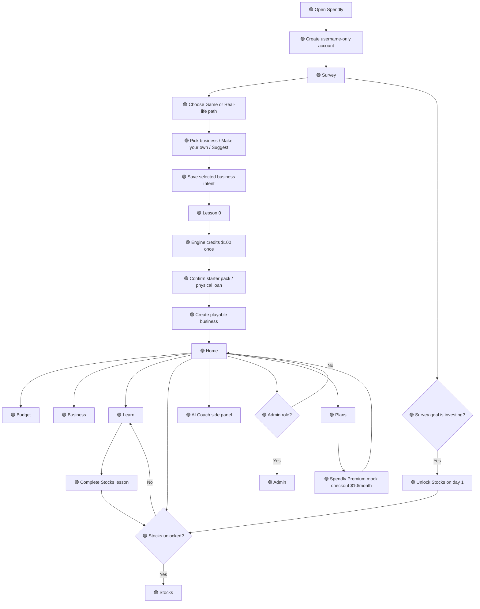

**Entities:** User account, Session, Wallet, Ledger transaction, Business, Lesson, Quiz attempt, Stock/company, Plan, AI Coach state, Admin role. **Formulas:** F1, F8, F11.

## B. Onboarding flow

Caption: The selected onboarding rule is the merged plan's survey, path picker, and business-selection question; there is no fixed four-question requirement. The business choice is saved as an intent before Lesson 0. The actual business and starter pack are created only after Lesson 0 grants the one-time $100 and the player confirms the setup total. This avoids charging for a business before the starting cash exists.

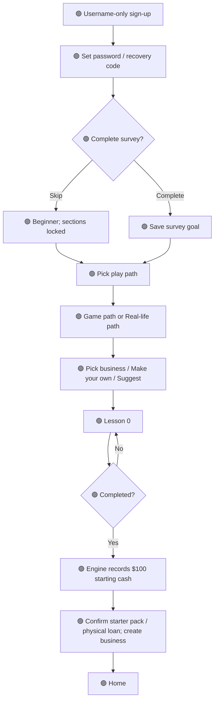

**Entities:** User account, Session, Business, Lesson, Lesson reward, Wallet, Ledger transaction. **Formulas:** F1.

## C. Budget flow

Caption: The player reviews the wallet, uses savings/loan/shop actions, and sees the warning before a player purchase that would make the balance negative. The engine applies the documented fee/interest/Fresh Start order.

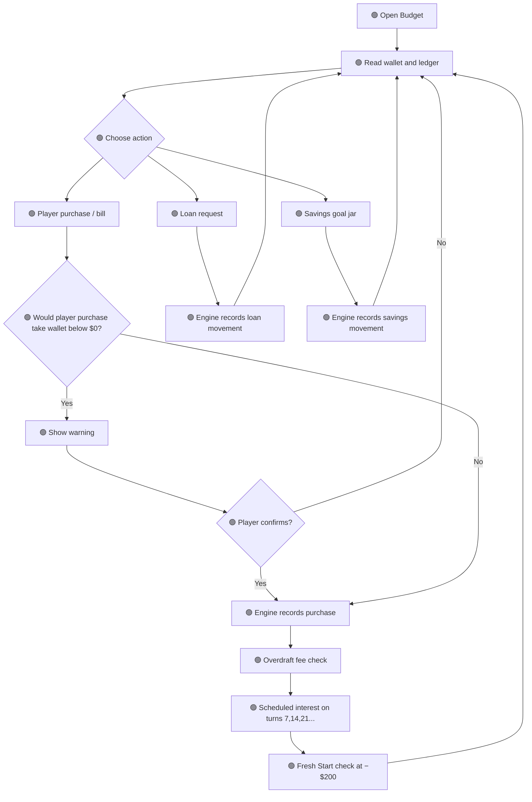

**Entities:** Wallet, Ledger transaction, Loan, Savings goal jar, Game turn, Money Report. **Formulas:** F1–F4.

## D. Business full-turn flow

Caption: At the start of a turn the engine draws/reveals the event so Supplier Discount can apply to player-confirmed restock orders in the same turn. Business events then modify visitors or operating inputs before demand; stock events change only the player's isolated market quotes. Month-end costs, overdraft processing, interest, Fresh Start and the Money Report finish before the dashboard result is committed.

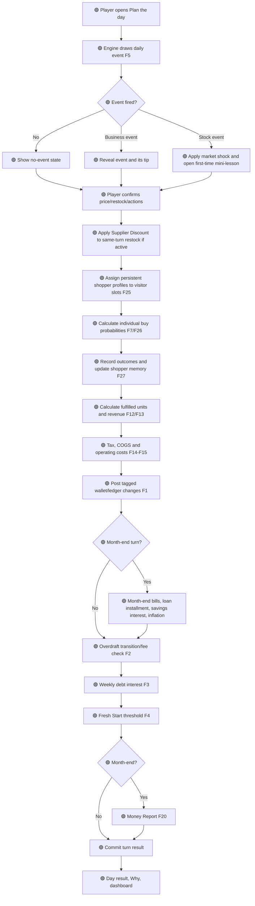

**Entities:** Business, Inventory/supplies, Service capacity, CustomerProfile, ConsumerAgent, ConsumerBusinessMemory, ConsumerVisit, Random event, EventDeckState, FiredEvent, Game turn, Wallet, Ledger transaction, Loan, SavingsJar, SavingsDeposit, Money Report. **Formulas:** F1–F7, F12–F15, F20, F23–F27; event modifiers are Appendix A.4.

## E. Learn flow

Caption: MVP pathway lessons contain five questions, four correct to pass. A failed attempt is saved and offers an unlimited retry; the first successful completion grants 10 points once and any newly earned badge. Rewards are not wallet cash and streak is off by default.

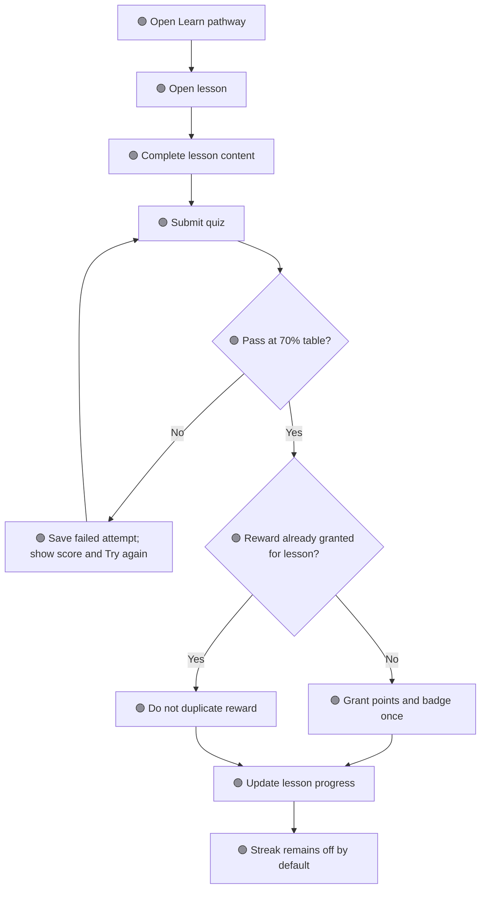

**Entities:** Lesson/pathway, Quiz attempt, Lesson reward, User account. **Formulas:** F8 and F18. Retry history behavior is defined in Appendix A.7.

## F. Stocks flow

Caption: Stocks use a simulated market and a separate $1,000 practice account. A trade changes the practice account and holdings, never the game wallet.

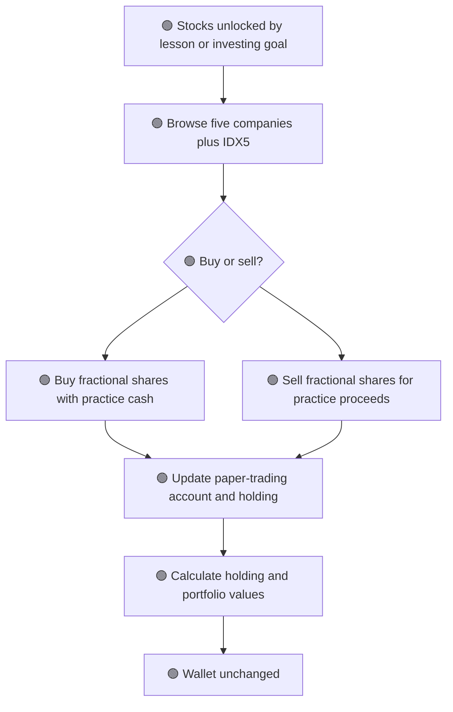

**Entities:** Stock/company, Paper-trading account, Stock holding, User account. **Formulas:** F9–F10 and F17.

## G. AI Coach flow

Caption: Template/customer tips are not AI-generated. The AI Coach answers only after the player opens it and asks; daily caps are Free 10 and Premium 30. The $20/month provider budget cap remains separate from the daily question caps.

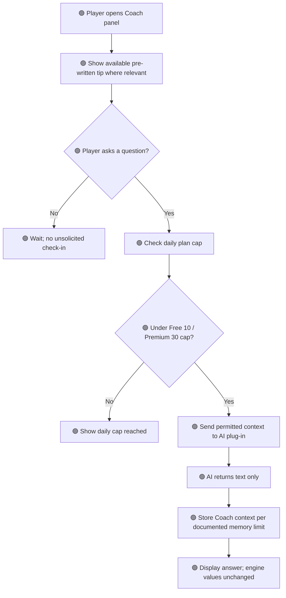

**Entities:** AI Coach conversation state, User account, Plan, AI usage/cost telemetry. **Formulas:** F11 and F19. Provider token prices remain versioned deployment configuration and requests fail closed if the pricing file is missing or older than 30 days.

## H. Admin and Plans flows

Caption: Admin is role-restricted; the MVP includes security, error tracking, backups and account controls, but detailed per-user AI cost reporting is deferred. Plans uses mock Premium checkout only.

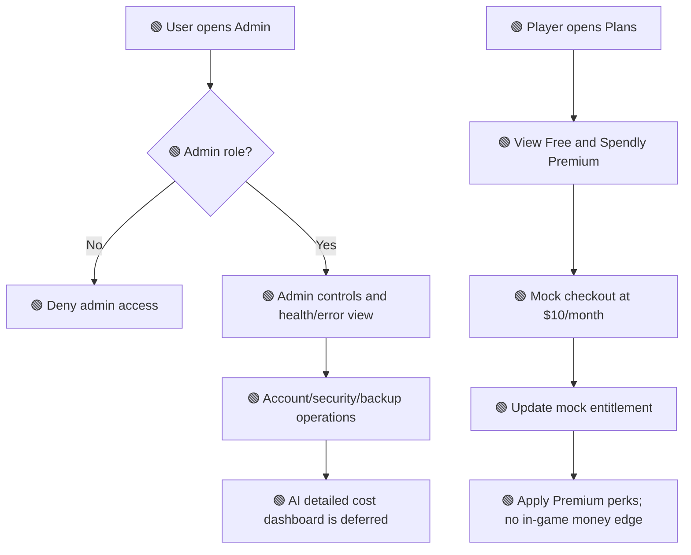

**Entities:** Admin role, User account, Session, Plan/Premium entitlement, AI usage/cost telemetry. **Formulas:** F11, F19, and F21; Premium price is fixed at $10/month, not derived from AI token cost.

## I. System-level data flow

Caption: The frontend sends player actions to the backend/game engine, which validates and calculates money before writing to PostgreSQL. The AI branch receives summaries/context and returns text; it does not write money data. Admin access is a separate permission-checked branch.

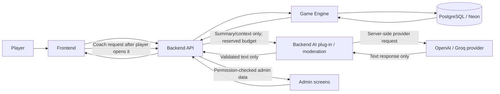

**Entities:** User account, Session, Wallet, Ledger transaction, Business, Game turn, Lesson, Stock data, AI Coach state, Admin role. **Formulas:** F1–F11 where applicable.

## J. Wallet money-flow diagram

Caption: Only the engine posts wallet entries using the canonical LedgerTag enum. Starting cash, Fresh Start, loan proceeds, business activity, bills, fees and the second-slot purchase are included. Stock practice trades are isolated from wallet movement. Learn rewards are points/badges, never wallet cash.

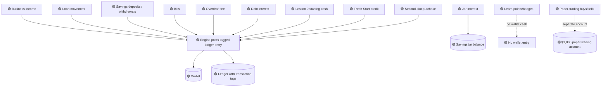

**Entities:** Wallet, Ledger transaction, Business, Loan, Savings goal jar, Game turn, Paper-trading account, Lesson reward. **Formulas:** F1–F4, F10.

## K. Major subsection data flows

### Business turn data flow

Caption: Player pricing and restocking enter the backend API, the engine reads the current business/customer/stock-or-service/turn state, and it writes the business result and tagged wallet changes.

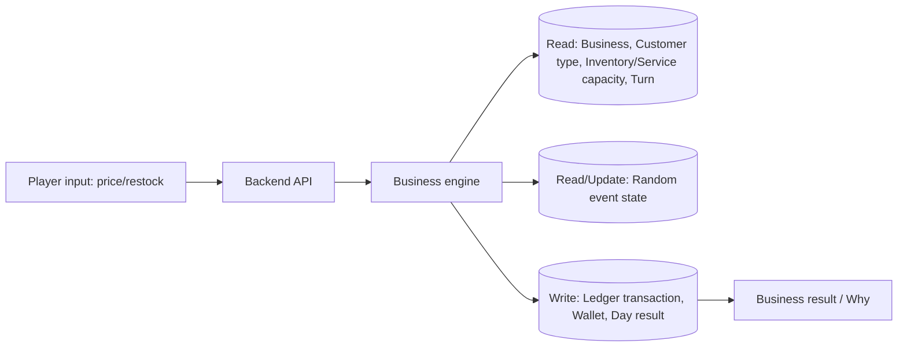

**Entities:** Business, Customer type, Inventory/supplies, Service capacity, Random event, Game turn, Wallet, Ledger transaction. **Formulas:** F1, F5–F7, F12–F15; F20 for month-end reporting.

### Consumer-agent assignment and learning data flow

Caption: The turn engine selects persistent shopper profiles from the player's account-scoped pool for each existing business visitor slot, computes the source-compatible purchase probability, records the seeded outcome, and writes relationship/price-sensitivity learning in the same atomic turn. The player receives only aggregate counts and reason codes; individual shopper IDs and state remain server-side.

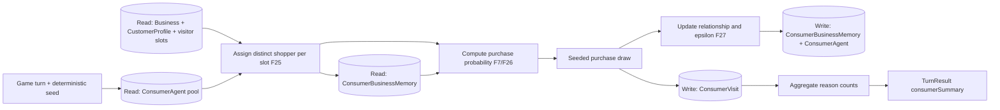

**Entities:** ConsumerAgent, ConsumerBusinessMemory, ConsumerVisit, CustomerProfile, Business, GameTurn, TurnResult. **Formulas:** F7, F25, F26, F27. No NPC wallet or city-ledger entity is read or written by the MVP shopper-agent flow.

### Learn and practice-lab data flow

Caption: Quiz attempts and one-time rewards are persisted separately from sandbox-lab attempts. Labs run against fixed fixtures and cannot mutate any live game-money or portfolio entity.

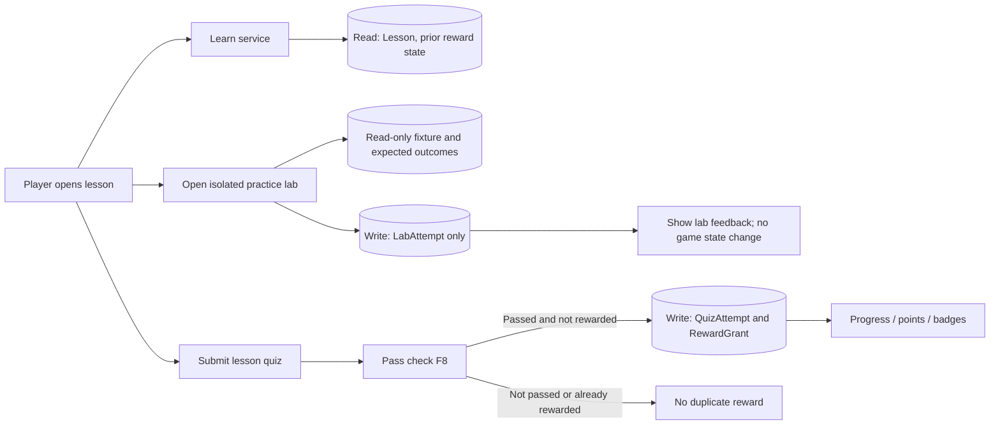

**Entities:** Lesson, Quiz attempt, LearningLab, LabAttempt, Lesson reward. **Formulas:** F8. Lab attempt persistence never creates a wallet or paper-trading ledger entry.

### Stocks data flow

Caption: The Stocks service reads simulated prices and the separate practice account, then updates practice cash and holdings without changing the game wallet.

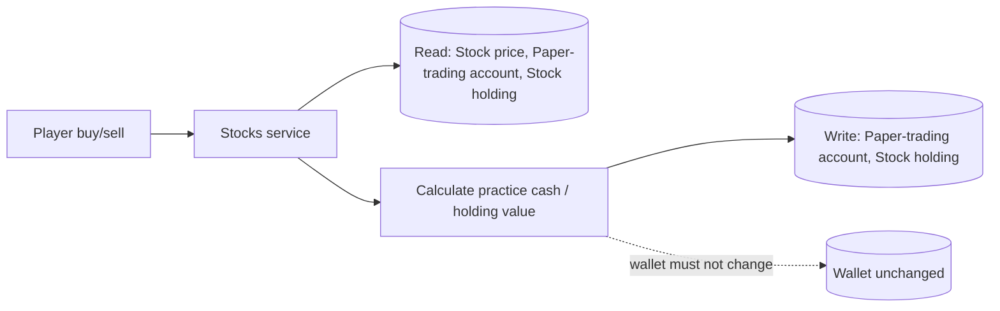

**Entities:** Stock/company, Paper-trading account, Stock holding, Wallet. **Formulas:** F9–F10.

### AI Coach data flow

Caption: The Coach checks the player's daily allowance, sends only the documented context through the provider plug-in, and returns text without writing game money or simulation state.

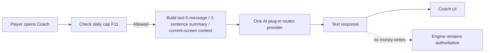

**Entities:** AI Coach conversation state, User account, Plan, AI usage/cost telemetry. **Formulas:** F11 and F19.

### Admin cost / budget flow

Caption: A player-requested Coach call passes daily-cap and monthly-budget controls before internal usage data is recorded; the detailed per-user cost dashboard is deferred by team decision.

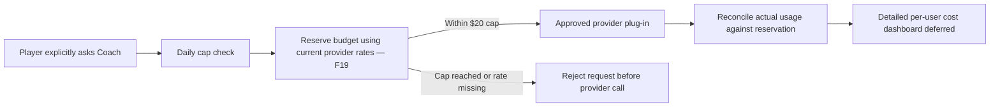

**Entities:** AI Coach conversation state, Plan, AI usage/cost telemetry, Admin role. **Formulas:** F11 and F19. The counter and hard-stop behavior are defined in D10; maintained provider token rates remain configuration, not guessed constants.

## L. Math flow diagram

Caption: A turn event is drawn before the player action window so Supplier Discount can affect a same-turn order. The engine applies business-event modifiers before demand, applies stock shocks only to the isolated market, then runs the documented charges, debt checks, Fresh Start and Money Report. The engine commits the turn atomically.

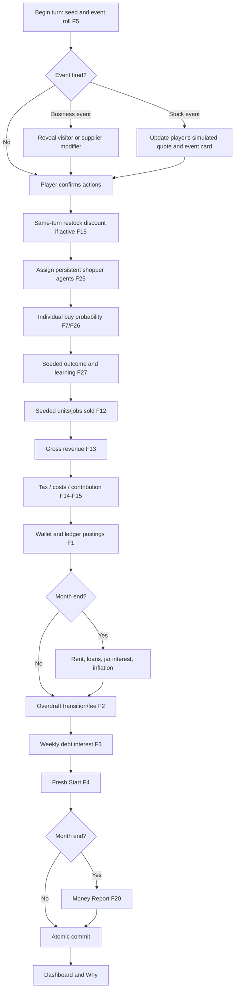

**Entities:** Business, CustomerProfile, ConsumerAgent, ConsumerBusinessMemory, ConsumerVisit, Inventory/supplies, Service capacity, Random event, EventDeckState, FiredEvent, Wallet, Ledger transaction, Game turn, Loan, SavingsJar, SavingsDeposit, Money Report, MarketWorld, StockQuote. **Formulas:** F1–F7, F12–F15, F20, F23–F27.

# Section 6 — Guess-Risk Score and Specification Completeness

## A. What this score measures

“Guess-risk” means the estimated share of MVP implementation requirements for which a developer or coding agent would need to invent a product rule, value, field, interaction, data behavior, or API detail because this specification does not state it. It is **not** an empirical probability that Claude or another model will hallucinate, write defective code, or misunderstand a clear requirement. Those empirical rates require a named model/version, a fixed task set, a scoring rubric, and observed evaluation results. The percentages below are specification-readiness estimates only.

## B. Weighted requirements audit method

An atomic requirement is one independently implementable behavior, value, field, validation, formula, state transition, screen action, API operation, test, content record, or asset contract. Split compound requirements into separate rows. Deduplicate only exact duplicates.

Assign each atomic requirement a criticality weight:

- `3` — wallet/ledger, money math, authentication/security/privacy, stock-wallet isolation, AI budget enforcement, account deletion, backup/restore, migrations, or integrity constraints.
- `2` — other MVP behavior, API contracts, state flows, Learn content/labs, accessibility, or acceptance criteria.
- `1` — non-blocking presentation details and owner-controlled creative deliverables with a defined asset/content contract.

Assign a gap fraction:

- `0.0` Ready: the exact behavior/value/schema/contract is supplied, and a verification test or deterministic acceptance check is defined.
- `0.5` Partial: some owner-authored content, external validation, or limited interpretation remains, but a safe implementation path is specified.
- `1.0` Blocked: a coding agent would have to invent a mandatory rule/value/field/interaction or stop and ask.

Explicitly deferred items are excluded from MVP scoring only when Section 3 marks them deferred and no MVP dependency still relies on them. Environment-specific secrets, GitHub handles, repository URL, and service account settings are tracked separately when this specification defines how they are supplied and validated.

`Weighted specification gap % = 100 × SUM(criticality_weight × gap_fraction) / SUM(criticality_weight)`.

`Weighted specification coverage % = 100 − weighted specification gap %`.

The atomic audit is the authoritative calculation. The feature-level table below is a preliminary triage proxy, not a substitute for enumerating every atomic requirement. Claude must independently perform the atomic calculation and may raise the result.

## C. Overall preliminary feature-level estimate

**Superseded:** the independent atomic audit is complete; see Appendix B for the final v2.8.6 result (0.26% weighted gap, GO). The text below is historical.

The current feature-level triage proxy, updated for the Green Individual Shopper Agents feature in V2.8.3, is **approximately 1.5% weighted MVP specification gap (approximately 98.5% feature-level coverage)**. It is calculated from the estimates in Section 6.D using their stated criticality weights: `0.95 weighted gap units / 62 total criticality weight * 100 = 1.532%`, rounded to one decimal place. This is a preliminary author estimate, not a verified atomic count and not a measured hallucination probability. Claude must independently enumerate the atomic Green requirements, recalculate the weighted gap, and raise the estimate if it finds any missing mandatory behavior, field, formula, test, contradiction, or unsafe assumption.

V2.8.3 adds BU4 Individual Shopper Agents to the Green denominator with weight 3 and a 2% feature-level residual integration proxy; to keep arithmetic explicit, the numerator/denominator change from 89/59 to 95/62. Appendix A.26's Stretch-only resident features are not included in the Green denominator. The standalone reference model does not reduce the remaining runtime implementation gap to zero.

The estimate treats the completed question banks in A.19 and A.20 as present: A.19 contains 45 questions for the nine MVP pathway lessons, and A.20 contains 30 questions for the six stock-event mini-lessons. The deterministic practice-lab contracts are in A.25. These are not outstanding authoring tasks. Owner-controlled lesson narration, final artwork files, policy review, and account-specific service configuration remain delivery/release work; they are not permission for a coding agent to invent product behavior.

## D. Per-feature preliminary guess-risk table

The values below are feature-level estimates of residual specification ambiguity. Criticality weight is included so the weighted proxy can be reproduced. “Low” follows the original banding: 0–15% Low, 16–35% Medium, 36–60% High, and 61–100% Very High.

| Feature | Owner | Criticality weight | Guess-risk estimate | Band | What remains / what would otherwise need guessing |
|---|---|---:|---:|---|---|
| C1 Wallet, ledger, transaction tags | Ethan | 3 | 0% | Low | Money precision, ledger invariants, tags, idempotency, and correction rules are specified. |
| C2 Day turns and month-end | Ethan | 3 | 0% | Low | Turn order, atomic processing, month-end, retry, and seeded behavior are specified. |
| C3 One business plus second slot | Ethan | 2 | 1% | Low | Slot entitlements and Free purchase price are specified; account setup remains operational. |
| O1 Username-only account and first login | Ethan | 3 | 4% | Low | Validation behavior is specified; final prohibited-name data and age/privacy review are owner/research release gates. |
| O2 Survey, play-path picker, business question | Kevin | 2 | 1% | Low | Options, skip behavior, and unlock mapping are specified; final editorial wording is owner content. |
| O3 Lesson 0 start reward | Kevin / Ethan | 3 | 0% | Low | Completion trigger, one-time $100 grant, ledger entry, and idempotency are specified. |
| B1 Overdraft, debt interest, Fresh Start, warning | Ethan | 3 | 0% | Low | Thresholds, timing, order, transition detection, fee cap, and tests are specified. |
| B2 Personal and business loans | Ethan | 3 | 1% | Low | Loan terms, schedule, rounding, payoff quote, and edge behavior are specified. |
| B3 Basic and locked savings jars | Ethan | 3 | 1% | Low | Rates, maturity, lot interest, withdrawal order, and edge behavior are specified. |
| B4 Bills and Money Report debt line | Ethan | 2 | 1% | Low | Reconciliation, categories, largest drain, top earner, debt cost, and tip selection are specified. |
| BU1 Online/physical catalog | Ethan | 2 | 2% | Low | Catalog/economy values and asset contracts are specified; final production art files are Cheyenne's deliverable. |
| BU2 Make Your Own and Suggest a Business | Ethan / Kevin | 2 | 1% | Low | Fields, bounds, workflow, moderation status, and non-playable suggestion behavior are specified. |
| BU3 Customer demand and day result | Ethan | 3 | 2% | Low | Demand, seeded conversion, catalog scales, event effects, and deterministic fixtures are specified. |
| BU4 Individual shopper agents and preference learning | Ethan | 3 | 2% | Low | Pool assignment, archetype mix, source-compatible purchase probability, relationship/epsilon learning, deterministic persistence, aggregate response, and tests are defined in A.26; integration is pending because no application code exists yet. |
| BU5 Player restocking and purchase warning | Ethan | 2 | 1% | Low | Pack sizes, discounts, event timing, quote confirmation, and inventory behavior are specified. |
| L1 Money, Business and Stocks pathways/labs | Kevin | 2 | 3% | Low | Nine lab fixtures/expected outcomes and quiz banks are specified; final lesson narration remains a Kevin editorial deliverable. |
| L2 Points and badges | Kevin | 2 | 2% | Low | Point amounts, badge criteria, one-time grants, and persistence behavior are specified. |
| L3 Stock-event mini-lessons | Kevin | 2 | 1% | Low | Six event types, 30 quiz questions, answer explanations, and one-time rewards are specified; source mapping is in A.25. |
| S1 Simulated market and paper trading | Ethan | 3 | 3% | Low | Price model, tick cadence, paper cash, wallet isolation and event shocks are specified; FRED/provider availability is validated at deployment. |
| S2 Stocks unlock | Kevin / Ethan | 2 | 0% | Low | Lesson/goal-based unlock behavior and paper-account creation trigger are specified. |
| AC1 AI Coach side panel | Kevin / Ethan | 3 | 4% | Low | Limits, memory, budget reservation, provider isolation and fail-closed behavior are specified; provider configuration is verified at deployment. |
| AC2 Pre-written customer lines | Kevin | 1 | 0% | Low | Initial line bank and deterministic selection are supplied. |
| AD1 Roles, security, backups, account controls | Ethan | 3 | 5% | Low | Access behavior and data rules are specified; legal/privacy review, account-specific backup target and restore drill remain release gates. |
| AD2 Safe mode, write queue and demo mode | Ethan / Myles | 3 | 1% | Low | Queue retry, safe mode, demo isolation and failure behavior are specified; CI/restore execution remains setup work. |
| P1 Spendly Premium mock checkout | Kevin / Ethan | 2 | 0% | Low | $10 mock price, 30-day no-payment entitlement, expiry and perks are specified. |
| 🟡 Trade notes (Add-on) | Kevin | 1 | 100% | Very High | Explicitly deferred; no MVP implementation is permitted. Define its contract only if promoted. |
| 🟡 Premium demand forecast/seasonal planner (Add-on) | Kevin / Ethan | 1 | 100% | Very High | Explicitly deferred; forecast inputs/algorithm require a new approved scope decision. |
| 🟡 Additional Premium stock tools (Add-on) | Kevin / Ethan | 1 | 100% | Very High | Explicitly deferred; no tools are named in the source, so none may be invented for MVP. |

The three Yellow rows are excluded from the Green MVP calculation because they are explicitly Add-ons. They must not be implemented from this specification as MVP features.

## E. Top five remaining readiness and release deliverables

These are the five most important remaining owner-controlled deliverables. The question bank and lab mechanics are already specified; they must not be listed as missing. The deliverables below do not authorize an agent to invent product rules. The technical behavior and fallback contracts are specified; the named owner supplies the real content, creative asset, or deployment input.

| Gap | Owner | Exact deliverable / closure test | Expected effect |
|---|---|---|---|
| 1. Lesson narration and editorial review | Kevin; Myles fact-checks | Author the player-facing lesson introduction/explanation copy from the objectives and source map in A.7/A.25. Fact-check every factual claim, retain the cited source IDs, and version the content. The 45 standard quiz questions and lab mechanics already exist. | Reduces remaining Learn content interpretation; no engine formula changes. |
| 2. Production artwork package | Cheyenne | Deliver the contracted `.glb`, `.svg`, `.webp`/`.png` assets and manifest in A.18. Run asset-path, file-format, dimensions/scale, license, checksum, and fallback tests. Placeholders remain valid for parallel code work. | Closes the creative-asset delivery gap; no simulation behavior changes. |
| 3. Username denylist and age/privacy review | Myles researches the denylist; Ethan owns account/security; Kevin reviews player-facing copy | Supply a versioned prohibited-name data file with false-positive/negative test cases. Review the 13+ age-confirmation, recovery, deletion, retention, and privacy notice before public release. Do not collect extra identity data merely to resolve this item. | Closes moderation/content and release review; validation contract remains unchanged. |
| 4. External provider/FRED configuration | Ethan and Myles | At deployment, verify supported OpenAI/Groq model IDs and current token rates from official provider documentation; update the versioned pricing configuration with source URL and checked date; verify FRED series access. Test missing/stale configuration fail-closed behavior. | Removes deployment-time provider uncertainty; not a new game rule. |
| 5. Repository and production recovery setup | Myles creates GitHub repo and CI; Ethan owns database recovery | Collect GitHub handles, configure protected `main` and required checks, generate OpenAPI from A.12/A.22, create the backup destination, ensure seven-day recovery coverage, and pass a restore drill before public release. | Closes environment/integration release gates; no product vision change. |

If these five deliverables are completed and verified, the projected feature-level specification-gap proxy is **approximately 0.5%**. That projection assumes no new contradiction is discovered during Claude's atomic audit. It is not an empirical hallucination rate and is not a guarantee that code will be error-free.

## F. Required independent Claude audit

Claude must read the entire `SPEC.md`, the original *Spendly Merged Spec v1*, and the original spec-generation instructions. It must independently enumerate the atomic Green requirements, assign criticality weights and gap fractions using Section 6.B, reproduce the weighted calculation, and challenge the feature-level estimate above. It must verify the complete Team/Ownership table, CRUD, MVP acceptance criteria, Stretch, Engine Math F1–F27, parameter values, Appendix A implementation defaults, database entities, API routes and schemas, Mermaid diagrams, tests, content/question banks, lab fixtures, source map, UI/asset contracts, Open Questions and change log.

Claude must report: (1) atomic requirement count by weight and readiness status; (2) exact weighted gap and coverage calculations; (3) per-feature Ready/Partial/Blocked status; (4) every contradiction, dangling reference, arithmetic error, unsupported external fact and missing test with section/line references; (5) the percentage of Green MVP requirements it can implement without inventing a product rule; (6) remaining owner-authored deliverables and runtime setup inputs; and (7) a clear GO/NO-GO recommendation for starting implementation. Claude must not edit this document, generate application code, or silently repair a finding during the audit. It must present proposed corrections separately for owner approval.

A coding GO requires: zero Blocked critical requirements; no unresolved contradiction in financial, security, privacy, data-integrity, wallet-isolation or turn-order rules; a weighted atomic specification gap below 10%; and every remaining noncritical item to have a safe placeholder/fallback or an explicit owner task that does not require the coding agent to invent behavior. If any condition fails, return NO-GO and list the smallest compatible corrections.

## G. Limits of the score

A complete specification reduces product-rule guessing but cannot guarantee zero coding errors or zero model hallucinations. Code correctness must later be measured through fixed implementation tasks, human PR reviews, type checks, unit/property tests, integration tests, end-to-end tests, security review, deployment checks and restore drills. Never relabel a specification-completeness estimate as an empirical model hallucination rate.

# Appendix A — Complete Implementation Defaults and Build Contracts

**Authority:** This section is the controlling implementation baseline for the first build. It supersedes every earlier `NOT IN DOC`, `NOT APPROVED`, unresolved Parameter Table entry, and earlier Open Question that covers the same behavior. The original merged plan remains the authority for the product vision and source-confirmed rules. Team-selected decisions remain team-confirmed. New numeric and behavioral defaults in this section are **V2.4 DESIGN DEFAULTS**: the product owner authorized this design-completion pass to make existing features implementable without agents inventing their own values. They are not claims about what the original source said. The relevant feature owner may propose a change through a reviewed spec PR and must update dependent formulas, tests, contracts, diagrams, and data fields together. Until a reviewed change is merged, these defaults are the implementation baseline.

**Build rule:** Claude Code and the other agents must implement these defaults as written. They must not substitute a different value or behavior because they prefer it. If they find a reproducible technical impossibility, security flaw, legal/privacy concern, source conflict, or provider incompatibility, they must stop only the affected task, attach evidence and a failing test or official documentation, propose the smallest compatible repair, and request the accountable owner's approval. They may continue unrelated Ready tasks. They must never conceal the change or silently alter a product rule.

**Source-status labels:** `SOURCE` means stated in Spendly Merged Spec v1; `TEAM` means explicitly selected by the team in this conversation; `V2 DEFAULT` means a concrete implementation decision made in this design-completion pass under the user's authorization; `RUNTIME CONFIG` means a value supplied securely by the deployment environment and not hard-coded into source code.

## A.1 Product and release scope

- Keep all four product areas: Budget, Business, Learn, and Stocks, plus the AI Coach side panel.
- Keep both Game and Real-life play paths. They change presentation only; engine rules and results are identical.
- MVP includes 18 selectable business templates across Make goods, Resell, and Service. The fourth Big Build base type remains in the data model and product roadmap; Food Truck and Coffee Cart are Stretch templates, consistent with Ethan's detailed implementation note. This resolves the earlier conflict without deleting the fourth concept.
- The full catalog contains 20 named templates: 18 MVP templates plus the two Big Build Stretch templates. All 20 use the same catalog/data schema.
- MVP includes the complete Money pathway (six lessons), two introductory Business lessons, and one introductory Stocks lesson. Business and Stocks pathways may be extended later; this keeps the source's full-Money/partial-other-pathways launch approach.
- MVP includes persistent Individual Shopper Agents as defined in Appendix A.26: 100 profiles per player simulation world, based on the three existing customer archetypes. Their scope is shopper identity, price sensitivity, business-relationship memory, deterministic assignment, and purchase outcomes only.
- The full Mundara resident simulation in Ethan's Consumer Agents prompt—including autonomous city routing, multi-product selection, NPC funds/ledger, jobs, housing, needs, mood, injuries, age, spawning, and departure—is Orange Stretch and is not an MVP dependency. This is not multiplayer.
- MVP Premium remains mock checkout only. No real payment collection, Stripe integration, or actual subscription billing is implemented in MVP.
- The product uses simulated play money only. No deposit, withdrawal, bank-link, brokerage-link, or real-money transaction functionality is permitted.

## A.2 Business catalog and economy defaults

### Customer profiles and demand

| Customer type | Base maximum price at $100 starting economy | Customer share | Buy-probability modifier |
|---|---:|---:|---:|
| Bargain Hunter | $1.00 | 40% | 1.00× |
| Loyal Regular | $2.40 | 40% | 1.10× |
| Premium Buyer | $4.00 | 20% | 1.00× |

These are V2.4 retuned defaults. The source's original $500-start customer values ($5, $12, and $25) are retained in source history but are not used for the $100-start MVP. For a business with price scale `s`, each customer's maximum price is `base_maximum × s`. The player-selected price `p` uses the source formula `1 − (p / p_max)^2`; clamp the result to `[0,1]`. Apply the Loyal Regular's 1.10 multiplier after the base formula and clamp again to `[0,1]`.

Each day's visitors are assigned to customer types using a deterministic seeded draw matching the 40/40/20 weights. The seed is generated from `(account_id, business_id, turn_number, visitor_index, simulation_version)`. Replaying the same account/turn/simulation version produces the same customers and results. The turn engine never uses unseeded randomness for a result that affects wallet money.

**V2.8 individual shopper extension:** The 40/40/20 values also seed the persistent `ConsumerAgent` pool in Appendix A.26. For each existing business visitor slot, the engine preserves the existing archetype draw and assigns a distinct, persistent agent of that archetype from the shared account-scoped pool. The agent's epsilon defaults to 1.20 and its per-business relationship score to 0.50, so the individualized purchase formula initially reproduces the source formula. The existing catalog visitor count remains fixed; the core MVP does not route agents globally between businesses and does not add an NPC cash economy.

The default player price is `50% × (Premium Buyer base maximum × business price scale)`. The player may set a price from `$0.01` through `200% × (Premium Buyer base maximum × scale)`, in `$0.01` increments. The selected price is saved per business and remains in effect until the player changes it. Price changes apply beginning with the next unprocessed turn.

### MVP business catalog

`Default price` is calculated from the rule above. `Visitors/day` is the fixed daily visitor count for the baseline simulation. Service templates have a job cap and no inventory. Make-goods templates use 10-unit restock packs; Resell templates use 2-unit packs.

| # | Business | Base type | Model | Price scale | Visitors/day | Jobs/day cap | Pack | Default price |
|---:|---|---|---|---:|---:|---:|---:|---:|
| 1 | Sticker Shop | Make goods | Online | 1.0× | 8 | — | 10 | $2.00 |
| 2 | Candle Studio | Make goods | Online | 1.5× | 8 | — | 10 | $3.00 |
| 3 | T-Shirt Printing | Make goods | Online | 3.0× | 8 | — | 10 | $6.00 |
| 4 | Soap Maker | Make goods | Online | 2.0× | 8 | — | 10 | $4.00 |
| 5 | Lemonade Stand | Make goods | Physical | 1.0× | 6 | — | 10 | $2.00 |
| 6 | Baked Goods Stand | Make goods | Physical | 1.5× | 6 | — | 10 | $3.00 |
| 7 | Sneaker Resale | Resell | Online | 20.0× | 7 | — | 2 | $40.00 |
| 8 | Book Resale | Resell | Online | 3.0× | 7 | — | 2 | $6.00 |
| 9 | Vintage Clothing | Resell | Online | 5.0× | 7 | — | 2 | $10.00 |
| 10 | Toy Resale | Resell | Online | 4.0× | 7 | — | 2 | $8.00 |
| 11 | Tech Accessories | Resell | Online | 6.0× | 7 | — | 2 | $12.00 |
| 12 | Plant Nursery | Resell | Physical | 2.0× | 5 | — | 2 | $4.00 |
| 13 | Tutoring | Service | Online | 2.0× | 8 | 3 | None | $4.00 |
| 14 | Graphic Design Studio | Service | Online | 4.0× | 8 | 3 | None | $8.00 |
| 15 | Pet Sitting | Service | Physical | 2.0× | 6 | 2 | None | $4.00 |
| 16 | Lawn Care | Service | Physical | 2.0× | 6 | 2 | None | $4.00 |
| 17 | Car Wash | Service | Physical | 2.0× | 6 | 2 | None | $4.00 |
| 18 | Bicycle Repair | Service | Physical | 3.0× | 6 | 2 | None | $6.00 |
| 19 | Food Truck | Big Build | Physical | 20.0× | 8 | 4 | 10 | Stretch |
| 20 | Coffee Cart | Big Build | Physical | 15.0× | 8 | 4 | 10 | Stretch |

The 14 additional template names beyond the four first-wave art examples are V2.4 catalog proposals created to make the 20-template requirement concrete. They use their base type's generic art until individual art is produced. The four first-wave art types remain Sticker Shop, Sneaker Resale, Lemonade Stand, and Plant Nursery. Food Truck and Coffee Cart remain unavailable to players in MVP.

### Supply costs, inventory, and restocking

| Base type | Unit supply-cost ratio | Initial pack | Restock pack | Inventory behavior |
|---|---:|---:|---:|---|
| Make goods | 30% of the template's default selling price | 10 units | 10 units | Player buys packs; one sold unit consumes one stock unit |
| Resell | 65% of the template's default selling price | 2 units | 2 units | Player buys packs; one sold unit consumes one stock unit |
| Service | 0% inventory cost | No inventory | No inventory | No supplies; daily jobs cap replaces stock cap |
| Big Build | 35% of default selling price | 10 units | 10 units | Stretch only; not selectable in MVP |

The initial unit supply cost is fixed from the template's default selling price at business creation, not the player's later chosen sale price. This keeps restocking costs predictable when a player changes selling prices. Supply cost is updated once per simulated month by the inflation rule below. The player buys a starter pack as part of business setup; the setup screen shows its price and requires confirmation before the business is created. No stock is granted free.

Bulk discount applies per individual purchase order based on total units ordered: 5% for 25–99 units and 10% for 100 or more units. Orders must be whole multiples of the template's pack size, with a maximum of 1,000 units per order. No discount applies below 25 units. The bulk discount is applied multiplicatively with the Supplier Discount event: `subtotal_after_discounts = raw_subtotal × (1 - bulk_discount) × (0.90 if event active else 1.00)`. Do not add the discount percentages together. Apply cent rounding once to the final order total. Save both discount components and the final effective unit cost on each inventory lot.

Auto-restock is off by default. When enabled, the game must show a confirmation prompt with quantity and total cost each time a new order is required; the player must approve that order. An unapproved order is not placed. A restock purchase that would take the wallet below zero triggers the source-required warning; the player may confirm and incur overdraft rules or cancel. If there is insufficient stock, sales are limited to stock on hand. Service businesses are limited by their jobs/day cap.

### Supply inflation

Use FRED `CPIAUCSL` (Consumer Price Index for All Urban Consumers: All Items in U.S. City Average, seasonally adjusted) as the monthly inflation input. Compute monthly CPI change as `(CPI_current / CPI_previous_month) − 1`. Clamp the monthly change to `[-2%, +2%]` to prevent a single data revision/outlier from making a large in-game cost jump. At each in-game month-end, multiply all existing business unit supply costs by `(1 + clamped_monthly_change)` and store the resulting cents value for the next month. If a current CPI observation is unavailable, reuse the last valid observation; if no valid observation exists, use 0% change and record a provider-warning event. The source says FRED rates and inflation set market/economy mood; this V2.4 rule makes the effect on supply prices deterministic.

### Operating expenses and business tax

- Sales tax: 7% of gross taxable business sales, paid by the business and recorded as a `sales_tax` outflow each turn.
- Online platform fee: 8% of gross online business sales, recorded as `platform_fee` each turn. The 8% is a V2.3 default because the source requires a per-sale platform fee but omits its amount.
- Physical rent plus utilities: one combined `$18.00` bill per physical business at each month-end (turns 30, 60, 90, etc.). It is a single `rent_utilities` ledger entry per business per month.
- Online businesses have no separate monthly rent/utilities bill in MVP; their 8% per-sale platform fee is their platform operating charge.
- Employee cost is `$0` in MVP because Hiring/Team is Stretch.
- No other operating cost, tax, payment processor charge, or fee is added in MVP unless explicitly added by a future approved decision.

### Physical business loan requirement

Creating a physical business automatically originates its linked `$100.00` business loan and credits the amount to the wallet with a `business_loan_proceeds` tag before the required starter-pack purchase. This implements the source rule that physical businesses need a business loan. A player can review the amount, APR, term, and monthly payment in the setup confirmation. One business loan is permitted per physical business. The loan is not available to fund an online business.


### CPI snapshot and supply-cost replay rule (V2.8.4)

For every turn-30/60/90 month-end, pin the latest CPI observation actually available at calculation time as `GameTurn.macro_snapshot_id`. Store `MacroSnapshot.id`, `series_id`, `observation_date`, `value`, `retrieved_at`, `source_url`, and `stale`. Apply an inflation change only if its `observation_date` is strictly later than `EconomyState.last_applied_cpi_observation_date`; otherwise the applied change is zero. Clamp the monthly change to [-2%, +2%]. Update each current unit cost month by month using the single A.2 money-rounding helper (round-half-away-from-zero to cents), then update the last-applied observation date. A retry or replay of the same GameTurn must use the stored `macro_snapshot_id`; it must not query live CPI again. F15 references this rule and must not independently compute a cumulative unrounded factor. If no valid observation exists, use zero inflation for that month and record the missing/stale status; never substitute a guessed value.

## A.3 Loan, savings, overdraft, and Fresh Start defaults

### Loan products

| Loan | Principal | APR | Term | Monthly payment | Availability |
|---|---:|---:|---:|---:|---|
| Personal loan | $50.00 | 12% fixed | 6 game months | $8.63 | Player may hold one active personal loan |
| Business loan | $100.00 | 8% fixed | 6 game months | $17.06 | Required once per physical business at creation; one per physical business |

Use fixed-payment amortization: `payment = principal × monthly_rate / (1 − (1 + monthly_rate)^(-number_of_months))`, with `monthly_rate = APR / 12`. Calculate using decimal arithmetic; round the posted installment to cents. The final installment is adjusted to the exact remaining principal plus interest so the balance reaches exactly zero; do not hard-code a one-cent adjustment without recalculating. First due turn is the first month-end turn (30, 60, 90, ...) at or after the loan creation turn; later installments are 30 turns apart. Loan proceeds and repayments are wallet ledger entries with loan-specific tags. No origination fee or prepayment penalty applies. A player may fully pay off an active loan early on any turn; partial extra-principal payments are not in MVP. Early payoff equals remaining principal plus simple interest accrued since the later of loan origination or the most recent scheduled installment, using `remaining_principal × APR × elapsed_turns / 360`, rounded half away from zero. The API first returns a payoff quote; the confirmed payoff request must send that exact quote amount, quote turn, and resource version. The engine recomputes the amount in the same transaction and returns 409 if the quote is stale. For scheduled installments, interest is monthly at `APR/12`; 30/360 daily accrual is used only for early-payoff quotes between scheduled month-ends. If a scheduled payment pushes the wallet below zero, the normal overdraft rule applies; the loan payment is not silently skipped.

### Savings jars

| Jar | APR | Lock | Interest credit |
|---|---:|---:|---|
| Basic savings | 1% fixed | No lock | Monthly at month-end |
| Locked savings | 3% fixed | 90 game turns | Monthly at month-end; withdrawal allowed after 90 turns |

Interest is calculated at each month-end from the jar balance captured at the start of that 30-turn period: `opening_month_balance × APR / 12`, rounded half away from zero to cents. Deposits posted during the current period are excluded from that period's opening balance and begin earning in the next 30-turn period. Basic-jar interest is immediately part of the withdrawable Basic balance. For Locked jars, monthly interest is allocated pro rata to the eligible deposit lots that existed at the start of the period; any leftover cents after proportional allocation are assigned one cent at a time by largest fractional remainder, ties by earliest `deposit_turn` then lot UUID. Interest allocated to a Locked lot follows that lot's maturity date. A Locked lot and its allocated interest cannot be withdrawn before `deposit_turn + 90`; after maturity, partial withdrawals are permitted and consume principal first then interest, FIFO across matured lots. No withdrawal is permitted against an unmatured lot. Minimum deposit is `$1.00`; no maximum deposit. Transfers between wallet and savings use `savings_deposit` and `savings_withdrawal` wallet ledger tags. They reconcile as wallet cash flows but do not count as business income or operating expense.

### Overdraft and debt interest

The source rules remain unchanged: a player purchase may be confirmed while negative; a warning appears before a player purchase that takes the wallet below zero; a `$5.00` fee is charged on each transition from nonnegative to negative, at most once per seven-turn week; while negative, annual interest is 12% and is charged every seventh turn. Use the effective weekly rate `0.12 / 52` against the end-of-turn negative balance on turns 7, 14, 21, etc., rounded half away from zero to cents. Bills/system-originated charges do not show a purchase confirmation warning, but can trigger the fee check.

### Fresh Start

- Free accounts receive 3 total Fresh Start uses across the account lifetime. Premium accounts have a maximum entitlement of 5 total uses across the account lifetime. These are total-use limits, not monthly resets.
- If end-of-turn wallet balance is `≤ −$200.00` and at least one use remains, the engine automatically posts a `fresh_start_credit` equal to the amount required to bring the wallet to `$0.00`, and consumes one use atomically.
- Fresh Start preserves businesses, inventory, loans, savings jars, stock practice account, lessons, badges, and history. It changes only wallet balance and the Fresh Start use count. Loans and other obligations remain payable.
- Fresh Start does not waive existing loans or reverse prior charges. Since the wallet is reset to zero, overdraft interest does not accrue until the wallet becomes negative again.
- If no Fresh Start uses remain, no reset occurs. The wallet remains negative and normal overdraft/interest rules continue. Show a clear “No Fresh Starts remaining” notice.
- Premium entitlement increases the account's maximum allowed total uses from 3 to 5 while Premium is active. Uses already consumed are never restored. On downgrade, the allowed total becomes 3; if the account has already used 3 or more, no further Free uses remain. Re-upgrading raises the maximum to 5 but does not reset the used count.

## A.4 Chance-event catalog and effects

Each player has a deterministic 13-card event deck: 7 Common, 4 Uncommon, and 2 Rare cards. The pool contains seven business event cards and six stock event types: Rate Hike/Cut, Inflation Report, Earnings Beat/Miss, Sector Boom, Product Recall, and Market Dip/Crash. Paired outcomes (Hike/Cut, Beat/Miss) are one card type with a deterministic outcome roll. There is a 10% chance per simulated turn that one event fires. If an event fires, choose rarity: Common 60%, Uncommon 30%, Rare 10%, then uniformly draw one unused card of that tier. Each tier has its own no-repeat deck; reshuffle a tier only after every card in that tier has fired once. Card IDs are the kebab-case event names: `social-buzz`, `good-weather`, `supplier-discount`, `quiet-day`, `rate-hike-cut`, `inflation-report`, `earnings-beat-miss` (Common); `competitor-promotion`, `equipment-issue`, `sector-boom`, `product-recall` (Uncommon); `community-festival`, `market-dip-crash` (Rare). Before choosing a card, sort the tier's unused card IDs lexicographically and select with the A.14.1 `event-card` draw. `EventDeckState.cycle_number` only counts reshuffles and is not an RNG key field. Paired outcomes use the A.14.1 `event-outcome` draw; target businesses, companies and sectors use the A.14.1 `event-target` draw. All event randomness uses the same deterministic turn seed and purpose-separated draws so replaying the same seed reproduces the same event and effect.

| Event | Class | Tier | Exact effect |
|---|---|---|---|
| Social Buzz | Business | Common | Each active online business visitor count +10% for that turn; round half up to a whole visitor, half up |
| Good Weather | Business | Common | Each active physical business visitor count +10% for that turn; round half up to a whole visitor |
| Supplier Discount | Business | Common | Unit supply cost −10% for restock orders placed after the event is revealed during that same turn; it stacks multiplicatively with the bulk discount |
| Quiet Day | Business | Common | One active business selected uniformly and deterministically receives −10% visitors for that turn; round half up |
| Rate Hike / Cut | Stocks | Common | Deterministic fair outcome: rate hike 50% applies ×0.90 to all five company prices; rate cut 50% applies ×1.10; recompute IDX5 from the five prices |
| Inflation Report | Stocks | Common | CPI year-over-year above 2.0% applies ×0.90 to all five company prices; at or below 2.0% applies ×1.10; recompute IDX5 from the five prices. If no valid CPI year-over-year value exists, the card is consumed with a no-effect notice, the same rule F5 uses for a business card with no eligible target |
| Earnings Beat / Miss | Stocks | Common | One selected company price ×1.10 for beat or ×0.90 for miss; beat/miss equally likely |
| Competitor Promotion | Business | Uncommon | One active business selected uniformly and deterministically receives −25% visitors for that turn; round half up |
| Equipment Issue | Business | Uncommon | One active physical business selected uniformly and deterministically has its effective daily visitor count reduced by 25%; round down, minimum 0 |
| Sector Boom | Stocks | Uncommon | One selected sector's company prices ×1.25 |
| Product Recall | Stocks | Uncommon | One selected company's price ×0.75 |
| Community Festival | Business | Rare | Each active physical business visitor count +50% for that turn; round half up |
| Market Dip / Crash | Stocks | Rare | All five company prices ×0.50; recompute IDX5 from the resulting five prices |

A business event shows a one-line prewritten tip on the day result. A stock event is saved as a pending Event Card even when Stocks is locked. When Stocks unlocks, the first pending card becomes available and opens its mini-lesson; subsequent pending cards are exposed in event order. An event card adds to the Event Cards collection. Each stock event mini-lesson awards 5 Learn points once per event type. The event itself may recur after its rarity deck is exhausted; the mini-lesson reward does not recur.

## A.5 Money Report definitions

At each month-end, generate one immutable Money Report for the preceding 30 turns, after all scheduled bills, loan installments, savings interest, overdraft checks, weekly debt interest and Fresh Start processing have completed. The report uses wallet ledger rows for cash-flow totals and business/loan/savings records for classifications.

- **Gained / wallet cash in:** sum of all positive wallet ledger entries during the period. Display `business_receipts`, combined `loan_proceeds` (summing `personal_loan_proceeds` and `business_loan_proceeds`), `starting_cash`, `fresh_start_credit`, `savings_withdrawal`, and `other_credits` as separate report categories. Only business receipts are operating income; loan proceeds are financing, starting cash is onboarding/bootstrap cash, and Fresh Start is recovery assistance.
- **Spent / wallet cash out:** absolute sum of all negative wallet ledger entries during the period. Display `inventory_purchase`, `sales_tax`, `platform_fee`, `rent_utilities`, `loan_interest`, `loan_principal`, `overdraft_fee`, `debt_interest`, `savings_deposit`, `business_slot_purchase`, and `other_debits` separately. Savings deposits and loan principal are cash outflows but are not operating expenses.
- **Net wallet change:** `closing_wallet_cents - opening_wallet_cents`; it must equal positive wallet ledger entries plus signed negative wallet ledger entries for the period. Include a reconciliation line for every category, including internal savings transfers, starting cash, loan proceeds and Fresh Start.
- **Cost of debt:** `loan_interest + debt_interest + overdraft_fee`. Do not include loan principal, savings transfers, or fresh-start assistance.
- **Business contribution:** per business, `gross_sales - sales_tax - FIFO_COGS - platform_fee - rent_utilities - employee_cost`. Rent/utilities is assigned to the business that incurred it. Business loan interest is shown in Cost of debt, not in operating contribution, so the report keeps operating performance separate from financing cost.
- **Top earner:** business with the largest business contribution for the month. Ties resolve by lowest catalog ID, then earliest business creation timestamp. If there are no business records, show “No business earnings yet.” If all contributions are negative, display the least-negative/highest contribution and label the value clearly; do not hide losses.
- **Biggest drain:** largest eligible expense category by absolute wallet debit, excluding `savings_deposit` and `loan_principal`. Eligible categories are supplies, rent/utilities, platform fee, sales tax, loan interest, debt interest, and overdraft fee. Ties use this order: supplies, rent/utilities, platform fee, sales tax, loan interest, debt interest, overdraft fee.
- **Tips:** show one or two prewritten tips. Select the first tip for the biggest-drain category. If net wallet change is negative, add the first negative-net-change tip. Never repeat a tip ID. If no eligible expense exists, use the general budgeting tip.

The template tip bank is versioned content owned by Kevin. Each record has `tip_id`, `trigger_category`, `condition`, `title`, `body`, and `content_version`. The first release includes at least two tips for supplies, rent/utilities, platform fees, debt/interest, and negative net change. The selection order is deterministic: biggest-drain tip or general-budgeting fallback first; net-result tip second; no duplicates. The no-activity case suppresses the second tip. AI Coach does not calculate, select, or author numeric report results. Jar interest is credited internally to the savings jar and is not part of wallet Gained until withdrawn.

| Report field | Exact calculation | Treatment |
|---|---|---|
| Gained | Sum of positive wallet ledger entries | Full cash-in reconciliation; categorized by tag |
| Spent | Absolute sum of negative wallet ledger entries | Full cash-out reconciliation; categorized by tag |
| Net wallet change | Closing wallet − opening wallet | Must equal Gained − Spent |
| Cost of debt | `loan_interest + debt_interest + overdraft_fee` | Excludes principal repayment |
| Business contribution | Gross − tax − COGS − platform fee − rent/utilities − employee cost | Operating result per business |
| Top earner | Maximum business contribution | Deterministic tie rule above |
| Biggest drain | Maximum eligible expense category | Excludes savings deposit and loan principal |

**Reconciliation invariant:** `opening_wallet + gained_cents - spent_cents = closing_wallet`. If this equality fails, do not create the Money Report; fail the month-end transaction, roll back the turn, record an internal error, and retry through the idempotent turn mechanism. This invariant is a required automated test.


**Canonical ledger mapping:** `business_receipts` is the only tag for business sales inflows. The report's `loan_proceeds` display category is a derived grouping of `personal_loan_proceeds` and `business_loan_proceeds`; do not store `loan_proceeds` as a ledger tag. The `business_slot_purchase` tag records the Free second-slot $50 debit. The complete allowed tag enum and posting map are in A.22 and are the only permitted wallet tag values.

## A.6 Simulated stock market and paper trading

### Fictional companies and starting prices

| Symbol | Fictional company | Sector | Initial share price |
|---|---|---|---:|
| BBYT | BrightByte Technologies | Technology | $40.00 |
| GSPR | GreenSprout Foods | Consumer | $15.00 |
| SSTR | SoleStreet Retail | Retail | $25.00 |
| HHLT | HarborHealth | Healthcare | $30.00 |
| STM | SunTrail Mobility | Transportation | $20.00 |
| IDX5 | Spendly Index 5 | Broad fictional index | 1,000.00 index points |

All issuers are fictional. The market is a learning simulation and must display that prices are simulated, not investment recommendations. The IDX5 is computed as `1000 × average(current_company_price / initial_company_price)` across the five companies. Each user's market world is isolated in MVP; multiplayer/shared-world behavior is Stretch.

### Update cadence and price formula

Each user has an isolated market world in MVP; there is no shared/global player market until Multiplayer Stretch. Update each user market world quotes every 5 real-time minutes, independently of game turns. If the application/server/Neon is asleep or unavailable, no live loop is required while it is offline. On the next market access, compute each missed five-minute tick chronologically from `last_tick_at + 5 minutes` through `floor(now_utc/5 minutes)*5 minutes`, using the persisted `market_seed`, each tick's exact UTC timestamp, the latest MacroSnapshot whose `retrieved_at` is not later than that tick, and the canonical `market-noise` RNG key in A.14.1. Commit each quote with its snapshot reference and tick timestamp; retries are idempotent by `(market_world_id,symbol,tick_timestamp)`. If deterministic backfill cannot complete, return `MARKET_DATA_UNAVAILABLE` and do not trade on stale quotes. After backfill the quote must still be no older than the 10-minute freshness limit. This allows a stock event generated by a player's day-turn event deck to modify that player's market without changing another player's quote history. One day has 288 five-minute intervals. Fetch FRED `DFF` (Federal Funds Effective Rate) and `CPIAUCSL` (CPI for All Urban Consumers, seasonally adjusted) daily at 02:00 UTC, retaining the last valid observations and their timestamps. CPI year-over-year percent is `(CPI_t / CPI_t−12 − 1) × 100`. `delta_DFF_pp` is the current DFF minus the previous available DFF in percentage points.

`macro_daily_bias = clamp(-0.02, +0.02, -0.001 × delta_DFF_pp - 0.0005 × (CPI_yoy_percent - 2.0))`.

For each company and five-minute tick, generate a deterministic `epsilon` uniformly in `[-0.0005, +0.0005]` from `(market_seed, ticker, tick_timestamp)` using the SHA-256-to-53-bit method defined for F12, with purpose `market-noise`. `tick_return = clamp(-0.005, +0.005, macro_daily_bias / 288 + epsilon)`. `next_price = max($0.01, previous_price × (1 + tick_return))`, rounded to cents for display only; retain six decimal places internally for deterministic calculations. Apply stock event multipliers after the normal tick update. IDX5 is recalculated from the five company prices after a multiplier; never multiply a derived IDX5 value a second time. FRED data affects market mood only; it does not claim to predict actual markets.

A trade requires a quote no older than 10 minutes. If DFF is older than 7 days or CPIAUCSL is older than 45 days, mark that macro input stale and continue using the last valid observation. If no valid observation exists for a series, use zero contribution for that series and display a stale-data notice. The market continues with deterministic noise; it does not freeze. All market quote history is append-only and stores source timestamps, formula version, and seed version.

The exact FRED API is used server-side only. Never expose the API key to the browser. Display the source notice required by the merged plan: “This product uses the FRED® API but is not endorsed or certified by the Federal Reserve Bank of St. Louis.” Official source references: [FRED API](https://fred.stlouisfed.org/docs/api/fred/), [DFF series](https://fred.stlouisfed.org/series/DFF), and [CPIAUCSL series](https://fred.stlouisfed.org/series/CPIAUCSL).

### Paper-trading rules

- Each player receives a separate `$1,000.00` practice-cash account once when Stocks unlocks.
- The paper account never transfers to/from the game wallet. Every trade uses only paper cash and paper holdings.
- Fractional shares are stored to 6 decimal places. Trade notional is `shares × execution_price`, rounded to cents for cash movement.
- No trading fees, commissions, dividends, short selling, margin, or negative paper cash in MVP.
- Buy rejects when notional exceeds available practice cash. Sell rejects when shares exceed the holding. A trade request is idempotent.
- Holdings value is `shares × latest price`; portfolio value is practice cash plus holdings value. Display game wallet, practice cash, holdings value and portfolio value as separate labels. Never display a sum that implies the paper portfolio is spendable wallet cash.


**Quote concurrency rule (V2.8.4):** A trade request includes `expectedQuoteAt`. The server performs deterministic backfill first, then compares the latest quote timestamp with `expectedQuoteAt`. If a newer quote exists, return HTTP 409 `QUOTE_CHANGED` with the latest quote and require the player to reconfirm. If the newest quote is more than 10 minutes old after backfill, return 503 `MARKET_DATA_UNAVAILABLE`. The server never silently executes at a price different from the one the player confirmed.

## A.7 Learn curriculum, quizzes, rewards, and onboarding

### MVP lesson plan

| Pathway | Lesson | Learning objective | Questions |
|---|---|---|---:|
| Money | 1. Wallet and ledger | Distinguish available wallet money from tagged transaction history | 5 |
| Money | 2. Budgeting and expenses | Identify income, planned spending, and fixed/variable costs | 5 |
| Money | 3. Debt and overdraft | Explain negative balances, fees, and debt interest | 5 |
| Money | 4. Savings jars | Compare accessible and locked savings and explain interest | 5 |
| Money | 5. Loans and repayment | Understand principal, APR, scheduled payments, and payoff | 5 |
| Money | 6. Monthly Money Report | Interpret net change, largest expense, and cost of debt | 5 |
| Business | 1. Business models | Distinguish Make goods, Resell, and Service; recognize Big Build as Stretch | 5 |
| Business | 2. Pricing and customers | Explain customer budgets, price, and buy probability | 5 |
| Stocks | 1. Market basics and paper trading | Understand simulated prices, shares, portfolio value, and wallet separation | 5 |

The three pathways remain visible. The six Money lessons are complete for MVP; Business and Stocks launch with the two and one introductory lessons listed above. Additional pathway lessons are post-MVP content, not missing MVP scope. Lesson 0 is a separate onboarding tutorial (not counted among the nine pathway lessons and not counted for Learn points). Lesson 0 has three fixed screens: how the game wallet/turn works, how to choose a business/play path, and the end-of-introduction confirmation. It has no quiz; it is completed only when the player presses `Finish introduction` on the final screen. This completion is the sole trigger for the one-time $100 grant under F22.

Each quiz has five questions. Four correct answers are required to pass, which satisfies the source's 70% threshold. Unlimited retries are allowed. Every attempt is stored with answers, correct count, percentage, pass state, content version, and timestamp. Only the first successful completion of each lesson grants 10 Learn points. Quiz retries never create extra points. The $100 Lesson 0 cash grant is a distinct one-time wallet grant, not a Learn point reward.

### Badge definitions

| Badge | Unlock condition |
|---|---|
| Money Starter | Pass at least 3 Money lessons |
| Money Navigator | Pass all 6 Money lessons |
| Business Builder | Pass both MVP Business lessons |
| Market Explorer | Pass the MVP Stocks lesson |
| Spendly Scholar | Pass all 9 MVP pathway lessons |

Streak tracking remains off by default and has no cash or points bonus. Stock-event mini-lessons use 5 questions each, 4 correct to pass, and 5 points once per event type. Event cards are saved to the player's Event Cards collection.

### Onboarding survey and path selection

The onboarding survey has three questions, followed by the separate play-path picker and business-selection question:

1. Primary goal: `manage_money`, `start_business`, or `learn_investing`.
2. Experience: `beginner`, `intermediate`, or `advanced`.
3. Preferred learning focus: `budgeting`, `business`, or `investing`.
4. Play path picker: `game` or `real_life` (visual theme only).
5. Business picker: one of the 18 MVP templates, `make_my_own`, or `suggest_a_business`.

If the player skips the survey, set experience to Beginner and set `survey_skipped=true`. The onboarding tutorial (Lesson 0) and the full Money pathway (all six lessons) stay open; the Business and Stocks pathways stay locked until the survey is completed. `experience` is stored only and has no gameplay or content effect in MVP. The survey may be completed later from Account/Onboarding; once saved, apply the normal goal-based Stocks unlock rule. If primary goal is `learn_investing`, Stocks unlocks on day 1; otherwise Stocks unlocks after passing the Stocks lesson. The survey never changes financial formulas or gives an in-game-money advantage.

## A.8 Make Your Own, Suggest a Business, and customer dialogue

Make Your Own MVP fields: `display_name` (3–24 characters), `base_type` (`make_goods`, `resell`, `service` only in MVP), `model` (`online` or `physical`), and `selling_price`. A custom business uses `price_scale=1.00`. Its defaults are: Make goods Online 8 visitors/day, Physical 6; Resell Online 7, Physical 5; Service Online 8 visitors/day with 3 jobs/day, Physical 6 visitors/day with 2 jobs/day. Make goods uses a 10-unit pack and 30% unit-cost ratio; Resell uses a 2-unit pack and 65% ratio; Service has no inventory and 0% supply cost. Online/physical platform/rent behavior is the same as the catalog. The valid price range is $0.01 through $8.00 (200% of $4.00 Premium Buyer maximum at scale 1.00), in one-cent increments. Generic base-type art is used. No AI-generated business types are created in MVP. A custom business's unit supply cost uses the A.2 default-price rule at scale 1.00: default price `$2.00` (50% of the $4.00 Premium maximum), so Make goods unit cost is 60 cents and Resell unit cost is 130 cents; the player's chosen `priceCents` does not change unit cost. Make Your Own and Suggest a Business `display_name` values run through the same versioned prohibited-name filter as usernames; a match returns 422 `VALIDATION_FAILED` with a `displayName` field error. Suggestion `description` text is visible only to its author and Admin/Viewer, never to other players.

Suggest a Business fields: `display_name` (3–24 characters), `proposed_base_type`, `proposed_model`, and `description` (maximum 280 characters). Submitting creates a `business_suggestion` record with status `pending`; it does not create a playable business or alter the catalog. If the player selects Suggest a Business during onboarding, the suggestion is saved, then the player must also choose one existing MVP catalog template or complete Make Your Own to start the game. The suggestion can remain pending while the player plays the selected business. Admin may mark `reviewed`, `accepted_for_research`, or `declined`, but cannot change the player's wallet or ledger.

Customer lines are selected from a prewritten bank and never generated by AI. Initial line bank (one of three lines chosen deterministically per outcome):

| Customer | Purchase lines | Non-purchase lines |
|---|---|---|
| Bargain Hunter | “Nice price—this fits my budget.” / “Good deal. I'll take it.” / “That's affordable. Add one.” | “I'll wait for a better deal.” / “A little more than I planned to spend.” / “Not today—I'm saving.” |
| Loyal Regular | “I like coming back here.” / “Good value again—I'll take one.” / “This is worth returning for.” | “I usually shop here, but I'll pass today.” / “I'll come back when I need it.” / “Not the right fit today.” |
| Premium Buyer | “Just what I was looking for.” / “Good quality—I'll take one.” / “Looks perfect. Add it to my order.” | “Not quite what I want today.” / “I'll keep looking for something that suits me.” / “I'll pass this time.” |

## A.9 Authentication, privacy, Admin, and data safety

### Accounts and age eligibility

- Players must confirm they are at least 13 years old before account creation. Store the confirmation timestamp and policy version; do not collect or store full date of birth in MVP.
- Username-only accounts; no email address or email-reset flow.
- Username: 3–20 lowercase ASCII letters, digits, or underscores; must begin/end with a letter or digit; consecutive underscores are not allowed. Username changes are allowed once every 30 days.
- Run the username through a versioned prohibited-name filter before create/change. Maintain the filter in a checked-in data file with a version and test cases; do not rely on an external moderation API for the username check.
- Password: 12–128 characters; accept spaces and common Unicode; do not impose composition rules. Hash with Argon2id using at least `m=19 MiB, t=2, p=1`; store hash parameters to support future rehash. See [OWASP Password Storage Cheat Sheet](https://cheatsheetseries.owasp.org/cheatsheets/Password_Storage_Cheat_Sheet.html).
- Login rate limit: 5 failed attempts per account or IP during 15 minutes; impose a 15-minute temporary lock, use generic failure messages, and do not reveal whether a username exists.
- Session cookie: `HttpOnly`, `Secure` in production, `SameSite=Lax`; 24-hour idle timeout and 7-day absolute lifetime. Rotate session on login and privilege changes.
- CSRF: use a signed double-submit token. `GET /auth/csrf` sets a `__Host-csrf` cookie (`Secure`, `SameSite=Lax`, `Path=/`, no `Domain`) and returns the matching opaque token in `CsrfTokenResponse`; the cookie is not `HttpOnly` because the frontend must copy its value into `X-CSRF-Token`. Every authenticated cookie-session `POST`, `PUT`, `PATCH`, or `DELETE` requires the header, exact cookie/header match, valid server HMAC signature, and same-origin `Origin`/`Referer`. Missing/invalid tokens return 403 `CSRF_INVALID`. Rotate the CSRF token on login, logout, and session renewal. Never use the CSRF token as authentication.
- Recovery code: generate 32 cryptographically random bytes, encode for one-time display, store only a secure hash, expire after 90 days, and allow one successful use. `POST /auth/recovery/rotate` requires exactly one of `currentPassword` or an unused `recoveryCode`; the recovery code is consumed in the same transaction that creates the replacement. No email recovery.
- Account deletion is real deletion. In the same deletion workflow, add a keyed-HMAC account fingerprint to an append-only `AccountDeletionTombstone` restore-control store that is backed up separately from Neon. Before any database backup restore is allowed to serve traffic, reapply every tombstone whose deletion time is newer than the backup snapshot; purge the restored account and linked rows again, verify referential integrity, then unlock traffic. Do not keep usernames or other direct identifiers in the tombstone.
- Tracking: only actions and page views may be recorded. Write them to `UsageEventRaw`, roll up once daily into `UsageEventDaily`, and delete raw rows older than 30 days. Do not record location, clicks/keystrokes beyond the defined page-view/action event, Coach message content, or unrelated telemetry. Delete account-linked daily aggregates when the account is deleted.
- Daily scheduled jobs (once per UTC day, idempotent per job and UTC date, result shown on the Admin overview): FRED `DFF`/`CPIAUCSL` fetch at 02:00 UTC; usage rollup into `UsageEventDaily` and deletion of `UsageEventRaw` older than 30 days; deletion of `AdminAuditLog` rows older than 90 days; redaction of `IdempotencyRecord` response bodies older than 90 days; expiry of mock Premium entitlements; cleanup of expired `LessonZeroCompletionToken` rows; deletion of `ErrorEvent` rows older than 30 days; and the encrypted logical database backup with seven retained copies.

These are V2.3 security defaults, not legal advice. Before public release, the team must have the age-eligibility, privacy notice, retention, and account deletion flow reviewed against applicable requirements for a product intended for ages 13+.

### Admin and Viewer

- `Admin`: can view operational status, error summaries, queue status, aggregate Coach spend, user account state, backup status, and demo fixture status. Admin cannot edit wallet balances, ledger entries, stock holdings, quiz rewards, or loan balances.
- `Viewer`: read-only access to the same permitted operational views, excluding secrets and raw passwords/recovery codes.
- No self-service role elevation. Admin identities are seeded through a one-time server-side bootstrap secret and stored as account role records. Role changes require an existing Admin and an audit-log entry.
- Admin actions are logged with actor, action, target ID, reason, timestamp, and result. Secret values are never logged. Retain AdminAuditLog rows for 90 days, then delete them; the retention setting is `RETENTION.admin_audit_days=90`. Retain full idempotency responses for 90 days; after that redact the response body but retain a key/request-hash tombstone while the account exists. An old retry whose response body has expired returns 409 `IDEMPOTENCY_RESULT_EXPIRED` and must not replay the command.

### Write queue and safe mode

All mutating commands enter a per-account FIFO write queue. Each command has a unique idempotency key. The queue preserves order for each account and runs each command inside a database transaction. If a command fails due to a transient error, retry after 1, 2, 4, 8, and 16 seconds (maximum five attempts). After the fifth failure, place the command in a dead-letter state, alert Admin, and do not silently drop it. The player sees a retryable or failed status with a request ID. Retrying a completed idempotency key returns the original result.

Safe mode stops new economic writes and turn advancement. Read-only browsing remains available. Do not claim that a queued command succeeded until the transaction commits. Do not replay a command after an irreversible external effect; there are no external payment/trade effects in MVP. When safe mode clears, process pending commands in FIFO order per account. A newly accepted asynchronous command returns HTTP `202 Accepted` with `{ requestId, status: "pending" }`; it does not return a success result. `GET /requests/{requestId}` returns `WriteRequestStatusResponse` with status `pending | retrying | completed | dead_letter`, attempt count, next retry time when relevant, and result only when completed. After the fifth transient failure the status is `dead_letter`, the Admin alert is raised, and the player receives a safe retry/support message. When safe mode rejects a new write, return HTTP 503 with stable code `SAFE_MODE_ACTIVE`; a previously accepted command remains in its queue and is not silently converted to a new command.

### Demo mode

Demo mode loads a deterministic 90-turn read-only fixture (three 30-turn months) into an isolated session. It is view-only, does not create a persistent account, does not persist any action, and resets to the same fixture on reload. Visitors may inspect Budget, Business, Learn, Stocks, and Money Reports. `Skip to month-end` advances only the in-session fixture view. All controls that would change money/data are disabled or return a `DEMO_READ_ONLY` response. The fixture is generated by the engine, not hand-written: one Sticker Shop at the default $2.00 price, careful-player restocks (the A.26 §11.1 rule), no personal loan or savings, chance events on, demo account UUIDv5 name `spendly:demo-fixture:account:v2.8.6`, and `simulation_version` `2.8.3`. It is regenerated only when `simulation_version` changes, and stored as a versioned read-only fixture.

### Backups

Development can use Neon Free. Production must meet the source's seven-day backup requirement. V2.3 production baseline: use a Neon plan that provides at least seven days of point-in-time restore, and perform a daily encrypted logical backup to a separately permissioned backup destination with seven complete daily copies retained. Restore tests must be run before launch and quarterly thereafter. Database restore and GitHub code revert are separate procedures. The exact Neon plan price is a deployment cost and is not hard-coded. The source's 7-day backup requirement remains mandatory. **Restore-drill acceptance:** RPO at most 24 hours and RTO at most 4 hours. Steps: (1) restore to a new Neon branch or database; (2) re-apply every `AccountDeletionTombstone` newer than the snapshot; (3) run referential-integrity checks and confirm each wallet's ledger sum equals its balance; (4) record start/end times and results in the release checklist. The drill passes only if all four steps succeed within the RTO.

### Error tracking

The backend writes every 5xx response and unhandled error to `ErrorEvent` (request ID, route, error code, HTTP status, time; no request bodies, secrets or user-entered text). Rows are deleted after 30 days by the daily job. `AdminOverviewResponse.errors24h` counts rows from the last 24 hours. No third-party error-tracking service is used in MVP.

## A.10 AI Coach, Premium, and provider-cost control

- Chat model: OpenAI `gpt-6-luna` for player-asked Coach chat. This is a compatibility update to the existing OpenAI chat-provider design: OpenAI announced that `gpt-4o-mini-2024-07-18` will be removed on January 14, 2027 and recommends `gpt-6-luna`. Basic short tasks use Groq production model `openai/gpt-oss-20b` behind the same provider plug-in. In MVP the only Groq basic task is the two-sentence player summary; every player-submitted question routes to the OpenAI chat model, and UI hints are prewritten templates, not AI calls. Model IDs remain environment/configuration values, not values duplicated through application code. **TEAM CONFIRMED (November 8, 2026, recorded by Kevin as product owner):** the merged source K4 chat model `gpt-4o-mini` is replaced by `gpt-6-luna` because OpenAI removes `gpt-4o-mini-2024-07-18` on January 14, 2027. This updates K4; it does not claim the original K4 row named `gpt-6-luna`. Official model/deprecation references are listed in Source and decision traceability; checked November 8, 2026.
- Free: 10 player-submitted Coach questions per UTC day. Premium: 30 per UTC day. Count a request when accepted for provider dispatch. A request rejected before dispatch does not count. A provider error after dispatch counts because provider usage may have occurred; the UI explains the failure.
- Coach context: last five messages, a two-sentence player summary, and current-screen summary only. Prune older individual messages from active conversation storage when a new message is committed; retain only the summary plus the five latest messages. The Coach has no database write tool, no engine access, and no ability to modify numerical game records.
- Monthly provider budget: `$20.00` total spend across both providers, reset at 00:00 UTC on the first day of each UTC month. Do not call either provider once committed usage plus reserved maximum cost would exceed $20.
- Chat request configuration: use the Responses API with model ID from the current provider config. For `gpt-6-luna`, pin `reasoning.effort="low"`; `max_output_tokens=750` includes both reasoning tokens and visible output. Do not increase output cap to hide a budget/config issue. If the provider returns an incomplete/truncated response, discard the partial answer and show the standard unavailable fallback.
- Moderation: backend calls `POST /v1/moderations` with `model="omni-moderation-latest"` before sending user input to either generation provider, and applies the same moderation check to generated output. If `flagged=true` or the moderation provider is unavailable/times out, fail closed: do not dispatch generation and return stable code `COACH_INPUT_BLOCKED` or `COACH_MODERATION_UNAVAILABLE` with player-safe copy. Apply the same no-dispatch rule for output moderation failure; do not display unreviewed output.
- Two-sentence player summary: generated by the Groq basic-task provider `openai/gpt-oss-20b` through the same backend AI plug-in; enforce exactly two short sentences and validate before storage. This summary task counts against the shared $20 monthly provider budget, but it does not consume the player's 10/30 daily chat-question cap because it is not a player-submitted question. If summary generation fails, retain the prior valid summary; do not block a normal Coach response solely because summary refresh failed.
- Request text max 2,000 characters; context max 4,000 input tokens; configured output cap 750 tokens. Before dispatch reserve estimated maximum request cost from a versioned pricing config. After response, settle against actual provider usage and release unused reservation. If a dispatched provider error returns no usage details, retain the full reservation until invoice reconciliation. If the pricing config is missing or older than 30 days, block provider requests and show “Coach temporarily unavailable”; never use stale guessed rates.
- Provider token rates are maintained in `config/ai-provider-pricing.json` with provider, model, input-per-million, cached-input-per-million (if available), output-per-million, currency, source URL, checked timestamp, and config version. Myles/Ethan update it at each model/provider change and at least monthly. Current prices must be verified from official provider pricing pages when setting up/deploying; do not bake a remembered web price into code.
- Template tips and prewritten customer lines work when AI service is unavailable. Daily caps and monthly budget cap are independent controls.

### Spendly Premium mock checkout

- Displayed price: `$10.00` per 30-day mock entitlement period. No payment method, card details, real charge, or payment processor is collected in MVP.
- The “subscribe” action displays a final confirmation that this is a no-payment demo checkout; confirmation sets `premium_mock_active` for 30 real days. There is no renewal and no cancellation action in MVP. At expiry, the account returns to Free automatically.
- Premium: 30 Coach questions/day, maximum 5 Fresh Start uses, and free second-business-slot unlock. Free: 10 Coach questions/day, maximum 3 Fresh Start uses, and second business slot purchase price `$50.00` from wallet.
- Premium does not increase business demand, customer budgets, stock returns, savings rates, loan terms, starting cash, or any other game-money advantage. The documented Premium slot and Fresh Start entitlements are the only gameplay-related plan differences in MVP.
- If a second business was created while Premium was active, the business remains playable after Premium expiry; the slot stays owned. If Premium expires before the second business is created, the player must pay the Free `$50` slot price to unlock it.
- Real billing/Stripe is Stretch and remains out of MVP.
- If Premium is already active, `POST /plans/premium/mock-checkout` returns 409 `PREMIUM_ALREADY_ACTIVE` and changes nothing; after expiry the player may run mock checkout again for a new 30-day period.

## A.11 Data model baseline

Use UUID primary keys, UTC timestamps, foreign keys, and database constraints. Money fields are signed integer cents; do not store money as floating-point. Use JSON only for versioned external payload snapshots or event metadata, not as a substitute for relational fields. Minimum MVP entities and key fields:

| Entity | Primary fields and constraints |
|---|---|
| User | `id`, normalized unique `username`, `password_hash`, `age_confirmed_at`, `age_policy_version`, `role`, `fresh_start_uses_consumed`, `lesson_0_completed_at` nullable, `starting_cash_grant_ledger_id` unique nullable, `username_changed_at` nullable, `version`, `created_at`, `deleted_at` |
| OnboardingProfile | `user_id` unique, `primary_goal`, `experience`, `learning_focus`, `play_path`, `survey_skipped`, `selected_business_action`, `selected_business_catalog_id` nullable, `custom_business_draft_json` nullable, `suggestion_id` nullable, `updated_at` |
| Session | `id`, `user_id`, `session_hash`, `created_at`, `last_seen_at`, `expires_at`, `revoked_at` |
| RecoveryCode | `id`, `user_id`, `code_hash`, `created_at`, `expires_at`, `used_at` |
| Wallet | `id`, `user_id` unique, `balance_cents`, `version`, `pending_overdraft_crossing` boolean not null default false, `pending_crossing_effective_turn` nullable integer, `last_overdraft_fee_week` nullable integer |
| LedgerEntry | `id`, `user_id`, `wallet_id`, `turn_id` nullable until effective turn is created, `effective_turn_number`, `effective_week_number`, `report_period_end_turn`, `tag` constrained to `LedgerTag`, `amount_cents` signed, `balance_after_cents`, `reference_type`, `reference_id`, `idempotency_key`, `created_at`; append-only; unique `(user_id,idempotency_key)` where present |
| BusinessCatalog | `id`, `slug` unique, `name`, `base_type`, `model`, `price_scale`, `visitors_per_day`, `job_cap`, `pack_size`, `cost_ratio`, `mvp_enabled`, `asset_key`, `catalog_version` |
| Business | `id`, `user_id`, `catalog_id` nullable for custom, `name`, `base_type`, `model`, `price_cents`, `price_scale`, `unit_cost_cents`, `inventory_units`, `job_cap`, `slot_number`, `created_at`, `closed_at`, `active`, `version` |
| ConsumerAgent | `id`, `user_id`, `agent_index`, `archetype`, `epsilon NUMERIC(12,9)`, `profile_seed`, `profile_version`, `simulation_version`, `created_at`, `updated_at`; unique `(user_id,agent_index,simulation_version)`; no funds or personal data |
| ConsumerBusinessMemory | `id`, `consumer_agent_id`, `business_id`, `relationship_score NUMERIC(12,9)`, `last_outcome`, `last_reason_code`, `visit_count`, `purchase_count`, `last_visit_turn`, `last_happy_turn`, `version`; unique `(consumer_agent_id,business_id)` |
| ConsumerVisit | `id`, `turn_id`, `business_id`, `consumer_agent_id`, `visitor_index`, `archetype`, `price_probability NUMERIC(12,9)`, `final_probability NUMERIC(12,9)`, `random_draw NUMERIC(18,17)`, `outcome`, `reason_code`, `created_at`; unique `(turn_id,business_id,visitor_index)` and unique `(turn_id,consumer_agent_id)` |
| BusinessSlot | `id`, `user_id`, `slot_number`, `unlock_source`, `purchase_ledger_entry_id` nullable, `created_at`; unique `(user_id,slot_number)` |
| BusinessSuggestion | `id`, `user_id`, `display_name`, `proposed_base_type`, `proposed_model`, `description`, `status`, `reviewed_by`, `reviewed_at` |
| GameTurn | `id`, `user_id`, `turn_number`, `simulation_version`, `seed`, `macro_snapshot_id` nullable FK to MacroSnapshot, `status`, `started_at`, `completed_at`; unique `(user_id,turn_number)` |
| TurnPlan | `id`, `user_id`, `turn_number`, `plan_version`, `event_preview_json`, `status`, `updated_at`; one active plan per user/turn |
| TurnPlanAction | `id`, `turn_plan_id`, `sequence`, `action_type`, `payload_json`, `expected_cost_cents` nullable, `overdraft_confirmed`, `created_at`; sequence is unique per plan |
| TurnResult | `id`, `turn_id`, `business_id`, `visitor_count`, `units_sold`, `gross_cents`, `tax_cents`, `fee_cents`, `event_id`, `why_payload`, `created_at` |
| InventoryPurchase / InventoryLot | `id`, `business_id`, `units_purchased`, `remaining_units`, `unit_cost_cents`, `discount_bps`, `total_cents`, `turn_id`, `idempotency_key`; sales consume lots FIFO |
| Loan | `id`, `user_id`, `business_id` nullable, `loan_type`, `principal_cents`, `apr_bps`, `term_months`, `monthly_payment_cents`, `remaining_principal_cents`, `origin_turn`, `first_due_turn`, `next_due_turn`, `last_paid_turn` nullable, `version`, `status` |
| SavingsJar | `id`, `user_id`, `jar_type`, `goal_label`, `goal_amount_cents`, `apr_bps`, `balance_cents`, `version`, `created_at`, `closed_at` |
| SavingsDeposit | `id`, `savings_jar_id`, `amount_cents`, `principal_remaining_cents`, `interest_remaining_cents`, `deposit_turn`, `maturity_turn` nullable for Basic, `created_at`; each Locked deposit is an independent maturity lot |
| Lesson | `id`, `pathway`, `lesson_key`, `title`, `content_version`, `question_count`, `required_correct`, `reward_points`, `is_mvp` |
| LessonSource | `id`, `lesson_id`, `source_id`, `source_url`, `source_title`, `accessed_at`, `supported_claim_ids`, `content_version`; unique `(lesson_id,source_id,content_version)` |
| LessonQuestion | `id`, `lesson_id`, `question_key`, `position`, `prompt`, `choices_json`, `correct_choice_key`, `explanation`, `content_version`; answer key and explanation server-side only until attempt result |
| QuizAttempt | `id`, `user_id`, `lesson_id`, `answers_json`, `score`, `passed`, `content_version`, `created_at` |
| LearningLab | `id`, `lesson_id` unique, `lab_key`, `title`, `objective`, `player_instructions_json`, `public_fixture_json`, `fixture_version`, `content_version`, `expected_result_json` (server-only), `is_mvp` |
| LabAttempt | `id`, `user_id`, `learning_lab_id`, `submitted_actions_json`, `passed`, `result_summary_json`, `fixture_version`, `content_version`, `created_at`; append-only; unlimited retries; no wallet or game-state write capability |
| RewardGrant | `id`, `user_id`, `reward_type`, `reward_key`, `points`, `granted_at`; unique `(user_id,reward_key)` |
| BadgeAward | `id`, `user_id`, `badge_key`, `awarded_at`; unique `(user_id,badge_key)` |
| StockAccount | `id`, `user_id` unique, `cash_cents`, `created_at` |
| StockHolding | `id`, `stock_account_id`, `symbol`, `shares_micros`, `updated_at`; unique `(stock_account_id,symbol)` |
| MarketWorld | `id`, `user_id` unique, `market_seed`, `simulation_version`, `created_at`, `last_tick_at`; one isolated simulated market world per player |
| StockQuote | `id`, `market_world_id`, `symbol`, `price_micros`, `quote_at`, `formula_version`, `market_seed_version`, `macro_snapshot_id`; unique per market/symbol/tick |
| StockTrade | `id`, `stock_account_id`, `symbol`, `side`, `shares_micros`, `execution_price_micros`, `notional_cents`, `idempotency_key`, `created_at` |
| MacroSnapshot | `id`, `series_id`, `observation_date`, `value`, `retrieved_at`, `source_url`, `stale`; unique `(series_id,observation_date)` |
| EventDeckState | `id`, `user_id`, `tier`, `simulation_version`, `cycle_number`, `used_card_ids`, `updated_at`; unique `(user_id,tier,simulation_version)` |
| FiredEvent | `id`, `user_id`, `turn_id`, `event_type`, `tier`, `target_id` nullable, `effect_payload`, `seed`, `created_at` |
| EventCard | `id`, `user_id`, `event_type`, `status` (`pending`, `available`, `completed`), `first_seen_at`, `completed_at` nullable, `rewarded_at` nullable; unique `(user_id,event_type)` |
| CoachConversation | `id`, `user_id`, `summary`, `created_at`, `updated_at` |
| CoachMessage | `id`, `conversation_id`, `role`, `content`, `provider`, `model`, `input_tokens`, `output_tokens`, `created_at`; retain only the latest five messages in active context and prune older rows |
| CoachUsage | `id`, `user_id`, `month_key`, `day_key`, `provider`, `model`, `estimated_cost_micros`, `actual_cost_micros`, `reserved_cost_micros`, `status`, `created_at` |
| PlanEntitlement | `id`, `user_id`, `plan_key`, `status`, `started_at`, `expires_at`, `source`; mock Premium expires automatically after 30 days and has no cancel/renewal action in MVP |
| MoneyReport | `id`, `user_id`, `period_start_turn`, `period_end_turn`, `opening_wallet_cents`, `closing_wallet_cents`, `net_change_cents`, `cost_of_debt_cents`, `gained_json`, `spent_json`, `top_earner_business_id` nullable, `biggest_drain_tag` nullable, `tips_json`, `created_at`; immutable snapshot |
| IdempotencyRecord | `id`, `user_id`, `key`, `request_hash`, `response_status`, `response_body`, `created_at`, `expires_at`; unique `(user_id,key)`; keep full response for 90 days, then redact response body but retain key/request hash/status tombstone while account exists so an old retry can never replay a mutation |
| AdminAuditLog | `id`, `actor_user_id`, `action`, `target_type`, `target_id`, `reason`, `result`, `created_at`; retain for 90 days; see also `ErrorEvent` below; no secrets or sensitive request bodies |
| UsageEventRaw | `id`, `user_id`, `event_kind` constrained to `action` or `page_view`, `occurred_at`; raw rows deleted after 30 days |
| UsageEventDaily | `user_id`, `event_date`, `action_count`, `page_view_count`, `rolled_up_at`; unique `(user_id,event_date)`; deleted on account deletion |
| ErrorEvent | `id`, `request_id`, `route`, `error_code`, `http_status`, `occurred_at`; no bodies or user text; deleted after 30 days |
| AccountDeletionTombstone | `id`, `account_fingerprint_hmac`, `deleted_at`, `deletion_epoch`; stored in a separately backed-up restore-control store and re-applied after restore |
| EconomyState | `user_id` unique, `last_applied_cpi_observation_date` nullable, `updated_at` |
| LessonZeroCompletionToken | `id`, `user_id`, `token_hash`, `content_version`, `created_at`, `expires_at`, `used_at`; one-use token, unique active token per user/content version |
| AdminWriteQueue | `id`, `user_id`, `sequence_number`, `command_type`, `payload`, `idempotency_key`, `status`, `attempt_count`, `next_attempt_at`, `request_id`, `created_at`, `completed_at`; FIFO per user and idempotency unique |

Additional constraints: `epsilon` and `relationship_score` use PostgreSQL `NUMERIC(12,9)`; values are rounded to 9 decimal places using decimal `ROUND_HALF_EVEN` after each learning update before being persisted. The application engine applies this quantization. The v2.8.5 audit verified that adding the same `NUMERIC(12,9)` half-even quantization to `consumer_agents_reference.py` leaves every A.26 §11.2 value byte-identical, so the frozen captured output remains the oracle; Ethan adds the explicit quantization step to the reference script at its next reviewed refresh. Random draws remain the canonical 53-bit SHA-256 values. `UsageEventRaw.event_kind` may only be `action` or `page_view`; no location, keystroke, message-content, or other behavioral tracking is permitted. Raw usage events are aggregated daily and deleted after 30 days by the retention job. `AccountDeletionTombstone` contains only a keyed HMAC fingerprint, no username, email, password, or recovery code; the tombstone registry is maintained outside the database backup being restored. Before a restored database is opened to traffic, apply all tombstones newer than the backup snapshot, permanently re-delete those accounts' user-linked rows, and then run referential-integrity checks. `LessonZeroCompletionToken` is generated at lesson-0 start, is bound to `user_id` and `content_version`, expires 24 hours after issue, and is consumed atomically with the one-time starting-cash grant. `LessonSource` records are versioned with the lesson text and identify which external source supports each factual claim; the answer key/lesson expected lab results are server-only. `Business` is not hard-deleted in MVP; closing sets `active=false` and `closed_at`. `CustomerProfile` is static/versioned configuration seeded with the three customer profiles and the 40/40/20 distribution. `ConsumerAgent` is a persistent account-scoped shopper profile; `ConsumerBusinessMemory` stores per-business learning; `ConsumerVisit` stores the immutable seeded turn outcome. Agents contain no real-person data, do not use an LLM, and have no spendable funds in MVP. `EventDeckState` is per user/tier/simulation version. `MarketWorld` is one per user; `StockQuote` is keyed by market world/symbol/tick. `MoneyReport` is unique per `(user_id, period_end_turn)`. `SavingsJar` deposits and withdrawals are ledger-linked; each deposit is a `SavingsDeposit` lot with its own maturity record. `BusinessSlot` is unique per user/slot number. `TurnPlan` is unique for one active user/turn; plan version increments on each full action-list replacement. `LessonQuestion` answer keys and explanations are server-only. `AdminWriteQueue` is ordered by per-user sequence number and uniquely idempotent. Migration rule: schema changes must be additive when possible, include forward and rollback plans, and never silently rewrite ledger history. Migrations run in CI against an empty database and a previous-version fixture database.

## A.12 API contract baseline

- API prefix: `/api/v1`. JSON request and response bodies. All timestamps are ISO-8601 UTC. All money values in API payloads are integer cents with a companion display currency code `USD`; client must not calculate game money.
- Common success envelope: `{ "data": ..., "requestId": "..." }`.
- Common error envelope: `{ "error": { "code": "STABLE_MACHINE_CODE", "message": "Player-safe message", "fieldErrors": {} }, "requestId": "..." }`.
- Use HTTP 400 for invalid shape, 401 for unauthenticated, 403 for forbidden/locked, 404 for absent resource, 409 for stale version/idempotency conflict/insufficient resource conflict, 422 for domain validation, 429 for cap/rate limit, and 503 for service/queue unavailable. Never return stack traces or secrets to the client.
- Every mutating POST, PATCH and DELETE requires `Idempotency-Key`, except the unauthenticated auth routes (`/auth/register`, `/auth/login`, `/auth/logout`, `/auth/recovery/use`) and `PUT /turns/current-plan/actions` (guarded by `planVersion`). Paginated routes take an opaque base64url `cursor` and `limit` (default 25, maximum 100). Mutating resources use `version` optimistic concurrency; stale `version` returns 409 and current version. Use request schema validation server-side.

| Method and route | Purpose | Main request fields | Owner |
|---|---|---|---|
| POST `/auth/register` | Username-only signup | `username`, `password`, `ageConfirmed`, `agePolicyVersion`, `recoveryCodeAcknowledged` | Ethan |
| POST `/auth/login` | Login | `username`, `password` | Ethan |
| POST `/auth/logout` | Revoke current session | none | Ethan |
| POST `/auth/recovery/rotate` | Generate replacement recovery code | exactly one of `currentPassword` or `recoveryCode` | Ethan |
| POST `/auth/recovery/use` | Recover account | `username`, `recoveryCode`, `newPassword` | Ethan |
| GET `/account/me` | Current profile and plan entitlement | none | Ethan/Kevin |
| PATCH `/account/username` | Change username | `newUsername`, `version` | Ethan/Kevin |
| PATCH `/account/onboarding` | Save survey/path/business selection | `primaryGoal`, `experience`, `learningFocus`, `playPath`, `surveySkipped`, `selectedBusinessAction`, `selectedBusinessCatalogId` | Kevin/Ethan |
| DELETE `/account/me` | Permanently delete account and user-linked records | `password`, `confirmationText` (must equal `DELETE`) | Ethan |
| POST `/onboarding/lesson-0/start` | Issue 24-hour user/content-bound Lesson 0 completion token | `contentVersion` | Kevin/Ethan |
| POST `/onboarding/lesson-0/complete` | Complete final intro and grant one-time $100 atomically | `completionToken`, `contentVersion` | Kevin/Ethan |
| GET `/dashboard` | Dashboard summary: wallet, business, turn, Money Report, separate paper portfolio | none | Ethan/Kevin |
| GET `/wallet` | Wallet balance/version | none | Ethan |
| GET `/wallet/ledger` | Paginated ledger | `cursor`, `limit`, optional `tag` | Ethan |
| GET `/business-catalog` | MVP templates plus Stretch labels | optional `includeStretch` | Ethan/Kevin |
| GET `/businesses` | Player-owned active/closed business list and business slots | none | Ethan/Kevin |
| POST `/businesses` | Create first/second-slot business and confirm any required setup loan/starter pack atomically | `catalogId` or `customBusiness`, `priceCents`, `starterPackUnits`, `expectedStarterPackTotalCents`, `confirmPhysicalBusinessLoan`, `expectedLoanPrincipalCents`, `onboardingVersion` | Ethan/Kevin |
| POST `/business-suggestions` | Submit a non-playable catalog suggestion | `displayName`, `proposedBaseType`, `proposedModel`, `description` | Kevin/Ethan |
| GET `/turns/current-plan` | Return next turn, stable event preview, staged actions, wallet warning preview and `planVersion` | none | Ethan/Kevin |
| PUT `/turns/current-plan/actions` | Replace the full ordered action list for the next turn; no money moves yet | `expectedTurn`, `planVersion`, `actions[]` | Ethan |
| POST `/turns/advance` | Atomically apply staged actions, event, business simulation, bills, interest, Fresh Start and report | `expectedTurn`, `planVersion` | Ethan |
| GET `/turns/{turnId}/result` | Read day result and server-generated Why explanations | none | Ethan/Kevin |
| POST `/business-slots/second/purchase` | Unlock Free second slot outside the day turn, with wallet warning if needed | `confirm`, `expectedCostCents`, `version` | Ethan |
| GET `/loans` | Loan list and schedules | none | Ethan |
| POST `/loans/{id}/payoff-quote` | Calculate current full early-payoff amount without moving money | `expectedVersion` | Ethan |
| GET `/savings-jars` | Jar balances, rates, deposit lots and maturity details | none | Ethan/Kevin |
| POST `/savings-jars` | Create Basic/Locked goal jar | `jarType`, `goalLabel`, `goalAmountCents` | Ethan/Kevin |
| GET `/learn/pathways` | Pathway/lesson list and progress | none | Kevin |
| GET `/lessons/{id}` | Public lesson text, question choices and content version; no answer keys | none | Kevin |
| POST `/lessons/{id}/attempts` | Submit quiz and receive score/pass/explanations; grants points once | `answers[]`, `contentVersion` | Kevin/Ethan |
| GET `/lessons/{id}/lab` | Read the lesson's isolated practice-lab instructions and fixture version | none | Kevin |
| POST `/lessons/{id}/lab/attempts` | Submit the lesson-specific typed `LabAttemptRequest` against the read-only deterministic fixture; stores attempt only | `{ labKey, answers, fixtureVersion, contentVersion }` plus `Idempotency-Key` header | Kevin/Ethan |
| GET `/stocks/market` | Quotes, source freshness, fictional company data and IDX5 | none | Ethan/Kevin |
| GET `/stocks/account` | Separate paper cash, holdings and portfolio value | none | Ethan/Kevin |
| POST `/stocks/trades` | Buy/sell fractional paper shares only | `symbol`, `side`, `sharesMicros`, `expectedQuoteAt` | Ethan |
| GET `/event-cards` | Pending/available/completed stock-event lesson cards | none | Kevin |
| POST `/event-cards/{eventType}/attempts` | Submit stock-event mini-lesson quiz and grant one-time points | `answers[]`, `contentVersion` | Kevin/Ethan |
| POST `/coach/messages` | Send player-requested Coach question | `text`, `currentScreenKey`, optional `conversationId` | Kevin/Ethan |
| GET `/plans` | Free/Premium mock entitlement and current expiry | none | Kevin/Ethan |
| POST `/plans/premium/mock-checkout` | Activate 30-day no-payment mock Premium | `confirmNoPayment` | Kevin/Ethan |
| GET `/demo/session` | Load isolated 90-turn read-only fixture | none | Ethan/Kevin |
| POST `/demo/session/skip-to-month-end` | Advance demo fixture to next month-end view | `sessionId`, `expectedTurn` | Ethan/Kevin |
| GET `/admin/overview` | Operational health, aggregate AI spend, backups and queue state | none | Ethan/Myles |
| GET `/admin/audit-log` | Read paginated admin audit records | `cursor`, `limit` | Ethan |
| GET `/admin/write-queue` | Read queue/dead-letter status | `cursor`, `limit`, optional `status` | Ethan/Myles |
| POST `/admin/safe-mode` | Enable/disable safe mode with reason | `enabled`, `reason`, `version` | Ethan |
| POST `/admin/users/{userId}/role` | Assign Admin or Viewer role | `role`, `reason`, `version` | Ethan |
| GET `/auth/csrf` | Issue signed double-submit CSRF token cookie and token | none | Ethan |
| GET `/money-reports` | Read paginated Money Report summaries | `cursor`, `limit` | Ethan/Kevin |
| GET `/money-reports/{periodEndTurn}` | Read one immutable Money Report | none | Ethan/Kevin |
| PATCH `/savings-jars/{id}/goal` | Edit a jar label/goal amount | `goalLabel`, `goalAmountCents`, `version` | Kevin/Ethan |
| DELETE `/savings-jars/{id}` | Close an empty jar only | `version` | Ethan |
| GET `/event-cards/{eventType}` | Read the full player-safe stock-event mini-lesson | none | Kevin |
| GET `/coach/conversation` | Read current conversation's allowed last-five-message context and summary | `conversationId` | Kevin/Ethan |
| GET `/coach/usage` | Read daily cap and monthly budget status | none | Ethan/Kevin |
| GET `/settings/auto-restock` | Read auto-restock preference and approval requirement | none | Ethan/Kevin |
| PATCH `/settings/auto-restock` | Change auto-restock enabled flag and threshold | `enabled`, `thresholdUnits`, `version` | Ethan/Kevin |
| POST `/business-suggestions/{id}/review` | Admin approve/reject a submitted suggestion | `decision`, `reviewNote`, `version` | Ethan/Kevin |
| GET `/admin/users/{userId}` | Admin minimal account-status lookup; no password/recovery/session secrets | none | Ethan |
| GET `/requests/{requestId}` | Read write-queue state for an accepted command | none | Ethan/Myles |
| GET `/health` | Liveness/readiness response; liveness does not query the database | none | Ethan/Myles |

A.12 is the canonical route inventory (method, path, purpose and owner) only. Appendix A.22 is the sole normative source for every request shape, response shape, status code and field name. A.12 must not contain separate JSON examples or alternative request/response field names. The actual OpenAPI file is generated from A.22 schemas before feature coding; a CI contract check fails if generated OpenAPI differs. An agent must not create an alternate route for the same operation.

A.12 contains no normative request/response examples. All request/response examples and TypeScript types are defined only in Appendix A.22. If an older A.12 example differs from A.22, the A.12 example is retired and A.22 controls.

## A.13 Technical repository baseline

The repository does not exist yet. This A.13 tree is the only canonical repository layout; any illustrative folder tree elsewhere in the workflow sections is non-normative and must match A.13. Create it from this clean layout; do not claim any CI or branch rule is already enabled.

```text
spendly/
  AGENTS.md
  SPEC.md
  README.md
  package.json
  package-lock.json
  .nvmrc
  .env.example
  apps/
    web/                  # plain HTML/CSS/TypeScript + three.js 0.147
    server/               # Node.js + Express + TypeScript API
  packages/
    engine/               # pure deterministic simulation and money rules
    contracts/            # API schemas/types/OpenAPI source
    shared/               # shared enums, IDs, date/decimal helpers
  db/
    migrations/
    seeds/
  assets/
    businesses/
    customers/
    events/
  tests/
    fixtures/
    integration/
    e2e/
  .github/
    workflows/
    CODEOWNERS
    pull_request_template.md
    ISSUE_TEMPLATE/
    agents/
      kevin.md
      ethan.md
      cheyenne.md
      myles.md
```

- Runtime: Node.js 26 LTS, pin `.nvmrc` to `26.13.0` as the current LTS baseline checked on 2026-11-08; update only by a planned dependency/security PR. [Official Node.js release record](https://nodejs.org/en/blog/release/v26.13.0).
- Package manager: npm workspaces with committed `package-lock.json`; no unpinned global dependencies.
- Frontend: plain HTML, CSS, and TypeScript with three.js exactly `0.147.0` as the source specified; use Vite for development/build only (no React/Vue/Angular unless separately approved).
- Backend: Express and TypeScript. Use `pg` for PostgreSQL access and SQL migrations in `db/migrations`; no ORM required in the first build.
- Validation: Zod schemas in `packages/contracts`; OpenAPI generated/maintained from those schemas.
- Testing: Node's built-in test runner or Vitest for pure unit tests (choose Vitest for uniform workspace setup); Supertest for API integration; Playwright for browser end-to-end tests.
- Lint/format: ESLint and Prettier with repository config; TypeScript strict mode enabled.
- The engine package must not import Express, browser APIs, or AI SDKs. It accepts typed inputs and returns deterministic typed outputs.
- Replit hosts the app; Neon PostgreSQL is the production database. Use the current LTS runtime supported by the deployment image; if the pinned Node 26 runtime is not supported by the chosen Replit image, Myles must document and test the nearest supported Node LTS before changing `.nvmrc`.

### Required project scripts

- `npm run dev` — run web and API in development.
- `npm run build` — build all workspaces.
- `npm run lint` — run ESLint.
- `npm run format:check` — verify Prettier formatting.
- `npm run typecheck` — type-check every workspace.
- `npm run test:unit` — deterministic engine/unit tests.
- `npm run test:integration` — API/database integration tests against an ephemeral test database.
- `npm run test:e2e` — Playwright browser acceptance tests.
- `npm run test` — run all test groups.
- `npm run db:migrate` and `npm run db:seed` — database setup.

### CI required checks

GitHub Actions must run `lint`, `format:check`, `typecheck`, `test:unit`, `test:integration`, `build`, and `test:e2e` on PRs to `main`. Database integration must use an isolated test database and must never point at production. CI uses mock AI/FRED providers and never real API keys. Required status-check names are configured in GitHub only after the first successful workflow run.

### Asset contract

- 3D business/customer models: `.glb`, glTF 2.0, Y-up, forward +Z, ground origin at y=0; customer models use a 1.7m human reference height and business props use a 4m-high reference box; keep model files under 3 MB and textures at or below 2048×2048.
- Business assets: `assets/businesses/{business-slug}/model.glb`, `assets/businesses/{business-slug}/icon.svg`, `assets/businesses/{business-slug}/thumbnail.webp`.
- Customer assets: `assets/customers/{customer-slug}/model.glb`, where `customer-slug` is `bargain-hunter`, `loyal-regular`, or `premium-buyer`.
- Event icons: `assets/events/{event-slug}.svg`.
- A.13 paths are the only physical paths. A.18 `asset_key` is a logical manifest key and must resolve to these paths; it must not introduce alternate filenames or scales.
- Cheyenne owns authored assets; Kevin owns how they appear in screens; Myles checks that asset names/paths exist in CI. Placeholders must use the same final path and file type and must be explicitly marked `placeholder` in metadata.

## A.14 Testing and acceptance baseline

### Core deterministic tests

All simulation randomness uses the SHA-256-to-53-bit function defined in F12. The fixture vector file in `tests/fixtures/rng-vectors.json` must contain fixed input strings and expected 53-bit output values. CI runs the same vectors in Node.js and any standalone balancing/reference script; no implementation may use `Math.random()` for money, customer, event, or market outcomes.

- Money arithmetic: integer-cent invariant, half-away-from-zero rounding, ledger sum equals wallet balance, compensating entries only, no duplicate idempotency processing.
- Turn engine: exact order of purchases/bills, overdraft fee, weekly interest, Fresh Start, and month-end inside turn 30; transaction rollback on partial failure; same seed and input reproduce same result.
- Demand: test all three customer types below/equal/above their max price, loyal 1.10 multiplier, probability clamp, customer mix, stock cap, service cap.
- Business economics: each of 18 templates has a first-month test; test no stock, failed restock, player price update, platform fee, physical monthly bill, and sales tax.
- Loans/savings: amortization schedule, final penny adjustment, month-end posting, locked-jar withdrawal before/at maturity, early loan payoff.
- Fresh Start: trigger at exactly -$200, trigger below -$200, no token remaining, Premium downgrade, repeated/concurrent trigger.
- Events: 10% trigger deterministic fixtures, tier distribution tests over a large deterministic sample, each card no-repeat before reshuffle, exact effect and cap/rounding.
- Stocks: quote update deterministic for same seed, floor at $0.01, stale macro fallback, event multiplier, fractional trades, insufficient cash/shares, strict wallet/account separation.
- Learn: 4/5 passes; 3/5 fails; unlimited retries; exactly one 10-point lesson reward; badge threshold exact; mini-lesson one-time 5-point reward.
- Coach: 10/30 daily limits, UTC reset, $20 budget reservation/settlement, stale price config fail-closed, provider timeout, input/output caps, no engine/database write access.
- Security: username constraints/filter, Argon2id hash verification, rate limiting, recovery code one-time expiry, session expiry/CSRF, 13+ confirmation, deletion.
- Demo: 90-turn fixture repeatability, no persistent writes, disabled controls, reset on reload.

### Canonical first-month deterministic economy fixture (V2.8.4)

The table formerly embedded here was generated with simulation version `2.4.0` and is retired; it is not an acceptance oracle. The only authoritative 30-turn business fixture table is Appendix A.26 §11.2, generated by `consumer_agents_reference.py` with `SIMULATION_VERSION="2.8.3"`, account UUIDv5 name `spendly:consumer-agent-fixture:account:v2.8.3`, business UUIDv5 name `spendly:consumer-agent-fixture:business:{business-slug}`, and the exact assumptions in A.26 §11.1. The reference script and captured result file in the audit package are independent design fixtures, not the application engine. CI must regenerate the A.26 §11.2 table from the checked-in reference fixture and fail on any mismatch. A source/spec revision that changes simulation behavior must deliberately bump `simulation_version`, regenerate fixture vectors and expected tables, and include a reviewed migration note; a documentation-only clarification does not bump the fixture version.

The A.26 §11.2 table is the single oracle. Do not copy or maintain a second 30-turn table in A.14. The former A.14 v2.4.0 results (including Sticker Shop 69 units/$175.30) are historical and must not appear as current acceptance values.

### A.14.1 Canonical RNG registry

`rng01(parts)` is defined exactly as: UTF-8 encode `parts.map(canonicalString).join("|")`; SHA-256; take digest bytes 0–7 as unsigned big-endian integer; shift right 11; divide by `2^53`. All string components are NFC-normalized, UUIDs lowercase canonical hyphenated strings, integer values base-10 with no leading zeros, and timestamps ISO-8601 UTC ending in `Z`. No component may contain `|`. The output interval is `[0,1)`.

| Purpose | Ordered key fields | Draw / selection rule |
|---|---|---|
| `event-trigger` | `[simulation_version, account_id, turn_number, "event-trigger"]` | Fire if `u < 0.10` |
| `event-tier` | `[simulation_version, account_id, turn_number, "event-tier"]` | Common if `<0.60`; Uncommon if `<0.90`; Rare otherwise |
| `event-card` | `[simulation_version, account_id, turn_number, tier, "event-card"]` | Eligible unused card IDs sorted lexicographically; select `min(floor(u*n), n-1)` |
| `customer-type` | `[simulation_version, account_id, business_id, turn_number, visitor_index, "customer-type"]` | Bargain if `<0.40`, Loyal if `<0.80`, Premium otherwise |
| `consumer-agent-assignment` | `[simulation_version, account_id, business_id, turn_number, visitor_index, "consumer-agent-assignment"]` | Available agent indexes of selected archetype sorted ascending; select `min(floor(u*n), n-1)` and remove from this turn's shared available set |
| `consumer-purchase` | `[simulation_version, account_id, business_id, turn_number, visitor_index, "consumer-purchase"]` | Purchase intent iff `u < P_buy`; this is the only purchase-purpose string |
| `customer-line` | `[simulation_version, account_id, business_id, turn_number, visitor_index, line_bank_version, "customer-line"]` | Eligible line IDs sorted lexicographically; select `min(floor(u*n), n-1)` |
| `market-noise` | `[market_seed, ticker, tick_timestamp_utc, "market-noise"]` | Map `u` linearly to the specified market-noise interval |
| `event-outcome` | `[simulation_version, account_id, turn_number, card_id, "event-outcome"]` | Rate Hike/Cut: hike if `u < 0.50`, else cut. Earnings Beat/Miss: beat if `u < 0.50`, else miss |
| `event-target` | `[simulation_version, account_id, turn_number, card_id, "event-target"]` | Eligible targets sorted lexicographically (active business UUIDs for Quiet Day/Competitor Promotion; active physical business UUIDs for Equipment Issue; company symbols for Earnings and Product Recall; sector names for Sector Boom); select `min(floor(u*n), n-1)` |
| `market-seed` | `[simulation_version, account_id, "market-seed"]` | `market_seed` = lowercase hex of the full SHA-256 digest of these parts; created once with `MarketWorld` |
| `resident-substep` (Stretch only) | `[simulation_version, account_id, resident_id, turn_number, offer_id_or_event_id, step_number, purpose]` | Each Stretch caller supplies a unique, stable `purpose`; the exact substep order is persisted in the daily snapshot |

**Processing order:** For one player turn, construct the complete active-business list, sort by canonical business UUID ascending, and process businesses in that order. Within each business, process `visitor_index` ascending. Use one shared set of available agent indexes across all active businesses for the entire turn. Do not shuffle the pool, do not depend on JavaScript object/map iteration order, and do not use database natural row order. The assignment function is called once for the full sorted active-business list, not separately per business. The agent selection algorithm is the `floor(u*n)` rule above, capped at `n-1` to guard floating-point edge rounding.

**No-repeat/replay invariant:** Every random draw is recomputable from the exact key and stable inputs. The fixture's `simulation_version` remains `2.8.3`; the reference script's UUIDv5 strings and expected output table are frozen in A.26 §11.1–§11.2. The old purpose string `purchase` is forbidden. The MVP engine launches with `simulation_version = "2.8.3"` so its outputs equal the A.26 §11.2 oracle. MVP uses no `consumer-pool-shuffle`, `consumer-agent-epsilon-init` or `consumer-learning` draw: agent indexes are fixed (0–39 Bargain Hunter, 40–79 Loyal Regular, 80–99 Premium Buyer), initial epsilon is exactly 1.20, and learning is deterministic. A Stretch feature that needs a new draw must add a registry row first. F12, F25, A.4, A.6, A.26 and all test fixtures must reference this registry, not restate key fragments independently.

## A.15 Definition of implementation-ready

An MVP requirement is Ready when: (1) the behavior is explicit in this file; (2) every required value is supplied by a baseline, formula, or named runtime config; (3) the owner and dependent data/API contract are identified; (4) acceptance criteria and tests are specified; and (5) no source/team decision conflicts with this V2.4 baseline. A task can proceed without a repository existing if it is repository-independent design/content work. Repo creation, credentials, secret values, GitHub handles, Replit deployment access, and Neon account configuration are setup inputs, not product decisions; they must be supplied at repository/deployment setup and must never be fabricated by an agent.

## A.16 Environment variables and deployment setup

`.env.example` must contain names only, never real values:

```dotenv
NODE_ENV=development
PORT=3000
DATABASE_URL=
SESSION_SECRET=
OPENAI_API_KEY=
GROQ_API_KEY=
OPENAI_MODEL_ID=
GROQ_MODEL_ID=
FRED_API_KEY=
AI_PRICING_CONFIG_PATH=config/ai-provider-pricing.json
BACKUP_ENCRYPTION_KEY=
BACKUP_DESTINATION_URL=
ADMIN_BOOTSTRAP_TOKEN=
```

Startup validation must fail clearly if mandatory production secrets are absent. No key may be committed, printed in logs, included in a browser bundle, or added to demo fixtures. `OPENAI_MODEL_ID`, `GROQ_MODEL_ID` and provider pricing are deployment-time maintained configuration, not guessed literals. FRED and AI services have test adapters for CI.

## A.17 Owner responsibilities for final baseline review

The V2.4 defaults are concrete and intended for implementation under the user's authorization. V2.5 adds the lab contracts and source map; V2.6 formalizes the Zero-Guess Specification and Build Rules and aligns the remaining API/lab fixture contracts; V2.7 adds an explicit design-completion method and requires the independent audit to check the original spec-generation prompt as well as the product source. The feature owners should perform a quick review before the first merge, but this is not a request to invent values or reopen settled product decisions:

- Ethan: demand/economy, cost schedule, loans, savings, Fresh Start, events, stocks, money, auth, API, DB, queue and backup.
- Kevin: screen/lesson content, onboarding, rewards presentation, Coach UI, Money Report copy, Premium presentation and customer lines.
- Cheyenne: confirm the business/customer/event art mapping and deliver assets to the asset contract.
- Myles: create repo, install shared instructions, create board, CI workflows, PR templates, CODEOWNERS once usernames are known, and automate the tests in Appendix A.14.

---

## A.18 Player-interface and asset presentation baseline

This baseline gives Kevin and Cheyenne implementation constraints while leaving their visual craft and final authored artwork to them. It does not prescribe exact page art or prevent the two play paths from having distinct looks.

### Shared responsive and accessible behavior

- Desktop/laptop is the target. The layout must remain usable at 360 CSS px wide; phone is compatibility-only, not a design target. Breakpoints: compact `<=767px`, tablet `768–1023px`, desktop `>=1024px`. Main dashboard max content width is 1440px; use a 12-column desktop grid, 8-column tablet grid, and 4-column compact layout.
- Spacing uses a 4px base scale: 4, 8, 12, 16, 24, 32, 40, 48px. Common card radius is 12px; button/input radius 8px. Controls have a minimum 44px target height. Body text default 16px, compact metadata minimum 12px.
- Typography uses a self-hosted or system sans-serif stack; do not require a third-party font network request for first render. Use semantic headings, visible focus indicators, keyboard-operable navigation, labelled inputs, and AA contrast for text and controls. Never convey success/error by color alone.
- Every async screen has loading, empty, error/retry and success states. Mutation buttons disable during an in-flight idempotent request and re-enable after success/failure. Show the backend `requestId` in a support/details affordance for errors.
- All user-facing money values are formatted from integer cents returned by the backend using `Intl.NumberFormat('en-US', { style:'currency', currency:'USD' })`; the browser never calculates a financial result.

### Real-life and Game visual paths

- Real-life path: calm dashboard presentation; light neutral surface, white/near-white cards, restrained blue/teal accent, clear financial hierarchy, charts and tables, low motion. It must emphasize wallet, month-to-date cash flow, next bills, and business controls.
- Game path: playful simulated-world presentation with the 3D street/buildings and character moments; darker world/navigation surfaces may be used, but all financial text must remain high-contrast and numerically identical to Real-life path. Use the same data contracts, controls, formulas, and result components under a different presentation theme.
- Suggested token palette: Real-life canvas `#F5F7FA`, surface `#FFFFFF`, text `#172033`, muted text `#596579`, primary `#2563EB`, success `#16845B`, warning `#A15C00`, danger `#B42318`; Game canvas `#101827`, surface `#1B293B`, text `#F8FAFC`, muted text `#C3CEDB`, primary `#60A5FA`, success `#34D399`, warning `#FBBF24`, danger `#F87171`. These tokens are V2.4 design defaults; maintain WCAG AA contrast.
- Use one shared responsive navigation model: desktop left navigation for Budget/Business/Learn/Stocks, top account/plan area, and collapsible Coach side panel; compact layout uses a navigation drawer and Coach sheet. Admin appears only to Admin-role accounts. A Viewer sees only authorized read-only Admin content.
- The Coach side panel is available on all authenticated player screens. It never opens unsolicited and never covers a critical purchase confirmation or month-end report action.
- Every screen must have a screen key included in Coach context and analytics; do not send raw private data or entire ledger history to the Coach.

### Screen acceptance contract

| Screen | Required visible regions | Required actions/states | Owner |
|---|---|---|---|
| Landing / sign-up | Product explanation, age confirmation, username/password, recovery-code warning | Register, login, error, recovery-code one-time display | Kevin / Ethan for behavior |
| Survey / path / business intent | Three survey questions, Game/Real-life picker, business selector | Save, skip survey, select catalog/Make Your Own/Suggest | Kevin |
| Lesson 0 | Three tutorial cards and Finish introduction | Complete once; show $100 grant confirmation | Kevin / Ethan |
| Home | Wallet, current turn, active business summary, next month-end, alerts, navigation | Open area, advance day if allowed, open Coach | Kevin |
| Budget | Wallet, ledger filters, loan cards, savings jars, debt cost | Loan request/payoff quote, deposit/withdraw, ledger details | Kevin / Ethan |
| Business | Active business switcher, price, stock/jobs, visitors, event, projected current-day input summary | Change price, buy/confirm restock, advance turn, close business | Kevin / Ethan |
| Day result | Visitors, units/jobs, gross revenue, tax, platform fee, costs, wallet change, event tip, Why text | Continue to dashboard/next day | Kevin / Ethan |
| Learn | Pathway cards, lesson list, progress, points, badges, Event Cards | Open lesson, submit/retry quiz, review event card | Kevin |
| Stocks | Five company quotes, IDX5, quote freshness, FRED notice, separate wallet/paper cash/holdings/portfolio | Buy/sell paper shares, view portfolio, view event mini-lesson | Kevin / Ethan |
| Coach | Conversation, usage cap, input, provider-unavailable/daily-cap states | Send explicit question, clear/open/close panel | Kevin / Ethan |
| Month-end report | Gained/Spent categories, wallet reconciliation, top earner, biggest drain, Cost of debt, tips | Open supporting ledger entries | Kevin / Ethan |
| Plans | Free/Premium benefits, $10 mock price, no-payment disclaimer | Confirm mock entitlement only | Kevin / Ethan |
| Admin | Health/error summary, queue status, aggregate spend, backup status, user role actions | Role-checked actions with audit reason | Ethan |
| Demo | Read-only 90-turn snapshot and demo banner | View-only navigation, skip to next month-end | Kevin / Ethan |

### 3D and image asset contract

- Asset names use lowercase kebab-case and stable logical keys, e.g. `customer-bargain-hunter.glb`, `business-sticker-shop.glb`, `event-social-buzz.svg`. Frontend code refers to logical `asset_key` values from catalog configuration, not hard-coded operating-system paths.
- 3D models use glTF 2.0 `.glb`, meters as units, origin at ground-contact center, Y-up, forward axis +Z, and a consistent human reference height of 1.7m. Business building footprint and character scale are documented in a small asset manifest.
- Texture images use WebP or PNG; vector icons use SVG. Provide 1x/2x raster fallbacks for any essential non-3D art. Every asset has a placeholder and a stable fallback so the screen remains usable before final art is merged.
- Each asset manifest record includes `asset_key`, file path, content type, license/source, dimensions or model scale, checksum, owner, and fallback key. Kenney Starter Kit license notice remains in the repository as required by the source.
- Art changes must not change simulation data, price, visitor count, hitboxes used for money-affecting actions, or engine results. The Game and Real-life path must display the same player outcomes.


# Appendix A.19 — Complete MVP lesson and stock-event question bank

**Authority:** The following question text, choices, answer keys, and explanations are V2.4 authored curriculum content. It completes the nine MVP pathway lessons and six stock-event mini-lessons in A.7/A.4. Each normal lesson has five questions and requires four correct. Each stock-event mini-lesson has five questions and requires four correct. Questions are single-answer multiple choice with four options. The answer key and explanations are stored server-side and are not included in the lesson GET response.

**Attempt rules:** Questions appear in the listed order in the canonical content version. The player may retry without a retry limit. Each submission stores the five selected choice keys, score, pass state, content version, and timestamp. The UI reveals the correct answer and explanation for each question only after the attempt is submitted. A passed lesson grants its ten Learn points once for the account/lesson key. A stock-event mini-lesson grants five points once per event type. Lesson 0 is not in this question bank and has no quiz.

## M1. Money — Wallet and ledger

| ID | Question | A | B | C | D | Correct | Explanation |
|---|---|---|---|---|---|---|---|
| M1-Q1 | What does the game wallet represent? | Money currently available for game purchases | The value of all stocks owned | Points earned from lessons | The total sales a business has ever made | A | The wallet is the spendable game-money balance. Stocks and Learn points are separate systems. |
| M1-Q2 | What is a ledger entry? | A record of one wallet money movement | A prediction of tomorrow's sales | A customer profile | A lesson badge | A | Each money movement is recorded as a tagged ledger entry so the balance can be explained and reconciled. |
| M1-Q3 | Why does Spendly store money as whole cents? | To avoid inconsistent floating-point money arithmetic | To make prices change randomly | To remove the need for a ledger | To make stock prices equal wallet prices | A | Integer cents and one shared rounding rule make wallet calculations consistent. |
| M1-Q4 | What does a transaction tag tell the player? | Why the money moved, such as supplies or a bill | Which color theme the player selected | How many visitors arrive tomorrow | Which customer is most loyal | A | Tags classify a transaction's purpose and support the ledger and Money Report. |
| M1-Q5 | Can the paper-trading account pay for a business restock? | No, it is separate from the game wallet | Yes, whenever a stock is sold | Only when the player has Premium | Only at month-end | A | The $1,000 paper account is for simulated stock practice and never moves into the wallet. |

## M2. Money — Budgeting and expenses

| ID | Question | A | B | C | D | Correct | Explanation |
|---|---|---|---|---|---|---|---|
| M2-Q1 | What is a budget? | A plan for how money may be received and spent | A list of stock symbols | A customer waiting list | A record of lesson answers | A | A budget compares expected money coming in with planned spending and saving. |
| M2-Q2 | Which is an operating expense for an online business in Spendly MVP? | The platform fee on sales | The player's lesson points | The paper-trading account balance | The business's stock portfolio value | A | Online businesses pay a per-sale platform fee in the MVP. |
| M2-Q3 | Which cost is charged to an active physical business at month-end? | The combined rent and utilities bill | An online platform fee on every sale | A fee for every customer visit | A stock-trading commission | A | Physical businesses have a combined rent-and-utilities bill at turns 30, 60, 90, and so on. |
| M2-Q4 | If a player moves money from the wallet into a savings jar, how should it be described? | A savings transfer, not a business operating expense | Business sales revenue | A stock trading gain | A customer refund | A | A deposit is a wallet cash outflow, but it is not an operating expense of the business. |
| M2-Q5 | Why should a player compare planned spending with available money? | To understand whether a purchase may cause a negative balance | To change the customer mix | To unlock a stock event | To change the business's tax rate | A | The wallet balance and purchase total determine whether the purchase crosses below zero and needs a warning. |

## M3. Money — Debt and overdraft

| ID | Question | A | B | C | D | Correct | Explanation |
|---|---|---|---|---|---|---|---|
| M3-Q1 | When does an overdraft fee become possible? | When a wallet movement takes a nonnegative balance below zero | Whenever a player opens the Budget screen | When a stock price increases | When a lesson is passed | A | The fee is tied to a transition from a nonnegative wallet balance to a negative balance. |
| M3-Q2 | How often can the $5 overdraft fee be charged? | At most once in each seven-turn week | Every time a player opens the Shop | Once per stock trade | Only at turn 30 | A | The merged plan limits the fee to one per seven-turn week. |
| M3-Q3 | When is negative-balance interest charged? | Every seventh turn while the wallet is negative | Every time a customer buys something | Only when Premium expires | Only when a business closes | A | The engine checks weekly on turns 7, 14, 21, and so on. |
| M3-Q4 | What happens at a Fresh Start threshold when a use remains? | The engine credits enough to bring the wallet to zero and consumes one use | All loans are erased | All businesses are deleted | The player receives stock shares | A | Fresh Start resets the wallet to zero but preserves businesses, loans, savings, stock practice account and history. |
| M3-Q5 | Does Fresh Start erase an outstanding loan? | No, the loan remains payable | Yes, every loan is deleted | Only the business loan remains | Only if the player has Premium | A | Fresh Start is wallet recovery, not loan forgiveness. |

## M4. Money — Savings jars

| ID | Question | A | B | C | D | Correct | Explanation |
|---|---|---|---|---|---|---|---|
| M4-Q1 | What is the main difference between Basic and Locked savings? | Basic is accessible; Locked deposits have a 90-turn maturity | Basic can only be used for stocks | Locked savings never earn interest | Basic is only available to Premium | A | Basic is withdrawable; each Locked deposit matures independently after 90 turns. |
| M4-Q2 | When does a new savings deposit begin earning interest? | In the next 30-turn interest period | Immediately for the period already in progress | Only after the player passes a quiz | Only after 90 turns for both jar types | A | Deposits during a period are excluded from that period's opening balance and begin earning in the next period. |
| M4-Q3 | How often is savings interest posted? | At month-end, every 30 game turns | Every visitor | Every real-time stock tick | Only when the jar is closed | A | Interest is credited in the month-end process inside turns 30, 60, 90, and so on. |
| M4-Q4 | Can an unmatured Locked deposit be withdrawn? | No, it must reach its 90-turn maturity first | Yes, without any restriction | Only by paying a sales tax | Only after the stock market closes | A | Each locked lot has its own maturity turn; only matured lots can be withdrawn. |
| M4-Q5 | If part of a matured Locked lot is withdrawn, what is reduced first? | That lot's remaining principal, then its allocated interest | A different unmatured lot | The game wallet's starting cash | The player's Learn points | A | Withdrawals consume principal before interest and use FIFO order across matured lots. |

## M5. Money — Loans and repayment

| ID | Question | A | B | C | D | Correct | Explanation |
|---|---|---|---|---|---|---|---|
| M5-Q1 | What is loan principal? | The amount originally borrowed | The amount of sales tax paid | The number of visitors | The player's available Learn points | A | Principal is the amount borrowed before interest and repayments. |
| M5-Q2 | What does APR describe? | The annual interest rate for a loan or savings product | The number of customer visits per day | The length of a lesson | The number of businesses allowed | A | APR is an annualized rate used by the loan or savings formula. |
| M5-Q3 | What is included in a scheduled fixed loan payment? | Principal repayment and interest due for that period | Only the original principal, never interest | Sales tax and platform fee | Learn points and badges | A | A fixed amortized payment pays interest and reduces the remaining principal. |
| M5-Q4 | Why does the final loan installment sometimes differ slightly from earlier installments? | It is adjusted to pay the exact remaining balance after cent rounding | The player can choose a new APR every month | The business chooses the payment randomly | The final payment includes a stock dividend | A | The final installment is recalculated so the balance reaches exactly zero. |
| M5-Q5 | What should happen if a player confirms an early payoff using an outdated quote? | The server rejects the stale quote and returns a new quote | The old quote is silently accepted | The loan is deleted without a wallet entry | The frontend calculates a replacement amount | A | The server recomputes payoff in the transaction and rejects stale versions to prevent incorrect payment amounts. |

## M6. Money — Monthly Money Report

| ID | Question | A | B | C | D | Correct | Explanation |
|---|---|---|---|---|---|---|---|
| M6-Q1 | How is net wallet change calculated? | Closing wallet balance minus opening wallet balance | Total stock value minus lesson points | Visitors minus units sold | Loan principal plus business price | A | Net wallet change is closing wallet cents minus opening wallet cents for the reporting period. |
| M6-Q2 | What belongs in Cost of debt? | Loan interest, overdraft fee and negative-balance interest | Loan principal and savings deposits | Business sales and Learn points | Stock holdings and badges | A | The report's Cost of debt includes interest and debt fees, not principal repayment. |
| M6-Q3 | Which item is excluded from Biggest drain? | A savings deposit | A supplies purchase | A rent-and-utilities bill | An overdraft fee | A | Savings deposits and loan principal are cash movements but not eligible operating/debt expense categories for Biggest drain. |
| M6-Q4 | What does Top earner identify? | The business with the highest business contribution for the month | The business with the most visitors regardless of costs | The player's most expensive stock | The lesson with the most questions | A | Top earner uses the defined business contribution calculation, including business expenses. |
| M6-Q5 | Why must the Money Report reconcile to the wallet ledger? | So the report cannot show a different cash result from recorded transactions | So a stock quote can be changed | So lesson questions are randomized | So the player can delete old entries | A | The report is created only when opening balance plus gains minus spending equals closing balance. |

## B1. Business — Business models

| ID | Question | A | B | C | D | Correct | Explanation |
|---|---|---|---|---|---|---|---|
| B1-Q1 | What happens in a Make goods business? | The business makes items and sells them | The business only trades stocks | The business lends money to customers | The business sells only lesson points | A | Make goods businesses produce inventory items that are sold to customers. |
| B1-Q2 | What happens in a Resell business? | The business purchases items and resells them | The business only sells jobs with no inventory | The business creates loans | The business creates stock market prices | A | Resell businesses buy stock packs and sell those purchased units to customers. |
| B1-Q3 | How does a Service business track its capacity? | With a jobs-per-day cap instead of inventory | With stock shares | With a 90-turn savings lock | With a platform subscription count | A | Service businesses have no supplies in the MVP baseline; daily job capacity limits sales. |
| B1-Q4 | Which operating-cost rule applies to online businesses? | They pay a platform fee per sale | They pay physical rent and utilities | They pay no costs of any kind | They pay one fee per customer account | A | Online businesses pay the configured platform fee per sale; physical businesses pay the combined rent/utilities bill. |
| B1-Q5 | Which statement about Big Build is correct for MVP? | The fourth base concept is preserved, but Food Truck and Coffee Cart templates are Stretch | Big Build is deleted | Every player starts with a Food Truck | Big Build changes the sales-tax rate | A | Big Build remains in the product vision and schema; its two specific templates are not selectable in MVP. |

## B2. Business — Pricing and customers

| ID | Question | A | B | C | D | Correct | Explanation |
|---|---|---|---|---|---|---|---|
| B2-Q1 | What does the documented customer buy-chance formula use? | The selling price compared with that customer's maximum price | The player's Learn points | The stock market's last quote | The number of badges | A | Buy probability is based on 1 minus the square of price divided by customer maximum price. |
| B2-Q2 | What is the base buy probability when price equals the customer's maximum price? | Zero | One hundred percent | Fifty percent | It depends only on the business name | A | When price divided by maximum price is 1, the formula gives 1 − 1² = 0. |
| B2-Q3 | What happens when a selling price is below a customer's maximum price? | The base buy probability is greater than zero | The customer must buy with certainty | The customer is removed from the mix | The business's tax rate changes | A | A price below the maximum gives a positive base probability, though not necessarily a guaranteed sale. |
| B2-Q4 | How is Loyal Regular loyalty applied? | Multiply the base buy probability by 1.10, then cap at 1.0 | Subtract 10 percentage points from probability | Increase inventory by 10 units | Reduce the price by 10 cents | A | The 1.10 multiplier increases base probability but probability cannot exceed 100%. |
| B2-Q5 | Can a business sell more inventory units than it has available? | No, sales are capped by available inventory | Yes, the missing units are created automatically | Only during a Rare event | Only for Resell businesses | A | Units sold are the minimum of customer demand and stock available; Service instead uses its job cap. |

## S1. Stocks — Market basics and paper trading

| ID | Question | A | B | C | D | Correct | Explanation |
|---|---|---|---|---|---|---|---|
| S1-Q1 | Are Spendly's stock prices real market prices? | No, they are simulated learning prices | Yes, they are exchange quotes | They are linked to the player's wallet | They are prices set by the player | A | Spendly uses fictional companies and a simulated market; it is not a real brokerage. |
| S1-Q2 | What is the starting paper-trading cash? | $1,000 in a separate practice account | $1,000 added to the game wallet | $100 in the business inventory | $10 in Learn points | A | The $1,000 paper-trading account is separate from the wallet. |
| S1-Q3 | How is the value of a stock holding calculated? | Shares owned multiplied by the latest simulated share price | Shares plus the game wallet | The business's monthly rent | The player's lesson score | A | Holding value is shares times the latest quote for that fictional company. |
| S1-Q4 | What is included in paper portfolio value? | Practice cash plus the value of paper holdings | Game wallet plus paper cash as spendable money | Only the original $1,000 | Only the most valuable stock | A | The practice portfolio includes paper cash plus paper holdings; it is not spendable wallet money. |
| S1-Q5 | Can paper-trading gains be transferred into the game wallet? | No, the two accounts never transfer money | Yes, after a winning trade | Only for Premium players | Only at month-end | A | The separate-account rule prevents stock practice from changing the game wallet. |

# Appendix A.20 — Stock-event mini-lesson question bank

All six event mini-lessons are triggered by their first corresponding stock-event type. If the event occurs while Stocks is locked, create a pending card and open it when Stocks unlocks. Each event type has one five-question mini-lesson and awards five points once per account/event type. Repeated event occurrences do not award duplicate points.

## E1. Rate Hike / Cut

| ID | Question | A | B | C | D | Correct | Explanation |
|---|---|---|---|---|---|---|---|
| E1-Q1 | What does the Rate Hike / Cut event represent? | A change in the simulated interest-rate environment | A change to the player's loan contract | A change to the business sales-tax rate | A lesson badge | A | It is a fictional market event representing a rate change; it does not rewrite an existing player loan. |
| E1-Q2 | In Spendly's event rule, what happens after a Rate Hike outcome? | The five company prices receive the configured 0.90 multiplier | The game wallet is reduced by 10% | Every business receives 10 extra visitors | The paper account is transferred to the wallet | A | The event applies its defined market-price multiplier to the five companies and recalculates IDX5. |
| E1-Q3 | What happens after a Rate Cut outcome? | The five company prices receive the configured 1.10 multiplier | The wallet receives a $10 credit | All loans are forgiven | The stock market stops updating | A | The defined Rate Cut outcome multiplies the five company prices by 1.10. |
| E1-Q4 | Does a simulated rate event change the APR on an existing Spendly loan? | No, player loan APRs are fixed by their loan product | Yes, every turn | Only for physical businesses | Only if the player owns a stock | A | The loan products use fixed APRs; the event modifies the simulated stock market only. |
| E1-Q5 | Why is IDX5 recalculated after a company-price event? | It is a derived index based on the five company prices | It is the player's wallet balance | It is a separate company share | It is the player's loan rate | A | IDX5 is derived from the five companies, so it is recalculated rather than independently multiplied again. |

## E2. Inflation Report

| ID | Question | A | B | C | D | Correct | Explanation |
|---|---|---|---|---|---|---|---|
| E2-Q1 | What does the Inflation Report event examine? | The simulated CPI year-over-year reading | The player's lesson score | The number of wallet transactions | The amount of inventory in one shop | A | The event uses the current CPI year-over-year value as its condition. |
| E2-Q2 | In the defined event rule, what happens when CPI year-over-year is above 2.0%? | The five company prices receive a 0.90 multiplier | All businesses close | The game wallet earns 2% interest | The sales tax changes | A | Above 2.0%, the defined event outcome applies a 0.90 price multiplier to the five companies. |
| E2-Q3 | What happens when CPI year-over-year is at or below 2.0%? | The five company prices receive a 1.10 multiplier | The player must repay all loans | The event is ignored | All shares become whole numbers | A | At or below 2.0%, the defined event outcome applies a 1.10 price multiplier. |
| E2-Q4 | Does the Inflation Report event directly change the game's sales-tax rate? | No, the sales-tax rate remains 7% in MVP | Yes, it doubles the tax | Yes, it removes the tax | Only for physical stores | A | The stock event changes simulated company prices; the 7% business sales-tax rule is separate. |
| E2-Q5 | What should Spendly show when its CPI input is stale? | A stale-data notice while using the documented fallback | A claim that the reading is current | A fabricated updated CPI value | A change to the player's age | A | Stale macro data is identified in the UI and the specified fallback is used. |

## E3. Earnings Beat / Miss

| ID | Question | A | B | C | D | Correct | Explanation |
|---|---|---|---|---|---|---|---|
| E3-Q1 | What does an earnings event represent? | A fictional company result compared with expectations | A player's business loan payment | A customer buying inventory | A Learn quiz pass | A | The event represents a fictional earnings result for one simulated company. |
| E3-Q2 | What is the defined effect of an Earnings Beat? | The selected company price receives a 1.10 multiplier | Every company price is halved | The player receives wallet cash | The company's share count doubles | A | A beat multiplies the selected company's simulated price by 1.10. |
| E3-Q3 | What is the defined effect of an Earnings Miss? | The selected company price receives a 0.90 multiplier | The selected company price doubles | The game wallet pays the company's debt | All trades are automatically sold | A | A miss multiplies the selected company's simulated price by 0.90. |
| E3-Q4 | Does an earnings event guarantee that a real company would perform the same way? | No, Spendly's companies and event are fictional | Yes, it predicts real earnings | Only if the market is open | Only for Premium users | A | The event exists only in the educational simulation and is not real-world market information. |
| E3-Q5 | Why is the affected company chosen deterministically? | So the same simulation seed can reproduce the same result | So the player can choose the result after seeing it | So the wallet balance changes | So the event cannot be tested | A | Deterministic selection makes the event reproducible and testable. |

## E4. Sector Boom

| ID | Question | A | B | C | D | Correct | Explanation |
|---|---|---|---|---|---|---|---|
| E4-Q1 | What is a sector in the fictional stock market? | A group of companies in a similar line of business | A player's savings jar | A business inventory pack | A type of loan | A | A sector groups companies by broad business activity, such as Technology or Retail. |
| E4-Q2 | What does Sector Boom affect in Spendly? | The companies in the selected sector | Every player's wallet | All customer prices | Only the IDX5 display label | A | The event applies its multiplier to one selected sector's company prices. |
| E4-Q3 | What multiplier is used by the defined Sector Boom event? | 1.25 | 0.90 | 0.50 | 1.00 | A | Sector Boom applies a 1.25 multiplier to companies in the selected sector. |
| E4-Q4 | Does a Sector Boom mean every company in the market must rise? | No, only companies in the selected sector are affected by this event | Yes, all prices always rise | Only IDX5 changes | Only the player's owned holdings change | A | The event is sector-specific, not a market-wide multiplier. |
| E4-Q5 | How should a player interpret Sector Boom? | As a simulated event example, not a guaranteed forecast | As a promise of future real returns | As a change to their wallet | As a real investment recommendation | A | Spendly teaches how event shocks can affect simulated prices; it does not guarantee future outcomes. |

## E5. Product Recall

| ID | Question | A | B | C | D | Correct | Explanation |
|---|---|---|---|---|---|---|---|
| E5-Q1 | What does a Product Recall event represent? | A fictional company product problem that affects its simulated price | A player deleting a business | A savings jar reaching maturity | A lesson being repeated | A | The event is a fictional company-specific shock in the learning market. |
| E5-Q2 | What price multiplier does the defined Product Recall event apply? | 0.75 | 1.25 | 1.10 | 1.50 | A | The selected company's simulated price is multiplied by 0.75. |
| E5-Q3 | Does Product Recall change every company's price? | No, it affects one deterministically selected company | Yes, all five equally | Only the IDX5 points | Only companies in the Technology sector | A | The event selects one company and changes only that company's price before recomputing IDX5. |
| E5-Q4 | Does Product Recall change the player's number of shares? | No, the price changes; share quantity does not | Yes, it deletes 25% of shares | Yes, it doubles all shares | Only if the player has Premium | A | The event changes the simulated quote, not the quantity of shares the player owns. |
| E5-Q5 | Why does Spendly store a quote history around this event? | To explain and reproduce the price change | To rewrite the business ledger | To change the player's age eligibility | To remove old quiz attempts | A | Quote history with event and formula versions supports auditability and deterministic tests. |

## E6. Market Dip / Crash

| ID | Question | A | B | C | D | Correct | Explanation |
|---|---|---|---|---|---|---|---|
| E6-Q1 | What does the Market Dip / Crash event represent? | A broad negative shock in the simulated market | A player overdraft fee | A business's monthly rent bill | A savings withdrawal | A | It is the fictional market's broad downside event. |
| E6-Q2 | What multiplier does the defined Market Dip / Crash event apply to the five company prices? | 0.50 | 0.75 | 0.90 | 1.25 | A | The event multiplies all five fictional company prices by 0.50. |
| E6-Q3 | What happens to IDX5 after the five company prices are changed? | It is recalculated from the five company prices | It receives a second 0.50 multiplier | It becomes the player's wallet balance | It is deleted | A | IDX5 is a derived index and is recalculated after the company price shock. |
| E6-Q4 | Does a market crash event move money out of the game wallet? | No, paper-market price changes stay in the separate practice account | Yes, it charges a wallet fee | Only for physical businesses | Only if the player has savings | A | Market price changes affect paper portfolio value but never the game wallet. |
| E6-Q5 | What is the educational purpose of this event? | To show that simulated market values can fall sharply and portfolio value can change | To tell players when to buy real stocks | To guarantee the market will recover next turn | To teach how to borrow money | A | The event illustrates volatility and the separation between price movement and spendable wallet cash. |


# Appendix A.21 — Money Report tip bank and player-facing “Why” templates

All text below is prewritten and version-controlled. The engine selects a template using the report/turn result; the AI Coach is not used to create these lines. Inserted values must come from the engine's result payload and be formatted by the shared money-formatting helper. Do not ask an AI model to calculate or rewrite a number.

## Monthly Money Report tips

The engine may show at most two tips. First select one tip for the `biggest_drain_tag` if eligible; otherwise select `tip_general_budgeting`. Then select exactly one net-result tip (`tip_net_negative`, `tip_net_positive`, or `tip_net_zero`) unless it duplicates the first tip. If there is no wallet activity and no business activity, show only `tip_no_activity`. This rule is identical to A.5. Deterministic tie order and categories are defined in A.5. The chosen `tip_key` values and rendered strings are stored in the immutable Money Report.

| Tip key | Trigger | Exact text |
|---|---|---|
| `tip_supplies_1` | Biggest drain = inventory purchases | “Supplies were your largest cash cost. Compare the cost of a restock pack with how quickly your business sells through it.” |
| `tip_supplies_2` | Biggest drain = inventory purchases | “You spent the most on supplies this month. Check your remaining stock before confirming the next restock.” |
| `tip_rent_1` | Biggest drain = rent/utilities | “Rent and utilities were your largest expense. Physical businesses receive this combined bill at month-end.” |
| `tip_rent_2` | Biggest drain = rent/utilities | “Your physical business had a month-end rent and utilities bill. Include that bill when planning the next month.” |
| `tip_platform_1` | Biggest drain = platform fee | “Platform fees were your largest expense. Online businesses pay the fee on sales, so include it when comparing prices.” |
| `tip_platform_2` | Biggest drain = platform fee | “Your online sales generated platform fees this month. Review gross sales and the fee together rather than looking at sales alone.” |
| `tip_debt_1` | Biggest drain = loan/debt interest or overdraft fee | “Debt costs were a major cash drain. Check the Cost of debt line to see interest and fees separately from loan principal.” |
| `tip_debt_2` | Biggest drain = loan/debt interest or overdraft fee | “A negative wallet balance can create recurring fees and interest. Review the timing of purchases and bills before the next turn.” |
| `tip_tax_1` | Biggest drain = sales tax | “Sales tax is paid by the business on gross taxable sales. It is separate from supplies and operating costs.” |
| `tip_tax_2` | Biggest drain = sales tax | “Your business paid sales tax on its sales this month. Compare gross sales with the tax and other business costs.” |
| `tip_net_positive` | Net wallet change > 0 | “Your wallet ended the month higher than it started. Compare the business contribution and cash movements to see what changed.” |
| `tip_net_negative` | Net wallet change < 0 | “Your wallet ended the month lower than it started. Review the largest drain and remember that savings deposits and loan principal are cash outflows, not operating expenses.” |
| `tip_net_zero` | Net wallet change = 0 | “Your wallet ended at its opening balance. Check the report categories to see which inflows and outflows offset each other.” |
| `tip_no_activity` | No business activity and no report expenses | “There was no business activity in this period. Choose a next step in your plan before advancing another day.” |
| `tip_general_budgeting` | No eligible biggest-drain category | “No single expense category stood out this month. Compare each category with your plan before the next turn.” |
| `tip_net_negative_2` | Net wallet change < 0 (second release variant) | “Your wallet went down this month. Check which planned purchases or bills could move to a later turn.” |

Where two tips are required and the selected first tip is `tip_net_positive`, `tip_net_negative`, or `tip_net_zero`, the second tip is the selected eligible drain tip. If there is no eligible drain, show only the net tip. If the wallet balance is negative, the net tip may be combined with one debt tip; the report still shows no more than two tips.

## Day-result “Why” templates

| Why key | Condition | Exact template |
|---|---|---|
| `why_sales` | One or more units/jobs sold | “You had {visitors} visitors and sold {units_or_jobs_sold} {unit_label} at {price}. Gross sales were {gross_revenue} before tax and fees.” |
| `why_no_sales_price` | Zero sales; no visitor converted | “You had {visitors} visitors, but none bought at the current price of {price}. Customer buy chance depends on price compared with each customer type’s maximum price.” |
| `why_no_sales_stock` | Demand occurred but inventory was zero | “Customers were available, but you had no stock to sell. Sales are limited by inventory on hand.” |
| `why_service_cap` | Demand exceeded service jobs cap | “Customer demand reached your service capacity. You completed {units_or_jobs_sold} jobs, up to the daily cap of {jobs_cap}.” |
| `why_tax` | Tax posted | “The business paid {sales_tax} in sales tax, calculated at 7% of gross taxable sales.” |
| `why_platform` | Online fee posted | “The online platform fee was {platform_fee}, calculated at 8% of gross online sales.” |
| `why_supplier_discount` | Supplier Discount event active on restock | “The Supplier Discount event reduced this turn’s confirmed restock order by 10%. The discount was applied with any bulk discount using multiplicative stacking.” |
| `why_overdraft` | Balance crossed below zero and fee charged | “Your wallet crossed below $0, so the {fee_amount} overdraft fee was charged. The weekly limit allows at most one such fee in this seven-turn week.” |
| `why_debt_interest` | Weekly debt interest charged | “Your end-of-turn wallet was negative, so {interest_amount} in weekly debt interest was charged at the configured annual rate.” |
| `why_fresh_start` | Fresh Start triggered | “Fresh Start added {credit_amount} to bring your wallet to $0. Your businesses, loans, savings, stock practice account, and learning progress were preserved.” |
| `why_month_end` | Turn divisible by 30 | “Month-end processing ran inside this turn. The result includes scheduled bills, loan payments, savings interest, debt checks, and your Money Report.” |
| `why_no_event` | No chance event triggered | “No chance event occurred today. The daily event chance is 10%.” |
| `why_event_business` | Business event occurred | “{event_title}: {event_effect_text}” |
| `why_event_stock` | Stock event occurred | “{event_title} changed the simulated stock market only. It did not change your game wallet.” |

All placeholders are required fields in the server result schema. If a field does not apply, use a separate template rather than rendering a blank placeholder. `Why` text is deterministic, safe, prewritten, and non-generative.

# Appendix A.22 — Canonical API and data-contract schemas

This appendix makes the API table in A.12 executable as implementation contracts. TypeScript types below are normative. Validation uses Zod in `packages/contracts`; OpenAPI is generated from the same definitions. Property names are camelCase in JSON. IDs are UUID strings unless explicitly defined otherwise. Money is integer cents. All writes require an `Idempotency-Key`, except idempotent `PUT` replacement of a turn plan; that PUT uses the `planVersion` optimistic lock. All mutating resource requests include the documented `version` where applicable.

## Shared types

```ts
export type UUID = string;
export type MoneyCents = number; // integer, safe integer, may be signed only for ledger amount/balance
export type ISODateTime = string; // RFC 3339 UTC ending in Z
export type ApiSuccess<T> = { data: T; requestId: string };
export type ApiError = {
  error: { code: string; message: string; fieldErrors: Record<string, string[]> };
  requestId: string;
};
export type PlayPath = "game" | "real_life";
export type BaseType = "make_goods" | "resell" | "service" | "big_build";
export type BusinessModel = "online" | "physical";
export type PlanKey = "free" | "premium_mock";
export type ConsumerReasonCode =
  | "bought"
  | "price_rejected"
  | "over_budget"
  | "out_of_stock"
  | "service_capacity_full"
  | "business_closed";
export type ConsumerSummary = {
  assignedVisitors: number;
  purchaseIntents: number;
  fulfilledPurchases: number;
  outcomesByReason: Partial<Record<ConsumerReasonCode, number>>;
};
```

`MoneyCents` validation: integer, `Number.isSafeInteger`, and within PostgreSQL BIGINT application bounds. Do not accept currency strings or decimal dollar numbers from the browser. The display layer formats integer cents into USD; it does not calculate or round game results.

## Canonical ledger tags and posting map

```ts
export type LedgerTag =
  | "business_receipts"
  | "inventory_purchase"
  | "sales_tax"
  | "platform_fee"
  | "rent_utilities"
  | "personal_loan_proceeds"
  | "business_loan_proceeds"
  | "loan_principal"
  | "loan_interest"
  | "debt_interest"
  | "overdraft_fee"
  | "starting_cash"
  | "fresh_start_credit"
  | "savings_deposit"
  | "savings_withdrawal"
  | "business_slot_purchase"
  | "other_credits"
  | "other_debits";
```

`business_receipts` is the only business-revenue tag. Personal and business loan proceeds remain separate stored tags but are grouped as `loan_proceeds` in the Money Report. The `$50.00` Free second-slot debit is `business_slot_purchase`. `other_credits`/`other_debits` are reserved for admin-reviewed compensating corrections only; no standard game action may use them. There is no valid `business` or `business_receipt` tag.

## Ledger effective-turn and out-of-turn posting contract

Every `LedgerEntry` has `effective_turn_number`, `effective_week_number`, and `report_period_end_turn`. A posting made during turn execution uses the active turn number. A setup or second-slot posting made outside turn execution is assigned to the next unprocessed turn number. `effective_week_number = floor((effective_turn_number - 1) / 7) + 1`; `report_period_end_turn = ceil(effective_turn_number / 30) * 30`. `turn_id` remains null only until the corresponding `GameTurn` row is created; the numeric effective-turn assignment is never null and is immutable. Player-confirmed setup/slot debits show the standard below-zero warning before commit. A nonnegative-to-negative transition sets `Wallet.pending_overdraft_crossing`; F2 consumes that flag at the overdraft stage of the effective turn. Fee itself cannot create a new crossing.

## Double-entry versus player wallet ledger

The player's wallet ledger is a signed account history: credits are positive, debits are negative, and the sum of entries reconciles to wallet balance. The city-resident Stretch economy, if activated, uses a separate balanced double-entry city ledger. Do not apply the Stretch city-ledger zero-sum rule to the player wallet ledger or combine the two accounts.


## Authentication and onboarding

```ts
export type RegisterRequest = {
  username: string; // normalized by server; 3–20 chars, letters/numbers/underscore
  password: string; // minimum 12, maximum 128 characters; server stores Argon2id hash
  ageConfirmed: true; agePolicyVersion: string; recoveryCodeAcknowledged: true;
};
export type RegisterResponse = {
  userId: UUID; username: string; recoveryCode: string; // shown once only
  sessionExpiresAt: ISODateTime;
};
export type OnboardingPatch = {
  primaryGoal: "manage_money" | "start_business" | "learn_investing";
  experience: "beginner" | "intermediate" | "advanced";
  learningFocus: "budgeting" | "business" | "investing";
  playPath: PlayPath; surveySkipped: boolean;
  selectedBusinessAction: "catalog" | "make_my_own" | "suggest_a_business";
  selectedBusinessCatalogId?: string;   // BusinessCatalog.slug, e.g. "sticker-shop"
  customBusinessDraft?: { displayName: string; baseType: "make_goods" | "resell" | "service"; model: BusinessModel; priceCents: MoneyCents };
  suggestionId?: UUID;
};
export type LoginRequest = { username: string; password: string };
export type LoginResponse = { userId: UUID; username: string; sessionExpiresAt: ISODateTime };
// POST /auth/logout returns 204 with no body. Failed login returns 401 with a generic message; a locked account/IP returns 429 LOGIN_LOCKED.
export type LessonZeroCompleteRequest = { completionToken: string; contentVersion: string };
export type LessonZeroCompleteResponse = {
  completed: true; grantApplied: boolean; startingCashGrantCents: 10000;
  walletBalanceCents: MoneyCents; lessonZeroCompletedAt: ISODateTime;
};
```

## Authentication/CSRF and one-time onboarding contracts

```ts
export type CsrfTokenResponse = { csrfToken: string; expiresAt: ISODateTime };
export type RecoveryRotateRequest =
  | { currentPassword: string; recoveryCode?: never }
  | { recoveryCode: string; currentPassword?: never };
export type RecoveryRotateResponse = { recoveryCode: string; expiresAt: ISODateTime };
export type LessonZeroStartRequest = { contentVersion: string };
export type LessonZeroStartResponse = { completionToken: string; expiresAt: ISODateTime; contentVersion: string };
export type LessonZeroCompleteRequest = { completionToken: string; contentVersion: string };
export type LessonZeroCompleteResponse = {
  completed: true; grantApplied: boolean; startingCashGrantCents: 10000;
  walletBalanceCents: MoneyCents; lessonZeroCompletedAt: ISODateTime;
};
```

`POST /onboarding/lesson-0/start` creates or returns the current unexpired token for the authenticated user/content version. The raw opaque token is shown to that user once and only its SHA-256 hash is stored. The token is bound to user and contentVersion and expires 24 hours after issue. `POST /onboarding/lesson-0/complete` validates and consumes the token in the same DB transaction that writes the one-time `starting_cash` ledger entry and unique grant marker. Repeating the same idempotency key returns the original response; using an already-consumed token with a new key returns 409 `COMPLETION_TOKEN_ALREADY_USED`; an expired token returns 409 `COMPLETION_TOKEN_EXPIRED`. The grant marker guarantees exactly one $100 grant per user.

All authenticated cookie-session unsafe methods require the CSRF contract in A.9 and a matching `X-CSRF-Token` header. `GET /auth/csrf` returns `CsrfTokenResponse` and sets the matching signed `__Host-csrf` cookie.

## Business setup and turn plans

```ts
export type CreateBusinessRequest = {
  catalogId?: string;
  customBusiness?: {
    displayName: string; baseType: "make_goods" | "resell" | "service";
    model: BusinessModel;
  };
  priceCents: MoneyCents;   // selling price for catalog or custom business
  starterPackUnits: number; expectedStarterPackTotalCents: MoneyCents;
  confirmPhysicalBusinessLoan: boolean; expectedLoanPrincipalCents: MoneyCents;
  onboardingVersion: number;
};
export type CreateBusinessResponse = {
  business: { id: UUID; name: string; baseType: BaseType; model: BusinessModel;
    priceCents: MoneyCents; inventoryUnits: number; unitCostCents: MoneyCents; version: number };
  setup: { starterPackDebitCents: MoneyCents; businessLoanProceedsCents: MoneyCents };
  walletBalanceCents: MoneyCents;
  loan: null | { id: UUID; principalCents: MoneyCents; aprBps: number; termMonths: number; monthlyPaymentCents: MoneyCents };
};
export type TurnAction =
  | { type: "set_business_price"; businessId: UUID; priceCents: MoneyCents }
  | { type: "restock"; businessId: UUID; units: number; expectedTotalCents: MoneyCents; confirmOverdraft: boolean }
  | { type: "savings_deposit"; jarId: UUID; amountCents: MoneyCents; confirmOverdraft: boolean }
  | { type: "savings_withdrawal"; jarId: UUID; amountCents: MoneyCents }
  | { type: "personal_loan_request"; expectedPrincipalCents: MoneyCents; confirm: true }
  | { type: "loan_early_payoff"; loanId: UUID; expectedPayoffCents: MoneyCents; quoteAsOfTurn: number; expectedLoanVersion: number }
  | { type: "close_business"; businessId: UUID };
export type CurrentTurnPlanResponse = {
  turnNumber: number; planVersion: number;
  eventPreview: null | { eventType: string; tier: "common" | "uncommon" | "rare"; title: string; description: string; supplierDiscountActive: boolean };
  actions: TurnAction[]; projectedWalletBalanceCents: MoneyCents; requiresOverdraftConfirmation: boolean;
};
export type ReplaceTurnPlanRequest = { expectedTurn: number; planVersion: number; actions: TurnAction[] };
export type AdvanceTurnRequest = { expectedTurn: number; planVersion: number };
export type AdvanceTurnResponse = {
  turnNumber: number; status: "completed"; walletBalanceCents: MoneyCents;
  businessResults: Array<{ businessId: UUID; visitors: number; unitsSoldOrJobs: number;
    grossRevenueCents: MoneyCents; salesTaxCents: MoneyCents; platformFeeCents: MoneyCents;
    eventId: string | null; why: string[]; consumerSummary: ConsumerSummary }>;
  stockEvent: null | { eventType: string; cardStatus: "pending" | "available" };
  monthEndReport: null | { reportId: UUID; periodEndTurn: number };
};
```

A `TurnAction` array is a complete replacement of the current plan. Duplicate action types are allowed only where they refer to different resource IDs; only one `set_business_price` per business, one close per business, and one early payoff per loan are accepted. The action array's order is the processing order within the player-action phase. The server validates ownership, all resource versions, slot availability, locked-savings maturity, loan payoff quote, price range, pack-size multiples, bulk discounts, event discount, and overdraft confirmation before accepting the plan. It returns all validation failures together as field errors. A 409 on stale `planVersion` returns the current plan. No money changes until the turn commits.


## Complete GET response catalog and remaining mutation contracts (sole normative source)

The following TypeScript response types are required for every GET route in A.12. `Page<T>` is cursor-based and stable within the response snapshot.

```ts
export type Page<T> = { items: T[]; nextCursor: string | null };
export type AccountMeResponse = { userId: UUID; username: string; role: "admin" | "viewer" | "player"; ageConfirmedAt: ISODateTime; playPath: PlayPath | null; surveySkipped: boolean; plan: PlanKey };
export type DashboardResponse = { wallet: { balanceCents: MoneyCents; version: number }; currentTurn: number; businesses: BusinessSummary[]; moneyReport: MoneyReportSummary | null; paperPortfolio: { cashCents: MoneyCents; holdingsValueCents: MoneyCents; totalValueCents: MoneyCents } };
export type LedgerEntryView = { id: UUID; tag: LedgerTag; amountCents: MoneyCents; balanceAfterCents: MoneyCents; effectiveTurnNumber: number; effectiveWeekNumber: number; createdAt: ISODateTime; referenceType: string; referenceId: UUID | null };
export type WalletResponse = { balanceCents: MoneyCents; version: number };
export type BusinessSummary = { id: UUID; catalogId: string | null; name: string; baseType: BaseType; model: BusinessModel; priceCents: MoneyCents; active: boolean; inventoryUnits: number; jobCap: number | null; slotNumber: 1 | 2; version: number };
export type BusinessCatalogItem = { catalogId: string /* BusinessCatalog.slug */; name: string; baseType: BaseType; model: BusinessModel; priceScale: number; visitorsPerDay: number; mvpEnabled: boolean; stretchReason: string | null; assetKey: string };
export type BusinessCatalogResponse = { catalogVersion: string; items: BusinessCatalogItem[] };
export type BusinessesResponse = { items: BusinessSummary[]; slots: Array<{ slotNumber: 1 | 2; unlocked: boolean; unlockSource: "free" | "premium" | "wallet_purchase" | null }> };
export type CurrentTurnPlanResponse = { turnNumber: number; planVersion: number; eventPreview: null | { eventType: string; tier: "common" | "uncommon" | "rare"; title: string; description: string; supplierDiscountActive: boolean }; actions: TurnAction[]; projectedWalletBalanceCents: MoneyCents; requiresOverdraftConfirmation: boolean };
export type TurnResultResponse = { turnId: UUID; turnNumber: number; walletBalanceCents: MoneyCents; businessResults: AdvanceTurnResponse["businessResults"]; firedEvent: { eventType: string; tier: string } | null; why: string[]; completedAt: ISODateTime };
export type MoneyReportSummary = { reportId: UUID; periodStartTurn: number; periodEndTurn: number; netChangeCents: MoneyCents; closingWalletCents: MoneyCents };
export type MoneyReportResponse = { reportId: UUID; periodStartTurn: number; periodEndTurn: number; openingWalletCents: MoneyCents; closingWalletCents: MoneyCents; gained: Record<string, MoneyCents>; spent: Record<string, MoneyCents>; netChangeCents: MoneyCents; costOfDebtCents: MoneyCents; topEarnerBusinessId: UUID | null; biggestDrainTag: LedgerTag | null; tips: Array<{ tipKey: string; title: string; body: string }> };
export type LoansResponse = { items: Array<{ id: UUID; loanType: "personal" | "business"; businessId: UUID | null; principalCents: MoneyCents; aprBps: number; remainingPrincipalCents: MoneyCents; monthlyPaymentCents: MoneyCents; nextDueTurn: number; status: "active" | "paid" }> };
export type SavingsJarsResponse = { items: Array<{ id: UUID; jarType: "basic" | "locked"; goalLabel: string; goalAmountCents: MoneyCents; aprBps: 100 | 300; balanceCents: MoneyCents; version: number; deposits: Array<{ depositId: UUID; principalRemainingCents: MoneyCents; interestRemainingCents: MoneyCents; depositTurn: number; maturityTurn: number | null }> }> };
export type PathwaysResponse = { pathways: Array<{ pathway: "money" | "business" | "stocks"; title: string; locked: boolean; lessons: Array<{ lessonId: UUID; lessonKey: string; title: string; completed: boolean; contentVersion: string }> }> };
export type LessonResponse = { lessonId: UUID; title: string; pathway: string; contentVersion: string; sections: Array<{ heading: string; body: string }>; questions: Array<{ questionId: UUID; prompt: string; choices: Array<{ key: "A" | "B" | "C" | "D"; text: string }> }> };
// LearningLabResponse, LabAttemptRequest and LabAttemptResponse are defined once in A.25.2 and are part of this A.22 contract; contentVersion is a string everywhere.
export type StocksMarketResponse = { quoteAt: ISODateTime; stale: boolean; companies: Array<{ symbol: string; name: string; sector: string; priceMicros: number; changeBps: number }>; idx5: { pointsMicros: number; changeBps: number }; simulatedMarketNotice: string };
export type StockAccountResponse = { cashCents: MoneyCents; holdings: Array<{ symbol: string; sharesMicros: number; currentPriceMicros: number; valueCents: MoneyCents }>; holdingsValueCents: MoneyCents; portfolioValueCents: MoneyCents };
export type EventCardsResponse = { items: Array<{ eventType: string; status: "pending" | "available" | "completed"; firstSeenAt: ISODateTime; rewardedAt: ISODateTime | null }> };
export type EventCardContentResponse = { eventType: string; title: string; body: string; lesson: { sections: string[]; questions: Array<{ questionId: UUID; prompt: string; choices: string[] }> }; contentVersion: string };
export type CoachConversationResponse = { conversationId: UUID; summary: string; messages: Array<{ messageId: UUID; role: "user" | "assistant"; content: string; createdAt: ISODateTime }> };
export type CoachUsageResponse = { questionsUsedToday: number; dailyCap: 10 | 30; monthlyBudgetStatus: "available" | "exhausted"; resetsAt: ISODateTime };
export type PlanResponse = { currentPlan: PlanKey; entitlementStatus: "active" | "expired" | "none"; expiresAt: ISODateTime | null; perks: string[]; displayedMonthlyPriceCents: 1000; paymentCollected: false };
export type DemoSessionResponse = { sessionId: UUID; currentTurn: number; maxTurn: 90; readOnly: true; dashboard: DashboardResponse };
export type AdminOverviewResponse = { serviceStatus: "healthy" | "degraded"; queueCounts: Record<"pending" | "retrying" | "dead_letter", number>; backup: { lastSuccessAt: ISODateTime | null; retentionDays: 7 }; monthlyAiSpendMicros: number; errors24h: number };
export type AdminAuditLogItem = { id: UUID; actorUserId: UUID | null; action: string; targetType: string; targetId: UUID | null; reason: string; result: string; createdAt: ISODateTime };
export type AdminWriteQueueItem = { requestId: UUID; userId: UUID; commandType: string; status: "pending" | "retrying" | "completed" | "dead_letter"; attemptCount: number; nextAttemptAt: ISODateTime | null; createdAt: ISODateTime; completedAt: ISODateTime | null };
export type AdminUserLookupResponse = { userId: UUID; username: string; role: "admin" | "viewer" | "player"; createdAt: ISODateTime; deletedAt: ISODateTime | null; accountStatus: "active" | "deleted"; plan: PlanKey };
export type WriteRequestStatusResponse = { requestId: UUID; status: "pending" | "retrying" | "completed" | "dead_letter"; attemptCount: number; nextAttemptAt: ISODateTime | null; result: Record<string, unknown> | null; safeErrorCode: string | null; createdAt: ISODateTime; completedAt: ISODateTime | null };
export type HealthResponse = { status: "ok" | "degraded"; service: "api"; checkedAt: ISODateTime; databaseChecked: false };
export type AutoRestockSettingsResponse = { enabled: boolean; thresholdUnits: number; alwaysRequiresPlayerApproval: true; version: number };
```

| Route | Request type | Response type | Status behavior |
|---|---|---|---|
| `GET /auth/csrf` | none | `CsrfTokenResponse` | 200 and sets signed `__Host-csrf` cookie |
| `POST /auth/recovery/rotate` | `RecoveryRotateRequest` | `RecoveryRotateResponse` | 200; 422 if both/neither credential supplied |
| `POST /onboarding/lesson-0/start` | `LessonZeroStartRequest` | `LessonZeroStartResponse` | 200; token bound to user/contentVersion |
| `GET /account/me` | none | `AccountMeResponse` | 200 |
| `GET /dashboard` | none | `DashboardResponse` | 200 |
| `GET /wallet` | none | `WalletResponse` | 200 |
| `GET /wallet/ledger` | cursor/limit/tag query | `Page<LedgerEntryView>` | 200 |
| `GET /business-catalog` | optional `includeStretch` | `BusinessCatalogResponse` | 200 |
| `GET /businesses` | none | `BusinessesResponse` | 200 |
| `GET /turns/current-plan` | none | `CurrentTurnPlanResponse` | 200 |
| `GET /turns/{turnId}/result` | none | `TurnResultResponse` | 200/404 |
| `GET /money-reports` | cursor/limit | `Page<MoneyReportSummary>` | 200 |
| `GET /money-reports/{periodEndTurn}` | none | `MoneyReportResponse` | 200/404 |
| `GET /loans` | none | `LoansResponse` | 200 |
| `GET /savings-jars` | none | `SavingsJarsResponse` | 200 |
| `GET /learn/pathways` | none | `PathwaysResponse` | 200 |
| `GET /lessons/{id}` | none | `LessonResponse` | 200/403/404 |
| `GET /lessons/{id}/lab` | none | `LearningLabResponse` | 200/403/404 |
| `GET /stocks/market` | none | `StocksMarketResponse` | 200/503 if no fresh quote after backfill |
| `GET /stocks/account` | none | `StockAccountResponse` | 200 |
| `GET /event-cards` | none | `EventCardsResponse` | 200 |
| `GET /event-cards/{eventType}` | none | `EventCardContentResponse` | 200/404 |
| `GET /coach/conversation` | optional `conversationId` query | `CoachConversationResponse` | 200/404 |
| `GET /coach/usage` | none | `CoachUsageResponse` | 200 |
| `GET /plans` | none | `PlanResponse` | 200 |
| `GET /demo/session` | none | `DemoSessionResponse` | 200 |
| `GET /admin/overview` | none | `AdminOverviewResponse` | 200/403 |
| `GET /admin/audit-log` | cursor/limit | `Page<AdminAuditLogItem>` | 200/403 |
| `GET /admin/write-queue` | cursor/limit/status | `Page<AdminWriteQueueItem>` | 200/403 |
| `GET /admin/users/{userId}` | none | `AdminUserLookupResponse` | 200/403/404 |
| `GET /requests/{requestId}` | none | `WriteRequestStatusResponse` | 200/403/404 |
| `GET /health` | none | `HealthResponse` | 200; liveness never touches database |
| `GET /settings/auto-restock` | none | `AutoRestockSettingsResponse` | 200 |

```ts
export type SavingsJarGoalPatch = { goalLabel: string; goalAmountCents: MoneyCents; version: number };
export type SavingsJarCloseResponse = { id: UUID; status: "closed"; closedAt: ISODateTime };
export type BusinessSuggestionReviewRequest = { decision: "reviewed" | "accepted_for_research" | "declined"; reviewNote: string; version: number };
export type BusinessSuggestionReviewResponse = { suggestionId: UUID; status: "reviewed" | "accepted_for_research" | "declined"; reviewedAt: ISODateTime };
export type AutoRestockSettingsPatch = { enabled: boolean; thresholdUnits: number; version: number };
export type AsyncWriteAccepted = { requestId: UUID; status: "pending" };
export type AsyncWriteStatus = WriteRequestStatusResponse;
export type ApiErrorCode =
  | "CSRF_INVALID" | "SAFE_MODE_ACTIVE" | "IDEMPOTENCY_RESULT_EXPIRED"
  | "COMPLETION_TOKEN_EXPIRED" | "COMPLETION_TOKEN_ALREADY_USED"
  | "QUOTE_CHANGED" | "MARKET_DATA_UNAVAILABLE"
  | "TRADE_NOTIONAL_BELOW_MINIMUM" | "SAVINGS_JAR_NOT_EMPTY"
  | "COACH_INPUT_BLOCKED" | "COACH_MODERATION_UNAVAILABLE"
  | "VALIDATION_FAILED" | "UNAUTHENTICATED" | "FORBIDDEN" | "NOT_FOUND" | "VERSION_CONFLICT"
  | "IDEMPOTENCY_KEY_REUSED" | "RATE_LIMITED" | "LOGIN_LOCKED" | "DEMO_READ_ONLY"
  | "DAILY_CAP_REACHED" | "AI_BUDGET_EXHAUSTED" | "COACH_UNAVAILABLE"
  | "INSUFFICIENT_PRACTICE_CASH" | "INSUFFICIENT_SHARES" | "PAYOFF_QUOTE_STALE" | "RESTOCK_QUOTE_CHANGED"
  | "SLOT_UNAVAILABLE" | "ACCOUNT_DELETION_CONFIRMATION_MISMATCH" | "INTERNAL_ERROR" | "SERVICE_UNAVAILABLE" | "PREMIUM_ALREADY_ACTIVE";
// HTTP mapping follows A.12: 400/422 VALIDATION_FAILED (with fieldErrors), 401 UNAUTHENTICATED, 403 FORBIDDEN/CSRF_INVALID/DEMO_READ_ONLY,
// 404 NOT_FOUND, 409 VERSION_CONFLICT/IDEMPOTENCY_KEY_REUSED/QUOTE_CHANGED/PAYOFF_QUOTE_STALE/RESTOCK_QUOTE_CHANGED/SLOT_UNAVAILABLE/SAVINGS_JAR_NOT_EMPTY/PREMIUM_ALREADY_ACTIVE,
// 429 RATE_LIMITED/LOGIN_LOCKED/DAILY_CAP_REACHED, 503 SAFE_MODE_ACTIVE/MARKET_DATA_UNAVAILABLE/AI_BUDGET_EXHAUSTED/COACH_UNAVAILABLE/SERVICE_UNAVAILABLE. No other code values are allowed.
```

- `PATCH /savings-jars/{id}/goal`: request `SavingsJarGoalPatch`, response `{ id, goalLabel, goalAmountCents, version }`. Only label and target amount change; balances, APR and deposit maturity lots do not.
- `DELETE /savings-jars/{id}`: allowed only when `balanceCents=0`; response `SavingsJarCloseResponse`; otherwise HTTP 409 `SAVINGS_JAR_NOT_EMPTY` and no state changes.
- `POST /business-suggestions/{id}/review`: request `BusinessSuggestionReviewRequest`, response `BusinessSuggestionReviewResponse`; Admin only; review never creates a playable template/business automatically.
- `PATCH /settings/auto-restock`: request `AutoRestockSettingsPatch`, response `AutoRestockSettingsResponse`; the preference never authorizes an automatic purchase without a turn-plan action and player confirmation.
- `POST /turns/advance`, `POST /businesses` and the turn-plan routes use the types above. The remaining mutation routes use this table (restored in v2.8.5 after it was accidentally removed in v2.8.4):

| Route | Request contract | Response data contract |
|---|---|---|
| `POST /loans/{id}/payoff-quote` | `{ expectedVersion: number }` | `{ loanId: UUID, quoteAsOfTurn: number, payoffAmountCents: MoneyCents, loanVersion: number, expiresAtTurn: number }`; quote expires when the turn advances or loan version changes |
| `POST /business-slots/second/purchase` | `{ confirm: true, expectedCostCents: 5000, version: number }` | `{ slotNumber: 2, unlockSource: "premium" \| "wallet_purchase", ledgerEntryId: UUID \| null, walletBalanceCents: MoneyCents, version: number }` |
| `POST /savings-jars` | `{ jarType: "basic" \| "locked", goalLabel: string, goalAmountCents: MoneyCents }` | `{ id: UUID, jarType: "basic" \| "locked", aprBps: 100 \| 300, balanceCents: 0, version: number }` |
| `POST /lessons/{id}/attempts` | `{ answers: Array<{ questionId: UUID, choiceKey: "A" \| "B" \| "C" \| "D" }>, contentVersion: string }` | `{ attemptId: UUID, correctCount: number, questionCount: 5, passed: boolean, explanations: Array<{ questionId: UUID, correctChoiceKey: string, explanation: string }>, pointsGranted: number, totalPoints: number }` |
| `POST /event-cards/{eventType}/attempts` | `{ answers: Array<{ questionId: UUID, choiceKey: "A" \| "B" \| "C" \| "D" }>, contentVersion: string }` | Same shape as lesson attempts; `pointsGranted` is 5 on the first pass for that event type, otherwise 0 |
| `POST /stocks/trades` | `{ symbol: string, side: "buy" \| "sell", sharesMicros: number, expectedQuoteAt: ISODateTime }` | `{ tradeId: UUID, practiceCashCents: MoneyCents, sharesHeldMicros: number, holdingValueCents: MoneyCents, portfolioValueCents: MoneyCents, executedAt: ISODateTime }` |
| `POST /coach/messages` | `{ text: string, currentScreenKey: string, conversationId?: UUID }`; omit `conversationId` to create the player's conversation | `{ conversationId: UUID, messageId: UUID, answerText: string, questionsUsedToday: number, dailyCap: 10 \| 30, monthlyBudgetStatus: "available" \| "exhausted", provider: string, model: string }` |
| `POST /plans/premium/mock-checkout` | `{ confirmNoPayment: true }` | `{ planKey: "premium_mock", status: "active", startedAt: ISODateTime, expiresAt: ISODateTime, paymentCollected: false }` |
| `POST /business-suggestions` | `{ displayName: string, proposedBaseType: BaseType, proposedModel: BusinessModel, description: string }` | `{ suggestionId: UUID, status: "pending", createdAt: ISODateTime }` |

`GET /coach/conversation` takes an optional `conversationId`; without it, it returns the player's current conversation (or 404 before the first message).

**Write-queue HTTP contract:** any asynchronous accepted write returns 202 and `AsyncWriteAccepted`, not a completed feature response. The client polls `GET /requests/{requestId}`. `WriteRequestStatusResponse.result` is null for `pending`, `retrying`, and `dead_letter`; it is populated only for `completed`. Use 503 `SAFE_MODE_ACTIVE` for rejected new writes while safe mode is enabled. A command already accepted before safe mode remains queued.

**Canonical schema rule:** This Appendix A.22 is the sole source of request/response fields. A.12 is only the route inventory. No A.12 code sample, appendix, diagram, mock or README may define a different casing, field name, type, enum value or response shape. If a contract needs to change, update A.22 first, regenerate OpenAPI and TypeScript validators, then update dependent screens/tests in the same reviewed change.

# Appendix A.23 — AI Coach prompt, output, and safety boundary

The Coach is an educational explanation assistant within Spendly, not an autonomous game agent. It may explain a result using the current screen summary and engine-provided facts; it may not create a transaction, recommend real investments, change a game setting, make a loan decision, edit a business, or call an engine/database mutation tool.

System instruction for the deployed Coach:

```text
You are Spendly Coach, an educational assistant inside a fictional money-life simulation for players aged 13 and older.
Explain budgeting, business simulation mechanics, lessons, and the exact game result facts supplied in the trusted context. Use clear, age-appropriate language. Be supportive and non-judgmental.
Never claim a simulated stock price is real, never provide personalized real-world investment instructions, and never present a game outcome as a real financial prediction. Do not ask for or repeat passwords, recovery codes, addresses, school names, or other personal identifiers. Do not request sensitive personal information.
The trusted engine facts are read-only. Do not recalculate, alter, infer, or invent wallet balances, prices, units sold, fees, loan balances, APRs, savings interest, stock holdings, or portfolio values. If the answer requires a number that is not present in the trusted context, say that the game result is not available in the current screen data and direct the player to the relevant result/report screen.
Do not claim to perform actions. You cannot spend money, place trades, advance a turn, change a business, write to an account, or alter progress.
If a question is outside Spendly's educational/game context, give a brief boundary statement and redirect to the relevant learning content. Do not attempt to act as a therapist, attorney, doctor, or personal investment adviser.
Return plain text only. Do not return JSON, code, tool calls, or fabricated citations.
```

The backend AI plug-in runs input moderation before provider dispatch and applies the same moderation endpoint to generated output after generation. The frontend never calls OpenAI or Groq directly; all provider requests pass through Backend API → AI plug-in → moderation/provider service. Store only the allowed last-five-message context, two-sentence player summary, and current-screen summary. Never send account recovery data, password hashes, session tokens, full usernames if unnecessary, or raw Admin records to the model. If moderation/provider validation fails, use the prewritten “Coach temporarily unavailable” response. No Coach prompt or provider can access the money engine as a tool.

# Appendix A.24 — Decision register and change-control protocol

| Decision class | Meaning | Required approval | May agent implement? |
|---|---|---|---|
| SOURCE | Explicit in Spendly Merged Spec v1 | Already source-confirmed | Yes, exactly as written |
| TEAM | Explicitly selected by team in chat | Team decision recorded in this file | Yes, exactly as written |
| V2 DEFAULT | Design completion decision authorized by product owner | Included in this baseline; feature owner may challenge in a reviewed spec PR | Yes, exactly as written unless the PR changes it |
| RUNTIME CONFIG | Secret, account ID, provider price snapshot or deployment value supplied at runtime | Account owner / operator | Only after real value is configured and validated |
| DEFERRED | Explicitly excluded from MVP and listed in Stretch | Product owner/team for promotion into MVP | No MVP implementation |

Every change PR must update all affected references: feature requirement, CRUD row/schema, engine formula or API contract, tests, diagrams, UI copy, migration, and change log. A PR that changes a financial constant must include a before/after 30-turn fixture comparison and a versioned `simulation_version` update. A PR that changes an API contract must regenerate OpenAPI and update frontend mocks. A PR that changes a lesson must increment `content_version`, preserve prior attempt records, and update answer keys/tests. No implementation agent may silently promote a Deferred item or redefine a V2 DEFAULT.

# Appendix A.25 — MVP practice labs and lesson source map

**Authority:** This appendix completes the “labs as in-game practice” requirement for all nine MVP pathway lessons. Each lab is a small guided exercise with a fixed fixture, learner actions, and an exact expected result. The fixtures are educational examples, not changes to the player's live game state. Every numerical fixture uses the approved V2.4 defaults from Appendix A; where a fixture isolates a concept, the fixture values are explicitly labelled as sandbox data.

## A.25.1 Global lab contract

1. Each MVP pathway lesson has exactly one practice lab: six Money labs, two Business labs, and one Stocks lab.
2. A lab opens from the lesson screen and shows a short goal, the supplied fixture, one or more actions, feedback, and a completion summary.
3. The lab executes in a sandbox namespace with no access to mutation services for `Wallet`, `LedgerEntry`, `Business`, `InventoryLot`, `Loan`, `SavingsJar`, `StockAccount`, `StockHolding`, `StockTrade`, or live `GameTurn`.
4. Completing or retrying a lab creates only a `LabAttempt` record. It does not award wallet money, Learn points, badges, or stock-trading cash. Normal lesson quiz completion continues to award the once-per-lesson 10-point reward under A.7/A.19.
5. Lab attempts may be repeated without a limit. Each attempt stores `fixture_version`, `content_version`, submitted actions, pass/fail, result summary, and UTC timestamp. A new lab version preserves old attempt history.
6. The deterministic fixture is versioned and the same lab/fixture/content version produces the same expected result. Changing a fixture requires a reviewed spec/content PR and updated tests.
7. Lab content must distinguish a Spendly game rule from a real-world educational concept. Game APRs, taxes, prices, discounts, market shocks, and simulated stock prices are Spendly defaults, not recommendations or forecasts for real money.

## A.25.2 Learning-lab API contract

`GET /lessons/{id}/lab` returns the selected lesson's single MVP lab as `ApiSuccess<LearningLabResponse>`. It returns the player-safe objective, instructions, public fixture, `fixtureVersion`, and `contentVersion`. It never returns `expected_result_json`, correct quiz answers, private validation rules, or answer keys.

`POST /lessons/{id}/lab/attempts` requires `Idempotency-Key` and the following discriminated request. The server validates both versions, evaluates the submitted answers against the server-side fixture, and appends a `LabAttempt`. Reusing an idempotency key with the same request returns the original result; reusing it with a different request returns 409. A successful response sets `gameStateChanged: false` and `rewardGranted: false` explicitly.

```ts
export type MVPPracticeLabKey =
  | "m1-wallet-ledger"
  | "m2-budgeting"
  | "m3-overdraft"
  | "m4-savings"
  | "m5-loans"
  | "m6-money-report"
  | "b1-business-models"
  | "b2-pricing-customers"
  | "s1-paper-portfolio";

export type LabAnswers =
  | { labKey: "m1-wallet-ledger"; answers: {
      starterPackTotalCents: number; grossSalesCents: number; salesTaxCents: number;
      platformFeeCents: number; closingWalletCents: number; inventoryRemainingUnits: number;
    } }
  | { labKey: "m2-budgeting"; answers: {
      classifiedIncome: boolean; classifiedFixedBills: boolean; classifiedVariableEssentials: boolean;
      classifiedSavingsTransfer: boolean; unallocatedRemainderCents: number;
    } }
  | { labKey: "m3-overdraft"; answers: {
      fixtureAChoice: "confirm" | "cancel"; fixtureAExpectedClosingCents: number;
      fixtureBChoice: "confirm" | "cancel"; fixtureBExpectedClosingCents: number;
    } }
  | { labKey: "m4-savings"; answers: {
      basicInterestCents: number; lockedInterestCents: number;
      currentPeriodDepositInterestCents: number; lockedMaturityTurn: number;
    } }
  | { labKey: "m5-loans"; answers: {
      firstMonthInterestCents: number; firstMonthPrincipalCents: number;
      remainingPrincipalCents: number;
    } }
  | { labKey: "m6-money-report"; answers: {
      gainedCents: number; spentCents: number; netWalletChangeCents: number;
      closingWalletCents: number; businessContributionCents: number;
      costOfDebtCents: number; biggestDrainTag: "inventory_purchase" | "sales_tax" | "platform_fee" | "rent_utilities" | "other";
    } }
  | { labKey: "b1-business-models"; answers: {
      stickerShopType: "make_goods" | "resell" | "service" | "big_build";
      sneakerResaleType: "make_goods" | "resell" | "service" | "big_build";
      tutoringType: "make_goods" | "resell" | "service" | "big_build";
      foodTruckType: "make_goods" | "resell" | "service" | "big_build";
      foodTruckSelectableInMVP: boolean;
      tutoringUsesInventory: boolean;
    } }
  | { labKey: "b2-pricing-customers"; answers: {
      bargainProbabilityMillionths: number; loyalProbabilityMillionths: number;
      premiumProbabilityMillionths: number; weightedExpectedProbabilityMillionths: number;
    } }
  | { labKey: "s1-paper-portfolio"; answers: {
      sharesMicros: number; executionPriceCents: number; remainingPracticeCashCents: number;
      initialHoldingsValueCents: number; initialPortfolioValueCents: number;
      laterHoldingsValueCents: number; laterPortfolioValueCents: number;
      walletUnchanged: boolean;
    } };

export type LearningLabResponse = {
  labKey: MVPPracticeLabKey;
  title: string;
  objective: string;
  playerInstructions: string[];
  publicFixture: Record<string, string | number | boolean | string[]>;
  fixtureVersion: string;
  contentVersion: string;
};

export type LabAttemptRequest = {
  fixtureVersion: string;
  contentVersion: string;
} & LabAnswers;

export type LabAttemptResponse = {
  attemptId: string;
  labKey: MVPPracticeLabKey;
  attemptNumber: number;
  passed: boolean;
  feedback: string[];
  authoritativeResults: Record<string, string | number | boolean>;
  fixtureVersion: string;
  contentVersion: string;
  gameStateChanged: false;
  rewardGranted: false;
};
```

Validation rules: all numeric request fields must be finite integers except `weightedExpectedProbabilityMillionths`, `loyalProbabilityMillionths`, and similar fields, which are integer millionths in `[0,1_000_000]`; reject negative amounts where not meaningful; use only the answer union matching the route's lesson ID; return 409 for stale fixture/content version; return 422 for invalid answer shape; and never execute a submitted lab action against a production game command handler. The server calculates `passed`, `feedback`, and `authoritativeResults`; it does not trust a client-submitted pass flag. **Pass rule:** an attempt passes only when every submitted answer field equals the server's authoritative value exactly (integer cents, integer counts and integer millionths exact; booleans and enum values exact). Probability millionths are rounded half away from zero (B2: Bargain 0, Loyal 336111, Premium 750000, weighted 284444). M2 passes only when all four `classified*` fields are `true` and `unallocatedRemainderCents` is 2000. For M3, each `fixture*Choice` may be `confirm` or `cancel`; the matching closing-cents field is checked against that chosen branch.

## A.25.3 Nine MVP labs

### M1 — Wallet and ledger: “Follow the money”

**Goal:** Reconcile a wallet balance and identify why each ledger entry exists.

**Sandbox fixture:** Opening wallet `$100.00`; purchase of one 10-unit Sticker Shop starter pack at `$0.60` per unit; five units sold at `$2.00` each; 7% sales tax; 8% online platform fee.

**Learner actions:** (1) classify the starter-pack debit as a business inventory purchase; (2) calculate gross sales; (3) identify the tax and platform-fee debits; (4) reconcile the closing cash balance and remaining inventory.

**Expected result:** Starter pack debit `$6.00`; gross sale credit `$10.00`; sales tax debit `$0.70`; platform-fee debit `$0.80`; closing wallet `$102.50`; inventory remaining `5` units. The exercise explains that wallet cash flow differs from business contribution because unsold inventory remains an asset. No fixture entry reaches the live ledger.

### M2 — Budgeting and expenses: “Plan a month”

**Goal:** Categorize cash needs and identify the amount left unallocated without prescribing a universal spending ratio.

**Sandbox fixture:** Monthly sandbox income `$100.00`; essential/fixed bills `$35.00`; variable essentials `$25.00`; planned savings transfer `$20.00`; unallocated remainder `$20.00`.

**Learner actions:** Categorize each item, calculate the unallocated remainder, and choose whether to assign that remainder to another planned category or leave it unallocated in the scenario.

**Expected result:** Allocated amount `$80.00`; unallocated amount `$20.00`; total remains `$100.00`. Feedback explains that a budget is a plan matched to a person's goals and circumstances; the example is not a mandatory 50/30/20 rule.

### M3 — Debt and overdraft: “Understand the warning”

**Goal:** Explain the negative-balance warning and weekly fee cap.

**Sandbox fixture A:** Wallet `$12.00`, current turn `5`, no overdraft fee used in turns 1–7, player considers a `$15.00` purchase.

**Expected result A:** If confirmed, purchase moves the balance to `−$3.00`; the eligible transition fee is `$5.00`; resulting balance is `−$8.00`. If cancelled, balance remains `$12.00`. No weekly interest is charged on turn 5.

**Sandbox fixture B:** Same purchase, but the seven-turn week already used its one overdraft fee.

**Expected result B:** If confirmed, balance becomes `−$3.00` and no second fee is charged in the same week. The lab also shows that exactly `$0.00` does not trigger a fee and that the fee itself is not a new transition into negative balance.


**Branch-specific correctness (V2.8.4):** The player may choose `confirm` or `cancel` in each fixture; the selected action is not itself marked right or wrong. The answer passes only when the submitted closing wallet matches the engine consequence of that chosen branch. For a fixture starting at 1,200 cents with a 1,500-cent player purchase and no fee already charged that week: `cancel` closes at 1,200 cents; `confirm` closes at -800 cents after the $5 overdraft fee. For the second fixture where that week's fee has already been charged: `cancel` closes at 1,200 cents; `confirm` closes at -300 cents and receives no second fee. M3 stores both choices and both expected result fields in `LabAnswers`; it passes only if each selected branch is calculated correctly. This tests understanding of consequences and does not force the player to choose debt.

### M4 — Savings jars: “Compare access and interest”

**Goal:** Compare the two defined game savings products and understand deposit timing.

**Sandbox fixture:** At turn 1, the start of a 30-turn month, `$100.00` is in a Basic jar and `$100.00` is in a Locked jar. A separate `$20.00` deposit is made into each jar at turn 1. The Locked deposit lot therefore has `deposit_turn = 1` and `maturity_turn = 91` under the rule `deposit_turn + 90`. The game APRs are 1% and 3%, respectively.

**Learner actions:** Calculate interest on the opening balance and identify which deposits are withdrawable before/after maturity.

**Expected result:** Basic opening-balance interest is `$0.08` for the month; Locked opening-balance interest is `$0.25`. The `$20.00` current-month deposits do not earn interest until the next monthly period. The Locked deposit lot becomes withdrawable only after its 90-turn maturity. These rates and restrictions are fictional Spendly settings.

### M5 — Loans and repayment: “Read a payment”

**Goal:** Distinguish principal from interest and understand scheduled amortization.

**Sandbox fixture:** Personal loan principal `$50.00`, fixed APR 12%, six monthly payments, displayed payment `$8.63`.

**Expected result:** First month's interest is `$0.50`; the first payment allocates `$8.13` to principal; remaining principal is `$41.87`. If a displayed payment and rounded allocation differ by a cent in the final period, the final payment is recalculated to clear the exact remaining principal under A.3. Learners identify that the payment includes both principal and interest. The loan is fictional and does not represent a real loan offer.

### M6 — Monthly Money Report: “Reconcile the month”

**Goal:** Read wallet movement, separate business contribution from financing/transfers, and identify the largest drain.

**Sandbox fixture:** Opening wallet `$100.00`; opening inventory `0` units; the business purchases `$20.00` of inventory during the period and sells/consumes all of those purchased units during the same period (so fixture COGS equals `$20.00`); business sales `+$80.00`; loan proceeds `+$50.00`; inventory purchase `−$20.00`; sales tax `−$5.60`; online platform fee `−$6.40`; personal-loan installment `−$8.63` (principal `$8.13`, interest `$0.50`); savings deposit `−$10.00`.

**Expected result:** Gained `$130.00`; Spent `$50.63`; net wallet change `+$79.37`; closing wallet `$179.37`. Business contribution for this fixture is `$48.00` (`$80.00 − $20.00 − $5.60 − $6.40`), before any other operating expense. Cost of debt is `$0.50`; inventory purchase is the largest eligible expense category at `$20.00`. The savings deposit is shown as an internal transfer; loan principal is a cash outflow but not an expense. The reconciliation identity must hold exactly.

### B1 — Business models: “Choose how the business works”

**Goal:** Distinguish Make goods, Resell, Service, and Big Build without treating Stretch templates as MVP-selectable.

**Sandbox fixture:** Sticker Shop (`Make goods`, inventory pack); Sneaker Resale (`Resell`, inventory pack); Tutoring (`Service`, no inventory, jobs/day cap); Food Truck (`Big Build`, Stretch label only).

**Learner actions:** Match each example to its base type, identify which consume inventory, and identify which use a jobs/day capacity limit.

**Expected result:** Sticker Shop = Make goods; Sneaker Resale = Resell; Tutoring = Service; Food Truck = Big Build and unavailable for MVP selection. Service consumes no inventory and is limited by jobs/day. Big Build remains in the product vision and catalog schema but is not player-selectable in MVP.

### B2 — Pricing and customers: “Explore customer budgets”

**Goal:** Explain how price and customer-specific maximum prices affect buy probability.

**Sandbox fixture:** Sticker Shop scale `1.0`; selling price `$2.00`; customer mix 40% Bargain Hunter, 40% Loyal Regular, 20% Premium Buyer; maximum prices `$1.00`, `$2.40`, and `$4.00`; Loyal Regular multiplier `1.10`.

**Expected result:** Bargain Hunter probability `0.0000`; Loyal Regular probability `0.3361` after the loyalty modifier; Premium Buyer probability `0.7500`. Weighted expected buy probability is approximately `0.2844` per visitor. The expected value is an explanatory average, not a promise that a specific seeded day will sell 0.2844 units per visitor; actual simulated outcomes are integer visitor-level seeded draws and inventory/service capped.

### S1 — Stocks basics: “Track a paper portfolio”

**Goal:** Distinguish practice cash, holdings value, portfolio value, and the game wallet.

**Sandbox fixture:** Practice cash `$1,000.00`; fictional BBYT quote `$40.00`; buy `5.000000` shares.

**Expected result:** Purchase notional `$200.00`; remaining practice cash `$800.00`; holdings value `$200.00`; portfolio value `$1,000.00`. A later sandbox quote of `$41.00` makes the holding value `$205.00` and portfolio value `$1,005.00`; practice cash remains `$800.00`. The game wallet remains unchanged throughout.

## A.25.4 Lesson factual-source map

The sources below support general financial and economic concepts. They do not establish Spendly's fictional game APRs, tax/fee rates, customer budgets, prices, business costs, or simulated stock multipliers; those are the V2.4 game rules defined elsewhere in this specification. Kevin stores the applicable source IDs with the versioned lesson content. Myles checks that factual explanations do not go beyond the cited material.

| Source ID | Official source | Use in Spendly lessons |
|---|---|---|
| CFPB-K | [CFPB — Financial knowledge and decision-making skills](https://www.consumerfinance.gov/consumer-tools/educator-tool/youth-financial-education/learn/financial-knowledge-decision-making-skills/) | M1 wallet/ledger reasoning, M2 planning, M6 comparing costs and using information |
| CFPB-A | [CFPB — Youth financial education activities](https://www.consumerfinance.gov/consumer-tools/educator-tool/youth-financial-education/teach/activities/) | M2 budgeting/buying/planning, M3 borrowing/credit concepts, M4 saving concepts, M5 loans/interest |
| CFPB-T | [CFPB — Teenagers and young adults](https://www.consumerfinance.gov/consumer-tools/money-as-you-grow/teen-young-adult/) | Age-appropriate language for earning, saving, planning, shopping, borrowing, and protecting personal information |
| INVEST-Y | [Investor.gov — Resources for classrooms](https://www.investor.gov/additional-resources/information/youth/resources-classrooms) | S1 introductory investing vocabulary and student activity ideas |
| INVEST-R | [Investor.gov — Risk and return](https://www.investor.gov/additional-resources/information/youth/teachers-classroom-resources/risk-and-return) | S1 risk/return, savings-versus-stock risk, and no-guarantee language; E6 market dip/crash interpretation |
| SBA-P | [U.S. Small Business Administration — Pricing for Profit](https://legacy.sba.gov/event/89369) | B1/B2 explaining how costs, customers, competitors, and perceived value relate to business pricing |
| FED-R | [Federal Reserve — Economy at a Glance: Policy Rate](https://www.federalreserve.gov/economy-at-a-glance-policy-rate.htm) | Stock event lessons explaining the real-world concept of the federal funds rate; Spendly's market reaction remains fictional |
| BLS-CPI | [U.S. Bureau of Labor Statistics — CPI Frequently Asked Questions](https://www.bls.gov/cpi/questions-and-answers.htm) | M4/M6 and the Inflation Report lesson explaining what a consumer price index measures and its limits |

### Lesson-to-source mapping

| Content item | Required source IDs | Claims that require source support |
|---|---|---|
| M1 Wallet and ledger | CFPB-K, CFPB-T | Financial record keeping, making informed money choices, and protecting personal information; Spendly ledger mechanics are sourced to this specification. |
| M2 Budgeting and expenses | CFPB-K, CFPB-A, CFPB-T | Planning, categorizing spending, comparing costs, and making choices based on personal goals; fixture amounts are fictional. |
| M3 Debt and overdraft | CFPB-A, CFPB-T | Borrowing means repaying borrowed funds plus interest/charges; Spendly's exact overdraft rule is a game rule. |
| M4 Savings jars | CFPB-A, INVEST-R | Saving goals, access/liquidity, and general risk/return distinctions; Spendly jar APRs and lock duration are fictional. |
| M5 Loans and repayment | CFPB-A, CFPB-T | Principal, interest, repayment and evaluating loan terms; Spendly loan terms are fictional. |
| M6 Monthly Money Report | CFPB-K, CFPB-A, BLS-CPI | Interpreting cash movement, comparing expenses, and explaining what CPI measures; Spendly report categories are game rules. |
| B1 Business models | SBA-P, CFPB-K | Business model choices and cost/customer considerations; Spendly base-type definitions are product rules. |
| B2 Pricing and customers | SBA-P, CFPB-K | The relationship between price, costs, customer perception, and comparing options; Spendly probability math is a fictional game mechanic. |
| S1 Market basics and paper trading | INVEST-Y, INVEST-R | What stocks represent, simulated gains/losses, risk/return, and no guaranteed profit; the paper account is a Spendly learning simulation. |
| E1 Rate hike/cut | FED-R, INVEST-R | What the federal funds rate is and the limits of interpreting market movement; Spendly price shocks are fictional. |
| E2 Inflation report | BLS-CPI, CFPB-K | What CPI measures and why percent changes require a defined series/time basis; Spendly's event multiplier is fictional. |
| E3 Earnings beat/miss | INVEST-Y, INVEST-R | General meaning of company performance/uncertainty and the risk of stocks; the event company and multiplier are fictional. |
| E4 Sector boom | INVEST-Y, INVEST-R | Company/industry categories and investment risk; Spendly's sector effect is fictional. |
| E5 Product recall | INVEST-R | General company-specific risk and uncertain price impact; Spendly's fictional company/event is not a real-world prediction. |
| E6 Market dip/crash | INVEST-R, INVEST-Y | Stock risk, returns, and the possibility of losses; Spendly's event shock is fictional. |

## A.25.5 Lab and content regression tests

- Every lesson in A.7 has exactly one active MVP lab key; no Stretch lesson is exposed as an MVP lab.
- A lab GET returns the exact versioned fixture, task list, and expected result schema without returning private quiz answer keys.
- A lab POST writes one `LabAttempt` and no wallet, ledger, business, inventory, loan, savings, stock-account, holding, trade, turn, or lesson-reward row.
- Repeating a lab creates a new attempt but cannot add points or cash.
- M1 expected close is `$102.50` and remaining inventory is `5` units.
- M3 branches produce `−$8.00` with an available weekly fee and `−$3.00` when the fee has already been used.
- M4 credits `$0.08` to Basic and `$0.25` to Locked based on the opening `$100.00` balances; current-period deposits do not accrue in that period.
- M5 first payment allocation is `$0.50` interest and `$8.13` principal, leaving `$41.87`.
- M6 closes at `$179.37`, with `$130.00` Gained, `$50.63` Spent and `+$79.37` net change.
- B2 probabilities are exactly `0`, `0.3361` (rounded for display), and `0.75`; weighted expected probability is `0.2844` to four decimal places.
- S1 paper portfolio is `$1,000.00` after buying five shares at `$40.00`, and `$1,005.00` after the sandbox quote moves to `$41.00`; wallet fixture is unchanged.
- All source IDs in the lesson manifest resolve to the official URLs in A.25.3; content version and source map are stored together.

# Appendix B — Independent Spec Readiness Audit

**Status: audit complete. v2.8.6 is FROZEN as the implementation baseline.** All four owners and their agents build from this exact `SPEC.md`; no other spec copy is valid.

| Version | Weighted spec gap (236 requirements, weight 586) | Critical blocked | Result |
|---|---:|---:|---|
| v2.8.3 | 16.72% | 1 | NO-GO (independent audit) |
| v2.8.4 | 7.94% | 0 | GO (independent audit) |
| v2.8.5 | 1.37% | 0 | GO (audit corrections) |
| v2.8.6 | 0.26% | 0 | GO; only open item is Myles's username denylist data (not a coding blocker) |

These percentages measure specification completeness (how much an implementer would have to guess). They are not a model hallucination rate and do not guarantee bug-free code; code quality is measured by the tests, CI and PR reviews defined in this spec.

From now on, the spec changes only through the A.24 change-control protocol: a reviewed PR that updates every dependent section, bumps the version, and records the change in the Change Log. Re-audits are not required for ordinary changes.

# Source and decision traceability

## Primary product source

- **Spendly Merged Spec v1**, dated November 6, 2026. This remains the authoritative source for product scope, technology, game rules, and numbers.

## Team decisions incorporated

1. Ethan owns simulation math and backend implementation; Cheyenne owns simulation presentation and graphics; Myles owns research plus builder/integration responsibilities; Kevin owns frontend, Learn, AI Coach and design.
2. Everyone may contribute edits; the section/feature owner approves and merges contributions. Shared decisions remain collaborative/team-vote decisions.
3. Onboarding uses the merged plan's survey, path picker and business-selection question; no fixed four-question requirement is imposed.
4. Use Spendly Premium at $10/month and keep the AI budget cap separate.
5. Players may continue purchases while negative, following the merged plan's overdraft rules.
6. Keep the $1,000 paper-trading account separate from the wallet; a dashboard may show both balances without merging them.
7. Award points and badges once per lesson, with no cash reward and no mandatory streak bonus; streak remains off by default.
8. Move detailed per-user AI cost reporting to later; retain the $20/month AI budget cap.
9. Map Green to MVP, Yellow to Add-on, Orange to Stretch; no Red items unless the source explicitly identifies removed ideas.
10. Include the AI-agent workflow in this specification.
11. The team is Kevin, Ethan, Cheyenne and Myles; Kayden and Nolan are not on the team.
12. Myles's builder role includes GitHub integration, CI/build workflows, integration testing, shared agent instructions, and development coordination.
13. GitHub is the shared repository and the team wants four people/agents to work in parallel without unsafe shared edits.
14. v1.1 engineering policies D1–D18 were added under the user's instruction to make the existing product features function together while preserving the product vision. V2.4 supplies implementation defaults; V2.5 adds practice labs; V2.6 formalizes Zero-Guess rules; V2.7 makes design-completion authority explicit; V2.8.0 integrates persistent Individual Shopper Agents into MVP and the full Mundara Resident Simulation as Stretch under Appendix A.26; V2.8.2 completes the remaining consumer-agent behavior formulas and pre-code criterion rubric; V2.8.3 adds the expanded reference property checks and refreshed deterministic fixtures.
15. v1.2 adds D19 and F22 to ensure Lesson 0's $100 starting-cash grant is one-time and idempotent, separate from non-cash Learn points/badges.
16. K4 update (November 8, 2026): the Coach chat model moves from `gpt-4o-mini` to `gpt-6-luna` (approved migration; see A.10). Groq `openai/gpt-oss-20b` remains the basic-task model.
17. v2.8.6 adopts the audit-recommended owner decisions in A.28 as the implementation baseline and freezes this file for implementation.

## Version 1.1/v1.2 and V2.0–V2.2 engineering history

The implementation decisions D1–D19 and formulas F1–F27 are retained for traceability. V2.0 first supplied concrete design defaults; V2.1 and V2.2 added schema/API/turn-order consistency corrections. V2.3 reconciled Money Report accounting, supplier-event timing and discount stacking, savings-lot interest/maturity, loan payoff contracts, onboarding business creation, Premium non-renewal, and UI/asset contracts. V2.4 supplied the concrete implementation defaults. V2.5 adds the complete practice-lab contract and corrected feature-level risk estimate. All new design defaults are labelled as such and were not claimed to exist in the original merged source.

## Current external service facts checked for this revision

- OpenAI announced on October 14, 2026 that `gpt-4o-mini-2024-07-18` will be removed from the API on January 14, 2027 and lists `gpt-6-luna` as its recommended replacement. V2.4 therefore upgrades the chat model identifier while preserving OpenAI as the Coach chat provider: https://developers.openai.com/api/docs/deprecations. Checked November 8, 2026.
- OpenAI lists standard `gpt-6-luna` pricing of $0.10 per 1M input tokens, $0.01 per 1M cached input tokens, and $0.50 per 1M output tokens for the current short-context pricing tier: https://developers.openai.com/api/docs/pricing and https://developers.openai.com/api/docs/models/gpt-6-luna. Pricing is a checked snapshot only; the runtime pricing file remains authoritative after each monthly verification. Checked November 8, 2026.
- Groq lists production model `openai/gpt-oss-20b` at $0.075 per 1M input tokens and $0.30 per 1M output tokens and documents its model availability: https://console.groq.com/docs/models. Checked November 8, 2026.

- GitHub documents branch protection controls including required pull-request reviews, status checks, conversation resolution, and preventing force pushes/deletions. GitHub Free supports protected branches for public repositories; private repositories require Pro, Team, or Enterprise for these protected-branch controls: https://docs.github.com/en/repositories/configuring-branches-and-merges-in-your-repository/managing-protected-branches/about-protected-branches
- Neon’s October 2, 2026 Free-plan update states that Free projects have a six-hour instant-restore window; Neon’s plan information describes a configurable seven-day restore window on Launch. The team must verify its project’s actual setting and run a restore drill before treating the seven-day requirement as satisfied: https://neon.com/blog/neon-free-plan-1-gb-per-project and https://neon.com/blog/new-usage-based-pricing
- Neon instant restore overwrites the branch's database data/schema at the selected point and is a database restore, not a GitHub code revert: https://neon.com/docs/introduction/branch-restore
- Anthropic's GitHub Action documentation notes that Claude does not create a PR by default in that integration; it can push a task branch and provide a PR link. The team's actual Claude Code workflow may differ depending on how it is configured: https://github.com/anthropics/claude-code-action/blob/main/docs/faq.md

## External GitHub documentation used for workflow guidance

- Protected branches and required checks/reviews: https://docs.github.com/en/repositories/configuring-branches-and-merges-in-your-repository/managing-protected-branches/about-protected-branches
- Managing branch protection rules: https://docs.github.com/en/repositories/configuring-branches-and-merges-in-your-repository/managing-protected-branches/managing-a-branch-protection-rule
- Automatically merging a PR after requirements pass: https://docs.github.com/en/pull-requests/how-tos/merge-and-close-pull-requests/automatically-merging-a-pull-request
- Reverting a merged PR: https://docs.github.com/en/pull-requests/how-tos/merge-and-close-pull-requests/reverting-a-pull-request
- Reviewing a PR: https://docs.github.com/en/pull-requests/how-tos/review-pull-requests/reviewing-proposed-changes-in-a-pull-request

---

# Change Log

| Date | Owner | Change |
|---|---|---|
| 2026-11-06 | Kevin | Merged four prior Spendly specs into Spendly Merged Spec v1 with 55 merge decisions (source record). |
| 2026-11-08 | Spendly team | Confirmed four-person roles, collaboration/owner approval rule, onboarding, Premium, overdraft, separate paper-trading account, Learn rewards, AI-cost reporting scope, color mapping, agent workflow, and Myles's build-integration responsibilities. |
| 2026-11-08 | Spendly team / product owner delegation | v1.1 engineering hardening: added no-guess/stop rules, money/ledger standards, idempotent writes, atomic turns, deterministic demand conversion, API contracts, Coach budget guard, demo/Admin constraints, Big Build scope clarification, and Neon backup compatibility warning. |
| 2026-11-08 | Spendly spec audit | v1.2: added formulas F12–F22, aligned formula references, clarified one-time Lesson 0 starting cash, fixed Business flow month-end node, reduced BU1 acceptance criteria to five, and made guess-risk denominator explicit. |
| 2026-11-08 | Myles (assigned) | Repository audit, GitHub protections, CI, tests, agent instructions, task board, integration coordination, and backup drill remain setup tasks; no repository was modified as part of writing this spec. |
| 2026-11-08 | Product-owner-delegated specification completion | v2.0: supplied concrete implementation defaults for the previously open MVP business economy, financial products, events, Money Report, stock market, Learn, security, Coach, Premium, schema, API routes, repo layout, assets, CI, and tests. |
| 2026-11-08 | Specification consistency completion | v2.1: corrected CRUD table width/fields, added loan/savings formulas, clarified Money Report, API, data entities, market-world isolation and deterministic RNG. v2.2: aligned all operative formula/diagram text with Appendix A, fixed loan/savings/turn-order contradictions, added independent Claude audit prompt, corrected first-month deterministic simulation outputs and established final weighted audit methodology. |

| 2026-11-08 | Final pre-code specification completion | v2.2: closed remaining cross-section mismatches, clarified lesson retry and Lesson 0 completion, per-deposit savings maturity, exact event timing and outcomes, corrected deterministic first-month test table, and added the independent weighted Claude audit as a pre-code gate. |
| 2026-11-08 | Product-owner-authorized specification completion | v2.3: corrected same-turn Supplier Discount event order and multiplicative discount stacking; made overdraft transition detection explicit; reconciled Money Report and Cost of debt; defined locked-savings lot interest allocation; specified full-loan early-payoff quote/confirm API; moved actual business creation after Lesson 0 cash grant; removed mock Premium cancellation route; added player UI/asset contracts and replaced the coarse 40-checkpoint self-score with a weighted atomic requirements audit. |
| 2026-11-08 | Product-owner-authorized specification completion | v2.4: restored the complete original six-section deliverable including per-feature risk/top-five gap sections; replaced the stale first-month simulation outputs with seeded v2.4.0 reference values; completed canonical turn-plan/API types and missing schema entities; aligned event and savings flows; supplied the full MVP lesson and stock-event quiz banks, report tip/Why text bank, and coach/provider policy; upgraded the OpenAI chat model because the source model is scheduled for removal; created a separate independent Claude readiness audit prompt. |
| 2026-11-08 | Product-owner-authorized specification completion | v2.5: added nine complete sandbox learning-lab contracts and regression fixtures; added Learn lab CRUD/data/API entities and factual-source map; corrected the risk score to a reproducible feature-level 1.5% proxy; restored per-feature risk table and top-five deliverables; clarified independent Claude audit gate and corrected stale V2.3/V2.4 references. |
| 2026-11-08 | Product-owner-authorized specification completion | v2.6: integrated the Zero-Guess Specification and Build Rules into the controlling product spec; aligned the lab-attempt route summary with the typed discriminated request; fixed the M4 deposit/maturity-turn fixture and M6 inventory/COGS reconciliation assumptions; updated the independent Claude audit to the V2.6 baseline. |
| 2026-11-08 | Product-owner-authorized specification completion | v2.7: added the explicit design-completion method for source omissions; updated the read-only Claude audit gate to verify the original spec-generation prompt in addition to the merged product source; aligned current version references. |
| 2026-11-08 | Product-owner-authorized Consumer Agents design integration | v2.8.0: added Green persistent Individual Shopper Agents, formulas F25–F27, ConsumerAgent/ConsumerBusinessMemory/ConsumerVisit schema and aggregate turn-response contracts; preserved the full Mundara Resident Simulation as Orange Stretch; appended Ethan's 23-criterion consumer-agent design, static reference-model checks and 30-turn fixtures in Appendix A.26; updated business flows and independent Claude audit instructions. |
| 2026-11-08 | Consumer Agents behavior reconciliation | v2.8.2: corrected the §3.4/F27 learning gradient to use the final probability that generates observed outcomes; added explicit Stretch craving, meal-time, age, job-search/work-reliability, deprivation/departure, city-ledger and daily-snapshot behavior; added M12–M16 derivations, settings, edge cases, extended tests, and the C1–C23 pre-code score JSON. |
| 2026-11-08 | Consumer Agents complete behavior/reference-check reconciliation | v2.8.3: aligned the full design appendix and standalone design file; added static reference checks for age-linked modifiers, craving multipliers, meal-time boundaries, job score, work reliability, city-reserve ledger balance, and deterministic hourly keys; regenerated all 18 30-turn fixtures with reference-model version 2.8.3; refreshed the Claude audit package. |
| 2026-11-08 | Consumer-agent probability-gradient consistency correction | v2.8.1: shopper epsilon learning now uses the final `P_buy` probability (including archetype and relationship multipliers) that generated the observed outcome; reference checks and worked example updated. |
| 2026-11-08 | Product-owner-authorized Claude v2.8.3 audit reconciliation | v2.8.4: retired the stale A.14 v2.4.0 golden table and made A.26 §11.2 the single oracle; specified UUIDv5 fixture identities, canonical RNG registry/field order/business order/no-shuffle selection; assigned out-of-turn wallet postings to the next unprocessed turn; added canonical LedgerTag enum and one tax/platform-fee entry per business/turn; prevented sub-cent free stock buys; pinned CPI observations to GameTurn and unified cost rounding; made A.22 the only API-contract source, completed GET response types and missing routes; added CSRF, deletion tombstones, daily usage rollup and 30-day purge; pinned Coach reasoning/moderation/summary behavior; specified 202/GET write-queue contracts; corrected frontend→backend→AI flow; aligned shopper numeric types and schemas; added market-tick backfill and quote-change handling; reconciled Money Report tips, M3 lab branches, survey skip unlock, retention, loan closure, repo/asset authorities and M14 example arithmetic. |
| 2026-11-08 | Independent Claude re-audit of v2.8.4 | v2.8.5: completed the A.14.1 RNG registry (event outcome/target, market seed, card IDs) and aligned F5, F25, A.4 and A.26 to it (no shuffle); restored the eight POST contracts dropped in v2.8.4; made Coach `conversationId` optional on first message; added login/logout, onboarding draft, error-code catalog, idempotency scope, pagination and deletion-confirmation contracts; added `User.username_changed_at/version` and `SavingsJar.version`; one lab-response definition with string `contentVersion`, lab pass rule and M3 both-branch fields; suggestion-review statuses aligned with A.8; general and second negative tips; MYO unit-cost basis; Inflation Report no-CPI rule; Groq task routing; scheduled-job list; diagram 5.A/5.B/5.J fixes; Stretch M11 example. No fixture value changed. |
| 2026-11-08 | Kevin (product owner) | v2.8.6: recorded the approved `gpt-6-luna` migration (K4 update); adopted the A.28 owner decisions (skip-survey unlock, Make Your Own name filter, ErrorEvent tracking, restore-drill RPO/RTO, engine-generated demo fixture, `PREMIUM_ALREADY_ACTIVE`); marked the audit complete and froze this file as the single implementation baseline. No fixture value changed. |

# Appendix A.27 — Claude v2.8.3 audit reconciliation register

This appendix records the direct document corrections made in v2.8.4. It does not claim the application runtime exists or that the next independent atomic audit has passed.

| Audit finding | v2.8.4 resolution | Controlling section |
|---|---|---|
| Critical: conflicting 30-turn golden fixtures | Retired the A.14 v2.4.0 table; A.26 §11.2 and the reference script/results are the only current fixture oracle. | A.14.1, A.26 §11.1–§11.2 |
| RNG keys, purpose strings, order, selection | Added canonical registry, exact ordered key fields, UUID/business ordering, visitor ordering, sorted agent candidates, `floor(u*n)`, no shuffle; F12 uses `consumer-purchase`. | F12, A.14.1, F25, A.26 |
| Out-of-turn wallet postings | Each ledger posting receives immutable effective turn/week/report period; crossing is persisted and evaluated by F2 at the assigned turn's fee stage. | F2, A.11, A.22 |
| Ledger tag drift | Added one `LedgerTag` enum and canonical mapping; `business_receipts` is the only business income tag; report `loan_proceeds` is a grouping only. | F1, A.5, A.22 |
| Sub-cent free stock buys | Reject <1-cent notionals; buy cost rounds up and sale proceeds round down using integer micros. | F10, A.22 |
| CPI non-replay and different rounding | Persist `macro_snapshot_id`, apply only newer observations, no live query on retry, one A.2 rounding helper. | A.2, A.11, F15, A.6 |
| API drift and missing GET responses/routes | A.12 is route inventory only; A.22 is sole normative schema source; typed GET response catalog and previously missing routes added. | A.12, A.22 |
| CSRF/recovery/backup deletion/tracking | Double-submit CSRF token and header, recovery rotate one-of request, external tombstone restore gate, raw page/action events aggregate daily and purge after 30 days. | A.9, A.11, A.12, A.22 |
| AI Coach reasoning/moderation/summary | Pin low reasoning effort, total 750 output token cap, name moderation model/fail-closed behavior, Groq summary generation/accounting. | A.10, A.22, A.23 |
| Write queue HTTP contract | Asynchronous writes return 202/requestId; GET request status states; safe-mode code defined. | A.9, A.12, A.22 |
| Frontend direct AI provider route | Diagram and behavior now route Frontend→Backend→AI plug-in/moderation→provider→Backend→Frontend. | Diagram 5.I, A.10, A.23 |
| Tax/platform fee posting granularity | One tax entry and one platform fee entry per business per turn. | F14, F15, A.22 |
| Shopper schema/number type mismatch | A.11 is sole schema, `epsilon` and relationship use `NUMERIC(12,9)` half-even at persistence boundary. | A.11, A.26 §7 |
| Market tick catch-up | Deterministic missed-tick backfill by UTC timestamp; 10-minute freshness and expected-quote conflict response. | A.6, A.11, A.22 |
| Money Report tip conflict | One canonical biggest-drain/general fallback + net-result tip algorithm and general tip key. | A.5, A.21 |
| Lab M3 choice pass rule | Either choice allowed; scoring checks arithmetic for both selected branches and weekly fee cap. | M3 lab, A.22 |
| Skipped survey lock | Beginner + Money/Lesson 0 access; Business/Stocks locked until survey completion; Stocks goal/lesson rule preserved. | A.3, diagram 5.B |
| Token, retention and loan closure | Defined one-use completion token, idempotency/admin-audit retention, and continuing liability on closed business loan. | A.11, A.9, F23 |
| Repo/asset/diagram drift | A.13 is canonical repo/asset structure; A.18 logical keys map to A.13; flow and money diagrams corrected. | A.13, A.18, Diagram 5.A, 5.I, 5.J |
| Stretch M14 worked-example arithmetic | Reliability corrected to 0.900. | A.26 M14 |
| K4 model change traceability | Provider switch recorded in v2.8.4; approved by the team in v2.8.6. | A.10, Team decision 16 |

**Audit baseline caution:** Claude's v2.8.3 report states that `atomic_green.csv` and a gap register contained the underlying 236 atomic rows, but those raw CSV/workbook files were not included in the package available for this revision. The v2.8.4 audit must therefore either use the original raw register if supplied separately, or reconstruct a complete atomic inventory and explicitly disclose that an exact row-for-row comparison to 16.72% cannot be guaranteed. It must not claim score improvement merely by changing requirement splitting, denominator, weights, or status definitions.

**Runtime evidence boundary:** This v2.8.4 document revision resolves specification text and static contracts only. It does not assert application runtime, API, database migration, restore-drill, UI, or integrated 30-turn test success. Those tests are specified and must run after the repository/application implementation exists. The static reference script is not the application engine.

# Open Questions and Setup Inputs

There are **no unresolved MVP product-rule or game-balance questions in the V2.8.4 design baseline**. The following inputs are intentionally supplied only when the team creates the repository or deployment accounts. They are not permissions for an agent to invent values.

## 1. GitHub repository URL and member handles

**Summary (3 to 5 sentences):** The repository has not yet been created, so its URL and each member's GitHub username are not available. These values are required to populate `CODEOWNERS`, apply branch protection, and link GitHub Projects tasks to the repository. They do not change any product feature, API, database field, formula, or screen behavior. Myles obtains them during repository setup.

**Possible Resolutions (3 to 5 sentences):** Option 1: Myles creates the private repository, collects the four handles, and records them in the repository-only `CODEOWNERS` file. Option 2: Use public usernames in this document, which is unnecessary and may expose more identity information than needed. Option 3: Skip CODEOWNERS, which weakens review routing. I recommend Option 1 because handles are operational metadata and should be stored in GitHub rather than the product specification.

## 2. Deployment credentials and service account values

**Summary (3 to 5 sentences):** The application requires actual Replit, Neon, OpenAI, Groq, FRED, and backup-destination credentials, but those secret values must be created and stored by the team in its service accounts. The specification defines the environment-variable names, behavior when missing, and fail-closed rules, but cannot know the team's private key values or account identifiers. These values are not code-design gaps and must never be placed in `SPEC.md`, GitHub commits, screenshots, or agent prompts. Myles and Ethan configure them after the accounts are created.

**Possible Resolutions (3 to 5 sentences):** Option 1: Create the required service accounts and enter the real values only in Replit Secrets / the approved deployment secret store. Option 2: Commit a local `.env` file containing real secrets, which is prohibited. Option 3: Omit required secrets and allow the app to start in a partially working production state, which is also prohibited. I recommend Option 1 because it keeps credentials private and makes deployment configuration repeatable.

---

## 3. GitHub repository visibility and protection-plan availability

**Summary (3 to 5 sentences):** The spec requires a protected `main` branch with pull-request review and automated status checks, but the repository does not yet exist and the team's GitHub plan/visibility choice is unknown. GitHub's protected-branch capabilities vary by repository visibility and plan, so Myles must verify the settings actually available rather than assume a toggle exists. This is account setup and does not change product behavior or API design. The required outcome is a protected `main` with equivalent review/check enforcement.

**Possible Resolutions (3 to 5 sentences):** Option 1: Create the repository private and use a GitHub plan that supports the required protected-branch rules. Option 2: Use a public repository with the available Free protections, only if the team is comfortable making source code public. Option 3: If the selected plan lacks a required control, document an equivalent enforcement process and upgrade before production. I recommend Option 1 for source privacy and predictable controls, after checking the team's budget and account plan.

## 4. Neon production restore window and backup destination

**Summary (3 to 5 sentences):** The product source requires seven days of backups, and the V2.4 baseline specifies point-in-time restore plus a separate encrypted daily logical backup. The exact Neon plan, restore-window setting, and backup destination depend on the team's accounts and cannot be populated before they exist. This does not leave a product rule undefined, but production must not launch until the seven-day restore/retention requirement is demonstrated by a successful restore drill. Ethan owns database recovery and Myles coordinates the drill and evidence.

**Possible Resolutions (3 to 5 sentences):** Option 1: Select a Neon plan/configuration that provides at least seven days of point-in-time restore and configure a separately permissioned encrypted daily backup. Option 2: Use a different PostgreSQL host that meets the same restore and retention contract. Option 3: Launch without the required retention, which conflicts with the source plan and is not recommended. I recommend Option 1 unless account pricing or availability makes Option 2 more practical; either option must pass the documented restore test before release.

## 5. Lesson narration and editorial source review

**Summary (3 to 5 sentences):** The nine MVP lesson objectives, 45 pathway quiz questions, 30 stock-event questions, answer explanations, and nine sandbox labs are specified in A.7, A.19, A.20, and A.25. The complete player-facing explanatory narration for each lesson has not been written as final UI copy, so Kevin still owns that editorial deliverable. This does not leave engine behavior or quiz/lab interactions undefined, but the finished learning experience needs reviewed text that stays within the lesson objectives and source map. Myles must fact-check factual statements against the official sources recorded in A.25.3.

**Possible Resolutions (3 to 5 sentences):** Option 1: Kevin writes and versions the concise lesson narration using the existing objectives, lab flow, question bank, and A.25 source map; Myles fact-checks it before merge. Option 2: Use only the existing objective, lab instructions, and question explanations in the first implementation, then add narration in a content-only update. Option 3: Ask an agent to draft narration from the approved sources, with Kevin editing and approving every lesson before release. I recommend Option 1 because it gives the first release a coherent learning experience while preserving the already-defined curriculum behavior.

## 6. Final production artwork files

**Summary (3 to 5 sentences):** Appendix A.18 defines the production asset names, formats, scale, licensing metadata, placeholder keys, and fallback behavior, but the final `.glb`, `.svg`, `.webp`, and `.png` files have not yet been created. Cheyenne owns these assets, while Kevin owns their presentation in the frontend. The code can be implemented against the defined asset manifest and placeholders, but the Game path cannot be considered visually complete until the real assets pass validation. This is a creative delivery gate, not a reason for an agent to invent simulation rules.

**Possible Resolutions (3 to 5 sentences):** Option 1: Cheyenne creates the four first-wave business assets, three customer models, event icons, and intro assets against A.18, then expands the remaining catalog art using generic base-type assets. Option 2: Ship with placeholders and schedule the remaining assets as a separate art milestone. Option 3: Replace the documented 3D presentation with a different visual approach, which would require a new team decision. I recommend Option 1 for the first-wave assets and Option 2 for later catalog art because this preserves the original visual plan without blocking parallel frontend work.

## 7. Username denylist and age/privacy review

**Summary (3 to 5 sentences):** A.9 defines username validation, account recovery, deletion, retention, and age-confirmation behavior, but the final versioned prohibited-name dataset and final player-facing privacy/age notice still require research and owner review. Myles owns research for the denylist, Ethan owns authentication and data handling, and Kevin owns the player-facing copy. The filter must avoid disclosing sensitive information or collecting extra identity data simply to perform moderation. Public release must wait until the age-eligibility and privacy requirements have been reviewed for the intended 13+ audience.

**Possible Resolutions (3 to 5 sentences):** Option 1: Myles researches and supplies a versioned denylist source with false-positive/false-negative tests, Ethan implements the already-specified filter and account controls, and Kevin prepares the notices for review. Option 2: Use only the existing generic validation rules at first and defer username-change functionality until the list is complete. Option 3: Remove username filtering, which would contradict the existing plan. I recommend Option 1 because it preserves the original username-only account design and gives the team a testable moderation data source.

## 8. External provider and FRED runtime configuration

**Summary (3 to 5 sentences):** The specification defines the Coach provider boundary, monthly budget, fail-closed behavior, FRED series, and the pricing/configuration format, but actual API credentials and current provider model/rate availability must be verified against the team's real accounts at deployment. Model identifiers and prices can change after this document is written, so they must not be treated as permanent hard-coded truth. Ethan owns provider integration and market data behavior, while Myles records official documentation and configuration versions. This is a runtime validation gate, not an invitation for a coding agent to choose a substitute provider silently.

**Possible Resolutions (3 to 5 sentences):** Option 1: At repository/deployment setup, Ethan and Myles verify model IDs, prices, quotas, and FRED access from official provider documentation, then update the versioned runtime configuration with source URL and checked date. Option 2: Keep external integrations disabled behind test adapters until real credentials and validated pricing are available. Option 3: Hard-code a provider/model/price snapshot with no update procedure, which is not recommended. I recommend Option 1 with Option 2 as the safe local-development fallback because this keeps provider changes explicit and testable.

# Appendix A.26 — Consumer Agents Technical Design and Compatibility Review

**Version:** 2.3 (V2.8.3 design addendum)  
**Owner:** Ethan  
**Support:** Kevin (customer experience and dialogue), Cheyenne (customer visuals), Myles (research, integration, test coordination)  
**Status:** Green MVP Individual Shopper Agents are incorporated into Section 2, Section 4, CRUD, API/schema and diagrams. The complete Mundara Resident Simulation remains Orange Stretch.  
**Purpose:** Turn Ethan's Consumer Agents prompt into an implementable design without changing Spendly's source-confirmed money rules or customer archetypes silently.

---

## 1. Executive decision

Ethan's prompt describes a **simulated resident population in Mundara**, not multiplayer and not a set of ChatGPT chatbots. Residents are deterministic game-engine agents. They choose where to shop, decide what to buy, adapt preferences, and—if the full life simulation is enabled—have funds, work, needs, homes, mood, age, and a lifecycle.

The design is split into two compatible releases:

- **Green MVP — Individual Shopper Agents:** every visitor opportunity is represented by a persistent, account-scoped shopper profile. Each agent starts from one of Spendly's three existing customer archetypes, retains its own price-sensitivity parameter and business-relationship memory, and updates those values from valid shopping outcomes. The existing catalog visitor counts, three customer types, customer maximum prices, loyal-customer 1.10 multiplier, inventory/service caps, and player-wallet accounting remain authoritative.
- **Orange Stretch — Mundara Resident Simulation:** global business selection, multi-product choice, NPC funds and city ledger, jobs and negotiation, hunger/thirst/sleep, cravings, mood, housing, injuries, aging, spawning, retirement/departure, and population balancing. This is a substantial city-life simulation and is not required for the first playable MVP.

This split preserves the useful core of Ethan's proposal without making the MVP depend on the Stretch Hiring/Team tab, city housing, a new NPC money economy, or a global population lifecycle.

## 2. Differences from Spendly Merged Spec v1

| Ethan prompt item | Existing Spendly source/decision | Design resolution |
|---|---|---|
| Per-person persistent customers | Source specifies three customer types and per-business visitor counts | MVP adds persistent shopper identities seeded from the three types; catalog visitor counts remain fixed opportunities |
| Business selection across city | MVP catalog defines fixed visitors/day for each player's business | Global choice across businesses is Stretch; MVP assigns visitor opportunities to the business whose catalog generated them |
| Product selection by quality/price | MVP business templates each expose one priced product/service offer | Multi-product choice and quality scoring are Stretch; no phantom SKU/quality field is added to MVP |
| Power-law demand `D0*(p/p_ref)^(-epsilon)` | Source buy probability is `1-(p/p_max)^2` | Do not replace source formula. Use a normalized exponent modifier that exactly preserves the source formula at default epsilon 1.2 |
| Loyalty return chance `lambda=0.25` | Source Loyal Regular receives a 1.10 buy-probability multiplier | Keep the 1.10 archetype modifier. Store a separate agent/business relationship score in MVP; global return-first routing is Stretch |
| NPC funds, wages, rent, treatment fees and payouts | MVP has one player wallet/ledger; Hiring/Team is Stretch | NPC funds require a separate city economy ledger in Stretch. They never share the player's wallet |
| Jobs and wage negotiation | Hiring/Team is Stretch | Stretch only |
| Hunger, thirst, sleep, cravings, injuries, mood, housing | Not in current MVP | Stretch only; mild fictional state indicators, no medical diagnoses or graphic content |
| Age, spawning, death/departure | Not in current MVP | Stretch only; player-facing language uses “moves away” or “retires” |

## 3. Green MVP — Individual Shopper Agents

### 3.1 What an MVP agent is

An MVP shopper agent is a persistent simulated customer profile, not a real person and not a generative AI session. It has:

- Stable `consumer_agent_id` within one player's isolated simulation world.
- One archetype: Bargain Hunter, Loyal Regular, or Premium Buyer.
- A price-sensitivity exponent `epsilon` (initial value 1.20; bounds 0.30–3.00).
- A per-business relationship score in `[0,1]` (initial value 0.50).
- Last outcome/reason code and visit counters for each business.
- A deterministic profile seed and profile/simulation version.

MVP agents do **not** have independent spendable funds, ages, jobs, homes, hunger, thirst, sleep, health, cravings, mood, children, or death/departure. Their affordability ceiling is the existing archetype maximum price multiplied by the business price scale. No NPC cash ledger is created in MVP.

### 3.2 Population and visitor assignment

- Create a deterministic pool of **100 shopper profiles per player simulation world** when the first business is created. The pool is account-scoped; there is no cross-player shared city in MVP.
- The pool has exactly 40 Bargain Hunters, 40 Loyal Regulars, and 20 Premium Buyers. Agent indexes are fixed by archetype: 0–39 Bargain Hunter, 40–79 Loyal Regular, 80–99 Premium Buyer. There is no pool shuffle (A.14.1).
- The existing catalog `visitors_per_day` counts remain the number of visitor opportunities for each business. The turn engine still processes each active business's configured opportunities. The total maximum daily opportunities is below the 100-profile pool size for the current one-plus-one business limit.
- For every opportunity, first draw the archetype using the existing 40/40/20 weighted draw (same deterministic purpose as the current implementation); then select one unused agent of that archetype for the current turn using purpose `consumer-agent-assignment`. An agent may visit at most once per player's simulation day. Selection is without replacement within that day. The selected agent identity persists across days.
- The opportunity's business is determined by the existing per-business visitor slot. MVP does not redistribute a fixed visitor opportunity to another business.
- This keeps the current 5–8 visitors/day per-template design and means actual daily archetype mix is deterministic but may vary by day, just as the current seeded type draw does.

### 3.3 Purchase probability — preserves the Spendly formula

Let `p` be the player selling price in cents and `p_max` be the archetype maximum after the business price scale, also in cents.

First calculate the source probability:

`P_source = clamp(1 - (p / p_max)^2, 0, 1)`

Then apply the agent's individual sensitivity:

`P_price = P_source^(epsilon / 1.20)`

The default `epsilon=1.20` makes `P_price` exactly equal to the existing source formula. Lower epsilon means less price-sensitive; higher epsilon means more price-sensitive. This parameter is an **individual sensitivity exponent normalized to preserve the source baseline**, not a claim that the formula has constant point elasticity.

Archetype modifier:

- Bargain Hunter: `M_type = 1.00`
- Loyal Regular: `M_type = 1.10`
- Premium Buyer: `M_type = 1.00`

Relationship modifier:

`M_relationship = 0.90 + 0.20 * relationship_score`

Initial relationship score 0.50 gives modifier 1.00. Final purchase probability:

`P_buy = clamp(P_price * M_type * M_relationship, 0, 1)`

The existing source formula and Loyal Regular 1.10 modifier are not removed. `P_price` is zero when `p >= p_max`; `p=0` gives 1 before modifiers. `p_max` is always positive for a valid MVP catalog price scale. If an invalid/zero `p_max` is ever read from corrupted configuration, fail the business turn and surface a configuration error; do not divide by zero.

The Ethan prompt's power-law expression `D(p)=D0*(p/p_ref)^(-epsilon)` is **not used in MVP**. As written it is undefined at `p=0`, can exceed the number of visitors, and conflicts with the explicit Spendly probability formula. The normalized exponent above adds individual sensitivity while preserving the source formula at the default. Expected demand is `SUM(P_buy_i)` across visitor opportunities; actual sales remain integer seeded outcomes and are capped by inventory or service capacity.

### 3.4 Per-business learning

Each agent/business pair has a relationship score `R` in `[0,1]`, initially `0.50` on first encounter.

Experience signal `s`:

- `+1`: the agent successfully buys and the business fulfills the purchase.
- `-1`: the agent selected a valid offer but it is out of stock or service capacity is exhausted before fulfillment.
- `0`: the agent declines because of price/affordability or another normal preference decision. No penalty for ordinary non-purchase.

Relationship update:

`R_next = clamp(R + 0.02 * s, 0, 1)`

At most one visit per agent per day means relationship changes by at most 0.02 (two percentage points) per agent/business/day. The relationship modifier in §3.3 converts this memory into a bounded purchase-probability factor from 0.90 to 1.10.

Price-sensitivity learning uses one-step squared-error gradient descent on the **final probability that generated the observed outcome**. Let `y=1` for a valid completed purchase and `y=0` for a valid price/preference rejection. Define `M=M_type*M_relationship`, `P_buy_raw=M*P_price`, and `P_buy=clamp(P_buy_raw,0,1)`. For `0<P_source<1` and `0<P_buy_raw<1`, apply the chain rule:

`dP_buy/d_epsilon = M * (P_price / 1.20) * ln(P_source)`

`epsilon_raw = epsilon - 0.05 * (P_buy - y) * dP_buy/d_epsilon`

If `P_source` is 0 or 1, or `P_buy_raw` is outside the unclamped interval `(0,1)`, define the derivative as 0 because the final probability is locally flat. First clamp the movement to `epsilon * [0.95,1.05]`, then clamp epsilon to `[0.30,3.00]`. Do not update for closed business, event suppression, out-of-stock after intent, or service-capacity exhaustion because those outcomes do not measure price preference. This loss uses the same `P_buy` that generated the Bernoulli outcome; using `P_price` for the loss while using `P_buy` for the random draw would be an inconsistent gradient. The update is deterministic and occurs inside the same atomic game-turn transaction as the outcome record.

### 3.5 Reasons and player explanations

Each visitor outcome returns one stable reason code: `bought`, `price_rejected`, `over_budget`, `out_of_stock`, `service_capacity_full`, or `business_closed`. In MVP, `over_budget` means the price is at or above the visitor's archetype maximum after scale (`P_source = 0`); `price_rejected` means `P_buy > 0` but the seeded draw produced no purchase intent. `business_closed` is reserved for audit records: closed businesses receive no visitors (F12), so it does not appear in normal turn summaries. MVP has no queue-wait, product-quality, injury, mood, housing, job, or sleep reason codes. Kevin's UI continues to use the prewritten customer line bank; customer dialogue is not generated by AI.

### 3.6 MVP acceptance tests

1. Exactly 100 agent rows are initialized once per user/simulation profile version, with 40/40/20 archetype counts; retries do not duplicate the pool.
2. Across a simulated turn, no agent appears in more than one visitor slot; the assignment is identical on replay with the same seed and simulation version.
3. For `epsilon=1.20` and `relationship_score=0.50`, probability equals the legacy source formula (including the Loyal Regular 1.10 modifier) exactly before final clamp.
4. For the same `P_source` in `(0,1)`, lower epsilon produces a higher purchase probability and higher epsilon produces a lower purchase probability.
5. A fulfilled purchase raises relationship by 0.02; stockout lowers by 0.02; price rejection leaves it unchanged; values never leave `[0,1]`.
6. Price-sensitivity learning changes only on valid purchase/price-rejection outcomes, remains in `[0.30,3.00]`, and moves no more than 5% per day.
7. The engine alone converts an agent's intent into sales, tax, platform fee, inventory/service-capacity change, and player-wallet ledger entries.
8. Replaying the same turn seed and initial agent state produces identical agent assignments, outcomes, updated preferences, business results, and wallet ledger entries.

## 4. Orange Stretch — Full Mundara resident simulation

All remaining behaviors in Ethan's prompt are retained as Stretch design, not deleted. They must not be enabled in MVP. The following equations are proposed defaults for a later owner-approved simulation version. They are not required for MVP readiness.

### 4.1 Business selection

For eligible open businesses `b`, define `w_b = I_b * A_b`, where `I_b` is the resident's interest multiplier and `A_b` is business attractiveness. If the resident has an active last-happy business, return to it with probability `lambda`; otherwise choose a business with:

`P(b) = w_b / SUM_j(w_j)`

Proposed defaults: `lambda=0.25`; `I_b=1.00` initially; `A_b` supplied by business configuration. If total weight is zero, resident does not visit and returns `no_eligible_business`. When global routing is enabled, the existing per-business visitor counts become calibration targets/attractiveness inputs and must not be double-counted as guaranteed traffic.

### 4.2 Product selection

When a Stretch business has multiple products, first reject products with `budget<=0` or `price>budget` as `over_budget`. For a candidate product with quality `q` in `[0,1]`, quality weight `w_q` in `[0,1]`, price `p`, and daily budget `B>0`:

`S = w_q*q + (1-w_q)*(1-p/B)`

Choose the highest-scoring eligible product, with deterministic tie-break by product ID. Buy only if `S >= theta`, with `theta=0.35`. The price-response probability in §3.3 is then used as the conversion probability for the selected product. The two stages mean “which offer is most attractive?” and “does the resident convert?”; do not add a third price multiplier. This multi-product stage is not active in MVP because MVP templates expose one priced offer/service per business.

### 4.3 Business/product price response

Use the source-preserving response from §3.3. The direct power-law demand expression is not used as a probability. Its derivative is negative for positive price, but it does not respect a finite visitor count without a cap and is undefined at zero price. If a future owner-approved market research model uses a power-law demand estimate, cap it to available visitor opportunities and define the zero-price limit explicitly before implementation.

### 4.4 Learning and clamps

- Return probability `lambda` starts at 0.25; bounds `[0,0.90]`; learning rate `eta_lambda=0.04`; one happy/unhappy signal changes it by `±0.02`; maximum absolute move per day `0.02`.
- Price sensitivity epsilon range `[0.30,3.00]`, initial mean `1.20`, per-agent initialization from a truncated normal `N(1.20,0.20²)` clipped to `[0.80,1.60]`; learning rate `eta_epsilon=0.05`, daily movement cap `5%` of current epsilon.
- Quality weight initial mean `0.50`, per-agent variation uniform over `[0.40,0.60]`; bounds `[0,1]`. Quality-weight learning is disabled until the multi-product feature has versioned quality ratings and enough valid product-choice observations.
- Budget multiplier for Stretch population diversity: truncated normal `N(1.00,0.05²)` clipped to `[0.90,1.10]` around the type maximum; this changes the Stretch resident's personal maximum but not the MVP archetype table.

### 4.5 Children and population

Proposed settings: initial population `100`, maximum population `500`, base daily spawn probability `0.001`, reference funds `10,000 cents`, child-weight mutation standard deviation `0.05`, maximum absolute mutation `0.10` (10%), one child maximum per parent per day. Spawn probability:

`P_spawn = 0 if population >= 500; otherwise 0.001 * min(1, max(0,funds_cents)/10000)`

A child inherits parent archetype and bounded traits. For each inheritable weight `w`, draw seeded `z` from a zero-mean normal with standard deviation 0.05 truncated to `[-0.10,+0.10]`, then `w_child=clamp(w_parent*(1+z),lower,upper)`. Child receives new ID, parent ID, generation `parent_generation+1`, and age 0. The proposed parent-to-child starting-funds transfer is 5% of the parent's current funds, rounded to cents, capped at the parent's available funds; post equal debit/credit city-ledger entries so money is conserved.

### 4.6 Funds and daily budget

Stretch residents have funds in integer cents. `opening_funds` is pre-income funds; `income_today` is income credited for the current day but not already included in opening funds. With `share=0.20`:

`available_funds = max(0, opening_funds + income_today)`

`daily_budget = min(available_funds, max(0, 0.20*opening_funds + income_today))`

Round any money movement to integer cents in the engine only. A purchase/food/drink/treatment/rent transaction is an atomic double-entry transaction in the separate city-economy ledger. The consumer agent returns intent only; it never posts a ledger entry or computes money balances.

Proposed population initialization: one city seed account credits the city resident pool, with initial agent balances funded from that city reserve. Child funds are transferred from the parent, never minted. Business wages debit an NPC employer account and credit the resident. NPC resident purchases debit the resident and credit an NPC business account. These transactions do not directly touch a player's wallet unless the player-owned business is explicitly the counterparty, in which case the engine posts paired city/player accounting entries. The player wallet is still changed only by the backend engine.

### 4.7 Needs: hunger, thirst, sleep

All needs are in `[0,1]`; `DeltaHours` is awake hours in the simulated day. Proposed rates: hunger `r_h=0.04/hour`, thirst `r_t=0.06/hour` (therefore thirst rises faster), sleep need `r_s=0.05/hour`; food reduction `f_h=0.55` per food purchase; drink reduction `f_t=0.65` per drink purchase; sleep recovery `rho=0.15` per sleep hour times home quality in `[0,1]`.

`h_next = clamp(min(1,h + 0.04*DeltaHours) - 0.55*ate,0,1)`

`t_next = clamp(min(1,t + 0.06*DeltaHours) - 0.65*drank,0,1)`

`s_next = clamp(min(1,s + 0.05*DeltaHours) - 0.15*hours_slept*home_quality,0,1)`

Urgency for a need `n` and trigger `g` where `0<=g<1`:

`U(n,g) = clamp((n-g)/(1-g),0,1)`

Proposed triggers: thirst `0.45`, hunger `0.55`, sleep `0.65`. Process higher urgency first; ties break thirst, hunger, sleep, then discretionary purchase. Product kinds must match the catalog taxonomy; food/drink purchase effects are defined per product kind in the Stretch settings table.

### 4.8 Mood

All driver values are normalized to `[0,1]`. Proposed weights sum to 1:

| Driver | Weight |
|---|---:|
| Funds ratio | 0.15 |
| Job status | 0.10 |
| `1-hunger` | 0.15 |
| `1-thirst` | 0.15 |
| `1-sleep_need` | 0.15 |
| Health | 0.10 |
| Craving met | 0.05 |
| Home quality | 0.15 |

`m_target = SUM(weight_k * driver_k)`

`m_next = clamp(mood + 0.05*(m_target-mood),0,1)`

Behavior effects:

`lambda_effective = clamp(lambda*(0.8+0.4*mood),0,0.90)`

`epsilon_effective = clamp(epsilon*(1.2-0.4*mood),0.30,3.00)`

Mood is a fictional game score only, never displayed or described as a mental-health diagnosis. It changes gradually and only affects the listed fictional behavior modifiers.

### 4.9 Age, retirement, and departure

Age is in game days. Proposed old-age hazard settings: `h0=0.001 per day`, `k=0.002 per day`, `a0=1800 days`, maximum age `3650 days`. For `age<=3650`:

`hazard(age)=min(20,0.001*exp(0.002*(age-1800)))`

`P_depart(age)=1-exp(-hazard(age))`

For finite capped hazard, `0<=P_depart<1`; derivative is positive before the hazard cap. At maximum age 3650, the agent is forced to leave the active population as `retired` rather than shown as dying. Severe deprivation departure trigger: 7 consecutive days where health `<=0.10` or the resident has zero funds and cannot obtain food or drink. Player-facing labels are `moves away` or `retires`; no graphic content, diagnosis, or distress depiction.

### 4.10 Housing

For positive monthly income, `affordability=monthly_rent_cents/monthly_income_cents`. If income is zero, affordability is defined as `+infinity` for rule evaluation, not divided by zero. Proposed move review trigger: affordability greater than `0.50` for 7 consecutive days. After the trigger:

`P_move = clamp(0.05 + 0.50*max(0,affordability-0.50),0.05,0.50)`

Target home affordability is `<=0.35`. Proposed schedule: rent due every 30 game days; 7-day grace period; late fee 200 cents once per missed monthly rent; resident loses the home after two consecutive unpaid rent cycles. If no target home meets the `0.35` target, choose the lowest-rent available home, or set status to `looking_for_a_place` if none exists. These are Stretch defaults and require balance tests against income/rent distributions before activation.

### 4.11 Jobs and negotiation

Employment is Stretch because the source's Hiring/Team feature is Stretch. Proposed limits preserve Ethan's prompt: maximum 60 work hours/week; overtime begins above 40. No overlapping jobs. A schedule is rejected/countered if its shift overlaps the resident's sleep window.

For negotiation, `M0` is the expected role wage in cents/hour. Normalize pressure `P` from the average of low-funds, hunger, thirst and no-home indicators; normalize strength `S` from the average of skill, mood and competing-offer indicators. Proposed coefficients `kappa=0.20`, `mu=0.15`:

`minimum_wage = clamp(M0*(1-0.20*P+0.15*S),wage_floor,wage_cap)`

`asking_wage = clamp(1.10*M0,wage_floor,wage_cap)`

For offer `O` and minimum `M>0`:

- `P_accept=1` if `O>=M`.
- `P_accept=1-(M-O)/(0.10*M)` if `0.90*M<=O<M`.
- `P_accept=0` if `O<0.90*M`.

A seeded draw accepts if `u<P_accept`; each counter consumes one patience point. Proposed patience default: 2 rounds. The acceptance function is continuous and non-decreasing in `O`; at 5% below minimum it is 0.5, at 10% below it is 0, and at 15% below it is 0. Counters may change only wage, hours/week, or shift start.

### 4.12 Injury/sickness-style state

Stretch only. Proposed daily event chance is 0.005; health decreases by 0.10 on an event, recovers by 0.20 per day when resting, and a treatment fee is 200 cents. Work hours are reduced by 50% on the event day. These are mild fictional status effects only; the UI must not show medical detail or real diagnoses. This feature requires a separate owner review of the effect on employment and the city ledger before activation.

### 4.13 Cravings (Stretch)

A resident may have at most one active craving. At the start of each resident day, if no craving is active, create one with probability `0.03`. Select uniformly from product kinds that exist in the city's active catalog, using the resident/day seeded draw. An active craving lasts at most 3 consecutive game days. A successful purchase of the matching product kind clears it immediately. If it remains unmet at the end of a day, the mood driver's `craving_met` value is `0`; if no craving is active it is `0.50`; if it is fulfilled that day it is `1.00`.

While active, a craving multiplies interest in its product kind by `1.20` and multiplies effective price sensitivity by `0.95`, clamped to `[0.30,3.00]`. A craving that is not fulfilled expires after day 3; it does not create a debt or a forced purchase. The mood target's existing 0.05 craving weight supplies the slow mood response; do not apply a second separate penalty. If the catalog has no eligible product kinds, no craving is created.

### 4.14 Meal-time and drink-demand curves (Stretch)

Food demand receives a time-of-day multiplier: `1.15` from 07:00–09:59, `1.25` from 11:00–14:59, `1.20` from 17:00–20:59, and `1.00` otherwise. Drink demand receives `1.15` from 10:00–19:59 and `1.00` otherwise. The existing MVP `Good Weather` event continues to perform its documented visitor-count effect; in the Stretch resident simulation only, it additionally sets `resident_drink_weather_multiplier=1.10` for that day. Other days use `1.00`. These factors modify need-priority only; they do not create extra money or bypass the resident budget.

Product-kind mapping is versioned: `hot_drink` is a drink; `baked_good` and `sandwich` are food. All other kinds must be explicitly mapped as `food`, `drink`, or `discretionary` in the product catalog before being used by the resident simulation. An unmapped kind is treated as discretionary and cannot satisfy a need.

### 4.15 Age-linked funds, loyalty, and price sensitivity (Stretch)

Age is measured in game days, not real-world years. Initial age is drawn from a truncated normal distribution with mean 1,200 days and standard deviation 700 days, clipped to `[0,3650]`. Let `A=age_days/3650`, clamped to `[0,1]`. Initial funds are `round_half_up(base_initial_funds_cents*(0.75+0.50*A))`, with `base_initial_funds_cents=10,000`. Thus younger residents start with 75% of the baseline and older residents with up to 125%.

Age modifies behavior without replacing learned preference state: `epsilon_age=clamp(epsilon*(1.20-0.40*A),0.30,3.00)` and `lambda_age=clamp(0.25*(0.75+0.50*A),0,0.90)`. Mood then applies its separate modifier: `epsilon_effective=clamp(epsilon_age*(1.20-0.40*mood),0.30,3.00)` and `lambda_effective=clamp(lambda_age*(0.80+0.40*mood),0,0.90)`. Daily discretionary funds share is `daily_share=0.20-0.10*A`, so older residents reserve a larger fraction of funds and behave more carefully. These age modifiers apply only to full resident Stretch, not MVP shopper agents.

### 4.16 Job search, job choice, work reliability, and retention (Stretch)

The Stretch job pool starts with four fictional role templates. Retail Associate: wage range 150–225 cents/hour, expected 24 hours/week, required skill 0.25. Production Assistant: 175–275 cents/hour, expected 30 hours/week, required skill 0.40. Service Specialist: 200–350 cents/hour, expected 24 hours/week, required skill 0.50. Shift Lead: 250–400 cents/hour, expected 32 hours/week, required skill 0.70. These are game-economy design defaults, not real-world wage guidance. Each resident has one wanted role and a base skill in `[0,1]`, initialized from a truncated normal with mean 0.50 and standard deviation 0.15, clipped to `[0.10,0.90]`.

An unemployed resident applies once per day to at most the top three open postings matching its wanted role or an explicitly configured transferable role. For each posting, `wage_fit=1` when wage max equals wage min; otherwise `clamp((offered_wage-wage_min)/(wage_max-wage_min),0,1)`. `hours_fit=clamp(1-abs(posted_hours-preferred_hours)/60,0,1)` and `skill_fit=clamp(1-abs(resident_skill-required_skill),0,1)`. Job score is `0.40*wage_fit+0.30*hours_fit+0.30*skill_fit`. Competing offers issued at the same clock hour are ranked by job score; exact ties use a deterministic draw keyed by resident ID, day seed, offer IDs, and step. The selected offer then uses §4.11 negotiation.

Work reliability is `clamp(1-0.20*sleep_need-0.15*hunger-0.20*thirst-0.15*(1-health)+0.10*(mood-0.50),0,1)`. Effective on-shift skill is `clamp(base_skill*(0.90+0.20*A)*work_reliability,0,1)`. Job morale is `0.40*wage_satisfaction+0.30*hours_fit+0.30*mood`, where `wage_satisfaction=clamp(current_hourly_wage/asking_wage,0,1)` and asking wage must be positive. A resident quits after job morale `<0.25` or mood `<0.20` for 3 consecutive scheduled workdays. A resident is fired if the employer closes the posting/business or work reliability is `<0.20` for 5 consecutive scheduled shifts. After quit/firing, the resident returns to the pool on the next game day. No resident may hold overlapping jobs.

Weekly pay uses hours recorded by the engine: `regular_hours=min(hours_worked,40)`, `overtime_hours=max(0,hours_worked-40)`, and `gross_weekly_wage=round_half_up(hourly_wage_cents*(regular_hours+1.50*overtime_hours))`. The 1.50 overtime multiplier is a fictional Stretch game setting, not a statement of employment law. Total weekly hours are capped at 60. Injury-day work availability is reduced according to §4.12; no unworked hours are paid unless a future owner-approved sick-pay rule is added.

### 4.17 Resident departure, funds disposition, and daily snapshot

The deprivation counter increments once per day when **any** of these conditions is true: resident funds are zero; hunger is at least `0.95`; thirst is at least `0.95`; or health is at most `0.10`. It resets to zero when none is true. After 7 consecutive deprivation days, the resident leaves the active population with status `moves_away`. Old-age hazard and forced retirement follow §4.9. On any retirement/departure, remaining resident funds transfer to the `CITY_RESERVE` account through a balanced double-entry city-ledger transaction; they never transfer to the player or a child. The resident lifecycle record is retained as a non-personal simulation tombstone so the ID cannot be reused; detailed event display is removed from the active city feed after 30 game days while aggregate counts remain.

The Stretch resident clock has 24 one-hour substeps within each Spendly one-day turn; this does not change the player's one-turn-equals-one-day rule or the separate real-time stock quote schedule. Meal windows, job offers resolved at a clock hour, work shifts, sleep windows, needs, and cravings use these hourly substeps. At the start of each resident day, freeze a versioned snapshot of each resident's state, active jobs, homes, funds, current needs, business/catalog state, and event state. The 24 hourly substeps derive their next state from this day-start snapshot plus prior deterministic substep results; no wall-clock time is used. The engine collects intents for each hour, applies them in a stable order by hour, resident ID, and action sequence, then commits ledger entries and next-state updates atomically at day end. Random draws use the day seed plus resident ID, event/offer ID, hour, and step number. Each spawn, departure, hire, quit, rent, move, treatment, food/drink purchase, wage payment, and negotiation step has a unique idempotency key. This implements Ethan's R2–R4 determinism and ledger requirements.

## 5. Mathematical derivations, examples, edge cases, and direction checks

All monetary examples below use integer cents. Stretch values are **proposed V2.8 defaults**, not source facts. MVP formulas preserve the original Spendly formula unless the design explicitly identifies a compatible extension. Clamp notation is `clamp(x,lo,hi)=min(max(x,lo),hi)`.

### M1. Product score and affordability (Stretch multi-product selection)

**Variables and units**

| Symbol | Meaning | Unit | Range / default |
|---|---|---|---|
| `p` | candidate product price | cents | integer `>=0` |
| `B` | resident daily purchase budget | cents | integer `>=0` |
| `q` | product quality rating | unitless | `[0,1]` |
| `wq` | resident quality weight | unitless | `[0,1]`, proposed mean `0.50` |
| `theta` | buy threshold | unitless | `[0,1]`, proposed `0.35` |
| `S` | product score | unitless | `[0,1]` when eligible |

**Expression and derivation**

Reject before division if `B<=0` or `p>B`, returning `over_budget`. Otherwise affordability ratio `p/B` is in `[0,1]`; its inverse `1-p/B` is in `[0,1]`. A convex weighted sum of quality and affordability is `S=wq*q+(1-wq)*(1-p/B)`. The candidate is acceptable only if `S>=theta`. When multiple products exist, choose the eligible product with the highest `S`; tie-break by stable product ID.

**ILLUSTRATIVE ONLY: worked example.** `p=300c`, `B=500c`, `q=0.80`, `wq=0.50`: `S=0.5*0.8+0.5*(1-300/500)=0.4+0.2=0.60`; with `theta=0.35`, the offer passes the score threshold.

**Edge cases**

| Case | Required result |
|---|---|
| `p=0`, `B>0` | `S=wq*q+(1-wq)`; valid score in `[0,1]` |
| `B=0` | `over_budget`; do not divide by zero |
| `p>B` | `over_budget`; do not calculate a score |
| `p=B` | affordability term is zero; quality alone contributes |
| `q=0` or `q=1` | score remains within `[0,1]` |
| `wq=0` or `wq=1` | score uses affordability only or quality only |

**Direction proof.** For eligible products and fixed `B>0`, `dS/dp=-(1-wq)/B<=0`; increasing price cannot improve the score. `dS/dq=wq>=0`; increasing quality cannot lower the score. The weighted sum stays in `[0,1]` because both inputs are in `[0,1]` and weights are nonnegative and sum to one.

### M2. Spendly demand and individual price sensitivity (MVP)

**Variables and units**

| Symbol | Meaning | Unit | Range / default |
|---|---|---|---|
| `p` | posted business price | cents | integer `>=0` |
| `pmax` | archetype/business maximum price | cents | positive integer from catalog scale |
| `epsilon` | resident price-sensitivity exponent | unitless | `[0.30,3.00]`, default `1.20` |
| `Psource` | original Spendly probability | probability | `[0,1]` |
| `Pprice` | individualized price probability | probability | `[0,1]` |
| `Mtype` | archetype modifier | multiplier | `1.00` or `1.10` |
| `R` | per-business relationship | unitless | `[0,1]`, initial `0.50` |
| `Mrel` | relationship multiplier | multiplier | `[0.90,1.10]` |

**Expression and derivation**

Preserve the source rule `Psource=clamp(1-(p/pmax)^2,0,1)`. Normalize the sensitivity extension around source exponent `1.20`: `Pprice=Psource^(epsilon/1.20)`. This makes the default `epsilon=1.20` exactly reproduce the source formula. Then set `Mtype=1.10` only for Loyal Regular and `1.00` for other archetypes; set `Mrel=0.90+0.20*R`; finally `Pbuy=clamp(Pprice*Mtype*Mrel,0,1)`. The Ethan-prompt power-law `D0*(p/p_ref)^(-epsilon)` is not used as a buying probability because it is undefined at `p=0`, can exceed the finite visitor count, and would replace the source-confirmed purchase curve. Expected demand is `sum(Pbuy_i)` over fixed visitor opportunities; realized units are seeded integer outcomes and remain capped by inventory or service jobs/day capacity.

**ILLUSTRATIVE ONLY: worked example.** Loyal Regular, `p=120c`, `pmax=240c`, `epsilon=1.20`, `R=0.50`: `Psource=1-(120/240)^2=0.75`; `Pprice=0.75`; `Mtype=1.10`; `Mrel=1.00`; `Pbuy=0.825`.

**Elasticity boundary example.** At `Psource=0.75`, `epsilon=0.30` gives `Pprice=0.930605`; `epsilon=3.00` gives `Pprice=0.487139`.

**Edge cases**

| Case | Required result |
|---|---|
| `p=0`, valid `pmax` | `Psource=1`, `Pprice=1` |
| `p=pmax` or `p>pmax` | `Psource=0`, `Pbuy=0` |
| `pmax<=0` from invalid catalog/config | abort affected turn with configuration error; do not divide by zero |
| `epsilon=0.30` or `3.00` | probability remains `[0,1]` |
| `R=0` or `1` | `Mrel=0.90` or `1.10` |
| final multiplier above 1 | clamp final probability to 1 |

**Direction proof.** For `0<p<pmax`, `dPsource/dp=-2p/pmax^2<0`. Since `epsilon/1.20>0`, `Pprice` is strictly decreasing in `p` on that interval. For `0<Psource<1`, `dPprice/depsilon=(Pprice/1.20)*ln(Psource)<0`, so higher epsilon lowers buying probability. Clamping makes the curve non-increasing at the endpoints; it is strictly decreasing only inside the active interval. This accurately states the effect without claiming strict decrease on the clipped regions.

### M3. Business choice (Stretch city routing)

**Variables and units**

| Symbol | Meaning | Unit | Range / default |
|---|---|---|---|
| `I_b` | resident interest in business `b` | multiplier | `>=0`, proposed initial `1.00` |
| `A_b` | business attractiveness | multiplier | `>=0`, configured per business |
| `w_b` | business choice weight | unitless | `I_b*A_b` |
| `lambda` | return-to-last-happy probability | probability | `[0,0.90]`, proposed `0.25` |
| `P(b)` | business selection probability | probability | `[0,1]` |

**Expression and derivation**

For eligible/open businesses, `w_b=I_b*A_b`. If the last-happy business is eligible, first perform a seeded return draw with probability `lambda`; if the draw fails, select from the normalized weighted distribution `P(b)=w_b/sum_j(w_j)`. If the last-happy business is selected via the return branch, its total probability is `lambda+(1-lambda)*w_last/sum(w)`. If no last-happy business is eligible, use the weighted distribution only. If `sum(w)=0`, do not visit and return `no_eligible_business`.

**ILLUSTRATIVE ONLY: worked example.** Three weights are `1.2`, `0.5`, and `0.8`, total `2.5`; normal choice probabilities are `0.48`, `0.20`, `0.32`. If the first business was the last-happy business and `lambda=0.25`, its combined choice probability is `0.25+0.75*0.48=0.61`.

**Edge cases**

| Case | Required result |
|---|---|
| no eligible businesses | no visit; `no_eligible_business` |
| all weights zero | no visit; never divide by zero |
| one eligible positive-weight business | probability 1 |
| last-happy business closed | skip return branch and use remaining eligible businesses |
| all but one business have zero weight | the positive-weight business gets probability 1 |

**Direction proof.** With other weights fixed and `sum(w)>0`, increasing one business's own positive weight increases its normalized probability (`dP_b/dw_b=(sum(w)-w_b)/(sum(w))^2>=0`) and does not increase another business's probability. Probabilities are nonnegative and sum to one. The return mixture is a convex combination and remains a valid distribution.

### M4. Preference learning: relationship and price sensitivity (MVP)

**Variables and units**

| Symbol | Meaning | Unit | Range / default |
|---|---|---|---|
| `R` | agent/business relationship score | unitless | `[0,1]`, initial `0.50` |
| `s` | experience signal | unitless | `-1`, `0`, or `+1` |
| `eta_R` | relationship step | score/day | `0.02` |
| `epsilon` | price sensitivity | unitless | `[0.30,3.00]` |
| `eta_epsilon` | gradient learning rate | unitless | `0.05` |
| `X` | maximum daily relative epsilon movement | fraction/day | `0.05` |
| `y` | valid observed purchase result | binary | `1` purchase, `0` preference rejection |

**Expression and derivation**

Relationship: `R_next=clamp(R+eta_R*s,0,1)`. A fulfilled purchase uses `s=+1`, a wanted offer that cannot be fulfilled because stock/capacity runs out uses `s=-1`, and normal price/preference rejection uses `s=0`. Define `M=M_type*M_relationship`, `P_buy_raw=M*P_price`, and `P_buy=clamp(P_buy_raw,0,1)`. Because the observed binary outcome `y` is generated from `P_buy`, the squared-error gradient must use that same probability: when `0<P_source<1` and `0<P_buy_raw<1`, `dP_buy/d_epsilon=M*(P_price/1.20)*ln(P_source)`; otherwise the derivative is 0 because the source probability is at a clipped endpoint or the final purchase probability is clamped. Update `epsilon_raw=epsilon-eta_epsilon*(P_buy-y)*(dP_buy/d_epsilon)`. Then clamp the daily step to `[epsilon*(1-X),epsilon*(1+X)]` and final epsilon to `[0.30,3.00]`. Do not update price sensitivity on closures, event suppression, stockout after intent, or service-capacity exhaustion.

**ILLUSTRATIVE ONLY: worked example.** For a Loyal Regular with `Psource=0.75`, `epsilon=1.20`, `M_type=1.10`, `M_relationship=1.00`, `P_price=0.75`, and `P_buy=0.825`, `dP_buy/d_epsilon=1.10*(0.75/1.20)*ln(0.75)=-0.197781`. If the agent buys (`y=1`), the raw update is approximately `1.198269`; if it rejects on price/preference (`y=0`), it is approximately `1.208158`. Both changes are inside the ±5% daily cap.

**Edge cases**

| Case | Required result |
|---|---|
| `R=0`, `s=-1` | remains 0 |
| `R=1`, `s=+1` | remains 1 |
| `Psource=0` or `1` | derivative set to 0; epsilon unchanged |
| stockout/capacity failure | no epsilon update; relationship decreases only for a valid wanted-but-unfulfilled outcome |
| repeated request | idempotency prevents applying learning twice |

**Direction proof.** `R_next` is nondecreasing in `s` until a clamp is reached. For `0<Psource<1`, the derivative is negative: when `y=1`, the gradient step decreases epsilon, raising future price probability; when `y=0`, it increases epsilon, lowering future price probability. The step limiter and final clamp bound all changes.

### M5. Child creation and bounded trait mutation (Stretch)

**Variables and units**

| Symbol | Meaning | Unit | Range / default |
|---|---|---|---|
| `funds` | resident available funds | cents | integer `>=0` |
| `F_ref` | funds reference | cents | `10,000` |
| `p_base` | base daily spawn chance | probability/day | `0.001` |
| `population` | active resident count | agents | `[0,500]` |
| `z` | trait mutation | relative fraction | truncated normal SD `0.05`, clamp `[-0.10,0.10]` |
| `w_parent` | inheritable trait | unitless | trait-specific bounds |
| `w_child` | inherited/mutated trait | unitless | same trait bounds |

**Expression and derivation**

`P_spawn=0` if population is at/above cap; otherwise `0.001*min(1,max(0,funds)/10000)`. For each inheritable trait, draw seeded `z~TruncatedNormal(0,0.05^2,-0.10,+0.10)` and calculate `w_child=clamp(w_parent*(1+z),lower,upper)`. A child receives a new ID, parent ID, generation `parent_generation+1`, and age 0. Proposed money-conservation rule: child receives 5% of parent funds, rounded to cents, transferred from parent through two balanced city-ledger entries; parent cannot go negative. This 5% transfer is a new Stretch default, not a source fact.

**ILLUSTRATIVE ONLY: worked example.** Population 100, funds 20,000c: `P_spawn=0.001`. If parent trait `w=0.50` and seeded mutation `z=+0.04`, child trait is `0.52` within bounds. If parent funds are 10,000c, child transfer is 500c and parent retains 9,500c.

**Edge cases**

| Case | Required result |
|---|---|
| population at cap | spawn probability 0 |
| funds 0 | spawn probability 0 |
| funds above reference | spawn probability remains 0.001 |
| mutation at ±0.10 | child trait still final-clamped to its own range |
| parent funds below transfer amount due to rounding | transfer is at most available parent funds |
| duplicate spawn event | unique idempotency key prevents duplicate child/transfer |

**Direction proof.** Below the population cap, `P_spawn` is nondecreasing in funds and never exceeds `p_base`; at the cap it is zero. Since `z` is bounded and `w_child` is finally clamped, no child trait escapes the allowed range. Money transfers conserve the total city ledger balance.

### M6. Resident funds and daily purchase budget (Stretch)

**Variables and units**

| Symbol | Meaning | Unit | Range / default |
|---|---|---|---|
| `opening_funds` | funds before today's income | cents | integer `>=0` |
| `income_today` | today's income not already in opening balance | cents | integer `>=0` |
| `available_funds` | funds available today | cents | integer `>=0` |
| `share` | opening-funds discretionary share | fraction | `[0,1]`, proposed `0.20` |
| `B` | daily budget | cents | integer, `0<=B<=available_funds` |

**Expression and derivation**

`available_funds=max(0,opening_funds+income_today)`. `B=min(available_funds,max(0,0.20*opening_funds+income_today))`, rounded down to whole cents for a spending cap. Rent, needs, treatment, and other debits are separately posted by the engine and reduce available funds before any later purchase is approved. The agent returns intent only.

**ILLUSTRATIVE ONLY: worked example.** Opening funds 10,000c and today's income 2,000c gives available funds 12,000c and daily budget `min(12,000,4,000)=4,000c`.

**Edge cases**

| Case | Required result |
|---|---|
| opening funds 0, income 0 | budget 0 |
| opening funds 0, income 1,000c | budget at most 1,000c |
| income duplicated on retry | idempotency prevents duplicate credit |
| purchase intents exceed daily budget | engine rejects excess intent; resident funds never below 0 |

**Direction proof.** For nonnegative inputs the budget is bounded above by available funds. Increasing opening funds or income cannot reduce the budget; both `available_funds` and the second term are nondecreasing. Spending never exceeds the ledger-verified available balance.

### M7. Hunger, thirst, sleep, and urgency (Stretch)

**Variables and units**

| Symbol | Meaning | Unit | Range / default |
|---|---|---|---|
| `h,t,s` | hunger, thirst, sleep need | score | `[0,1]` |
| `hours_awake` | elapsed awake time | hours/day | `[0,24]` |
| `hours_slept` | rest duration | hours/day | `[0,24]`; must not overlap job shift |
| `r_h,r_t,r_s` | need accumulation rates | score/hour | `.04`, `.06`, `.05` respectively |
| `f_h,f_t` | need relief per valid food/drink purchase | score | `.55`, `.65` |
| `rho` | sleep recovery rate | score/hour | `.15` |
| `home_quality` | home sleep factor | score | `[0,1]` |
| `trigger_k` | need priority trigger | score | thirst `.45`, hunger `.55`, sleep `.65` |

**Expression and derivation**

`h_next=clamp(min(1,h+0.04*hours_awake)-0.55*ate,0,1)`. `t_next=clamp(min(1,t+0.06*hours_awake)-0.65*drank,0,1)`. `s_next=clamp(min(1,s+0.05*hours_awake)-0.15*hours_slept*home_quality,0,1)`. For need `n` and trigger `g<1`, `U(n,g)=clamp((n-g)/(1-g),0,1)`. Select the highest positive urgency first; ties resolve thirst, hunger, sleep, then discretionary choice. `hot_drink` is classified as drink; `baked_good` and `sandwich` are food; catalog product-kind mapping is versioned.

**ILLUSTRATIVE ONLY: worked example.** Starting hunger `.50`, 6 awake hours and one food purchase yields `clamp(.50+.04*6-.55,0,1)=.19`. Starting thirst `.40`, 6 awake hours and one drink yields `.11`. Starting sleep need `.30`, 6 awake hours, 2 sleep hours and home quality `.80` yields `.30+.05*6-.15*2*.80=.36`.

**Edge cases**

| Case | Required result |
|---|---|
| need 0, no elapsed time | stays 0 |
| need 1, positive elapsed time | remains 1 before relief |
| need relief drives below 0 | clamp to 0 |
| `hours_awake+hours_slept>24` | reject invalid schedule; do not double-count a day |
| `g=1` | invalid configuration; trigger must be `<1` |

**Direction proof.** Before clamping, each need is nondecreasing with awake hours and nonincreasing with its corresponding relief event/sleep duration. For fixed `g<1`, urgency derivative with respect to need is `1/(1-g)>0` in the active interval and zero in the clamped regions, so urgency is nondecreasing.

### M8. Mood and derived behavior modifiers (Stretch)

**Variables and units**

| Symbol | Meaning | Unit | Range / default |
|---|---|---|---|
| `x_k` | normalized mood driver | score | `[0,1]` |
| `a_k` | driver weight | fraction | `[0,1]`, sum exactly 1 |
| `m_target` | weighted mood target | score | `[0,1]` |
| `m` | prior mood | score | `[0,1]` |
| `alpha` | smoothing factor | fraction/day | `[0,1]`, proposed `.05` |
| `lambda_eff` | effective return loyalty | probability | `[0,.90]` |
| `epsilon_eff` | effective price sensitivity | unitless | `[.30,3.00]` |

**Expression and derivation**

`m_target=sum(a_k*x_k)`, where drivers are funds ratio, job status, `1-hunger`, `1-thirst`, `1-sleep_need`, health, craving met, and home quality. Proposed weights in §4.8 sum to 1. `m_next=clamp(m+0.05*(m_target-m),0,1)`. `lambda_eff=clamp(lambda*(0.8+0.4*m),0,0.90)`. `epsilon_eff=clamp(epsilon*(1.2-0.4*m),0.30,3.00)`.

**ILLUSTRATIVE ONLY: worked example.** With drivers `.8,1,.6,.8,.7,.9,1,.8` and weights `.15,.10,.15,.15,.15,.10,.05,.15`, `m_target=.795`. From prior mood `.60`, `m_next=.60975`. At `lambda=.25`, `lambda_eff=.260975`; at `epsilon=1.20`, `epsilon_eff=1.14732`.

**Edge cases**

| Case | Required result |
|---|---|
| all drivers 0 | target mood 0 |
| all drivers 1 | target mood 1 |
| prior mood 0 or 1 | next mood remains `[0,1]` |
| weight sum not exactly 1 within decimal tolerance | reject configuration |

**Direction proof.** With nonnegative weights summing to one, `m_target` is a convex combination in `[0,1]`. For `alpha in [0,1]`, smoothing moves mood toward target without overshoot. `lambda_eff` is nondecreasing in mood; `epsilon_eff` is nonincreasing in mood before clamps. Mood is a fictional game variable, not a diagnosis.

### M9. Age hazard and departure (Stretch)

**Variables and units**

| Symbol | Meaning | Unit | Range / default |
|---|---|---|---|
| `age` | fictional resident age | game days | `[0,3650]` |
| `h0` | base daily departure hazard | probability/day rate | `.001` |
| `k` | hazard growth coefficient | per game day | `.002` |
| `a0` | reference age | game days | `1800` |
| `H` | capped hazard | rate/day | `(0,20]` |
| `DeltaDays` | elapsed simulation days | days | `>=0` |
| `P_depart` | daily departure probability | probability | `[0,1)` before max-age forced retirement |

**Expression and derivation**

`H=min(20,h0*exp(k*(age-a0)))`; `P_depart=1-exp(-H*DeltaDays)`. At the max-age limit, the system marks the resident `retired` regardless of draw. The 7-day deprivation rule uses the exact condition in §4.9. Player-facing label is `retires` or `moves away`; no graphic death depiction.

**ILLUSTRATIVE ONLY: worked example.** At age `a0=1800`, `H=.001/day`, so for one day `P_depart=1-exp(-.001)=.0009995`. At 3650 days, H is approximately `.0404473/day` and daily probability approximately `.0396402`.

**Edge cases**

| Case | Required result |
|---|---|
| age 0 or a0 | finite hazard and probability |
| age at max | deterministic retirement status; no graphic depiction |
| `DeltaDays=0` | probability 0 |
| hazard cap reached | probability remains `<1` for finite positive interval |
| negative age or negative delta | reject invalid state |

**Direction proof.** For `k>0`, uncapped hazard derivative is `k*H>0`; hence `P_depart` increases with age while uncapped. At the cap it becomes constant, so it is nondecreasing. For finite `H` and finite `DeltaDays`, `1-exp(-H*DeltaDays)` is in `[0,1)`.

### M10. Housing affordability and move choice (Stretch)

**Variables and units**

| Symbol | Meaning | Unit | Range / default |
|---|---|---|---|
| `rent` | monthly rent | cents/month | integer `>=0` |
| `income` | monthly income | cents/month | integer `>=0` |
| `a` | rent/income affordability ratio | ratio | `>=0`, `+infinity` if income=0 and rent>0 |
| `d_over` | consecutive days above trigger | days | integer `>=0` |
| `P_move` | move probability after trigger | probability | `[.05,.50]` |

**Expression and derivation**

For income>0, `a=rent/income`. If income=0 and rent>0, set `a=+infinity`; if both are zero, set `a=0`. If `a>0.50` for 7 consecutive days, `P_move=clamp(0.05+0.50*max(0,a-0.50),0.05,0.50)`. Target housing affordability is `a<=0.35`. Rent due is every 30 resident days; 7-day grace period; one 200c late fee per unpaid cycle; resident changes to `looking_for_a_place` after 2 consecutive unpaid cycles. If no home meets target, choose the lowest-rent available unit; if none exists, remain `looking_for_a_place`.

**ILLUSTRATIVE ONLY: worked example.** Rent 6,000c/month and income 10,000c/month gives `a=.60`; after 7 over-trigger days, `P_move=.05+.50*(.60-.50)=.10`.

**Edge cases**

| Case | Required result |
|---|---|
| income 0, rent >0 | `a=+infinity`; move probability clamps to .50 after trigger |
| income 0, rent 0 | `a=0`; no affordability trigger |
| ratio `<=.50` | no move trigger |
| `a` very high | `P_move` remains at most .50 |
| no available homes | status `looking_for_a_place`; no duplicate home assignment |

**Direction proof.** For positive income, affordability ratio increases with rent and decreases with income. Above .50, the unclamped move expression has slope .50 with respect to `a`; clamping makes it bounded and nondecreasing. Moving is a seeded event and never an unseeded decision.

### M11. Job negotiation (Stretch)

**Variables and units**

| Symbol | Meaning | Unit | Range / default |
|---|---|---|---|
| `M0` | expected role wage from posting | cents/hour | positive integer |
| `P` | normalized financial/need pressure | score | `[0,1]` |
| `S` | normalized resident strength (skill/mood/offers) | score | `[0,1]` |
| `kappa` | pressure coefficient | fraction | `.20` |
| `mu` | strength coefficient | fraction | `.15` |
| `M` | resident walk-away minimum | cents/hour | posting's `[wage_min,wage_max]` |
| `O` | employer wage offer | cents/hour | integer in posting range |
| `u` | deterministic seeded draw | unitless | `[0,1)` |

**Expression and derivation**

`M=clamp(M0*(1-0.20*P+0.15*S),wage_min,wage_max)`. `asking_wage=clamp(1.10*M0,wage_min,wage_max)`. `P_accept=1` if `O>=M`; `P_accept=1-(M-O)/(0.10*M)` if `0.90*M<=O<M`; otherwise `0`. Accept iff `u<P_accept`. Every counter consumes one of the proposed 2 patience rounds and may change only wage, weekly hours, or shift start. The job posting supplies positive wage min/max; it is invalid if `wage_min<=0` or `wage_max<wage_min`. Weekly hours must remain `<=60`; overtime begins above 40; shifts may not overlap the resident's sleep window.

**ILLUSTRATIVE ONLY: worked example.** Service Specialist posting (range 200–350 c/hour), `M0=200c/hour`, `P=0`, `S=0`: `M=200c/hour`. Offer 200c yields 1; offer 190c (5% below) yields `1-(10/20)=0.50`; offer 180c (10% below) yields 0; offer 170c (15% below) yields 0. With `P=.50`, `S=.50`, the raw minimum `200*(1-.10+.075)=195c` is clamped up to the posting's `wage_min` of 200c.

**Edge cases**

| Case | Required result |
|---|---|
| `M<=0` | invalid job posting/state; reject before probability calculation |
| `O>=M` | accept probability 1 |
| `O=.90*M` | probability 0 |
| `O=.95*M` | probability .50 (up to integer-cent rounding) |
| `O<.90*M` | probability 0 |
| patience exhausted | decline and return to job pool |
| proposed hours >60 or shift overlaps sleep | reject/counter; do not create overlapping employment |

**Direction proof.** On `[0.90M,M]`, `dP_accept/dO=1/(0.10M)>0`; outside it the function is constant 0 or 1. At `.90M`, the middle expression equals 0; at `M`, it equals 1, so the piecewise function is continuous and nondecreasing in offer wage.

### M12. Age-linked resident behavior (Stretch)

**Variables and units:** `age_days` (game days, integer `[0,3650]`), `A` (normalized age `[0,1]`), `epsilon` (unitless `[0.30,3.00]`), `lambda` (probability `[0,0.90]`), `base_initial_funds_cents` (cents, `10000`), and `daily_share` (fraction `[0.10,0.20]`).

**Expression:** `A=clamp(age_days/3650,0,1)`; `initial_funds=round_half_up(10000*(0.75+0.50*A))`; `epsilon_age=clamp(epsilon*(1.20-0.40*A),0.30,3.00)`; `lambda_age=clamp(0.25*(0.75+0.50*A),0,0.90)`; `daily_share=0.20-0.10*A`. Mood factors are then applied as defined in M8.

**ILLUSTRATIVE ONLY:** At `age=0`, initial funds are 7,500c, `epsilon_age=1.20*1.20=1.44`, `lambda_age=.1875`, and daily share `.20`. At `age=3650`, initial funds are 12,500c, `epsilon_age=.96`, `lambda_age=.3125`, and daily share `.10`.

**Edge cases:** age below zero or above 3650 is invalid and rejected; values at either boundary are valid; all outputs are clamped to their stated ranges. **Direction proof:** initial funds and loyalty are nondecreasing in age; epsilon and discretionary share are nonincreasing in age. Thus older residents start with more funds, are more loyal, and reserve a larger part of funds.

### M13. Craving generation and meal-time demand (Stretch)

**Variables and units:** `p_crave=.03/day`; `craving_days=3`; `interest_craving_multiplier=1.20`; `epsilon_craving_multiplier=.95`; food/drink time multipliers are unitless; `hour` is local simulated clock hour `[0,23]`.

**Expression:** if no craving is active and the seeded draw `u<p_crave`, select one available product kind uniformly and set remaining days to 3. Matching-kind interest is multiplied by 1.20; effective epsilon is multiplied by .95 then clamped. A matching fulfilled purchase clears the craving. An unmet craving expires after its third day. Food multiplier is 1.15 for 07:00–09:59, 1.25 for 11:00–14:59, 1.20 for 17:00–20:59, and 1.00 otherwise. Drink multiplier is 1.15 for 10:00–19:59 and 1.00 otherwise; the Stretch Good Weather event applies an additional 1.10 drink multiplier. Need priority is `urgency * time_multiplier * weather_multiplier`; this affects choice order only and never bypasses available funds.

**ILLUSTRATIVE ONLY:** A craving for `sandwich` changes its interest from 1.00 to 1.20 and multiplies epsilon 1.20 by .95 to 1.14. A lunch-hour food urgency of .60 becomes `.60*1.25=.75`.

**Edge cases:** no available catalog kinds means no craving; a second craving cannot replace an active one; matching purchase clears; expiry clears after 3 days; hour outside `[0,23]` is invalid. **Direction proof:** more need raises urgency; matching craving raises the matching kind's interest and lowers its effective epsilon; multipliers are positive and bounded.

### M14. Job search and work reliability (Stretch)

**Variables and units:** wage values are integer cents/hour; hours are hours/week; skill, reliability, mood and fit values are `[0,1]`; `wage_fit`, `hours_fit`, and `skill_fit` are normalized scores.

**Expression:** `job_score=.40*wage_fit+.30*hours_fit+.30*skill_fit`. `work_reliability=clamp(1-.20*sleep_need-.15*hunger-.20*thirst-.15*(1-health)+.10*(mood-.50),0,1)`. `effective_skill=clamp(base_skill*(.90+.20*A)*work_reliability,0,1)`. `job_morale=.40*wage_satisfaction+.30*hours_fit+.30*mood`. `weekly_pay=round_half_up(hourly_wage_cents*(min(hours,40)+1.50*max(0,hours-40)))`, with hours capped at 60.

**ILLUSTRATIVE ONLY:** For wage fit `.8`, hours fit `.9`, skill fit `.7`, job score is `.80`. For sleep need `.2`, hunger `.3`, thirst `.1`, health `.9`, mood `.7`, reliability is `.900`. A $2.00/hour resident working 45 hours earns `round_half_up(200*(40+1.5*5))=9,500c` for the week.

**Edge cases:** invalid or zero wage floors are rejected; wage range max must be at least min; zero hours pays zero; hours over 60 are rejected; sleep overlap is rejected; job score and reliability remain `[0,1]`. **Direction proof:** job score is nondecreasing in wage, hours fit and skill fit; reliability is nonincreasing in hunger, thirst, sleep need and health loss, and nondecreasing in mood.

### M15. Departure and city-ledger transfer (Stretch)

**Variables and units:** deprivation flags are booleans; `Z=7` consecutive game days; `funds_cents` is integer cents; `CITY_RESERVE` is a city account.

**Expression:** `deprived_today = (funds_cents==0) OR (hunger>=.95) OR (thirst>=.95) OR (health<=.10)`. `deprivation_days_next = deprivation_days+1` when true, else `0`. When it reaches 7, set status `moves_away`. On any departure/retirement, debit the resident account by its remaining funds and credit `CITY_RESERVE` by the same amount in one unique-key transaction.

**ILLUSTRATIVE ONLY:** A departing resident with 2,350c transfers 2,350c to City Reserve; consolidated city-ledger net change is zero.

**Edge cases:** zero funds with a nonnegative balance never creates negative funds; zero remainder posts no monetary transaction; repeated departure request is idempotent; status cannot transition twice. **Direction proof:** deprivation counter increases only on consecutive deprivation days; a healthy/non-deprived day resets it; the equal debit and credit preserve city-ledger balance.

### M16. Injury and recovery state (Stretch)

**Variables and units:** daily injury chance `.005`; health `H` in `[0,1]`; injury change `.10`; recovery `.20/day` while resting; treatment fee `200c`.

**Expression:** on a seeded daily injury draw below `.005`, set `H_after=clamp(H-.10,0,1)`, reduce available work hours to 50% for that day, and offer treatment. If treatment is selected and funds are at least 200c, the engine posts a 200c treatment debit; otherwise no treatment charge is posted. On a rest day, `H_next=clamp(H+.20,0,1)`. The agent only returns intent; the engine owns all money movements.

**ILLUSTRATIVE ONLY:** Health `.80` becomes `.70` after an event; a resting day restores it to `.90`. A treatment payment of 200c is posted only when the resident can afford and accepts it.

**Edge cases:** health cannot leave `[0,1]`; funds cannot become negative from treatment; duplicate event IDs do not apply twice; no graphic or medical-detail output. **Direction proof:** injury cannot increase health; rest cannot decrease health; recovery is bounded by 1.

### 5.12 Consolidated parameter inventory

| Parameter | Default | Min / max or constraint | Settings key | Scope |
|---|---:|---|---|---|
| `theta` | 0.35 | `[0,1]` | `consumer_agent.product_buy_threshold` | Stretch |
| `epsilon` | 1.20 | `[0.30,3.00]` | `consumer_agent.epsilon_default` | MVP/Stretch |
| `lambda` | 0.25 | `[0,0.90]` | `consumer_agent.return_probability` | Stretch |
| `eta_R` | 0.02 | `[0,0.02]` per visit | `consumer_agent.relationship_step` | MVP |
| `eta_epsilon` | 0.05 | `[0,0.10]` | `consumer_agent.epsilon_learning_rate` | MVP |
| `X` | 0.05 | `[0,0.05]` daily relative change | `consumer_agent.epsilon_daily_move_pct` | MVP |
| `Y` | 0.10 | `[0,0.20]` absolute mutation | `consumer_agent.child_mutation_abs_cap` | Stretch |
| `sigma` | 0.05 | `[0,0.10]` mutation SD | `consumer_agent.child_mutation_sd` | Stretch |
| `alpha` | 0.05 | `[0,1]` | `consumer_agent.mood_alpha` | Stretch |
| `r_h` | 0.04/hour | `[0,1]` | `consumer_agent.hunger_rate_per_hour` | Stretch |
| `r_t` | 0.06/hour | `[0,1]`, must exceed `r_h` | `consumer_agent.thirst_rate_per_hour` | Stretch |
| `r_s` | 0.05/hour | `[0,1]` | `consumer_agent.sleep_rate_per_hour` | Stretch |
| `h0` | 0.001/day | `[0,1]` | `consumer_agent.old_age_hazard_base` | Stretch |
| `k` | 0.002/day | `[0,0.01]` | `consumer_agent.old_age_growth_k` | Stretch |
| `a0` | 1800 days | `[0,3650]` | `consumer_agent.old_age_reference_days` | Stretch |
| `kappa` | 0.20 | `[0,1]` | `consumer_agent.job_minimum_wage_pressure_coeff` | Stretch |
| `mu` | 0.15 | `[0,1]` | `consumer_agent.job_minimum_wage_strength_coeff` | Stretch |
| `Z` | 7 consecutive days | `[1,30]` | `consumer_agent.deprivation_departure_days` | Stretch |
| `N` | 365 days | Positive integer validation horizon | `consumer_agent.population_drift_test_days` | Stretch test only |

MVP settings must be loaded from one versioned settings object, validate at startup, and be included in deterministic replay metadata. Stretch settings are not activated by the MVP engine. The wage floor/ceiling come from each Stretch job posting's `wage_min_cents_per_hour` and `wage_max_cents_per_hour`; they are not global magic constants.

## 6. Settings table

| Setting key | Proposed default | Bounds / generation | Scope |
|---|---:|---|---|
| `consumer_agent.pool_size` | 100 | Fixed 100 per account in MVP | MVP |
| `consumer_agent.type_mix_bps` | 4000 / 4000 / 2000 | Exactly totals 10,000 basis points | MVP |
| `consumer_agent.epsilon_default` | 1.20 | `[0.30,3.00]` | MVP |
| `consumer_agent.epsilon_init_sd` | 0.20 | Truncated normal `[0.80,1.60]` for Stretch diversity; MVP starts at 1.20 pending economy rebaseline | MVP/Stretch |
| `consumer_agent.epsilon_learning_rate` | 0.05 | `[0,0.10]` | MVP |
| `consumer_agent.epsilon_daily_move_pct` | 0.05 | `[0,0.05]` | MVP |
| `consumer_agent.relationship_initial` | 0.50 | `[0,1]` | MVP |
| `consumer_agent.relationship_step` | 0.02 | Absolute maximum 0.02/day | MVP |
| `consumer_agent.relationship_modifier_min` | 0.90 | `[0.90,1.10]` | MVP |
| `consumer_agent.relationship_modifier_max` | 1.10 | `[0.90,1.10]` | MVP |
| `consumer_agent.return_probability` | 0.25 | `[0,0.90]` | Stretch |
| `consumer_agent.product_quality_weight` | 0.50 | Generated `[0.40,0.60]`; clamped `[0,1]` | Stretch |
| `consumer_agent.product_buy_threshold` | 0.35 | `[0,1]` | Stretch |
| `consumer_agent.budget_multiplier_mean` | 1.00 | Truncated normal ±2 SD, SD 0.05, `[0.90,1.10]` | Stretch |
| `consumer_agent.child_spawn_probability` | 0.001/day | `[0,0.01]` | Stretch |
| `consumer_agent.city_population_initial` | 100 | `[1,500]` | Stretch |
| `consumer_agent.city_population_cap` | 500 | `[100,5000]` | Stretch |
| `consumer_agent.child_funds_reference_cents` | 10000 | `>0` | Stretch |
| `consumer_agent.child_funds_transfer_fraction` | 0.05 | `[0,0.20]` | Stretch |
| `consumer_agent.population_drift_test_days` | 365 | Positive integer test horizon | Stretch test only |
| `consumer_agent.child_mutation_sd` | 0.05 | `[0,0.10]` | Stretch |
| `consumer_agent.child_mutation_abs_cap` | 0.10 | `[0,0.20]` | Stretch |
| `consumer_agent.daily_funds_share` | 0.20 | `[0,1]` | Stretch |
| `consumer_agent.hunger_rate_per_hour` | 0.04 | `[0,1]` | Stretch |
| `consumer_agent.thirst_rate_per_hour` | 0.06 | Must exceed hunger rate; `[0,1]` | Stretch |
| `consumer_agent.sleep_rate_per_hour` | 0.05 | `[0,1]` | Stretch |
| `consumer_agent.food_need_reduction` | 0.55 | `[0,1]` | Stretch |
| `consumer_agent.drink_need_reduction` | 0.65 | `[0,1]` | Stretch |
| `consumer_agent.sleep_recovery_per_hour` | 0.15 | `[0,1]` | Stretch |
| `consumer_agent.thirst_trigger` | 0.45 | `[0,0.99]` | Stretch |
| `consumer_agent.hunger_trigger` | 0.55 | `[0,0.99]` | Stretch |
| `consumer_agent.sleep_trigger` | 0.65 | `[0,0.99]` | Stretch |
| `consumer_agent.mood_alpha` | 0.05 | `[0,1]` | Stretch |
| `consumer_agent.old_age_hazard_base` | 0.001/day | `[0,1]` | Stretch |
| `consumer_agent.old_age_growth_k` | 0.002/day | `[0,0.01]` | Stretch |
| `consumer_agent.old_age_reference_days` | 1800 | `[0,3650]` | Stretch |
| `consumer_agent.max_age_days` | 3650 | Positive integer | Stretch |
| `consumer_agent.deprivation_departure_days` | 7 | `[1,30]` | Stretch |
| `consumer_agent.housing_move_trigger` | 0.50 | `[0,1]` | Stretch |
| `consumer_agent.housing_target_ratio` | 0.35 | `[0,1]` | Stretch |
| `consumer_agent.housing_move_trigger_days` | 7 | `[1,30]` | Stretch |
| `consumer_agent.housing_move_chance_base` | 0.05 | `[0,1]` | Stretch |
| `consumer_agent.housing_move_chance_slope` | 0.50 | `[0,1]` | Stretch |
| `consumer_agent.housing_rent_due_interval_days` | 30 | Positive integer | Stretch |
| `consumer_agent.housing_grace_days` | 7 | `[0,30]` | Stretch |
| `consumer_agent.housing_late_fee_cents` | 200 | Nonnegative cents | Stretch |
| `consumer_agent.housing_eviction_unpaid_cycles` | 2 | `[1,6]` | Stretch |
| `consumer_agent.job_max_hours_week` | 60 | Hard cap | Stretch |
| `consumer_agent.job_overtime_threshold_hours` | 40 | Hard threshold | Stretch |
| `consumer_agent.job_patience_rounds` | 2 | `[0,5]` | Stretch |
| `consumer_agent.job_minimum_wage_pressure_coeff` | 0.20 | `[0,1]` | Stretch |
| `consumer_agent.job_minimum_wage_strength_coeff` | 0.15 | `[0,1]` | Stretch |
| `consumer_agent.injury_chance_per_day` | 0.005 | `[0,0.05]` | Stretch |
| `consumer_agent.injury_health_delta` | 0.10 | `[0,1]` | Stretch |
| `consumer_agent.injury_recovery_per_rest_day` | 0.20 | `[0,1]` | Stretch |
| `consumer_agent.injury_treatment_fee_cents` | 200 | Nonnegative cents | Stretch |
| `consumer_agent.craving_chance_per_day` | 0.03 | `[0,0.10]` | Stretch |
| `consumer_agent.craving_duration_days` | 3 | `[1,7]` | Stretch |
| `consumer_agent.craving_interest_multiplier` | 1.20 | `[1.0,1.5]` | Stretch |
| `consumer_agent.craving_epsilon_multiplier` | 0.95 | `[0.80,1.00]` | Stretch |
| `consumer_agent.food_breakfast_multiplier` | 1.15 | `[1.0,1.5]` | Stretch |
| `consumer_agent.food_lunch_multiplier` | 1.25 | `[1.0,1.5]` | Stretch |
| `consumer_agent.food_dinner_multiplier` | 1.20 | `[1.0,1.5]` | Stretch |
| `consumer_agent.drink_day_multiplier` | 1.15 | `[1.0,1.5]` | Stretch |
| `consumer_agent.good_weather_drink_multiplier` | 1.10 | `[1.0,1.5]` | Stretch |
| `consumer_agent.initial_age_mean_days` | 1200 | `[0,3650]` | Stretch |
| `consumer_agent.initial_age_sd_days` | 700 | `>0` | Stretch |
| `consumer_agent.initial_funds_base_cents` | 10000 | Nonnegative cents | Stretch |
| `consumer_agent.initial_funds_age_min_multiplier` | 0.75 | `[0.5,1.0]` | Stretch |
| `consumer_agent.initial_funds_age_max_multiplier` | 1.25 | `[1.0,1.5]` | Stretch |
| `consumer_agent.daily_funds_share_young` | 0.20 | `[0,1]` | Stretch |
| `consumer_agent.daily_funds_share_old` | 0.10 | `[0,1]` | Stretch |
| `consumer_agent.job_score_wage_weight` | 0.40 | `[0,1]` | Stretch |
| `consumer_agent.job_score_hours_weight` | 0.30 | `[0,1]`; weights total 1 | Stretch |
| `consumer_agent.job_score_skill_weight` | 0.30 | `[0,1]`; weights total 1 | Stretch |
| `consumer_agent.job_quit_morale_threshold` | 0.25 | `[0,1]` | Stretch |
| `consumer_agent.job_quit_consecutive_days` | 3 | `[1,14]` | Stretch |
| `consumer_agent.job_fire_reliability_threshold` | 0.20 | `[0,1]` | Stretch |
| `consumer_agent.job_fire_consecutive_shifts` | 5 | `[1,30]` | Stretch |
| `consumer_agent.overtime_multiplier` | 1.50 | `[1.0,2.0]` | Stretch |
| `consumer_agent.departure_city_reserve_share` | 1.00 | `[0,1]` | Stretch |
| `consumer_agent.home_starter_units` | 250 | Nonnegative integer | Stretch |
| `consumer_agent.home_starter_rent_cents` | 2000 | Nonnegative cents/month | Stretch |
| `consumer_agent.home_starter_quality` | 0.40 | `[0,1]` | Stretch |
| `consumer_agent.home_central_units` | 175 | Nonnegative integer | Stretch |
| `consumer_agent.home_central_rent_cents` | 3500 | Nonnegative cents/month | Stretch |
| `consumer_agent.home_central_quality` | 0.65 | `[0,1]` | Stretch |
| `consumer_agent.home_premium_units` | 75 | Nonnegative integer | Stretch |
| `consumer_agent.home_premium_rent_cents` | 5500 | Nonnegative cents/month | Stretch |
| `consumer_agent.home_premium_quality` | 0.90 | `[0,1]` | Stretch |
| `consumer_agent.home_move_cost_cents` | 200 | Nonnegative cents | Stretch |
| `consumer_agent.location_same_district` | 1.25 | Positive multiplier | Stretch |
| `consumer_agent.location_adjacent_district` | 1.10 | Positive multiplier | Stretch |
| `consumer_agent.location_nonadjacent_district` | 0.85 | Positive multiplier | Stretch |
| `consumer_agent.resident_hours_per_day` | 24 | Fixed integer | Stretch |
| `consumer_agent.city_population_min_after_365d` | 50 | `<= initial population` | Stretch test only |
| `consumer_agent.city_population_max_after_365d` | 150 | `>= initial population` | Stretch test only |

## 7. Data model and ledger boundary

MVP adds:

- `ConsumerAgent`: `(id, user_id, agent_index, archetype, epsilon NUMERIC(12,9), profile_seed, profile_version, simulation_version, created_at, updated_at)` (identical to A.11, which controls), unique `(user_id,agent_index,simulation_version)` and FK to User.
- `ConsumerBusinessMemory`: `(id, consumer_agent_id, business_id, relationship_score, last_outcome, last_reason_code, visit_count, purchase_count, last_visit_turn, last_happy_turn, version)`, unique `(consumer_agent_id,business_id)`; FK to ConsumerAgent and Business.
- `ConsumerVisit`: `(id, turn_id, business_id, consumer_agent_id, visitor_index, archetype, price_probability, final_probability, random_draw, outcome, reason_code, created_at)`, unique `(turn_id,business_id,visitor_index)` and unique `(turn_id,consumer_agent_id)` to enforce one visit per agent/day.

MVP shopper agents have no `funds_cents` column and no separate NPC ledger. Their archetype maximum is a willingness-to-pay ceiling, not a cash account. The player wallet receives only engine-posted business revenue under existing F13/F14 rules.

Stretch adds separate `CityResidentState` (age, funds, mood, skill, wanted role, active craving, need scores, deprivation counter), `CityLedgerEntry`, `CityJobPosting`, `CityEmployment`, `CityHome`, `CityRentCycle`, `CityResidentNeed`, `CityResidentLifecycle`, `CityResidentSnapshot`, and `CityResidentCraving` records. All city-ledger entries are balanced double-entry rows and are isolated from the player's wallet unless an explicit engine transaction connects an NPC purchase to a player-owned business. No AI agent writes ledger rows.

## 8. Determinism and replay

MVP agent initialization and assignment use the existing SHA-256-to-53-bit deterministic random function. MVP uses only the A.14.1 purposes `customer-type`, `consumer-agent-assignment` and `consumer-purchase`; there is no `consumer-pool-shuffle`, `consumer-agent-epsilon-init` or `consumer-learning` draw in MVP (fixed agent indexes, initial epsilon exactly 1.20, deterministic learning). Inputs include `simulation_version`, account ID, agent index, turn number, business ID, visitor index, and purpose as applicable. State updates and outcomes are committed atomically with the turn. A retry returns the original committed result; a failed transaction commits neither visit result nor agent learning state.

For full resident Stretch, include agent ID, event ID, offer ID and step number in the deterministic seed key. Every spawn, departure, hire, quit, rent posting, move, offer, negotiation counter, treatment, food/drink purchase, and transfer has a unique idempotency key.

## 9. Compatibility and explicit non-goals

- Not multiplayer. Each player's MVP shopper pool is isolated. A shared Mundara world across players would be a separate multiplayer decision.
- Not 100 ChatGPT conversations. Agent behavior is local deterministic TypeScript math; AI provider calls remain only for the player-invoked AI Coach.
- Not a replacement for the three customer archetypes. The three types remain the source defaults from which individual agents are initialized.
- Not a replacement for the player's wallet or ledger. MVP shoppers have no spendable funds.
- Global city business choice and multiple product selection are Stretch because MVP visitor counts are assigned by each business and each template has one priced offer.
- Full NPC jobs, housing, resident wages, needs and population growth are Stretch because Hiring/Team and city infrastructure are not in the approved MVP scope.
- No real health diagnoses or graphic injury/death depiction. Residents leaving the simulation are described as “moves away” or “retires.”

## 10. Required tests and Ethan's 23 criteria

The 23 criteria in Ethan's prompt are retained as the full system acceptance rubric. For the MVP shopper subset, run C1 (price response), C2 (loyalty), C3 (archetype/profile variety where enabled), C4 (safe learning), C7/R1 and R3 (engine-only money math and deterministic replay), C8 (reason codes), C9 (no personal data/no extra AI calls), and C23 (math bounds/monotonicity). C5/C6/C10–C22 apply to the full resident Stretch feature once implemented.

Static math verification possible now:

- Product score is bounded to `[0,1]` after early affordability rejection (`B<=0` or `p>B` never divides).
- `P_source=1-(p/p_max)^2` is non-increasing on `p>=0` and strictly decreasing for `0<p<p_max`.
- `P_price=P_source^(epsilon/1.2)` is bounded `[0,1]`; for `0<P_source<1`, increasing epsilon decreases purchase probability.
- The business-choice probabilities are nonnegative and sum to 1 when eligible total weight is positive.
- Loyalty updates are clamped and move at most 0.02 per valid outcome.
- The epsilon gradient update moves in the intended direction and is bounded by configured rate and clamps.
- Need updates clamp to `[0,1]`; urgency is monotone increasing in need for a fixed trigger.
- Mood smoothing with alpha in `[0,1]` keeps mood in `[0,1]`.
- Death/departure hazard gives a probability in `[0,1)` when finite and positive.
- Housing move probability is bounded `[0.05,0.50]` after the affordability trigger.
- Negotiation acceptance is continuous and non-decreasing in offer wage.

Runtime tests not run: no Spendly source repository or simulation engine exists yet. Drift, population balance, job-market realism, housing distribution, ledger balancing under deaths, and full 30-day resident lifecycle tests must be implemented and run before the Stretch city simulation can ship.

## 11. Pre-code verification, 23 criteria, and reference economy fixtures

### 11.1 What was actually executed

The standalone `consumer_agents_reference.py` script is a deterministic, standard-library-only **reference model**, not Spendly application code. It ran 21 static/property checks and 18 one-business, 30-turn baseline fixtures. It verified formula bounds/directions, two-business unique-agent assignment and deterministic replay, and that the careful-player baseline wallet remained nonnegative across each modeled turn. It does not run a database, API, real game engine, job system, full city lifecycle, AI provider, or UI.

The 30-turn fixtures assume one active business per player, default selling price, no chance events, no CPI change, player-approved restocks whenever affordable, no optional savings/personal loan activity, and the source/V2.4 setup and recurring cost rules. Physical businesses include the documented $100 linked business-loan proceeds, $18 month-end rent/utilities, and $17.06 first monthly business-loan installment. The fixtures test a single business per account; the separate two-business assignment check verifies distinct profiles in a shared daily pool. These fixtures are an initial viability check, not proof every player strategy is profitable or that all event/price combinations remain solvent.

### 11.2 Deterministic 30-turn baseline results

All amounts are USD. `Min wallet` is the lowest wallet balance observed from setup through turn 30. All 18 MVP catalog templates remained nonnegative in this careful-player baseline. These results depend on the explicitly stated assumptions in §11.1 and must be regenerated if any catalog/economy/agent parameter changes.

| Business | Visitors/day | Units sold | Gross | Tax | Platform fee | Supply spend | Min wallet | End wallet |
|---|---:|---:|---:|---:|---:|---:|---:|---:|
| Sticker Shop | 8 | 64 | $128.00 | $8.96 | $10.24 | $36.00 | $94.00 | $166.80 |
| Candle Studio | 8 | 65 | $195.00 | $13.65 | $15.60 | $54.00 | $91.00 | $202.75 |
| T-Shirt Printing | 8 | 78 | $468.00 | $32.76 | $37.44 | $126.00 | $82.00 | $353.80 |
| Soap Maker | 8 | 68 | $272.00 | $19.04 | $21.76 | $72.00 | $88.00 | $247.20 |
| Lemonade Stand | 6 | 45 | $90.00 | $6.30 | $0.00 | $24.00 | $194.00 | $218.64 |
| Baked Goods Stand | 6 | 50 | $150.00 | $10.50 | $0.00 | $45.00 | $191.00 | $250.44 |
| Sneaker Resale | 7 | 54 | $2,160.00 | $151.20 | $172.80 | $1,404.00 | $48.00 | $480.00 |
| Book Resale | 7 | 44 | $264.00 | $18.48 | $21.12 | $171.60 | $92.20 | $145.00 |
| Vintage Clothing | 7 | 51 | $510.00 | $35.70 | $40.80 | $338.00 | $82.50 | $182.50 |
| Toy Resale | 7 | 45 | $360.00 | $25.20 | $28.80 | $239.20 | $86.00 | $156.40 |
| Tech Accessories | 7 | 51 | $612.00 | $42.84 | $48.96 | $405.60 | $84.40 | $199.00 |
| Plant Nursery | 5 | 46 | $184.00 | $12.88 | $0.00 | $119.60 | $194.80 | $211.26 |
| Tutoring | 8 | 59 | $236.00 | $16.52 | $18.88 | $0.00 | $100.00 | $300.60 |
| Graphic Design Studio | 8 | 60 | $480.00 | $33.60 | $38.40 | $0.00 | $100.00 | $508.00 |
| Pet Sitting | 6 | 48 | $192.00 | $13.44 | $0.00 | $0.00 | $200.00 | $343.50 |
| Lawn Care | 6 | 51 | $204.00 | $14.28 | $0.00 | $0.00 | $200.00 | $354.66 |
| Car Wash | 6 | 48 | $192.00 | $13.44 | $0.00 | $0.00 | $200.00 | $343.50 |
| Bicycle Repair | 6 | 43 | $258.00 | $18.06 | $0.00 | $0.00 | $200.00 | $404.88 |


### 11.3 Ethan's C1–C23 pre-code status

| Criterion | Status before application code | Evidence / limitation |
|---|---|---|
| C1 Price response | Static + reference fixture PASS | Price monotonicity at epsilon 0.30, 1.20, 3.00; full route runtime still pending |
| C2 Loyalty | Partial / Stretch not run | MVP relationship learning is specified; 25% return-first routing is Stretch |
| C3 Variety | Partial / Stretch not run | MVP preserves 40/40/20 archetype mix; truncated-normal budget/quality diversity is Stretch |
| C4 Safe learning | Static PASS | Gradient direction, clamps, and daily movement cap checked |
| C5 Safe spawning | Stretch not run | Spawn rate/mutation math is bounded; population integration not implemented |
| C6 Bounded drift | Stretch not run | Requires a multi-month engine run and statistical thresholds |
| C7 Spendly rules | Static design PASS; runtime pending | Consumer agent has no money authority; deterministic assignment checked; ledger integration awaits engine |
| C8 Explainable | Static PASS | All MVP visitor outcomes have specified reason codes |
| C9 Safe and cheap | Static design PASS | Consumer agents make no LLM calls and store no real-person data; application logging/cap tests await engine |
| C10 Funds realism | Stretch not run | Full NPC funds economy is excluded from MVP |
| C11 Age realism | Stretch not run | Age/initial age distribution is not activated in MVP |
| C12 Population balance | Stretch not run | Birth/departure and city reserve tests require full resident system |
| C13 Job realism | Stretch not run | Hiring/Team and city job pool are Stretch |
| C14 Eating realism | Stretch not run | Hunger/meal-time demand curves are Stretch |
| C15 Craving realism | Stretch not run | Cravings are Stretch |
| C16 Injury realism | Stretch not run | Mild game-style injury/sickness state is Stretch |
| C17 Mood realism | Stretch not run | Mood is Stretch; static bounded-smoothing property checked |
| C18 Safe for young players | Design review PASS; UI runtime pending | Player-facing departures use “moves away”/“retires”; no diagnoses/graphic details |
| C19 Housing realism | Stretch not run | Home inventory/district distribution is not active in MVP |
| C20 Thirst realism | Stretch not run | Drink demand/day curve is Stretch |
| C21 Sleep realism | Stretch not run | Schedule enforcement is Stretch |
| C22 Negotiation fairness | Static math PASS; runtime Stretch pending | Acceptance function is continuous/nondecreasing; no actual job market exists yet |
| C23 Math correctness | Static property checks PASS for modeled expressions | Runtime/property tests against TypeScript engine remain required |

No full Ethan C1–C23 JSON PASS is claimed. A full overall pass cannot be issued pre-code because Stretch population, employment, housing, lifecycle and integrated ledger tests have no running application engine. The table is the exact current pre-code status.

### 11.4 Extended behavior checks and pre-code criterion scores

The following extended checks cover Ethan's full 15 behavior categories at design/static level. They do not claim that an application runtime exists.

| Added check | Expected result |
|---|---|
| Craving generation | At most one active craving; seeded 3% daily opportunity; matching purchase clears it; unmet craving expires after 3 days |
| Meal-time demand | Food multipliers follow breakfast/lunch/dinner windows; drink multiplier follows daytime window; weather modifier applies only in Stretch |
| Age behavior | Initial funds/loyalty are nondecreasing with age; epsilon/daily discretionary share are nonincreasing |
| Job search | Job score is bounded and nondecreasing in wage, hours fit and skill fit; competing offers resolve deterministically |
| Work reliability | Reliability is bounded and changes in the documented direction for need, health and mood inputs |
| Departure ledger | Deprivation counter resets on a non-deprived day; departure transfers remaining funds to City Reserve; transaction rows sum to zero |
| Daily snapshot | All decisions use the same start-of-day snapshot; state changes apply after intents are collected; same seed replay is identical |

**Pre-code 1–5 rubric (design/static evidence only):** a score of 4 or 5 means the formula/contract is specified and static properties have been checked; it does not imply integrated runtime tests have passed. The full city-resident feature remains Stretch and does not block Green shopper-agent MVP readiness.

```json
{
  "scores": {
    "C1": 5, "C2": 4, "C3": 4, "C4": 5, "C5": 3, "C6": 3,
    "C7": 4, "C8": 5, "C9": 4, "C10": 3, "C11": 4, "C12": 3,
    "C13": 3, "C14": 4, "C15": 4, "C16": 4, "C17": 4, "C18": 4,
    "C19": 3, "C20": 4, "C21": 4, "C22": 3, "C23": 4
  },
  "reasons": {
    "C1": "Source-compatible price curve and monotonicity checks exist; score 5.",
    "C2": "MVP relationship memory is defined; global return-first routing is Stretch; score 4.",
    "C3": "MVP archetypes and persistent profile variety are defined; richer budget/quality spread is Stretch; score 4.",
    "C4": "Learning derivative, daily movement limit and clamps are specified and checked; score 5.",
    "C5": "Spawn/mutation rules are specified but no integrated population engine exists; score 3.",
    "C6": "A demographic reference test is defined, but full resident population drift runtime is not integrated; score 3.",
    "C7": "Ledger separation, integer-cent engine authority, snapshots and deterministic keys are specified; runtime ledger integration remains pending; score 4.",
    "C8": "Stable reason codes and player-safe explanations are specified; score 5.",
    "C9": "Synthetic agents make no LLM calls and store no real-person data; application cost-cap integration remains pending; score 4.",
    "C10": "Stretch funds and budget formulas are defined but not exercised in an integrated city economy; score 3.",
    "C11": "Age distribution and age-linked behavior rules are defined; runtime lifecycle behavior remains pending; score 4.",
    "C12": "Balanced double-entry departure transfers are specified but not tested in a running population engine; score 3.",
    "C13": "Job catalog, scoring, negotiation, work reliability and exit rules are specified but not runtime-tested; score 3.",
    "C14": "Food need, priority and meal-time curve are defined; integrated demand response remains pending; score 4.",
    "C15": "Craving generation, effect, clearing and expiry are defined; runtime tests remain pending; score 4.",
    "C16": "Mild injury, treatment affordability and recovery rules are defined; runtime tests remain pending; score 4.",
    "C17": "Mood drivers, weights and bounded update are defined; full lifecycle runtime remains pending; score 4.",
    "C18": "Player-facing labels and non-graphic fictional presentation are specified; UI testing remains pending; score 4.",
    "C19": "Housing affordability and late-rent rules exist, but district inventory runtime remains pending; score 3.",
    "C20": "Thirst priority, time curve and weather modifier are defined; runtime demand tests remain pending; score 4.",
    "C21": "Sleep accumulation/recovery and shift-overlap rejection are specified; schedule runtime remains pending; score 4.",
    "C22": "Negotiation math is continuous and bounded, but the integrated job-market workflow is not runtime-tested; score 3.",
    "C23": "Static expressions, edge cases, units and representative examples are checked; full TypeScript property tests remain pending; score 4."
  },
  "failed_checks": ["C5 integrated spawn/population runtime", "C6 full resident drift runtime", "C12 city-ledger death/departure runtime", "C13 job-market runtime", "C19 housing inventory runtime", "C22 integrated job negotiation runtime", "C23 application-engine property tests"],
  "overall": "fail"
}
```

**Overall result: FAIL for the complete 15-behavior city-resident system before application code exists.** This is expected: Ethan's rubric requires runtime evidence for population, jobs, housing, and ledger lifecycle. The Green MVP shopper subset has a separate pre-code pass; it must still be tested against the actual TypeScript engine after implementation.

### 11.5 Remaining Stretch activation gates

The full resident system is retained as Stretch. Before promoting it, owners must runtime-test the role/job posting supply and wage funding, home inventory capacity and rent distribution, city-reserve opening balance and player-business settlement, 24-hour schedule/shift handling, population drift/deprivation behavior, and player-facing lifecycle UI. The role templates, proposed home inventory, initial age/funds distributions, meal/drink curves, product-kind mapping, reserve funding method, and population drift acceptance bands are specified as Stretch defaults above; they remain proposed and must be approved by Ethan before Stretch activation. These are not Green MVP blockers because the corresponding features are explicitly Stretch.

## 12. Claude audit instructions

The master `SPEC.md` now references this addendum as Appendix A.26. The reproducible reference script is `consumer_agents_reference.py`; V2.8.3 uses the corrected final-probability gradient in F27/M4 and reconciles craving, age, meal-time, work, and departure behavior across the full Stretch design. The companion Claude audit must read `SPEC.md`, the original merged source, the original specification-generation prompt, this consumer-agent design, and Ethan's consumer-agent prompt. It must audit MVP Shopper Agents as Green and the full Mundara resident system as Orange Stretch. It must not count Stretch-only behavior as a Green MVP blocker unless an MVP dependency uses it. It must not claim runtime tests passed; only static algebraic checks can be reported before code exists.

### 12.5 Reproducibility artifacts

The companion `consumer_agents_reference.py` is a standard-library-only reference model (version 2.8.3) used for the pre-code checks described above. The captured output is in `CONSUMER_AGENT_REFERENCE_RESULTS.txt`. These artifacts are supporting evidence for Appendix A.26, not part of the runtime application and not a substitute for the TypeScript engine's tests after implementation.

# Appendix A.28 — v2.8.5 independent re-audit corrections

The v2.8.4 register in A.27 marked several items as resolved that were not yet changed in the v2.8.4 text. v2.8.5 applies them. Corrections that need an owner decision are listed separately and are not applied.

| Item | State found in v2.8.4 | v2.8.5 correction |
|---|---|---|
| RNG registry | A.4 still used `event-card-index` + `cycle_number`; F5 and F25 used other key orders; A.26 §3.2/§8 still listed a pool shuffle and two unused purposes; no keys for event outcomes, targets or market seed | One registry (A.14.1) with `event-outcome`, `event-target`, `market-seed`; card IDs listed in A.4; F5, F25, A.26 reference it; no shuffle |
| POST route contracts | The "Other route contracts" table (payoff quote, second slot, savings jar, lesson attempt, trade, Coach message, mock checkout, suggestion) was deleted | Restored in A.22, with optional `conversationId` and event-card attempt shape |
| Skip-survey lock, M11, diagram 5.A non-admin branch, 5.B, 5.J, M3 type | Claimed fixed in A.27 but unchanged | Fixed (skip-survey unlock remains an owner decision below) |
| Contract gaps | No login/logout types, onboarding draft fields, `User.version`, `SavingsJar.version`, error-code catalog, pagination limits, idempotency exemptions, deletion confirmation value; two `LearningLabResponse` types; suggestion-review statuses differed from A.8 | All aligned in A.11, A.12, A.22, A.25.2 |

**Owner decisions (adopted in v2.8.6 as the implementation baseline):**

| Requirement | Owner | Decision |
|---|---|---|
| Skip-survey unlock rules | Kevin | Money pathway fully open; Business and Stocks pathways unlock when the survey is completed; `experience` has no gameplay effect in MVP |
| Username denylist data | Myles | Still open: Myles supplies the versioned list and tests before public release. The filter contract is complete, so coding is not blocked |
| Make Your Own name moderation | Kevin | Run `display_name` through the username prohibited-name filter; suggestion text is Admin-only |
| Error tracking store | Ethan | `ErrorEvent` table (request ID, route, code, time; no bodies), 30-day retention, feeds `errors24h` |
| Restore-drill acceptance | Ethan | RPO 24 h, RTO 4 h; drill passes when tombstones re-apply and ledger-sum checks pass |
| Demo 90-turn fixture | Kevin / Ethan | Engine-generated: one Sticker Shop at default price, careful-player restocks, events on, 90 turns (A.9) |
| Mock checkout while Premium is active | Kevin | Return 409 `PREMIUM_ALREADY_ACTIVE`; no extension |
| K4 model change | Team | Approved: `gpt-6-luna` (Team decision 16) |

